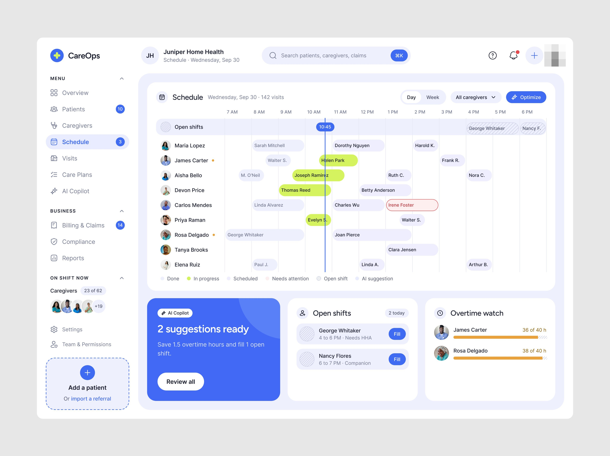
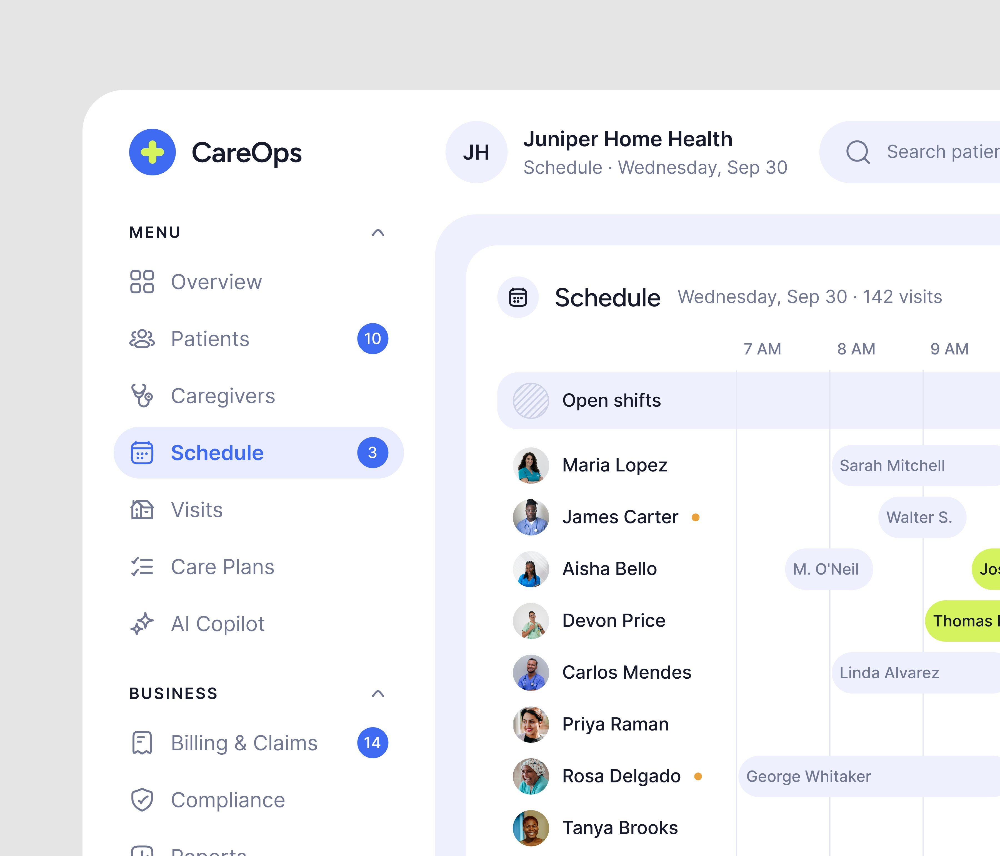
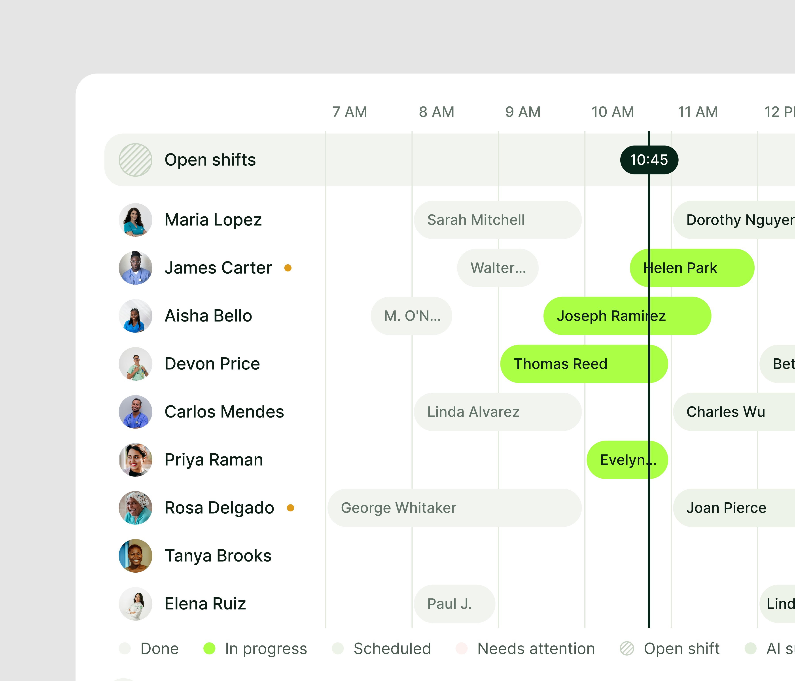
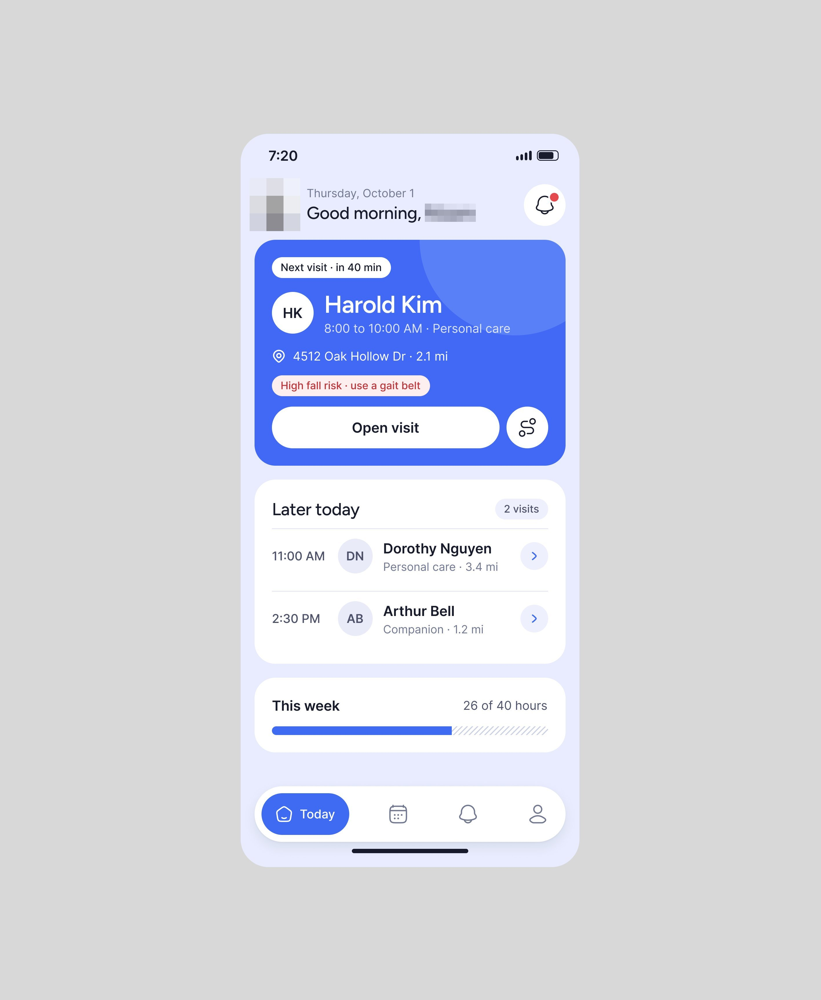
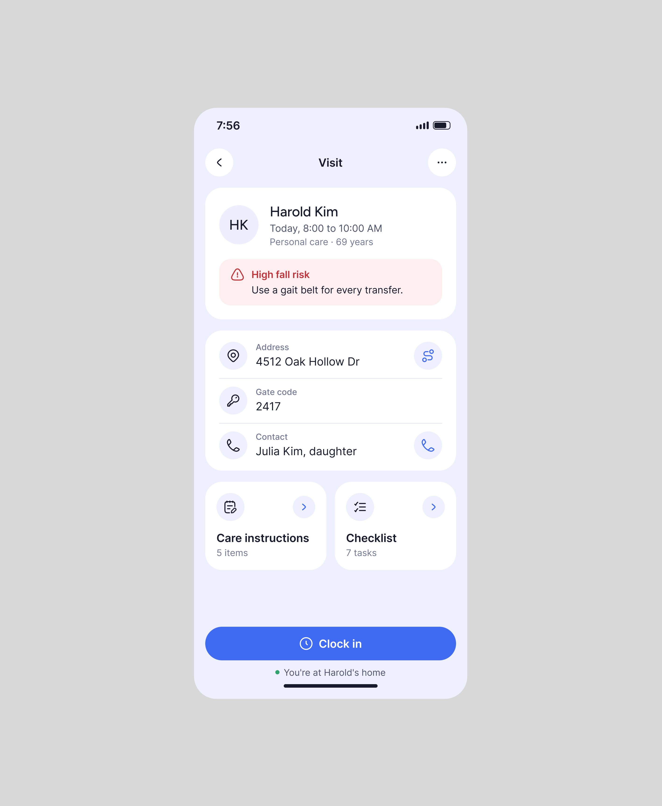

# CareOps

**Escala de cuidadores de saúde domiciliar.** 4 peças em seis dias. A legenda o chama de *"health tech CareOps, a hospital management platform"*; a tela é de uma agência de saúde em casa ("Juniper Home Health", 142 visitas no dia).
**[CONFIRMADO]**

| Campo | Valor |
|---|---|
| Setor | saúde domiciliar: pacientes, cuidadores, escala, visitas, planos de cuidado, faturamento |
| Para quem | a coordenação da agência (web) e o cuidador (celular) |
| Tema | claro; branco `#FCFCFC` e cinza `#E4E4E4` **[MEDIDO, amostra quantizada]** |
| Plataforma | web (Schedule) + celular (hoje, visita, notas da visita) |
| Acento | azul `#3C60F0` (botões, linha da hora atual, cartão do AI Copilot) e lima `#CCF054` nos blocos de visita em andamento **[MEDIDO, amostra quantizada]** |

## Telas publicadas

<!--T:CareOps-->
| # | views | salvos | salvos/1k | mídia | legenda |
|---|---:|---:|---:|---|---|
| 1 | 3.187 | 49 | 15,4 | 2 img | Healthy saas product UI design for health tech CareOps, a hospital management platform. |
| 2 | 6.291 | 42 | 6,7 | 3 img | How is that design? |
| 3 | 1.281 | 8 | 6,2 | 1 img | Rate this UI ! 10 / ? |
| 4 | 1.342 | 21 | 15,6 | 1 img | Check your schedule! Isn't it easy? |
| **total** | **12.101** | **120** | **9,9** | | |
<!--/T-->

## O que cada tela tem

- **Schedule (web)** — grade do dia em blocos por cuidador, a linha da hora atual em azul com a
  hora em pílula, a faixa hachurada "Open shifts", uma visita em conflito em vermelho, e embaixo o
  cartão azul **"AI Copilot · 2 suggestions ready · Save 1.5 overtime hours and fill 1 open
  shift"** com "Review all", turnos abertos com "Fill" e "Overtime watch". Publicado inteiro e em
  recortes ampliados, um deles com a sugestão aberta: *"Suggestion 1 of 3 · Move James's 2 PM
  visit to Maria"* com o porquê (1.8 milhas de distância e a certificação exigida) e Apply / Skip.
  
  
  
  
- **Celular do cuidador** — a próxima visita em cartão azul com o aviso vermelho "High fall risk ·
  use a gait belt", a visita com código do portão e contato e o botão "Clock in" (que sabe "You're
  at Harold's home"), e as notas com o resumo da nota de voz por campo (condição, pele,
  acompanhamento) e a assinatura do paciente.
  
  
  

## O que a série ensina

- **A sugestão da IA mora na própria grade**, ancorada no bloco que ela quer mover, com o motivo
  em uma frase e dois botões.
- **O risco do paciente viaja com a visita** até o celular (o aviso vermelho aparece no cartão,
  na visita e no clock-in).
