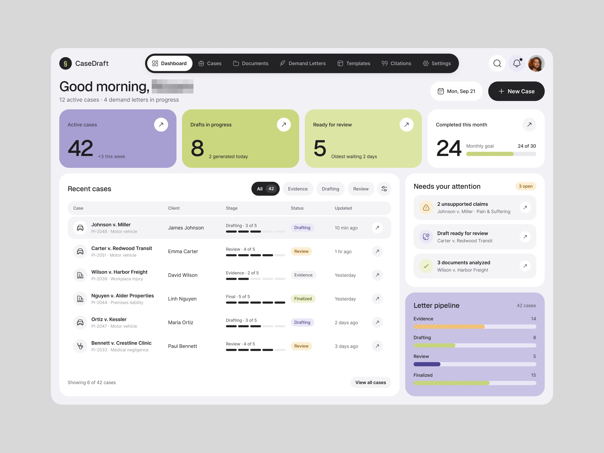
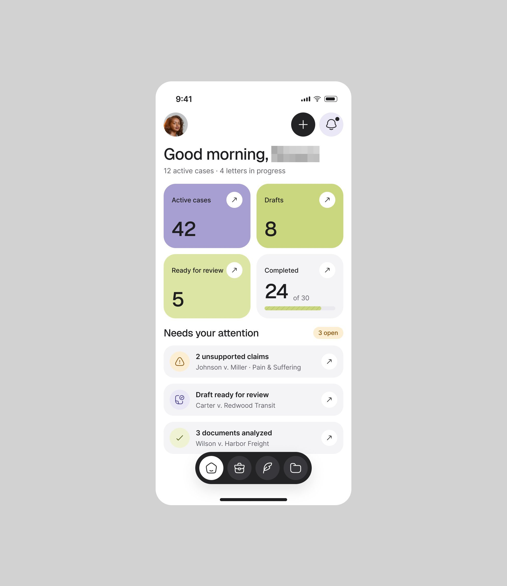
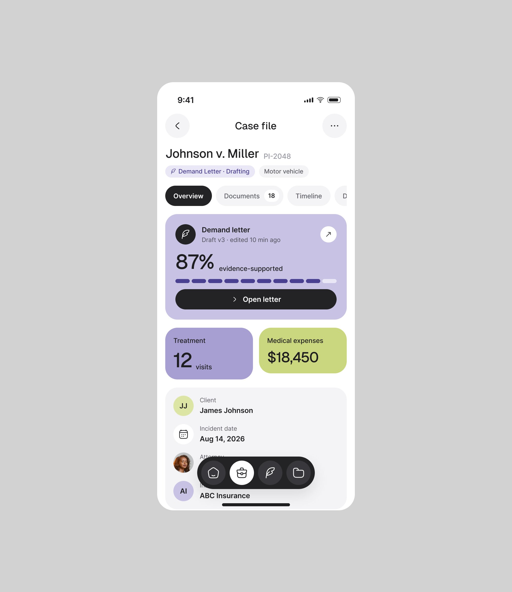
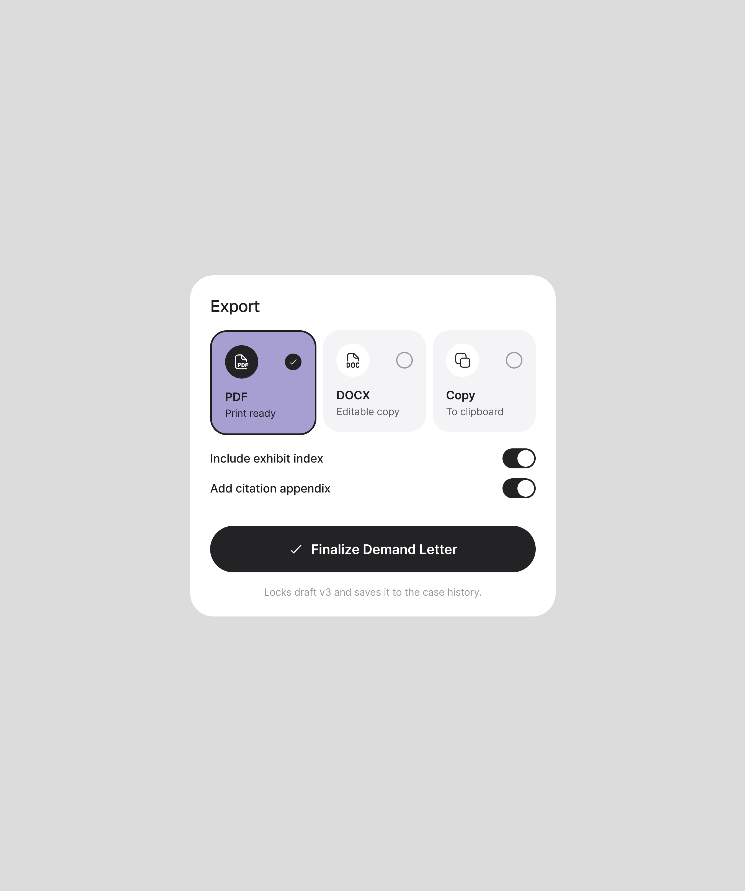
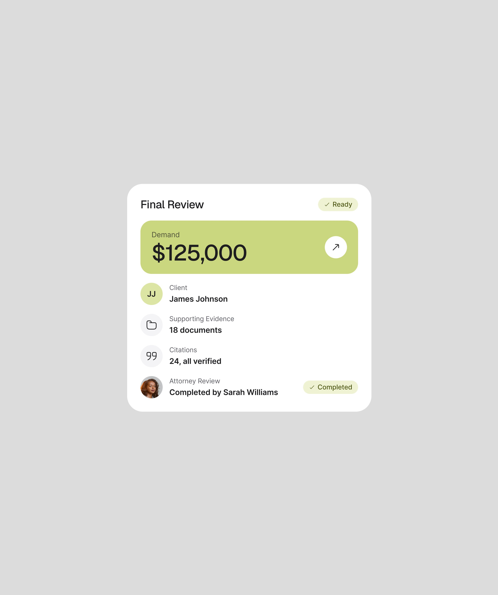
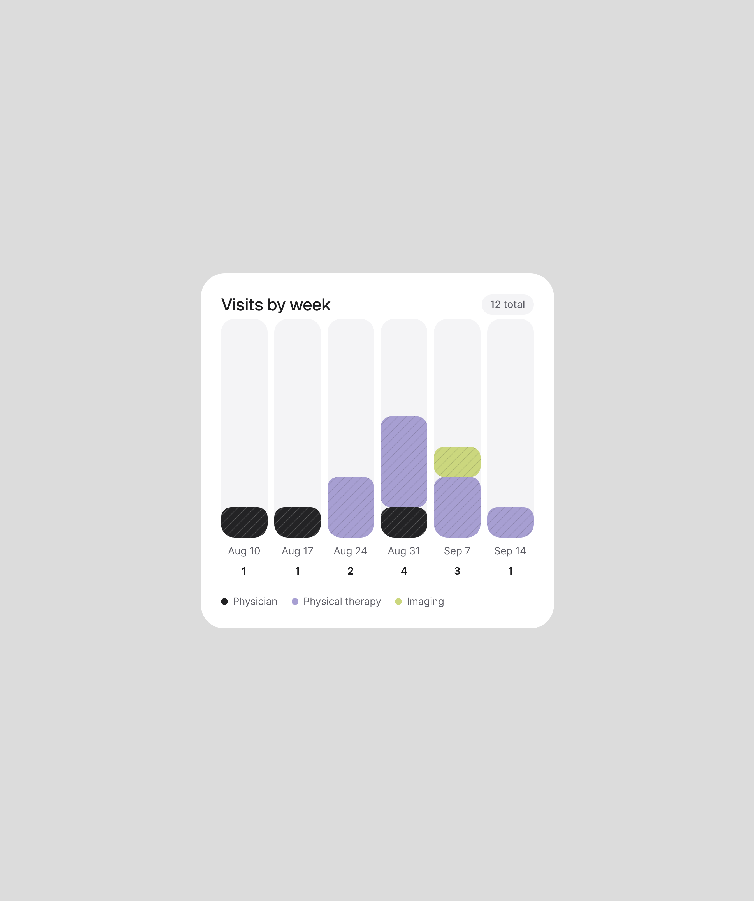
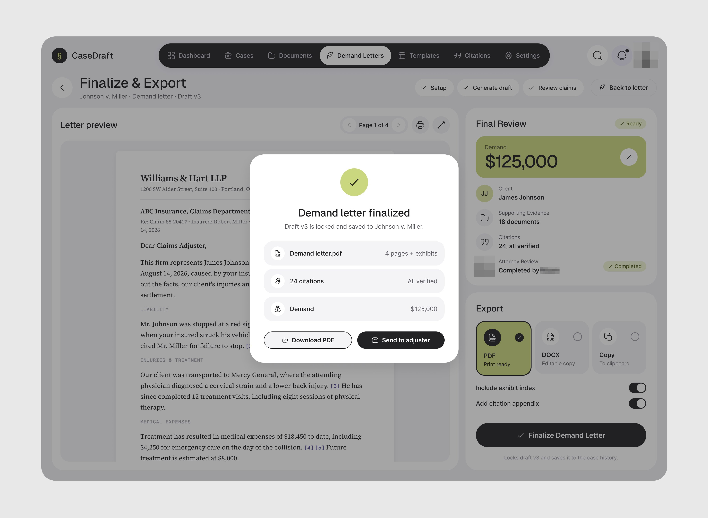

# CaseDraft

**Carta de cobrança jurídica escrita com IA, conferida por advogado.** 4 peças em dez dias. A peça
de abertura diz só *"AI legal demand-letter workspace!"*, com o celular na continuação (*"Mobile!"*).
**[CONFIRMADO]**

| Campo | Valor |
|---|---|
| Setor | escritório de advocacia de danos pessoais: casos, documentos, cartas de demanda, modelos, citações |
| Para quem | o advogado ("Good morning, [nome] · 12 active cases · 4 demand letters in progress") |
| Tema | claro sobre cinza `#D8D8D8` de moldura **[MEDIDO, amostra quantizada]** |
| Plataforma | web (painel, Finalize & Export) + celular (home, ficha do caso, linha do tempo) |
| Acento | lavanda (casos ativos, o PDF escolhido) e lima-oliva `#C0CC78` (rascunhos, valor da demanda) em cartões inteiros; preto nos botões **[MEDIDO, amostra quantizada]** |
| Navegação | barra de abas preta em pílula no topo (Dashboard, Cases, Documents, Demand Letters, Templates, Citations, Settings), sem sidebar |

## Telas publicadas

<!--T:CaseDraft-->
| # | views | salvos | salvos/1k | mídia | legenda |
|---|---:|---:|---:|---|---|
| 1 | 3.578 | 58 | 16,2 | 1 img | AI legal demand-letter workspace! |
| 2 | 689 | 4 | 5,8 | 3 img | Mobile! |
| 3 | 15.099 | 311 | 20,6 | 3 img | Small cards that create a full screen UI Design. |
| 4 | 2.250 | 27 | 12,0 | 1 img | Clean popup design and easy decision-making. |
| **total** | **21.616** | **400** | **18,5** | | |
<!--/T-->

## O que cada tela tem

- **Painel** — quatro KPIs em cartões coloridos (42 casos ativos em lavanda, 8 rascunhos em lima,
  5 para revisão em lima-claro, 24 concluídos de 30 com barra de meta), a tabela "Recent cases"
  com a etapa em barra segmentada e selo, "Needs your attention" com três itens e o "Letter
  pipeline" em barras por etapa (Evidence, Drafting, Review, Finalized).
  
- **Celular** — a mesma home em grade 2×2 com a barra inferior flutuante preta; a ficha do caso
  "Johnson v. Miller" com o cartão lavanda da carta ("87% evidence-supported", "Open letter"); e
  a linha do tempo em que cada evento tem uma chave **"Used by AI when drafting"**: o advogado
  decide qual fato a IA pode usar. Ver
  [../03-padroes-de-ia/04-rastreabilidade.md](../03-padroes-de-ia/04-rastreabilidade.md).
  
  
  
- **Cartões isolados** (a peça *"Small cards that create a full screen UI Design."*, a mais
  salva da série, 311): Export (PDF, DOCX, Copy em cartões; duas chaves; "Finalize Demand
  Letter"), Final Review (demanda de $125,000 em lima, 18 documentos, "24, all verified" de
  citações, revisão do advogado "Completed") e "Visits by week" em barras empilhadas.
  
  
  
- **Finalize & Export** — o popup de sucesso "Demand letter finalized · Draft v3 is locked and
  saved" com o que foi gerado e "Send to adjuster", por cima da prévia da carta, que é a única
  coisa em serifa da tela (o documento jurídico parece documento).
  

## O que a série ensina

- **O controle da IA fica no dado, não numa tela de configuração**: uma chave por evento da linha
  do tempo, "evidence-supported" em porcentagem na carta, "all verified" nas citações.
- **Serifa só no artefato que sai do produto** (a carta). A interface continua sans.
- **Cartão isolado como peça**: três cartões pequenos, cada um uma decisão, renderam mais
  salvos que a tela inteira.
