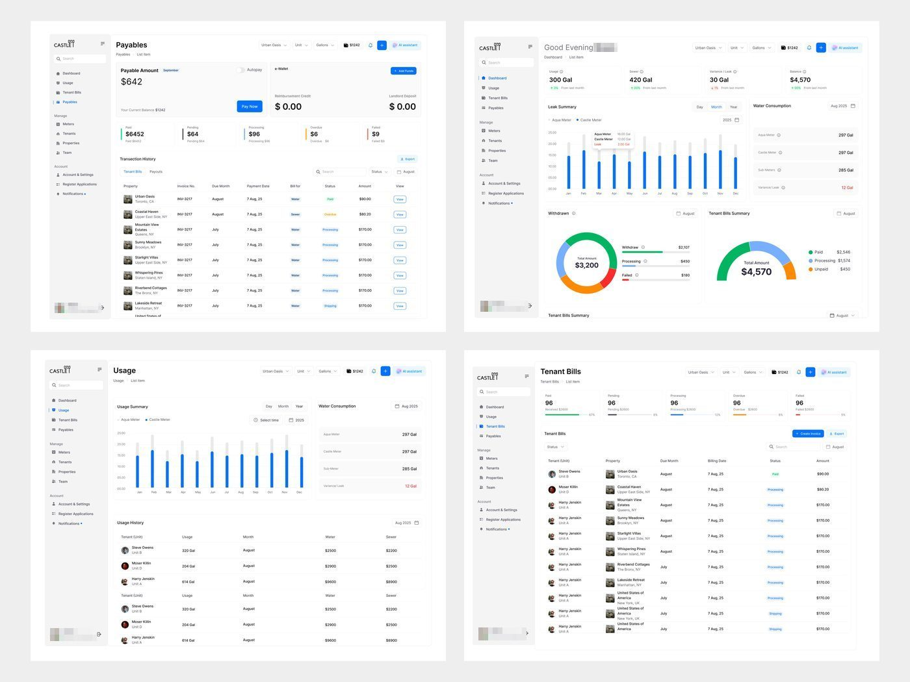

# Castle

**A série mais longa em tempo**: 32 peças em sete meses e meio, sempre o mesmo
produto real de cliente ("Real Product, Real design!", "This enterprise product is
about to live. Submetering and property management."). 30.142 views, 299 salvos
(9,9/1k).

| Campo | Valor |
|---|---|
| Nome | CASTLET (logo com torre de castelo sobre o "T") |
| Setor | submedição de água/esgoto e gestão de imóveis de aluguel: consumo por medidor, contas do inquilino, pagáveis, vazamentos |
| Para quem | administrador de imóveis ("Good Evening [nome]") e inquilino (tela "Select an account type: I am Landlord / I am Tenants") |
| Tema | claro; branco com cinza `#F3F3F3` **[MEDIDO]** |
| Plataforma | web desktop |
| Acento | azul `#2970FE` (barras, nav ativo, botões); verde `#16B269` e laranja `#F69008` em status e gauges **[MEDIDO]** |

## Telas publicadas

<!--T:Castle-->
| # | views | salvos | salvos/1k | mídia | legenda |
|---|---:|---:|---:|---|---|
| 1 | 413 | 0 | 0,0 | 1 img | Real Product, Real design!  Share your feedbacks guys.. |
| 2 | 91 | 0 | 0,0 | 1 img | Team member - Property Management |
| 3 | 231 | 0 | 0,0 | 1 img | Real Product, Real design! |
| 4 | 873 | 4 | 4,6 | 1 img | Is it too clean or just right? |
| 5 | 2.147 | 25 | 11,6 | 1 img | Dashboard design💚 |
| 6 | 914 | 2 | 2,2 | 1 img | Clean UI + Actionable Insights.  Rate this design (1-10)! |
| 7 | 442 | 0 | 0,0 | 1 img | Turning data into clarity.   A scalable SaaS interface built for high- |
| 8 | 2.545 | 33 | 13,0 | 1 img | Functional or just pretty? ⭐️  How’s the hierarchy looking on this one |
| 9 | 488 | 1 | 2,0 | 1 img | Rate this dashboard's UX from 1-10! |
| 10 | 1.316 | 7 | 5,3 | 1 img | Rate this UI from 1-10.  What would you change? 🧐 |
| 11 | 513 | 4 | 7,8 | 1 img | Property management was a mess.  One dashboard fixed that.   Here's wh |
| 12 | 274 | 0 | 0,0 | 1 img | Property managers were checking each meter manually.  We built a dashb |
| 13 | 1.008 | 14 | 13,9 | 1 img | Dashboard design 👀 |
| 14 | 384 | 0 | 0,0 | 1 img | Property managers were chasing  payments across spreadsheets and email |
| 15 | 139 | 0 | 0,0 | 1 img | 🚧👀 |
| 16 | 710 | 3 | 4,2 | 1 img | One of those dashboard i designed last year. 🙂 |
| 17 | 643 | 3 | 4,7 | 1 img | Good dashboards don't show more data. They help you make better decisi |
| 18 | 339 | 0 | 0,0 | 1 img | A user who feels capable comes back.  And who feels confused rarely do |
| 19 | 598 | 4 | 6,7 | 1 img | Simple enough to trust. Powerful enough to manage. |
| 20 | 367 | 0 | 0,0 | 1 img | Good dashboards don't show more data. They help you make better decisi |
| 21 | 345 | 2 | 5,8 | 1 img | Your product should make work feel easier, not harder. |
| 22 | 377 | 1 | 2,7 | 1 img | our product should make work feel easier, not harder. |
| 23 | 273 | 1 | 3,7 | 1 img | The best dashboards don't just organize data they simplify decisions. |
| 24 | 550 | 4 | 7,3 | 3 img | Imagine managing every property from one clean dashboard. |
| 25 | 686 | 4 | 5,8 | 1 img | Saas product design - Water management |
| 26 | 439 | 2 | 4,6 | 1 img | Saas product design - Water management |
| 27 | 5.047 | 88 | 17,4 | 1 img | Saas product design - Castle |
| 28 | 963 | 7 | 7,3 | 1 img | Saas product design - Castle |
| 29 | 1.791 | 28 | 15,6 | 1 img | Saas product design - Castle |
| 30 | 1.023 | 5 | 4,9 | 1 img | Saas product design - Castle |
| 31 | 783 | 3 | 3,8 | 1 img | This enterprise product is about to live.  Submetering and property ma |
| 32 | 3.430 | 54 | 15,7 | 1 img | Saas product design,Castle |
| **total** | **30.142** | **299** | **9,9** | | |
<!--/T-->

## Navegação

Sidebar branca clássica: logo + hambúrguer, busca, Dashboard, Usage, Tenant Bills,
Payables / Manage (Meters, Tenants, Properties, Team) / Account (Account &
Settings, Register Applications, Notifications). Topo: título + breadcrumb ("Team
> Managers"), filtros "Urban Oasis / Unit", saldo "$1242", botão azul e "AI
assistant".

## Módulos

Dashboard ("300 Gal", "420 Gal", Leak Summary, Water Consumption em barras azuis,
gauges de Withdraws e Tenant Bills), Usage, Tenant Bills (tabela longa com foto do
imóvel), Payables ("Payable Amount $642" com botão Pay Now), Properties
("Urban Oasis" com foto), Team (lista e painel "Preview"), Account & Settings
(Property Configuration em tabela com botão preto "Send"), onboarding.

## O que é específico

É o produto mais "SaaS genérico" da biblioteca: azul padrão, sidebar convencional, tabela com
muitas colunas. Serve de contraste com FixTrack (mesmo setor, no método): o FixTrack
troca o azul por verde e coral, reduz a tabela a 3 chamados com linguagem de
problema e faz a sidebar mais leve. **[OBSERVADO]**

## Performance

32 peças, mediana ≈540 views. Só decola quando o alcance do perfil cresce
(5.047 e 3.430 views nas últimas). Vitrines em mockup de monitor/iMac em perspectiva.
