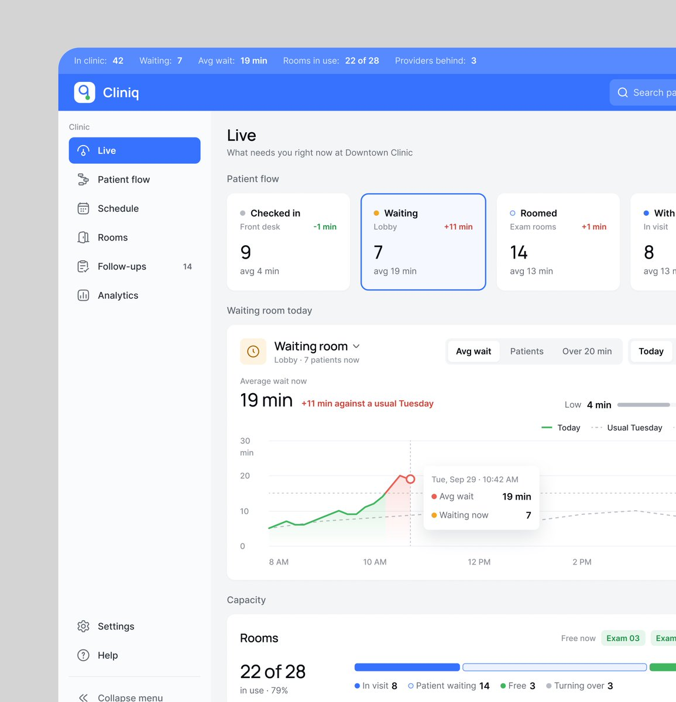
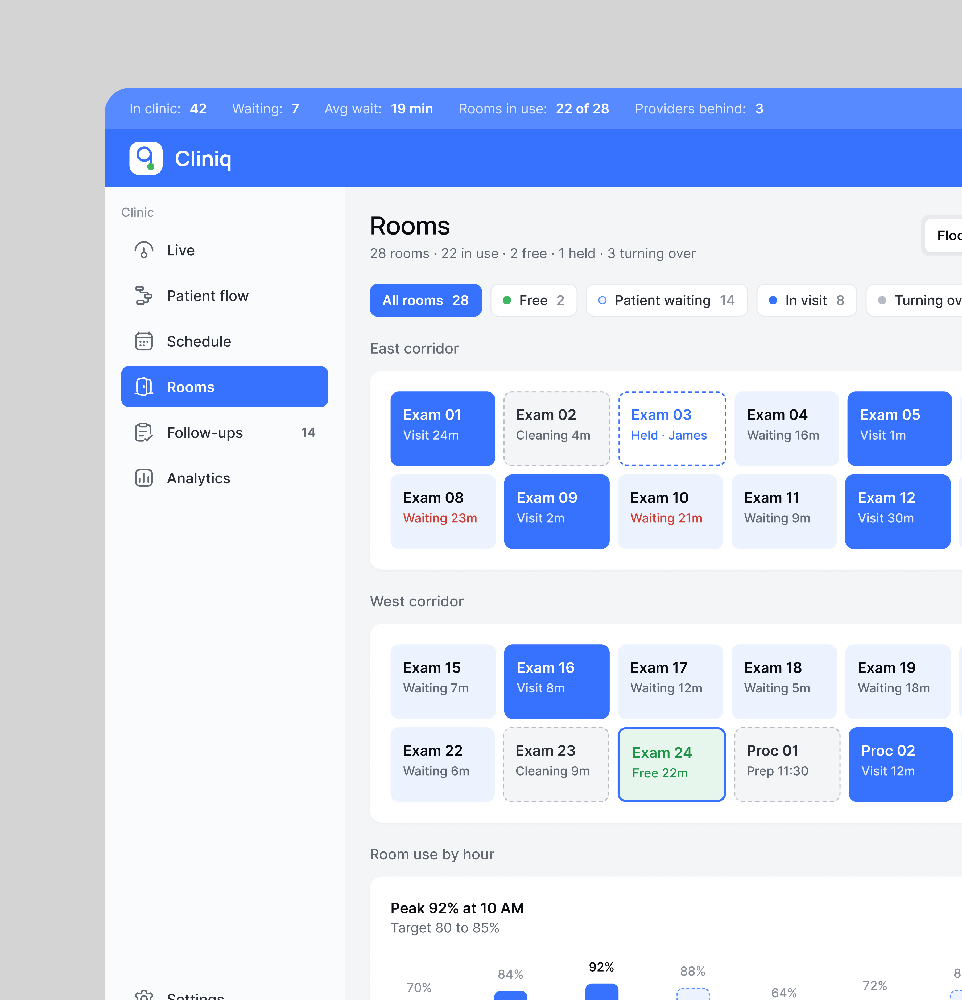

# Cliniq

**Operação em tempo real de uma clínica.** 3 peças em dois dias. A legenda da última diz o que é: *"Designing the real-time operations layer that sits
beside the EHR"*: não substitui o prontuário, fica do lado. **[CONFIRMADO]**

| Campo | Valor |
|---|---|
| Setor | clínica ambulatorial (Downtown Clinic): fluxo de pacientes, salas, agenda, retornos |
| Para quem | a recepção e a coordenação da clínica |
| Tema | claro com **barra superior azul cheia** com os números do momento (42 na clínica, 7 esperando, espera média 19 min, 22 de 28 salas em uso, 3 profissionais atrasados) |
| Plataforma | web (Live, Patient flow, Rooms, ficha do paciente) |
| Acento | azul `#306CFC` em tudo que é ação e estado "em visita" **[MEDIDO, amostra quantizada]** |

## Telas publicadas

<!--T:Cliniq-->
| # | views | salvos | salvos/1k | mídia | legenda |
|---|---:|---:|---:|---|---|
| 1 | 5.754 | 96 | 16,7 | vídeo | Clinic operation management SAAS design. |
| 2 | 2.510 | 29 | 11,6 | 1 img | Clinic room interface design! |
| 3 | 1.595 | 9 | 5,6 | 1 img | Designing the real-time operations layer that sits beside the EHR |
| **total** | **9.859** | **134** | **13,6** | | |
<!--/T-->

## O que cada tela tem

- **Live** — *"What needs you right now at Downtown Clinic"*: quatro etapas do fluxo do paciente com
  contagem e média (Waiting destacado com "+11 min"), a espera de hoje contra uma terça comum com o
  pico marcado, e a capacidade das salas em barra.
  
- **Rooms** — salas por corredor em blocos: azul cheio em visita, branco esperando com o tempo
  (vermelho quando passa), tracejado em espera, verde livre; uso por hora embaixo.
  
- **Vídeo** — Live, Patient flow em tabela e a ficha da paciente com o aviso "Update sent to Emily
  Carter". Quadros em [../05-apresentacao/video-e-movimento.md](../05-apresentacao/video-e-movimento.md).

## O que a série ensina

- **A barra do topo vira o painel**: os cinco números que a recepção precisa ver a cada minuto
  ficam fixos em cima de toda tela.
- **A sala é o componente**: estado por cor e borda, e o tempo de espera escrito no bloco.
