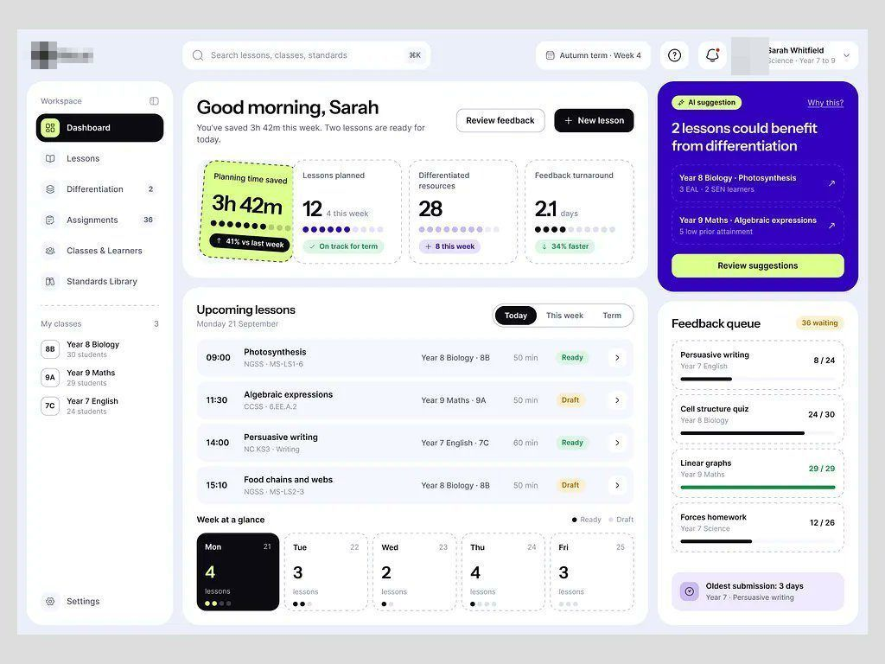

# Co-professor de IA

| Campo | Valor |
|---|---|
| Nome | Co-professor de IA (legenda: co-professor de IA para planejar aula da educação básica) |
| Setor | educação básica: planejamento de aula, diferenciação, correção |
| Para quem | professora ("Sarah Whitfield · Science · Year 7 to 9") |
| Tema | claro, fundo lavanda `#EAEDF9` **[MEDIDO]** |
| Plataforma | web |
| Acento | índigo `#3300C2` (cartão de sugestão da IA) + lime `#DDFF8C` (tempo economizado, botão) **[MEDIDO]** |

## Módulos

"Good morning, Sarah / You've saved 3h 42m this week"; 4 KPIs com borda
**tracejada** e pontos de progresso (o de tempo economizado em lime inclinado,
como etiqueta colada); cartão índigo "AI suggestion: 2 lessons could benefit from
differentiation" com botão lime; Upcoming lessons (hora, turma, código de
currículo, status Ready/Draft); Week at a glance (5 cartões de dia, hoje em
preto); Feedback queue com barras de correção.

## O que é específico

Valor medido em **tempo do professor**, não em nota. Toque lúdico (etiqueta
inclinada, borda tracejada) sem sair da grade de dashboard.
