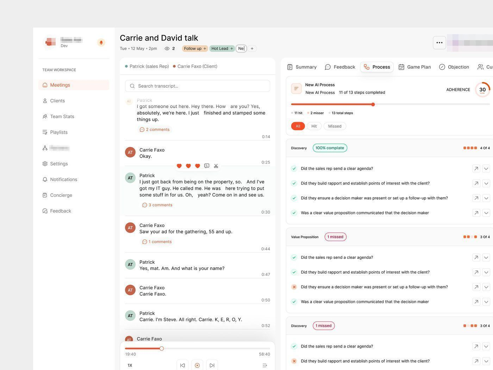

# Coach de vendas (coach de vendas)

**Produto e site de marketing juntos**: a série mostra o produto e o site dele, com
duas versões de hero e duas de rodapé, uma descartada e uma escolhida.

| Campo | Valor |
|---|---|
| Nome | Coach de vendas (logo: ondas sonoras em vermelho-laranja); aparece também como coach de vendas |
| Setor | coaching de vendas com IA para agências: analisa gravação de reunião, aderência ao processo, objeções |
| Para quem | gestor comercial e vendedor de agência (a legenda diz coaching de vendas com IA para vendedor de agência) |
| Tema | claro |
| Plataforma | web (produto) + site de marketing |
| Acento | laranja `#FF4922` **[MEDIDO]** |

## Módulos

- **Reunião** (a aba de detalhes do processo, a versão mais completa da
  série): transcrição com avatares e comentários à esquerda; à direita
  abas Summary / Feedback / Process / Game Plan / Objection; aderência "30" em
  anel laranja, "11 of 13 steps completed", checklist por fase (Discovery 100%
  complete, Value Proposition "1 missed") com ✓ verde e ✗ vermelho; player de
  áudio no pé.
- Sidebar TEAM WORKSPACE: Meetings, Clients, Team Stats, Playlists, Partners,
  Settings, Notifications, Concierge, Feedback.
- **Cartões**: cartões isolados do produto.
- **Site**: 2 versões de hero focadas em campanha, e duas de rodapé (a descartada
  e a escolhida).

## O que é específico

Avaliação de conversa: checklist binário por etapa do método de vendas e contagem
de etapas cumpridas. A série mostra **a versão descartada ao lado da escolhida**,
o que ensina o critério de escolha melhor que a tela final sozinha.
