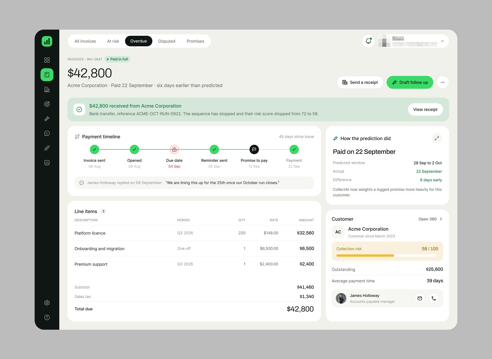
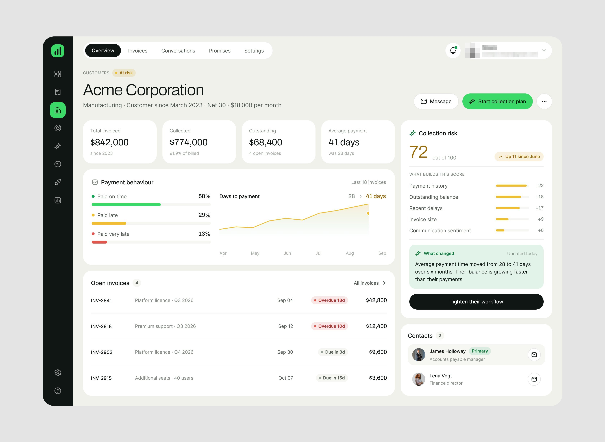
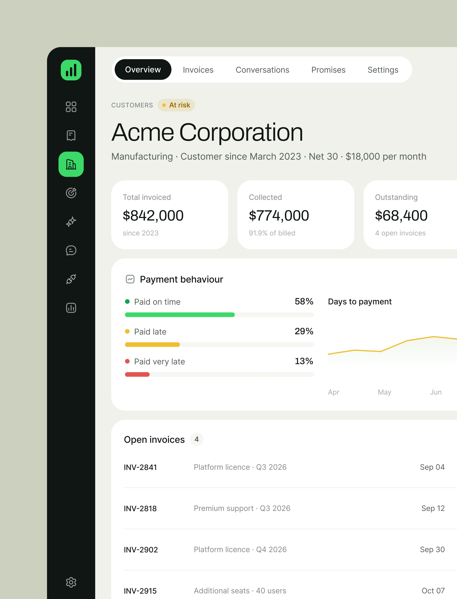
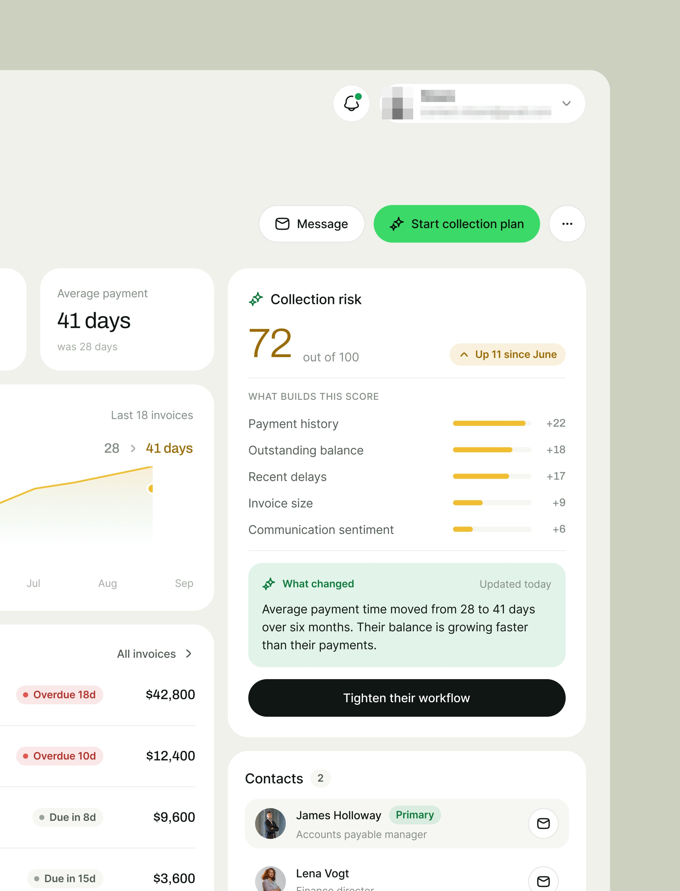
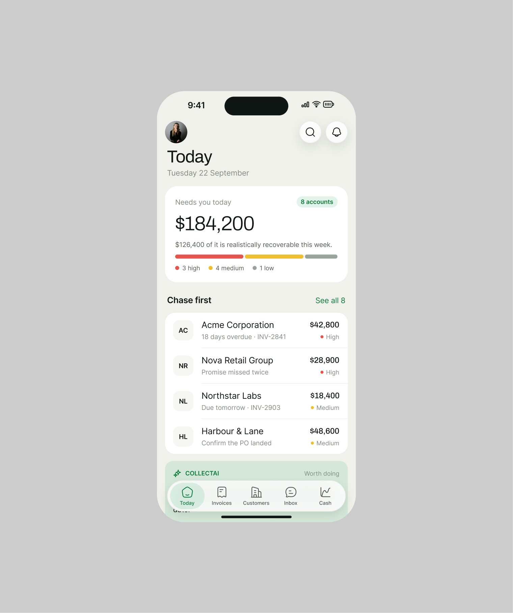
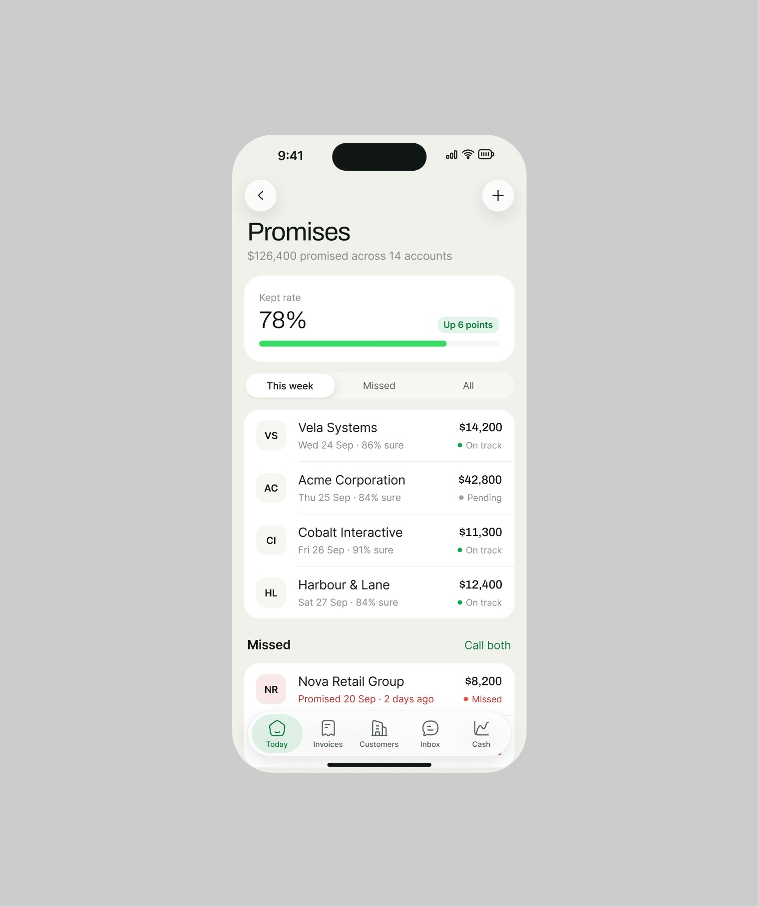
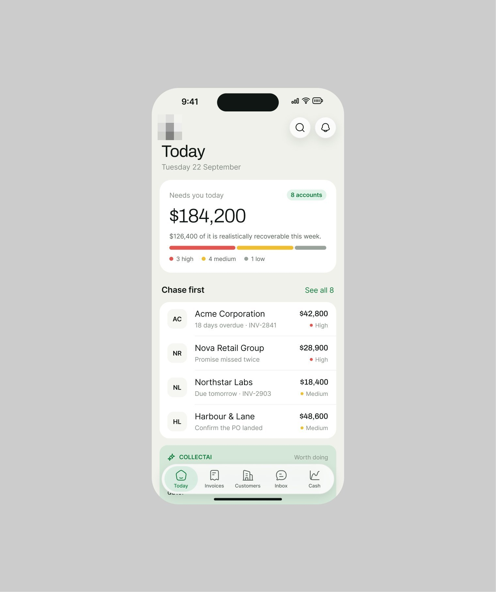

# CollectAI

**Contas a receber que preveem quando o cliente paga.** A primeira peça está em
[outros-produtos.md](outros-produtos.md); a série tem 8 peças em nove dias, web e iOS. A frase da
legenda para o produto:
*"What If Your Invoices Could Predict? Invoice Management UI Design."*.
**[CONFIRMADO]**

| Campo | Valor |
|---|---|
| Setor | cobrança B2B: faturas, promessas de pagamento, previsão de caixa, risco por cliente |
| Para quem | o financeiro de uma empresa média (Sarah Keller na web; outro nome no celular) |
| Tema | claro com neutros tingidos de verde; rail escuro de ícones com o ativo em verde (ver [../01-sistema-visual/cor.md](../01-sistema-visual/cor.md)) |
| Plataforma | web (fatura, cliente) + iOS (tela de bloqueio, Today, Promises, Cash) |
| Acento | verde vivo nos botões de ação ("Start collection plan", "Draft follow up") e no widget da tela de bloqueio |

## Telas publicadas

<!--T:CollectAI-->
| # | views | salvos | salvos/1k | mídia | legenda |
|---|---:|---:|---:|---|---|
| 1 | 21.328 | 89 | 4,2 | 3 img | Native iOS app UI design for CollectAI. |
| 2 | 28.541 | 341 | 11,9 | 1 img | Overdue Page design... Clean and to the point. |
| 3 | 2.355 | 17 | 7,2 | vídeo | clean . Simple iOS app ui design for fintech. |
| 4 | 9.936 | 195 | 19,6 | 2 img | What If Your Invoices Could Predict? Invoice Management UI Design. |
| 5 | 3.644 | 59 | 16,2 | 1 img | Designers, Fintech app UI should be simple and easy to make decisions. One of my great pro |
| 6 | 6.656 | 50 | 7,5 | 3 img | IOS mobile app design! Simple, clean, and user-friendly. Isn't it? |
| 7 | 5.876 | 48 | 8,2 | 3 img | IOS money management mobile app design. |
| 8 | 3.551 | 65 | 18,3 | 1 img | Fintech saas should be easy to use like this one. |
| **total** | **81.887** | **864** | **10,6** | | |
<!--/T-->

## O que cada tela tem

- **Fatura (web)** — $42,800 "Paid 22 September · six days earlier than predicted", faixa verde
  do pagamento recebido, a linha do tempo do pagamento em seis passos, o cartão **"How the
  prediction did"** (janela prevista, data real, diferença, e a frase de que o sistema agora pesa
  mais as promessas registradas), os itens e o cliente com risco 58/100. Repostada dias depois.
  
  
- **Cliente (web)** — "Acme Corporation" com selo At risk, totais, comportamento de pagamento em
  três barras, faturas abertas com atraso, **"Collection risk 72 of 100"** com o que compõe a nota
  em barras, o cartão verde "What changed" (prazo médio de 28 para 41 dias) e "Tighten their
  workflow". Publicada inteira (4:3) e partida em díptico de retrato.
  
  
  
- **iOS** — tela de bloqueio verde com o widget "$184,200 needs you" e notificações do produto
  (promessa detectada, pagamento recebido); Today com "Needs you today" e "Chase first"; Promises
  com a taxa cumprida 78%. E o vídeo-esteira de três celulares
  ([../05-apresentacao/video-e-movimento.md](../05-apresentacao/video-e-movimento.md)).
  
  
  
  

## O que a série ensina

- **A previsão presta contas.** A tela da fatura paga não só registra o pagamento: mostra quanto
  a previsão errou e o que o sistema aprendeu. É o padrão de confiança explícita aplicado depois
  do fato ([../03-padroes-de-ia/03-confianca-explicita.md](../03-padroes-de-ia/03-confianca-explicita.md)).
- **Nota com composição** ("72 of 100" com cinco fatores em barra) em vez de semáforo solto.
- **Repostagem pesada**: as mesmas três telas de iOS saíram em três peças com legendas diferentes,
  em nove dias, e a fatura em duas.
