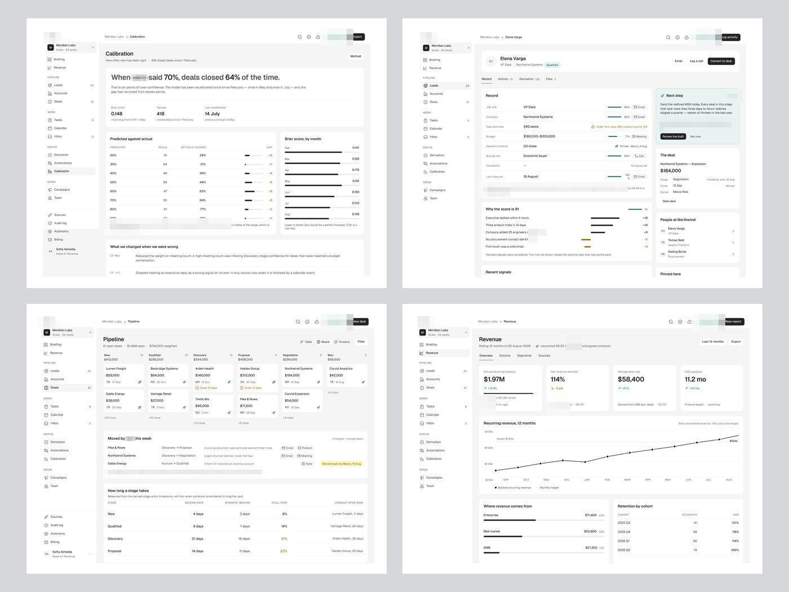
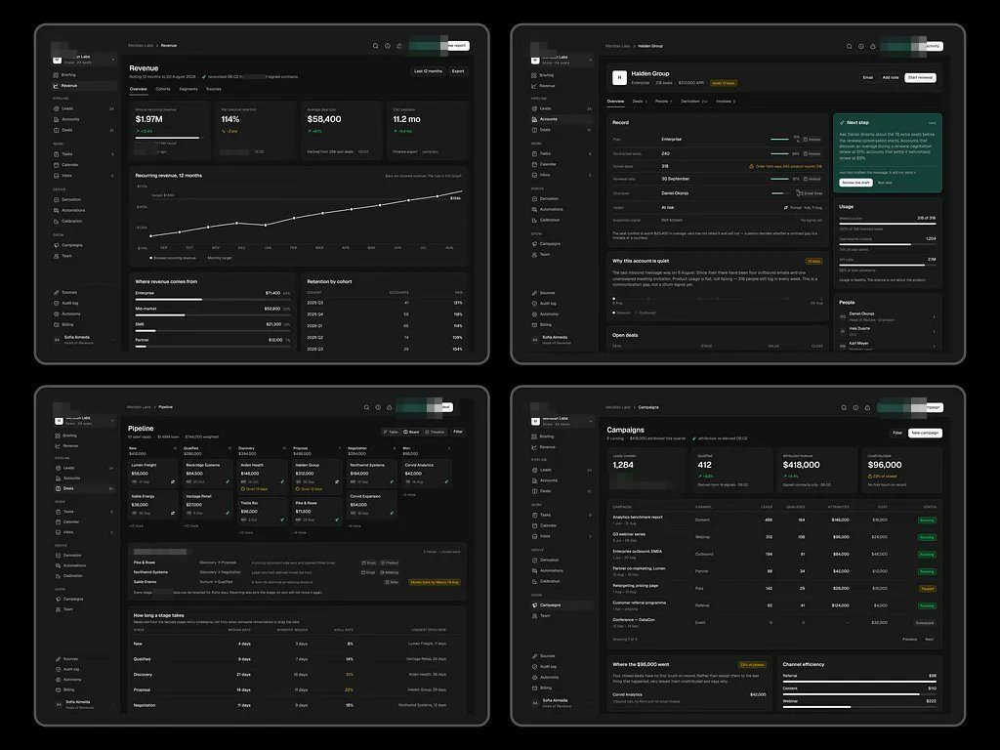

# CRM de receita

**A série mais longa.** Quase todas com a mesma legenda (o nome do produto e a categoria,
inteligência de receita com IA); a que abre com gancho (o volume de trabalho do designer como prova) é a que se destaca: legenda repetida apaga a série.

| Campo | Valor |
|---|---|
| Nome | CRM de receita (minúsculo, com ponto verde depois do nome) |
| Setor | CRM / inteligência de receita: leads, contas, deals, previsão e calibração do modelo |
| Para quem | Head of Revenue de SaaS B2B ("Sofia Almeida · Head of Revenue", workspace "Meridian Labs · Scale · 24 seats") |
| Tema | claro (fundo `#F5F5F5`, cartão `#FFFFFF`) e escuro (fundo `#181818`) **[MEDIDO]** |
| Plataforma | web desktop |
| Acento | verde `#29715D`; cartão de IA em menta `#E1F4F0`; botão "Ask [produto]" em menta `#C8EDED` com ícone de brilho; botão de ação preto `#2E2E2E`-`#484848` **[MEDIDO]** |

> Nota: uma peça tem legenda de app de despesas com IA, mas a imagem mostra o logo do CRM de receita; e outra (legenda de CRM de receita) mostra o logo do app de despesas com IA. As tabelas seguem o **logo**, não a legenda: as legendas dessas duas estão trocadas. **[OBSERVADO]**

## Navegação

Sidebar branca estreita (≈190 px) com grupos em caixa baixa pequena: Briefing,
Revenue / PIPELINE (Leads 24, Accounts, Deals 61) / WORK (Tasks 9, Calendar,
Inbox 5) / DERIVE (Derivation, Automations, Calibration) / GROW (Campaigns, Team)
e no pé Sources, Audit log, Autonomy, Billing. Topo: breadcrumb "Meridian Labs >
Tela", ícones de busca, info e alerta, botão menta "Ask CRM de receita" e botão preto de
ação principal ("Export", "Log activity", "New deal").

## Módulos

| Tela | O que tem |
|---|---|
| Calibration | manchete em frase ("When [produto] said 70%, deals closed 64% of the time."), Brier score, tabela previsto × real com barra de gap, "What we changed when we were wrong" |
| Lead (Elena Varga) | abas Record / Activity / Derivation / Files; cada campo com barra de confiança e fonte (Email, Meeting, Call); "Why the score is 91" com contribuições +/-; cartão menta "Next step" com rascunho da IA |
| Pipeline | kanban de 6 colunas com valor por coluna, "Moved by [produto] this week" com reversão, "How long a stage takes" |
| Revenue | 4 KPIs (ARR $1.97M, NRR 114%...), linha de 12 meses com meta, receita por segmento, retenção por coorte |
| Audit log (escuro) | tabela de ações da IA com resultado (Applied/Held/Stopped) e "Decision record" em mono |

## Componentes-chave

- **Frase-manchete** no topo de tela analítica, com o número em negrito dentro da frase.
- **Barra de confiança por campo** (curta, verde) + fonte do dado ao lado.
- **Explicação do score** como lista de sinais com barra positiva (preta) e negativa (ocre `#917110`).
- Tudo o que a IA mudou é **reversível e datado** ("Moved back by Marco, 19 Aug").

## O que é específico deste setor

Dinheiro e previsão: a tela precisa convencer o gestor de que o modelo é honesto.
Daí a tela de calibração, o log e a explicação de cada score.

## Como reproduzir

Apresentação em **colagem 2×2 de telas inteiras** sobre cinza `#D6D7DB`
**[MEDIDO]**; cada tela com fundo `#F5F5F5` e cartões brancos, sem sombra,
raio ≈12 px; tipografia pequena (corpo ≈13 px) e densa.
