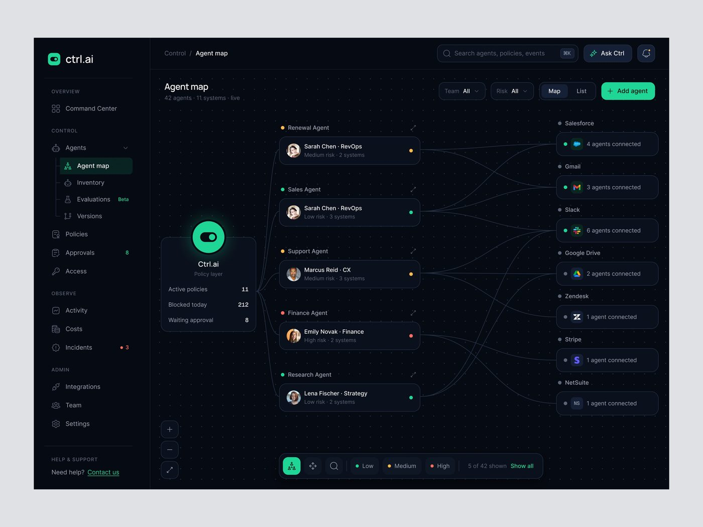
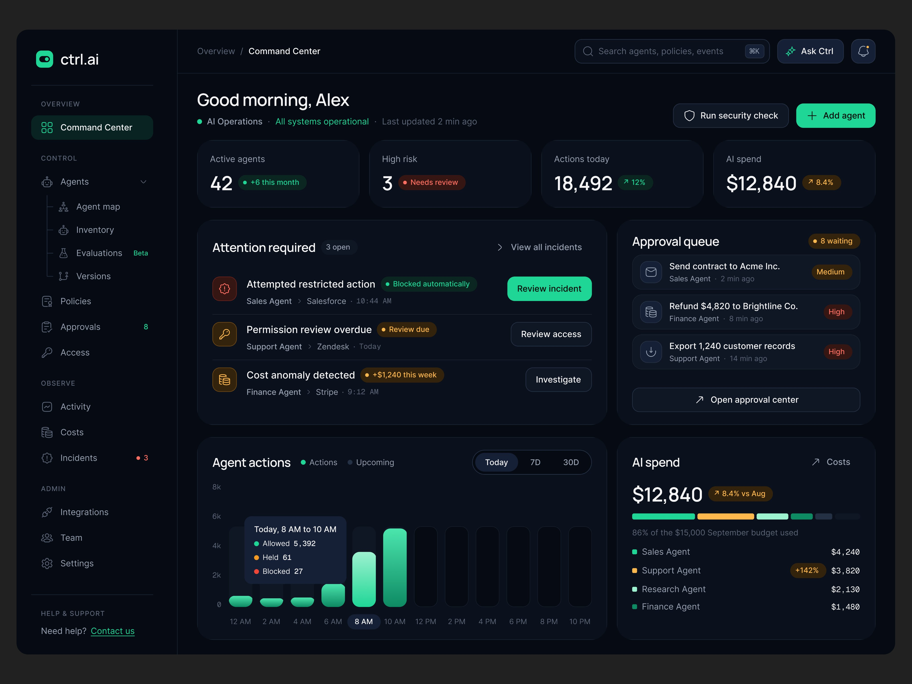

# Ctrl.ai

5 peças, 8.807 views, 73 salvos (8,3/1k). Legenda recorrente:
*"Know what your AI agents can do. Control what they're allowed to do."*

| Campo | Valor |
|---|---|
| Nome | ctrl.ai (logo: toggle branco em quadrado verde) |
| Setor | camada de política e permissão para agentes de IA ("Policy layer") |
| Para quem | TI / segurança |
| Tema | escuro, azul-noite `#060C18` **[MEDIDO]** com grade de pontos |
| Plataforma | web |
| Acento | menta `#1FD696` (botão "Add agent", nó central, toggle) **[MEDIDO]** |

## Telas publicadas

<!--T:Ctrl.ai-->
| # | views | salvos | salvos/1k | mídia | legenda |
|---|---:|---:|---:|---|---|
| 1 | 2.176 | 20 | 9,2 | 1 img | Know what your AI agents can do.  Control what they’re allowed to do. |
| 2 | 1.757 | 17 | 9,7 | vídeo | Know what your AI agents can do. Control what they’re allowed to do. |
| 3 | 1.255 | 12 | 9,6 | 1 img | Track your agents! |
| 4 | 1.033 | 1 | 1,0 | 1 img | Ctrl. ai, AI Agent Control & Governance |
| 5 | 2.586 | 23 | 8,9 | 1 img | The Interface Behind Smarter AI Agent Control. AI Governance Dashboard UI Design. |
| **total** | **8.807** | **73** | **8,3** | | |
<!--/T-->

## Módulos

Agent map: nó central "Ctrl.ai · Policy layer" com
contadores (Active policies 11, Blocked today 212, Waiting approval 8), coluna de
agentes com dono e risco (ponto amarelo/verde/vermelho), coluna de sistemas reais
(Salesforce, Gmail, Slack, Google Drive, Zendesk, Stripe, NetSuite) ligados por
curvas finas; legenda Low/Medium/High no pé. Sidebar OVERVIEW / CONTROL (Agents >
Agent map, Inventory, Evaluations Beta, Versions) / OBSERVE / ADMIN.

## Mais telas da série

Ctrl.ai: o Command Center escuro "Good morning, Alex" com "Attention required" (uma ação por linha),
fila de aprovação com risco e o gasto de IA por agente.

