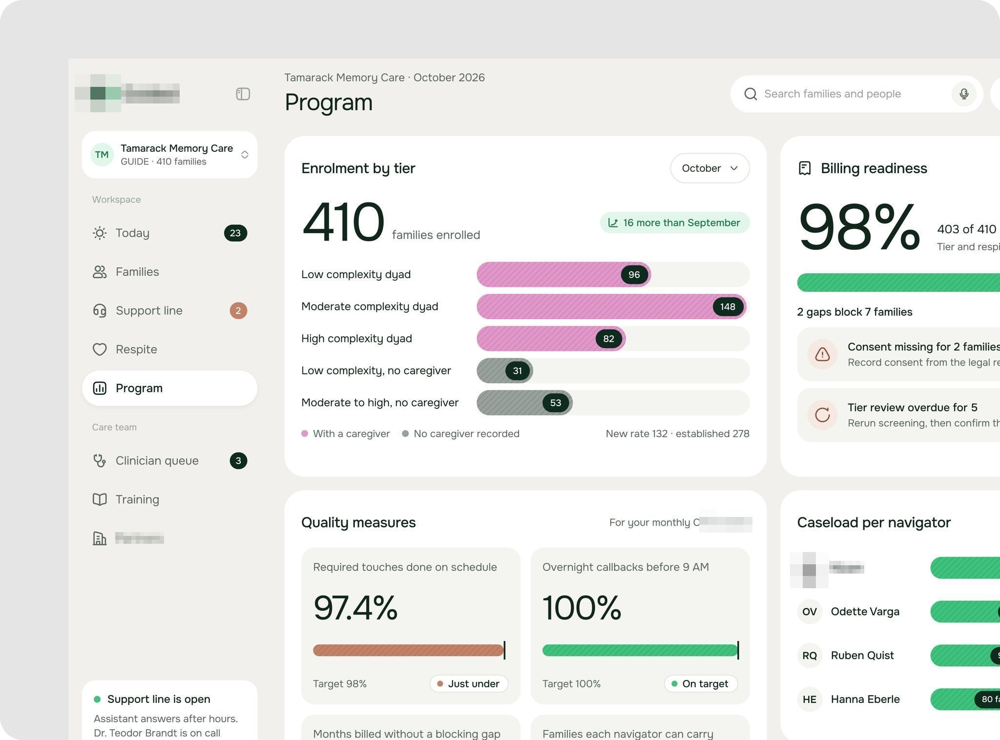
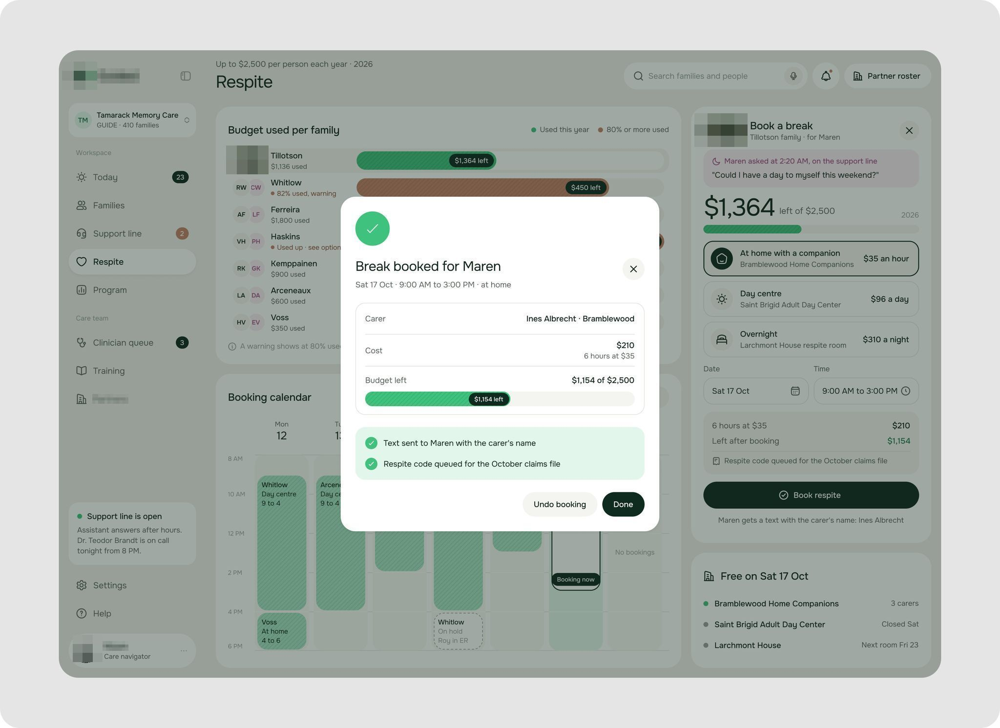
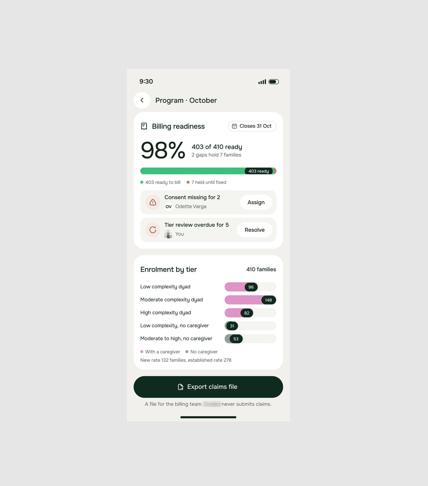
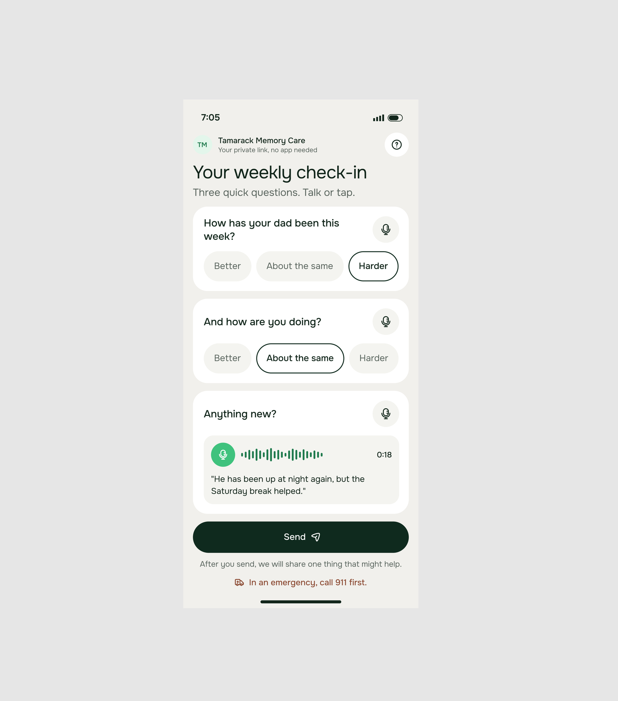
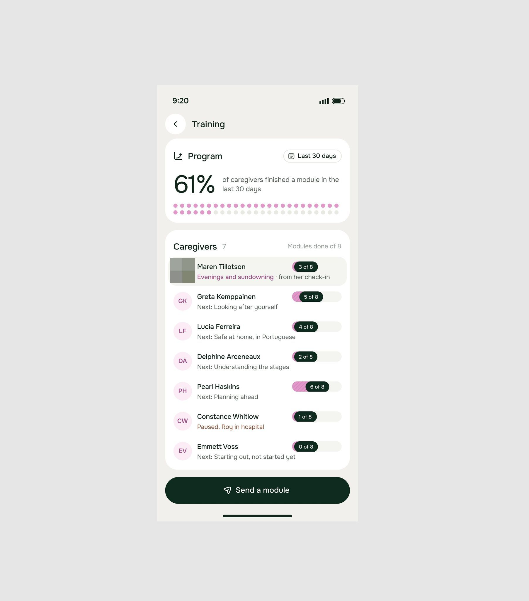
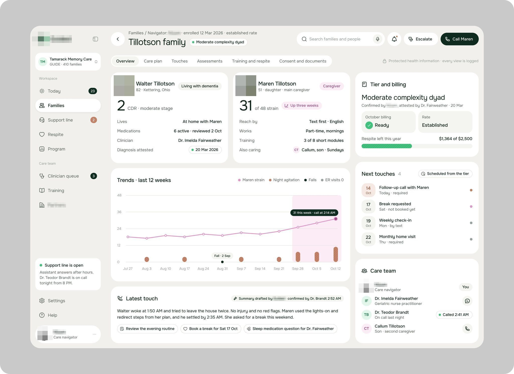
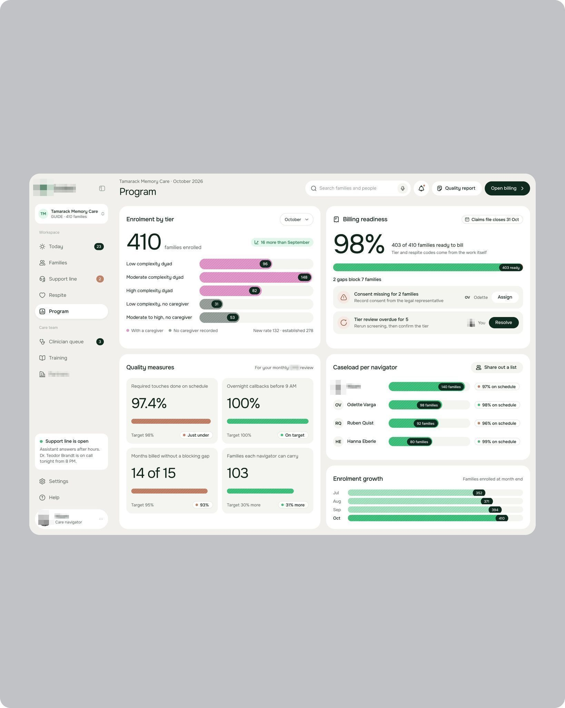
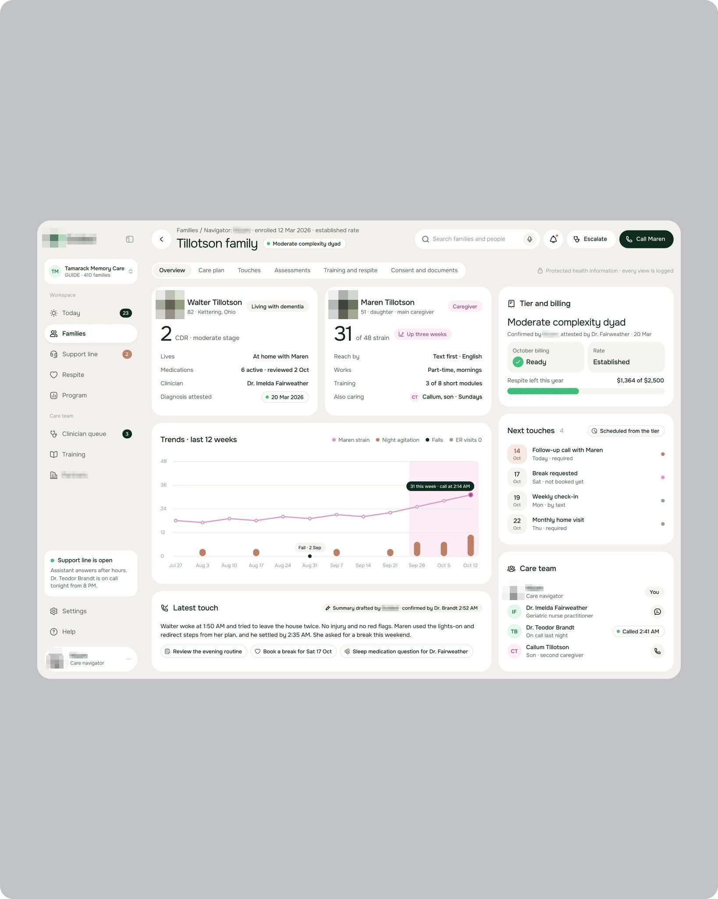

# Programa de cuidado de demência

**Sistema para programa de cuidado de demência: paciente e cuidador familiar no mesmo registro.** **[CONFIRMADO]** pelo logo.

| Campo | Valor |
|---|---|
| Setor | programa de cuidado de demência (GUIDE, EUA): famílias, contatos, pausas (respite), treinamento, cobrança |
| Para quem | a navegadora de cuidado ("[nome] · Care navigator") e o familiar |
| Tema | claro, branco |
| Plataforma | web + iOS |
| Acento | verde-escuro no logo e botões; rosa nas barras de nível [OBSERVADO] |

## O que a ficha ensina

- **Ponha os dois perfis lado a lado, com o mesmo peso**: o diagnóstico do paciente e o "31 of 48 strain" da cuidadora.
- **Mostre a cobrança como prontidão**: "Billing readiness 98%" com o que falta e "Export claims file".
- **Deixe o familiar responder por voz**, com três perguntas em chips.

## O que cada tela tem

Uma linha por imagem; o texto da tela vai entre aspas.

- Programa de cuidado de demência (cuidado de demência): "Program" com 410 famílias por nível em barras, prontidão de cobrança 98% e medidas de qualidade 
- Programa de cuidado de demência: "Respite" com o popup "Break booked for Maren", orçamento usado e as confirmações enviadas 
- Programa de cuidado de demência no iPhone: "Billing readiness 98%" com pendências e "Enrolment by tier" em pílulas, e "Export claims file" 
- Programa de cuidado de demência no iPhone: "Your weekly check-in" para o familiar, com três perguntas em chips e resposta por voz 
- Programa de cuidado de demência no iPhone: "Training" com 61% do programa e o progresso de cada cuidadora em selo 
- Programa de cuidado de demência: família Tillotson com o paciente e a cuidadora lado a lado, tendências de 12 semanas, próximos contatos e equipe 
- Shot em retrato 4:5 com a tela pequena no cinza: "Program" do programa de cuidado de demência com matrículas por nível e cobrança 98% 
- Shot em retrato 4:5: a família Tillotson no programa de cuidado de demência 
