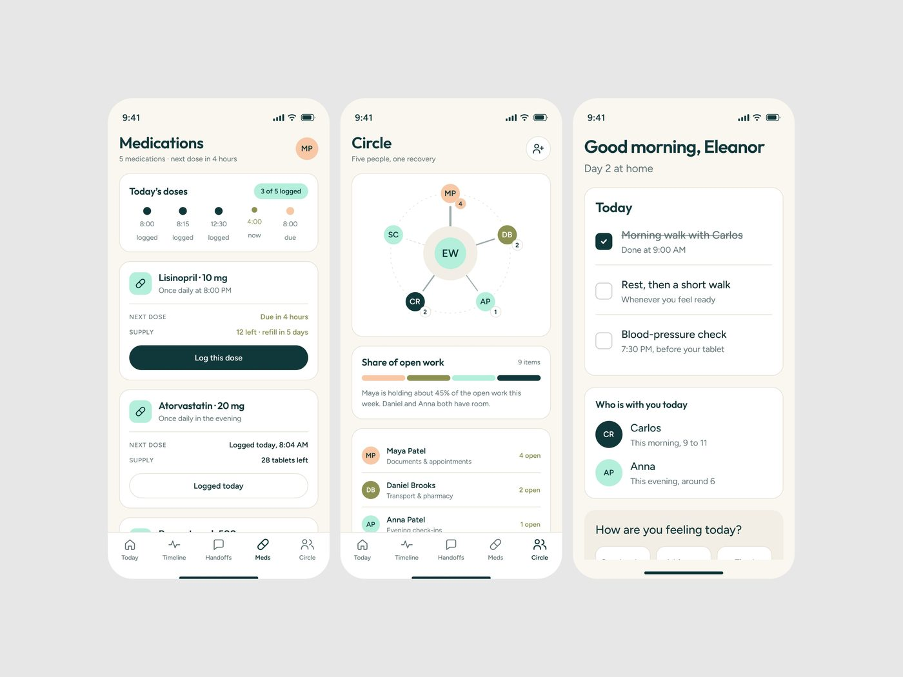
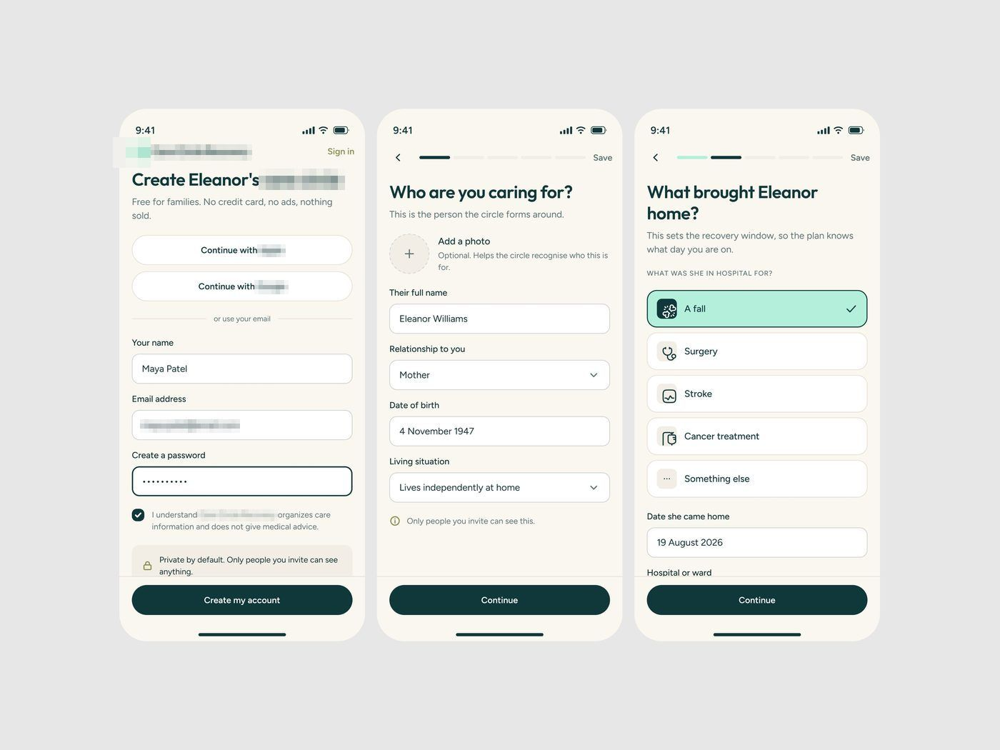

# App de cuidado pós-alta

Uma das legendas
explica o público: gente de 40 a 60 anos é o público principal
do app. **[CONFIRMADO]**

| Campo | Valor |
|---|---|
| Nome | App de cuidado pós-alta |
| Setor | cuidado familiar depois de alta hospitalar: remédios, tarefas do dia, quem está com o paciente |
| Para quem | filho/filha de 40 a 60 anos organizando o cuidado de um dos pais ("Create Eleanor's care circle") |
| Tema | claro, creme `#F9F6F0` sobre `#E7E7E7` **[MEDIDO]** |
| Plataforma | mobile |
| Acento | teal escuro `#10383A` (botões, pontos) + menta claro na opção selecionada **[MEDIDO]** |

## Módulos

Medications ("3 of 5 logged", doses em linha do tempo horizontal, "Log this dose"),
Circle (grafo radial das pessoas em volta de "EW" com carga de tarefas), Today
(checklist com riscado no feito), onboarding em 3 passos (conta, "Who are you
caring for?", "What brought Eleanor home?" com opções grandes: A fall, Surgery,
Stroke, Cancer treatment).

## O que é específico

Público mais velho: fonte maior que o padrão do método, botão de largura total, uma
pergunta por tela, linguagem de família ("Five people, one recovery"), nada de
número técnico. Promessa de privacidade explícita ("Private by default").
