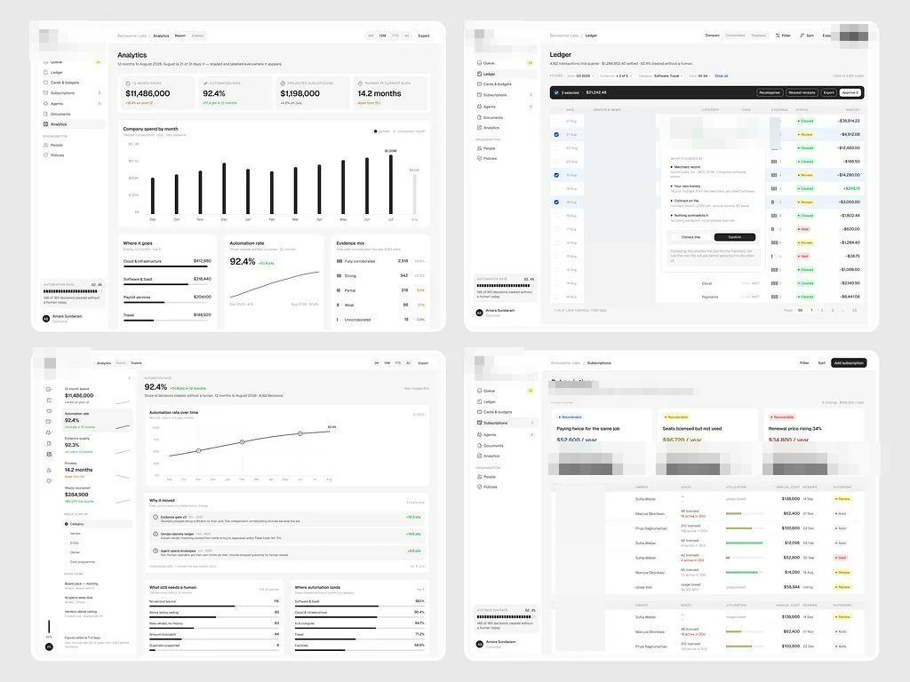
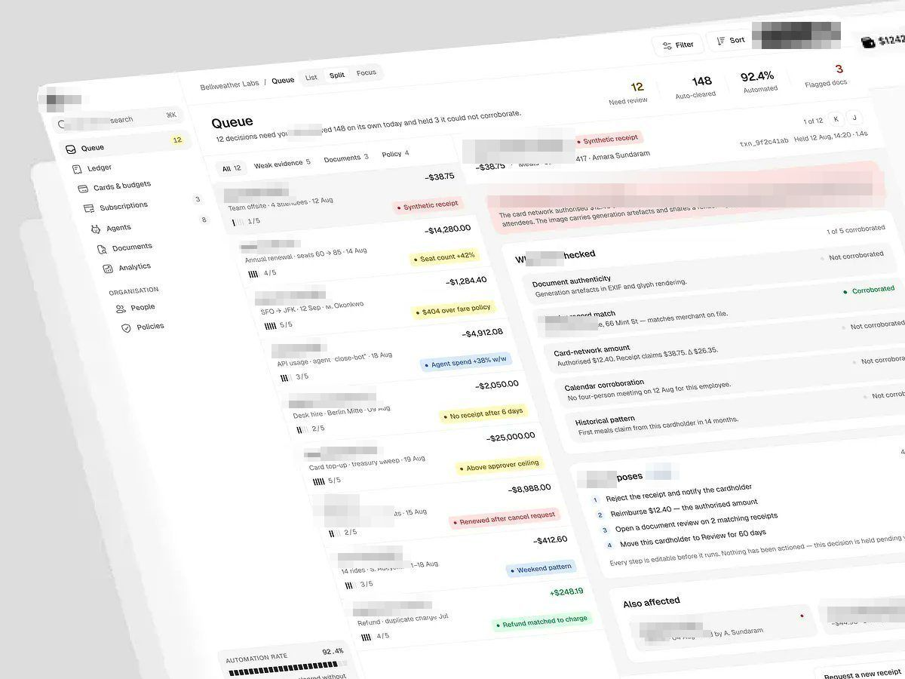
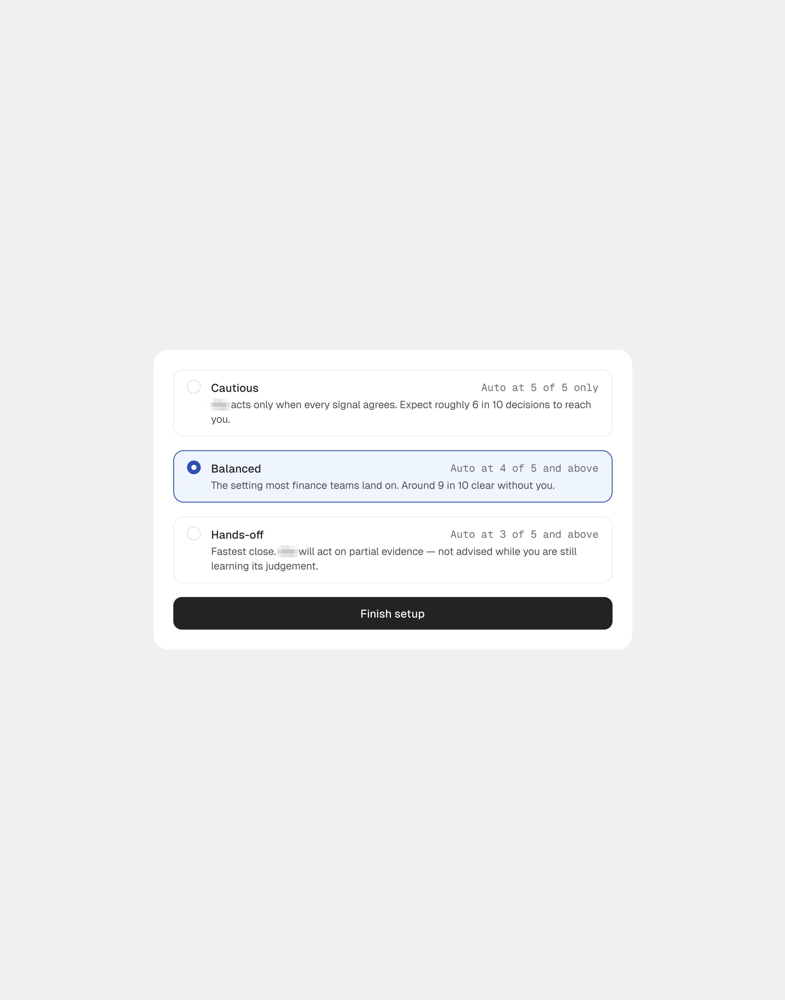
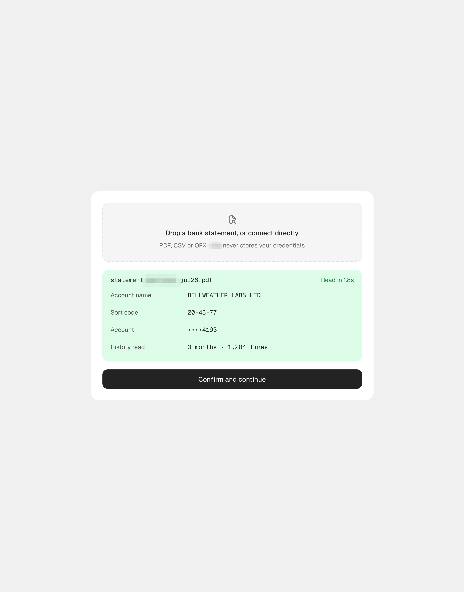
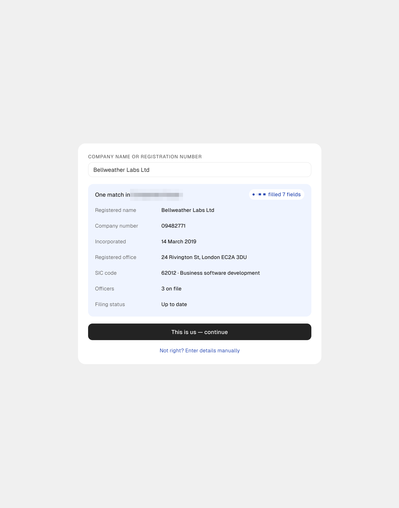

# App de despesas com IA

Série
irmã do CRM de receita, publicada em paralelo e com a mesma estrutura de sidebar clara.

| Campo | Valor |
|---|---|
| Nome | App de despesas com IA (logo quadrado preto) |
| Setor | despesas corporativas e recibos com IA: fila de revisão, ledger, cartões e orçamentos, assinaturas, agentes, documentos, analytics |
| Para quem | financeiro / controladoria ("Bellweather Labs", "Amara Sundaram") |
| Tema | claro; fundo `#F6F6F6`, cartão `#FFFFFF` **[MEDIDO]** |
| Plataforma | web desktop (+ site de marketing) |
| Acento | quase monocromático: preto para barras e botões ("Ask [produto]" preto com atalho), cor só em status (verde "Refund matched", amarelo "Above approver ceiling", vermelho "Synthetic receipt") **[OBSERVADO]** |

> Nota: uma das peças tem legenda de CRM de receita, mas a imagem mostra o logo do app de despesas com IA (e uma do CRM de receita, o inverso). As tabelas seguem o **logo**. **[OBSERVADO]**

## Navegação

Sidebar clara: Queue (12), Ledger, Cards & budgets, Subscriptions, Agents,
Documents, Analytics / ORGANISATION (People, Policies); no pé "AUTOMATION RATE
92.4%" com barra de traços e o usuário. Topo: breadcrumb, abas Queue / List /
Split / Focus, Filter, Sort, botão preto "Ask [produto] ⌘K".

## Módulos

| Tela | Conteúdo |
|---|---|
| Queue | lista de decisões pendentes (fornecedor, valor, motivo em pílula colorida, barras de evidência "3/5") + detalhe do recibo: alerta vermelho "The receipt does not match the charge", "What [produto] checked" com 5 verificações, "[produto] proposes" em passos numerados, "Also affected" |
| Ledger | tabela de transações com seleção múltipla e barra de ação preta |
| Analytics | 4 KPIs, barras pretas finas de gasto por mês, "Where it goes", taxa de automação |
| Subscriptions | 3 cartões de recomendação ("Paying twice for the same job", "Seats licensed but not used") com valor anual e botão preto, tabela de ferramentas |

## O que é específico deste setor

Fraude e conformidade de despesa: cada item tem **evidência contada** (3/5) e a IA
mostra o que verificou antes de propor. Pouca cor porque é contabilidade.

## Mais telas da série

App de despesas com IA: três cartões isolados de onboarding (legenda: só o nome, cartões do fluxo de onboarding): o nível de
autonomia em três opções com a regra em mono, o extrato lido com os campos extraídos e a empresa
achada no registro oficial com "[produto] filled 7 fields".

