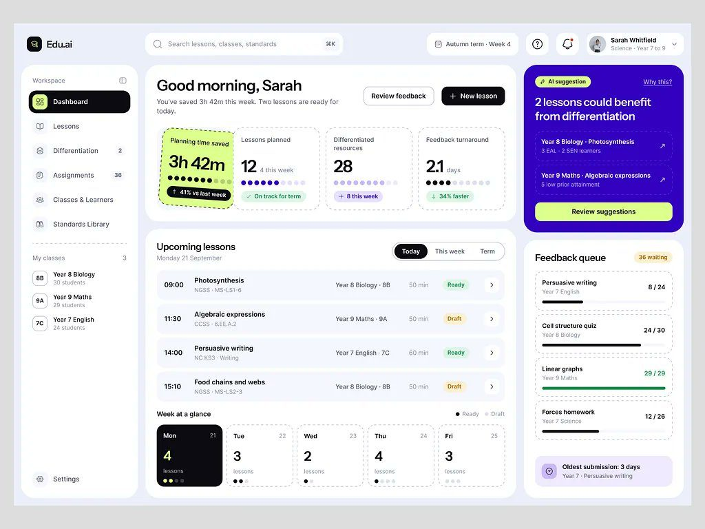

# Edu.ai

2 peças em dias seguidos, 5.575 views, 76 salvos (13,6/1k).

| Campo | Valor |
|---|---|
| Nome | Edu.ai ("AI Co Teacher for K 12 lesson planning") |
| Setor | educação básica: planejamento de aula, diferenciação, correção |
| Para quem | professora ("Sarah Whitfield · Science · Year 7 to 9") |
| Tema | claro, fundo lavanda `#EAEDF9` **[MEDIDO]** |
| Plataforma | web |
| Acento | índigo `#3300C2` (cartão de sugestão da IA) + lime `#DDFF8C` (tempo economizado, botão) **[MEDIDO]** |

## Telas publicadas

<!--T:Edu.ai-->
| # | views | salvos | salvos/1k | mídia | legenda |
|---|---:|---:|---:|---|---|
| 1 | 2.204 | 7 | 3,2 | 3 img | Small but effective |
| 2 | 3.371 | 69 | 20,5 | 1 img | Edu, ai. AI Co Teacher for K 12 lesson planning |
| **total** | **5.575** | **76** | **13,6** | | |
<!--/T-->

## Módulos

"Good morning, Sarah / You've saved 3h 42m this week"; 4 KPIs com borda
**tracejada** e pontos de progresso (o de tempo economizado em lime inclinado,
como etiqueta colada); cartão índigo "AI suggestion: 2 lessons could benefit from
differentiation" com botão lime; Upcoming lessons (hora, turma, código de
currículo, status Ready/Draft); Week at a glance (5 cartões de dia, hoje em
preto); Feedback queue com barras de correção.

## O que é específico

Valor medido em **tempo do professor**, não em nota. Toque lúdico (etiqueta
inclinada, borda tracejada) sem sair da grade de dashboard.
