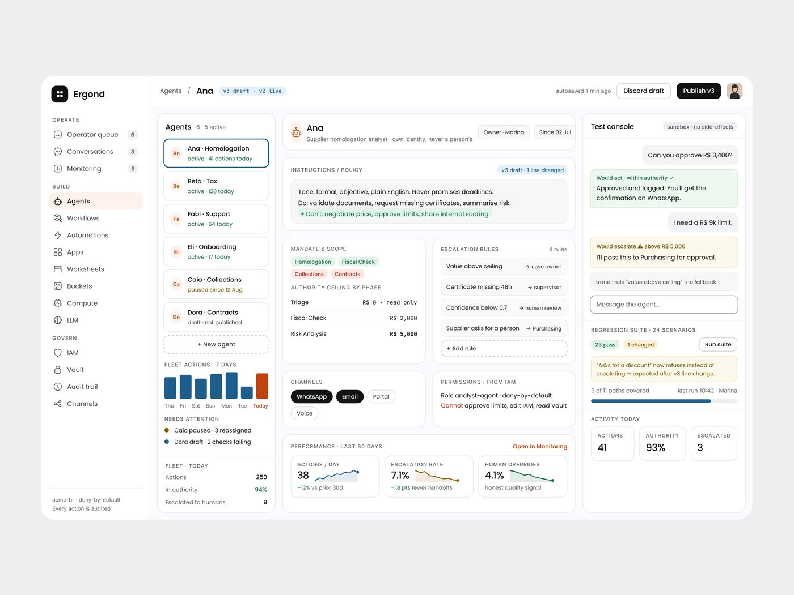
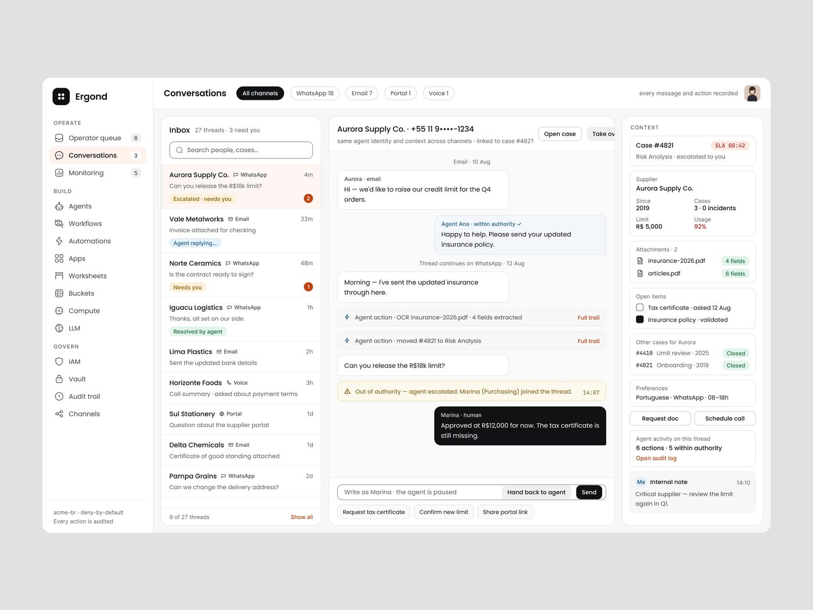
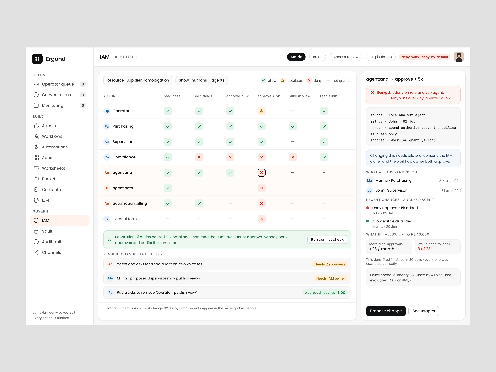

# Ergond

**O produto "denso" de propósito, e o contraponto do FixTrack.** 6 peças, 112.407
views, 1.030 salvos. O nome **nunca aparece na legenda** ("Data heavy UI FOR ai
agents that runs company…", "So many things on one screen, still seamless
Experience.", "Enjoy…"): identificado pelo logo.

| Campo | Valor |
|---|---|
| Nome | Ergond |
| Setor | agentes de IA que executam processos da empresa (homologação de fornecedor, fiscal, cobrança, contratos) |
| Para quem | operações de empresa brasileira: valores em R$, WhatsApp como canal, workspace "acme-br" |
| Tema | claro, página `#FFFFFF`, moldura `#EEEEEE` **[MEDIDO]** |
| Plataforma | web desktop |
| Acento | azul-petróleo `#1E5E8C` (barras, progresso) + ferrugem `#C3410D` (barra "Today", links "Open in Monitoring") **[MEDIDO]** |
| Nav ativo | pêssego `#FFF2EC` **[MEDIDO]** |

## Telas publicadas

<!--T:Ergond-->
| # | views | salvos | salvos/1k | mídia | legenda |
|---|---:|---:|---:|---|---|
| 1 | 11.016 | 211 | 19,2 | 3 img | Data heavy UI FOR ai agents that runs company... |
| 2 | 3.934 | 57 | 14,5 | 3 img | Heavy data-driven interface design. |
| 3 | 46.261 | 110 | 2,4 | 1 img | So many things on one screen, still seamless Experience. |
| 4 | 35.004 | 416 | 11,9 | 1 img | Enjoy... |
| 5 | 4.187 | 28 | 6,7 | 3 img | See more in details! |
| 6 | 12.005 | 208 | 17,3 | 1 img | Product design for a complex automation system. |
| **total** | **112.407** | **1.030** | **9,2** | | |
<!--/T-->

## Navegação

Sidebar de ≈224 px com logo em quadrado preto, 3 grupos em caixa alta:
**OPERATE** (Operator queue 6, Conversations 3, Monitoring 5), **BUILD** (Agents,
Workflows, Automations, Apps, Worksheets, Buckets, Compute, LLM), **GOVERN**
(IAM, Vault, Audit trail, Channels). No pé: "acme-br · deny-by-default / Every
action is audited". Topo: breadcrumb "Agents / Ana" + selo mono "v3 draft · v2
live" + "autosaved 1 min ago" + "Discard draft" + botão preto "Publish v3".

## Módulos / telas

| Tela | Estrutura |
|---|---|
| Agente "Ana" | 3 colunas: lista de agentes (243 px) com barra "Fleet actions · 7 days" / centro (605 px) com Instructions/Policy, Mandate & Scope, Escalation rules, Channels, Permissions, Performance / Test console (336 px) com conversa de teste, regression suite e Activity today **[MEDIDO em tela 1440]** |
| Conversations | inbox de 27 threads por canal (WhatsApp, Email, Portal, Voice), conversa com ações do agente no meio e contexto do caso à direita |
| Automations | paleta de nós (Triggers, Logic, Actions, People & tools) com nome em mono (`rows.update_cells`) + canvas de fluxo com versão "v21 draft · v20 live" |
| LLM routing | tabela de modelo primário e fallback por workflow, gráfico de failover |
| Detalhes | recortes ampliados |

## Componentes-chave

- **Diff de política em linha**: "+ Don't: negotiate price…" em verde dentro do
  bloco de instruções, com selo "v3 draft · 1 line changed".
- **Teto de autoridade por fase** em tabela com valor mono ("R$ 2,000").
- **Regras de escalonamento** como linhas "condição → destino".
- **Bolhas de teste** coloridas pelo veredito: verde "Would act · within
  authority", amarelo "Would escalate ⚠ above R$ 5,000".
- Rótulos de seção em caixa alta com tracking largo (INSTRUCTIONS / POLICY,
  MANDATE & SCOPE).

## O que é específico deste setor

Governança explícita em cada tela: quem é o dono do agente, desde quando, o que
ele pode e não pode, para quem escala, qual versão está no ar. É o tipo de
produto chamado de "data-heavy" na discussão do FixTrack. **[INFERIDO]** pelo
tipo de tela.

## Performance

6 peças, **112.407 views, 1.030 salvos, 9,2 salvos/1k**. Duas peças de imagem
única passaram de 35 mil (46.261 e 35.004, esta com 416 salvos).

## Como reproduzir

- Grade de 3 colunas dentro do conteúdo: 243 / 605 / 336 px, gap 16 px.
- Cartão branco, borda `#EDEDF0`-ish 1 px, raio ≈16 px, rótulo de seção 11-12 px
  caixa alta tracking ≈0,08em.
- Números monetários e versões em monoespaçada.

## Mais telas da série

Ergond: a matriz de permissões IAM (ator × ação, com a regra "agent.ana → approve > 5k" explicada,
quem tem a permissão, mudanças recentes e simulação "What if") em *"Product design for a complex
automation system."* (12.005 views, 208 salvos).

