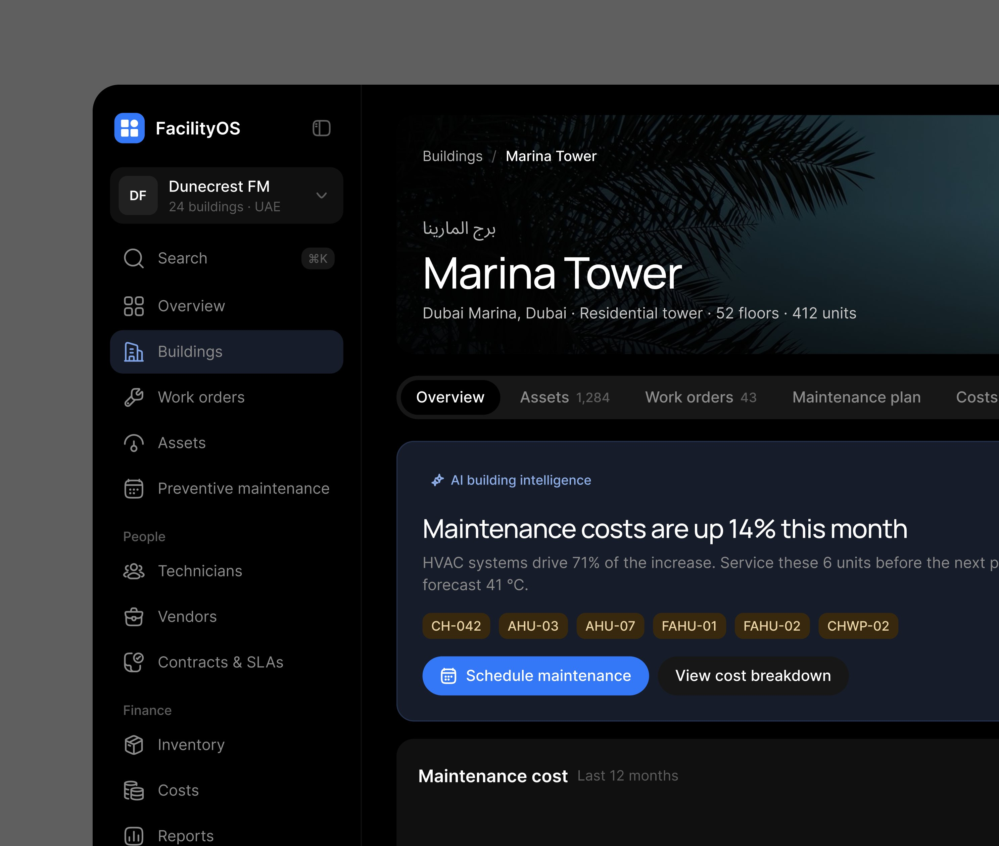
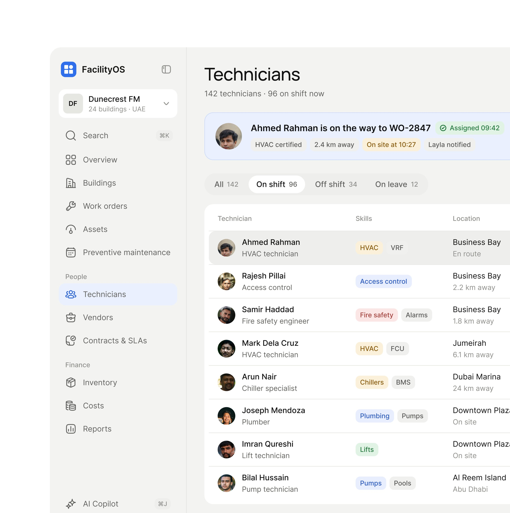

# FacilityOS

**ERP de manutenção predial para uma empresa dos Emirados.** 2 peças, a primeira escura e a
segunda clara. *"Meet FacilityOS, ERP product
UXUI design for the UAE-based company."*. **[CONFIRMADO]**

| Campo | Valor |
|---|---|
| Setor | gestão de facilities: prédios, ativos, ordens de serviço, manutenção preventiva, técnicos, fornecedores, contratos |
| Para quem | a operadora de facilities (Dunecrest FM, 24 prédios, Emirados) |
| Tema | escuro preto `#000000` com foto do prédio no cabeçalho; claro na lista de técnicos **[MEDIDO, amostra quantizada]** |
| Plataforma | web |
| Acento | azul `#3078F0` (botão "Schedule maintenance", item ativo) e âmbar nos selos de equipamento **[MEDIDO, amostra quantizada]** |
| Detalhe de lugar | o nome do prédio também em árabe acima de "Marina Tower" |

## Telas publicadas

<!--T:FacilityOS-->
| # | views | salvos | salvos/1k | mídia | legenda |
|---|---:|---:|---:|---|---|
| 1 | 2.284 | 19 | 8,3 | 1 img | Meet FacilityOS, ERP product UXUI design for the UAE-based company. |
| 2 | 1.918 | 26 | 13,6 | 1 img | Home service saas product UXUI design with taste |
| **total** | **4.202** | **45** | **10,7** | | |
<!--/T-->

## O que cada tela tem

- **Prédio (escuro)** — cabeçalho com foto, nome em árabe e inglês e os números do prédio (52
  andares, 412 unidades), abas (Assets 1.284, Work orders 43, Maintenance plan, Costs) e o cartão
  **"AI building intelligence · Maintenance costs are up 14% this month"** com o porquê (sistemas de
  climatização respondem por 71% do aumento), os equipamentos em selos âmbar e "Schedule
  maintenance" / "View cost breakdown".
  
- **Technicians (claro)** — o destaque "Ahmed Rahman is on the way to WO-2847" com certificação,
  distância, chegada e quem foi avisado; abas por turno; tabela com foto, função, habilidades em
  selos coloridos e local.
  

## O que a série ensina

- **Localização visível**: o idioma do lugar entra no cabeçalho do objeto (o nome em árabe), não
  numa troca de idioma da interface.
- **A frase da IA nomeia o equipamento** que causa o custo e já oferece agendar a manutenção.
