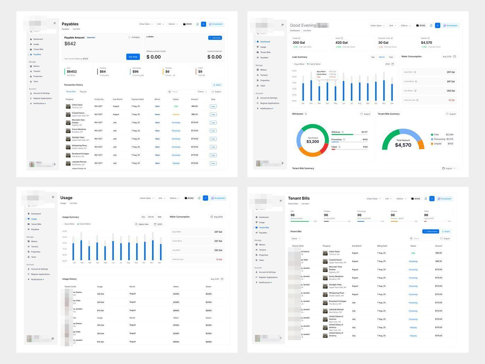

# Painel de gestão de imóveis

**A série mais longa em tempo**: 32 peças em sete meses e meio, sempre o mesmo
produto real de cliente (as legendas insistem em produto real e design real, e
anunciam o produto corporativo de submedição e gestão de imóveis prestes a entrar no ar).

| Campo | Valor |
|---|---|
| Nome | CASTLET (logo com torre de castelo sobre o "T") |
| Setor | submedição de água/esgoto e gestão de imóveis de aluguel: consumo por medidor, contas do inquilino, pagáveis, vazamentos |
| Para quem | administrador de imóveis ("Good Evening [nome]") e inquilino (tela "Select an account type: I am Landlord / I am Tenants") |
| Tema | claro; branco com cinza `#F3F3F3` **[MEDIDO]** |
| Plataforma | web desktop |
| Acento | azul `#2970FE` (barras, nav ativo, botões); verde `#16B269` e laranja `#F69008` em status e gauges **[MEDIDO]** |

## Navegação

Sidebar branca clássica: logo + hambúrguer, busca, Dashboard, Usage, Tenant Bills,
Payables / Manage (Meters, Tenants, Properties, Team) / Account (Account &
Settings, Register Applications, Notifications). Topo: título + breadcrumb ("Team
> Managers"), filtros "Urban Oasis / Unit", saldo "$1242", botão azul e "AI
assistant".

## Módulos

Dashboard ("300 Gal", "420 Gal", Leak Summary, Water Consumption em barras azuis,
gauges de Withdraws e Tenant Bills), Usage, Tenant Bills (tabela longa com foto do
imóvel), Payables ("Payable Amount $642" com botão Pay Now), Properties
("Urban Oasis" com foto), Team (lista e painel "Preview"), Account & Settings
(Property Configuration em tabela com botão preto "Send"), onboarding.

## O que é específico

É o produto mais "SaaS genérico" da biblioteca: azul padrão, sidebar convencional, tabela com
muitas colunas. Serve de contraste com app de manutenção predial (mesmo setor, no método): o app de manutenção predial
troca o azul por verde e coral, reduz a tabela a 3 chamados com linguagem de
problema e faz a sidebar mais leve. **[OBSERVADO]**
