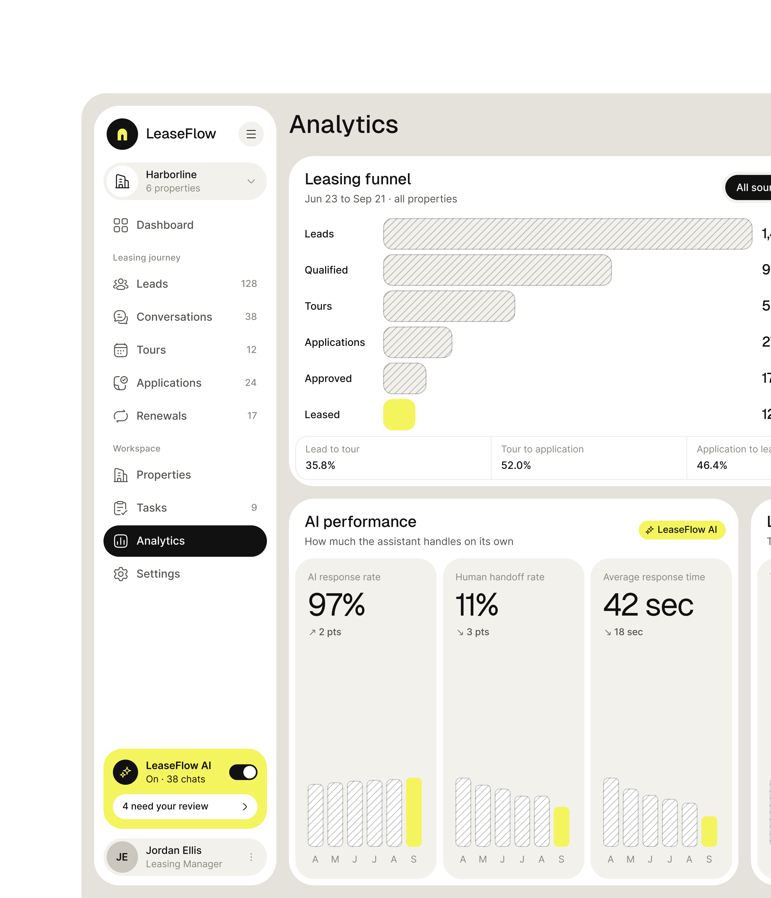
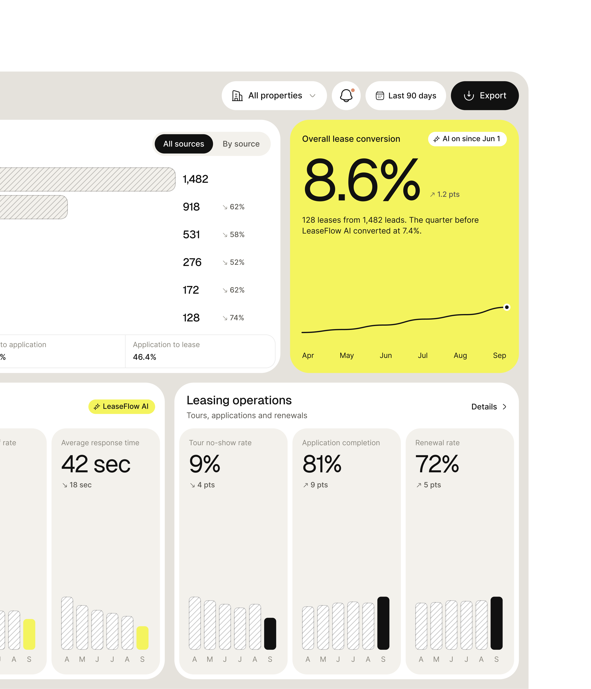
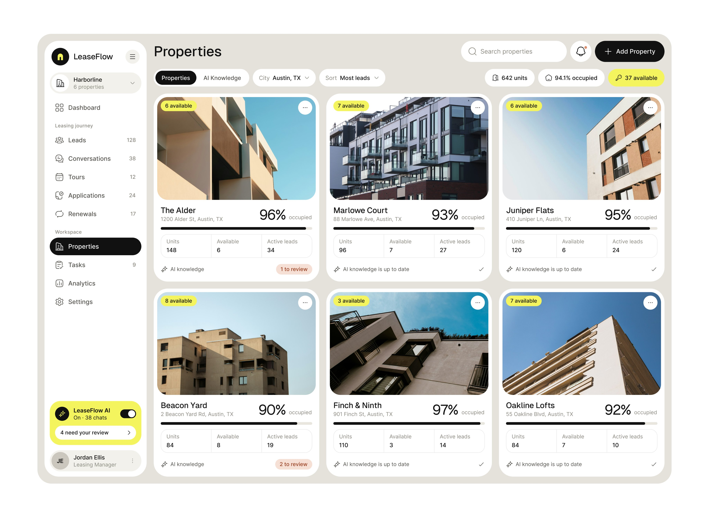
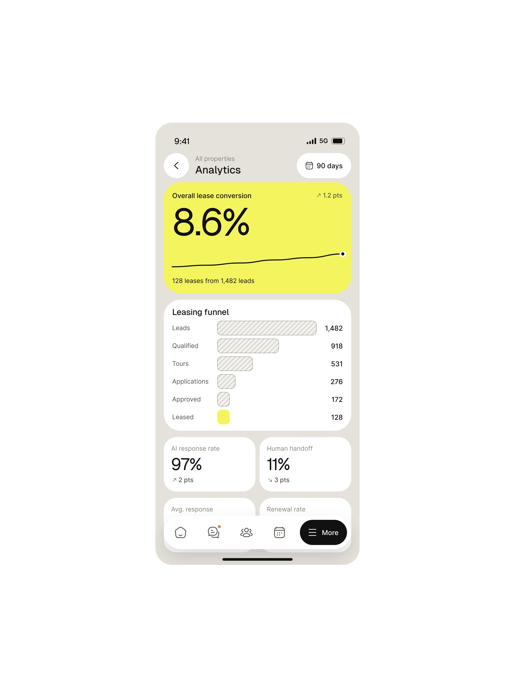
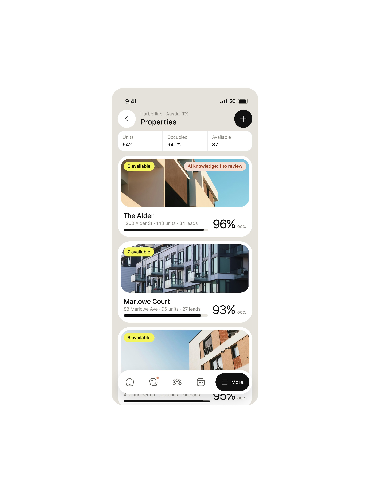
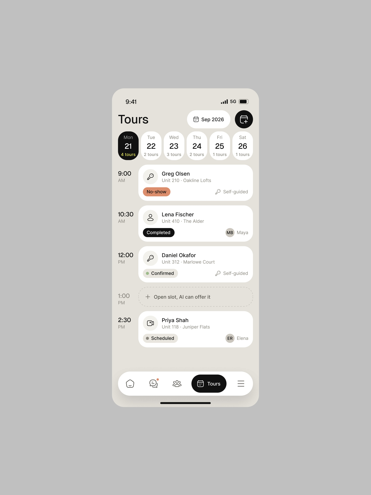
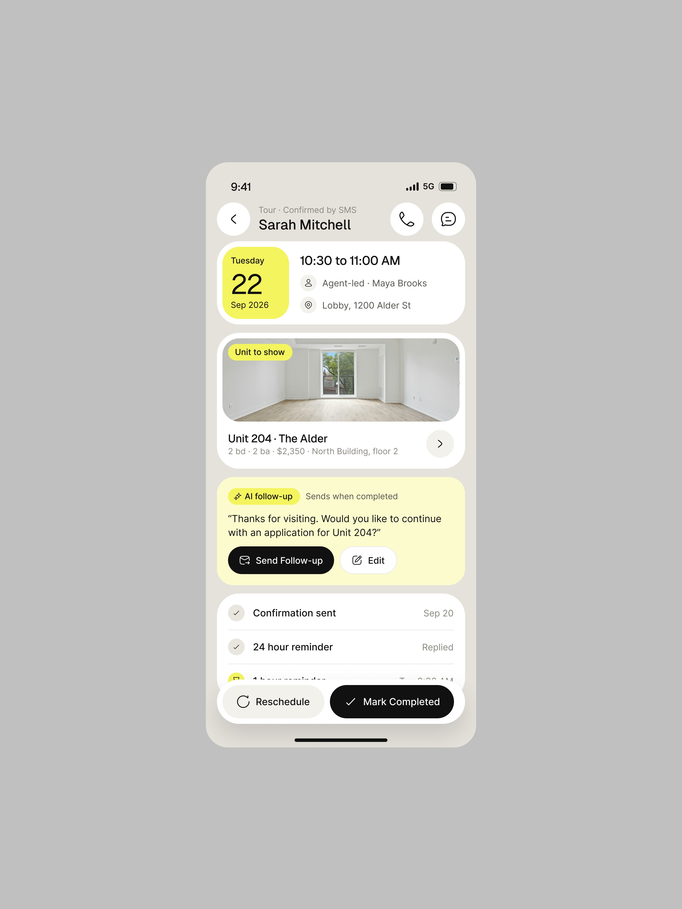
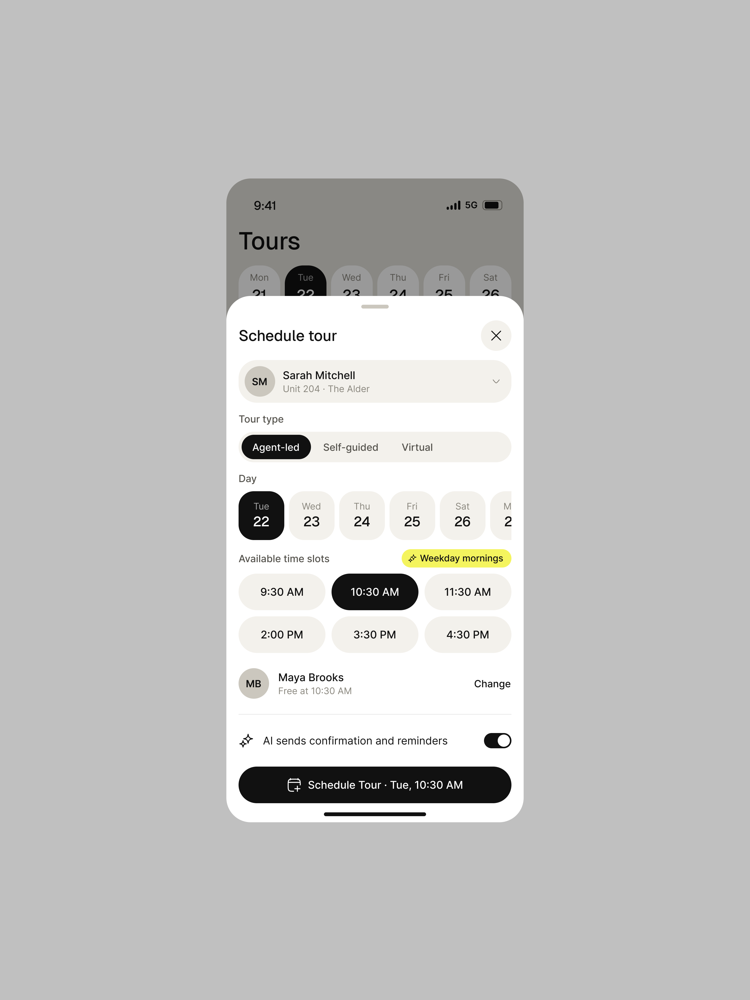
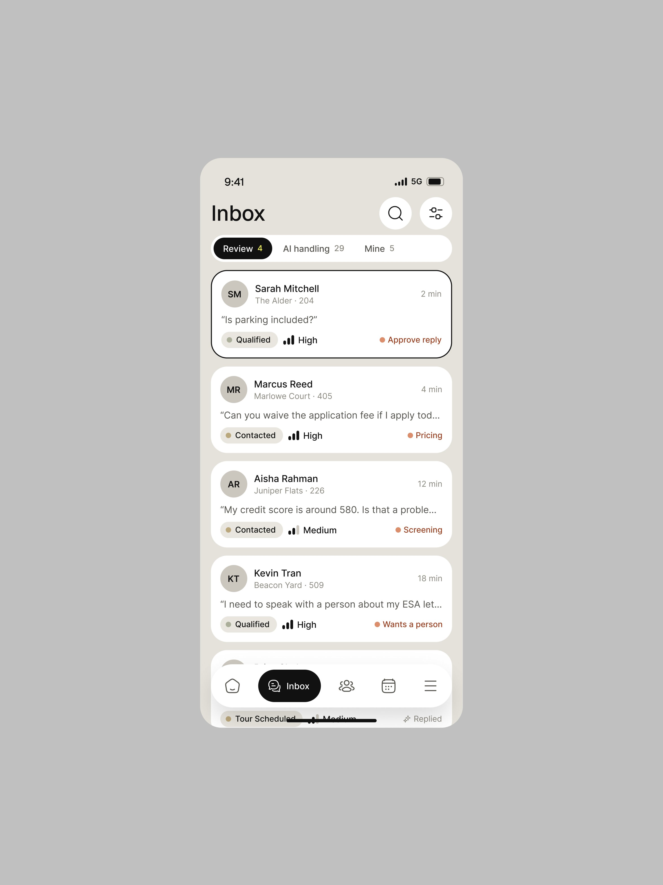
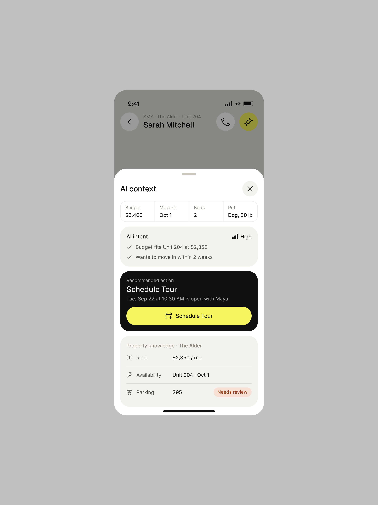

# LeaseFlow

**Locação de imóveis com um assistente que atende o lead.** 9 peças em dez dias, web e celular,
todas claras e com um amarelo-limão que ocupa cartões inteiros. A legenda descreve o produto: *"LeaseFlow AI is one workspace for
prospect conversations, tours, applications, and renewals. The assistant answers property
questions from verified knowledge, qualifies leads, books tours, chases missing documents, and
starts renewal outreach. People review and approve the decisions that matter."*. **[CONFIRMADO]**

| Campo | Valor |
|---|---|
| Setor | locação residencial: leads, visitas, propostas e renovação, numa carteira de prédios (Harborline, 6 propriedades, Austin) |
| Para quem | gerente de locação (Jordan Ellis, "Leasing Manager"); o assistente fala com o interessado por SMS |
| Tema | claro; página quase branca `#FCFCFC` e cartões `#F0F0E4` creme **[MEDIDO, amostra quantizada]** |
| Plataforma | web (Analytics, Properties, Renewals) + celular (Analytics, Properties, Tours, Inbox, conversa) |
| Acento | amarelo-limão `#F0F054` em cartão inteiro (conversão, data da visita, follow-up da IA) e na última barra de cada série; preto nos botões principais **[MEDIDO, amostra quantizada]** |
| Moldura do shot | retrato 2952×3933 no celular (3:4) e 2952×3438 no díptico web; fundo branco, não o cinza de costume |

## Telas publicadas

<!--T:LeaseFlow-->
| # | views | salvos | salvos/1k | mídia | legenda |
|---|---:|---:|---:|---|---|
| 1 | 3.035 | 45 | 14,8 | 3 img | LeaseFlow AI is one workspace for prospect conversations, tours, applications, and renewal |
| 2 | 4.949 | 106 | 21,4 | 2 img | Cool, clean SaaS UI Design for Leasflow. |
| 3 | 28.161 | 419 | 14,9 | 3 img | Schedule flow design for mobile app.. |
| 4 | 5.830 | 119 | 20,4 | 1 img | Property listing page uxui design! |
| 5 | 12.585 | 89 | 7,1 | 3 img | Mobile app design for a property leasing platform. |
| 6 | 2.056 | 29 | 14,1 | 1 img | The Future Of Intelligent Property Leasing. AI, Powered Property Leasing SaaS UI Design. |
| 7 | 14.396 | 211 | 14,7 | 1 img | Did I cook it? Btw, it's not vibe-coded  |
| 8 | 3.083 | 33 | 10,7 | 1 img | Property listing page uxui design for Leasflow |
| 9 | 1.015 | 11 | 10,8 | 2 img | Yellow colored design, will you give it a dislike? |
| **total** | **75.110** | **1.062** | **14,1** | | |
<!--/T-->

## O que cada tela tem

- **Analytics (web)** — funil de locação em barras hachuradas de cima para baixo (Leads 1.482,
  Qualified 918, Tours 531, Applications 276, Approved 172, Leased 128) com a conversão de cada
  etapa ao lado, e só a última barra em amarelo. Embaixo, "AI performance · How much the
  assistant handles on its own": 97% de resposta, 11% de passagem a humano, 42 s de tempo médio,
  cada um com barras mensais hachuradas e o mês atual em amarelo. Na outra metade, o cartão
  amarelo inteiro "Overall lease conversion 8.6%" com a frase de comparação (*"128 leases from
  1,482 leads. The quarter before LeaseFlow AI converted at 7.4%."*) e o selo "AI on since Jun 1".
  
  
- **Properties (web)** — grade de seis prédios em cartões com foto grande, selo amarelo de
  unidades livres, ocupação em número grande (96%, 93%...), três números por prédio e o estado
  do conhecimento da IA ("AI knowledge is up to date" ou "1 to review" em rosa).
  
- **Renewals (web)** — "Robert Lang · Unit 305" com "28 days until the lease expires", a conversa
  com o resumo da IA em amarelo-claro, mensagens marcadas por quem escreveu (IA ou pessoa), duas
  ofertas de renovação lado a lado e o cartão "AI suggestion · Send both options together" com o
  porquê. Ver o padrão em
  [../03-padroes-de-ia/12-acao-reversivel-e-rascunho.md](../03-padroes-de-ia/12-acao-reversivel-e-rascunho.md).
  
- **Celular** — Analytics em pilha (cartão amarelo no topo), Properties com foto, a agenda de
  visitas com o espaço livre "Open slot, AI can offer it", a folha "Schedule tour" com a chave
  "AI sends confirmation and reminders", a visita com o follow-up pronto, a Inbox dividida em
  "Review / AI handling / Mine" e a conversa com "Draft reply · Waiting for you" e o par
  Take Over / Approve Reply.
  
  
  
  
  
  
  
  
  

Repostagens da série: o díptico do Analytics voltou dias depois com outra legenda
([esquerda](../galeria/05-apresentacao/diptico-analytics-esquerda-repostagem-leaseflow.png),
[direita](../galeria/05-apresentacao/diptico-analytics-direita-repostagem-leaseflow.png)) e a tela
inteira apareceu sobre cena cinza
([shot](../galeria/05-apresentacao/shot-sobre-cena-cinza-analytics-leaseflow.jpg)).

## O que a série ensina

- **Uma cor viva em cartão inteiro, só onde está a resposta.** O amarelo pinta o número que
  responde a pergunta da tela (a conversão), a data da visita e o que a IA preparou; o resto é
  creme, branco e preto. É a regra do acento único levada ao limite. **[OBSERVADO em 9 peças]**
- **Hachura como "o resto"** e cor cheia como "o que importa": barras hachuradas para as etapas e
  os meses anteriores, cheias para a última etapa e o mês atual.
- **A IA aparece como estado de cada coisa**, não como chat: "AI knowledge is up to date" no
  prédio, "AI handling" na aba da inbox, "AI can offer it" no horário livre, "AI on since Jun 1"
  no KPI.
- **Rendimento:** a peça da agenda (3 telas de celular, *"Schedule flow design for mobile
  app.."*) foi o maior da série, 28.161 views e 419 salvos.
