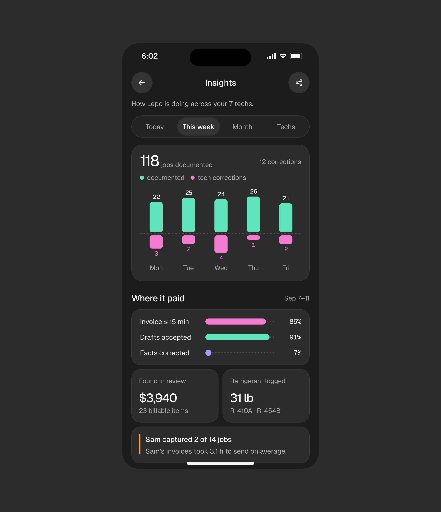
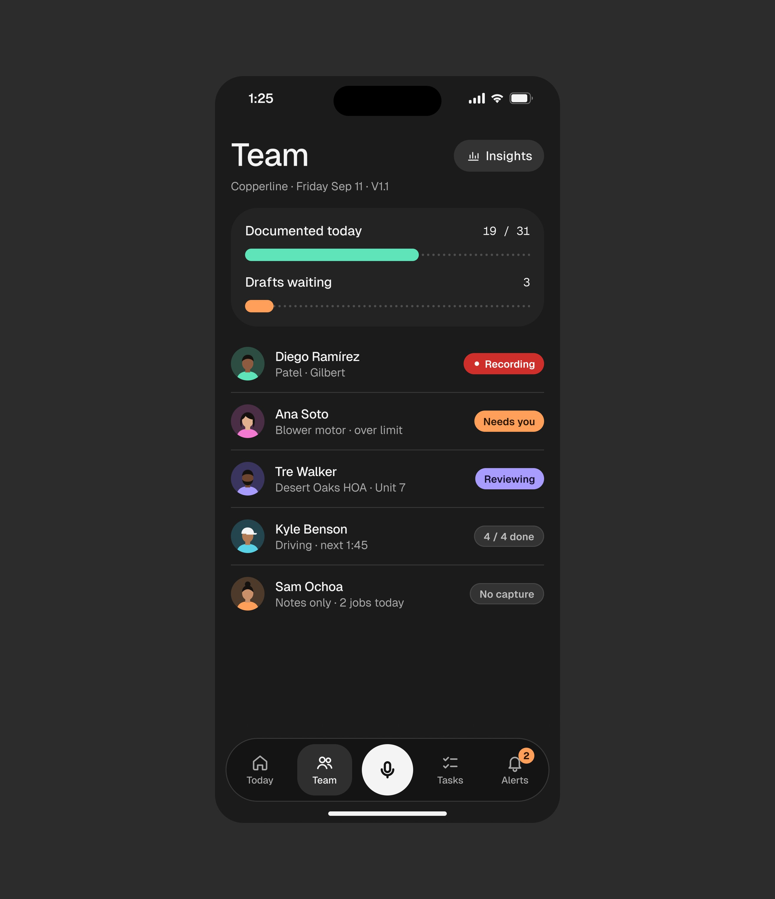
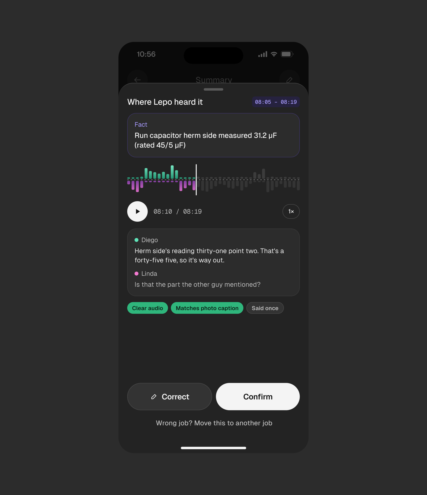

# Lepo

5 peças, 22.324 views, 186 salvos (8,3/1k).

| Campo | Valor |
|---|---|
| Nome | Lepo ("AI voice note-taker mobile APP") |
| Setor | anotação por voz em campo para técnicos de refrigeração e ar-condicionado (HVAC): capacitor, refrigerante R-410A, pressão de sucção |
| Para quem | dono de empresa de serviço e seus técnicos ("How Lepo is doing across your 7 techs") |
| Tema | escuro; tela `#2A2A2A`, cartões `#1B1B1B`-`#212121` **[MEDIDO]** |
| Plataforma | mobile |
| Acento | menta `#5FE3B8` (documentado) + rosa `#E47BD0`-ish (correções do técnico) + vermelho `#CE2F2B` (botão de gravar) **[MEDIDO]** |

## Telas publicadas

<!--T:Lepo-->
| # | views | salvos | salvos/1k | mídia | legenda |
|---|---:|---:|---:|---|---|
| 1 | 1.012 | 5 | 4,9 | 1 img | Lepo - AI note-taker mobile application. |
| 2 | 5.220 | 2 | 0,4 | 3 img | Lepo, AI Note Taker Mobile App |
| 3 | 4.404 | 39 | 8,9 | 3 img | Rate the UI ❤️ |
| 4 | 5.311 | 85 | 16,0 | 3 img | AI voice note-taker mobile APP ❤️ Soon you will see it live. |
| 5 | 6.377 | 55 | 8,6 | 3 img | Voice note taker IOS app screen UIUX Design. |
| **total** | **22.324** | **186** | **8,3** | | |
<!--/T-->

## Módulos

- **Gravação**: forma de onda espelhada (menta acima = você, rosa abaixo = cliente),
  "Lepo is catching" com itens extraídos em tempo real ("Run cap herm 31.2 µF ·
  rated 45/5") e o horário em mono, botão vermelho grande de parar.
- **Insights**: "118 jobs documented", barras divergentes por dia (menta para
  cima, rosa para baixo = correções), "Where it paid" com 3 barras de progresso,
  "Found in review $3,940", "Refrigerant logged 31 lb", nota com barra lateral
  laranja "Sam captured 2 of 14 jobs".

## O que é específico

Uso com mão ocupada: escuro, tipografia grande, um botão enorme. O valor para o
dono é dinheiro recuperado ("Found in review $3,940"), não a transcrição.

## Mais telas da série

Lepo: as três telas escuras de iOS (Insights, Team, "Where Lepo heard it") voltaram juntas numa
peça própria (a de Insights é a mesma imagem que já está na galeria).

