# Painel de licenciamento solar

**A série de referência do nicho vertical.** Junto com as telas saíram as folhas de variáveis do Figma do
produto: o único caso em que o **design system inteiro está escrito**. Tokens
completos em
[../01-sistema-visual/design-system-publicado.md](../01-sistema-visual/design-system-publicado.md).

| Campo | Valor |
|---|---|
| Nome | Painel de licenciamento solar (logo: quadrado preto com 4 pontos, um deles lime) |
| Setor | licenciamento de instalação solar residencial: projeto → permit → vistoria → PTO |
| Para quem | instaladora de energia solar ("Sunridge Solar · Austin, TX"), coordenador de licenças |
| Tema | claro; `bg/canvas #EFEEF4`, `bg/panel #FFFFFF`, `bg/card #F4F4F8` **[CONFIRMADO]** |
| Plataforma | web desktop |
| Acento | `lime/500 #C9F24C`, texto sobre lime `text/on-accent #141805`; alerta `clay/500 #E1543A`; atenção `amber/500 #EDA122` **[CONFIRMADO]** |
| Texto | `text/primary #111116`, `secondary #55545F`, `muted #8A8996` **[CONFIRMADO]** |

Essa peça é **uma tela cortada em duas metades verticais** (2.466 × 3.051
cada), para caber no feed em retrato: a metade esquerda mostra sidebar + cartão do
projeto + tabela; a direita, KPIs + pipeline + cartão de IA + gauge.
Legenda: do caos do produto feito com IA ao acabamento, com a interface redesenhada até o
potencial inteiro. É redesenho de um produto de cliente.

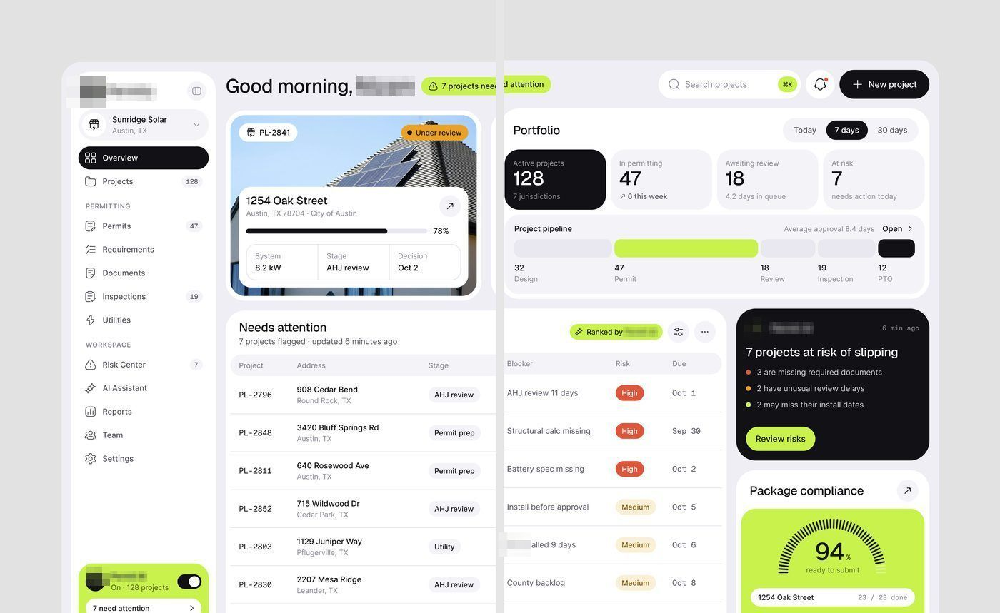

## Navegação

Sidebar branca com seletor de empresa (ícone de loja + "Sunridge Solar / Austin, TX"),
item ativo **preto cheio com texto branco** (raio total), grupos PERMITTING
(Permits 47, Requirements, Documents, Inspections 19, Utilities) e WORKSPACE
(Risk Center 7, AI Assistant, Reports, Team, Settings). Contadores em pílula
cinza. No pé, cartão **lime** "[produto] · On · 128 projects" com toggle preto e
botão "7 need attention". Topo: saudação "Good morning, [nome]" em ≈48 px + pílula
lime "⚠ 7 projects need attention", busca com atalho ⌘K em lime, sino, botão preto
"+ New project".

## Módulos

| Bloco | Conteúdo |
|---|---|
| Cartão do projeto | foto de telhado com painéis ocupando o cartão, selo "PL-2841", pílula laranja "Under review", cartão branco sobreposto com endereço, barra de progresso preta 78%, 3 células (System 8.2 kW, Stage AHJ review, Decision Oct 2) |
| Portfolio | seletor Today / 7 days / 30 days; 4 KPIs (o primeiro em cartão **preto** "Active projects 128"), pipeline em 5 barras horizontais proporcionais (a etapa atual em lime, a final em preto) |
| Needs attention | tabela Project (mono "PL-2796") / Address / Stage / Blocker / Risk (pílula High vermelha, Medium bege) / Due (mono) , "Ranked by [produto]" em pílula lime |
| Assistente de IA do licenciamento | cartão preto: "7 projects at risk of slipping", 3 motivos com ponto colorido, botão lime "Review risks" |
| Package compliance | gauge de traços lime "94% ready to submit" + "23 / 23 done" |

## Componentes-chave

- Preto `#111116` como segunda cor de destaque (item ativo, KPI principal, cartão
  de IA, botão), lime como primeira. Nada de azul.
- IDs e datas em **monoespaçada** (PL-2796, Oct 1, "6 min ago").
- A regra do DS: *"Panels sit flat on the canvas; only the plan viewer lifts."*

## O que é específico deste setor

O objeto central é **o imóvel** (foto real do telhado) e o tempo regulatório
(AHJ review, PTO, "Average approval 8.4 days"). Risco é prazo que escorrega.

## Como reproduzir

Use a tabela de tokens de [design-system-publicado.md](../01-sistema-visual/design-system-publicado.md).
Pontos que o olho confirma: raio de painel ≈32 px, cartão ≈24 px, pílula total;
título 48 px regular; linhas de tabela ≈80 px de altura com separador `line/soft #E3E2EC`.

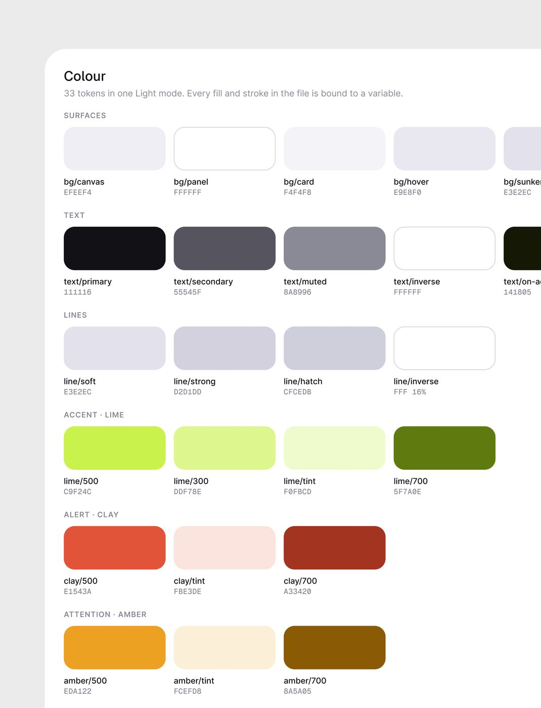

## Mais telas da série

**O painel de licenciamento solar é redesenho.** O caso: um produto bagunçado feito com IA, um
pedido de redesenho, duas direções exploradas. Esta é a direção que ficou **de fora**, e vale
estudar por isso (Overview com portfólio e o cartão preto do assistente de IA do licenciamento, Projects em
grade de fotos, Compliance review com nota 87, Permit package com a faixa lima "Filed with the City of
Austin"). **[CONFIRMADO]** Também: o díptico de Reports (ciclo da licença com e sem a
checagem da IA, "AI pre check saves 2.3 days"), a tela Documents com a checagem da IA por arquivo e o
cartão preto "Document intelligence", e o app iOS em vídeo-esteira (tela de bloqueio, rastreio da
licença, inspeções com as fotos que o fiscal espera, câmera que lê a placa, "Permit approved").

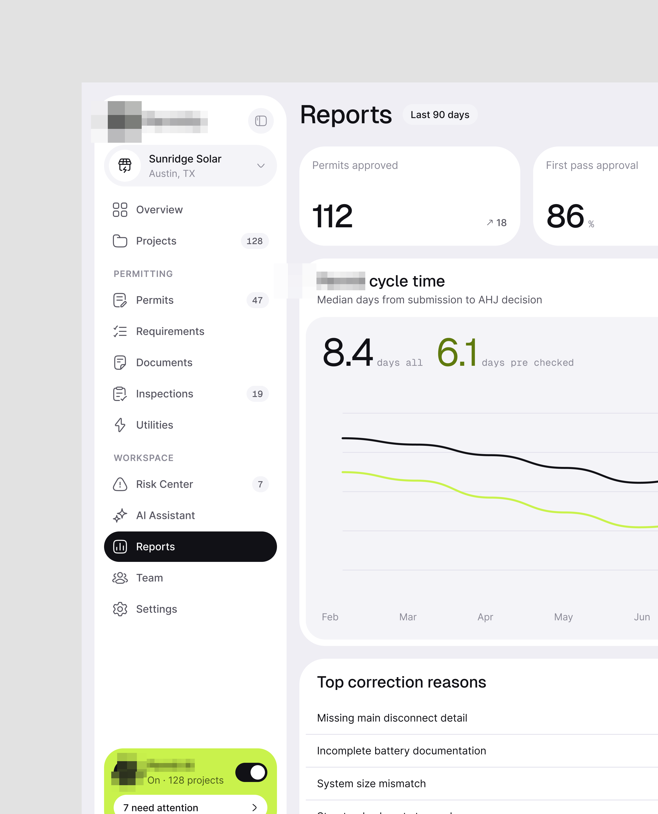
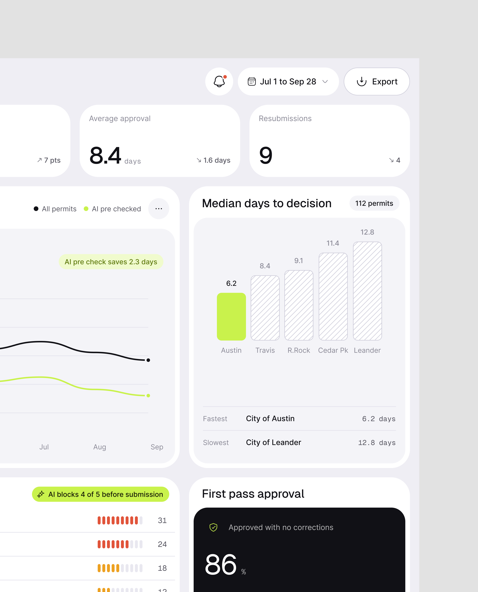
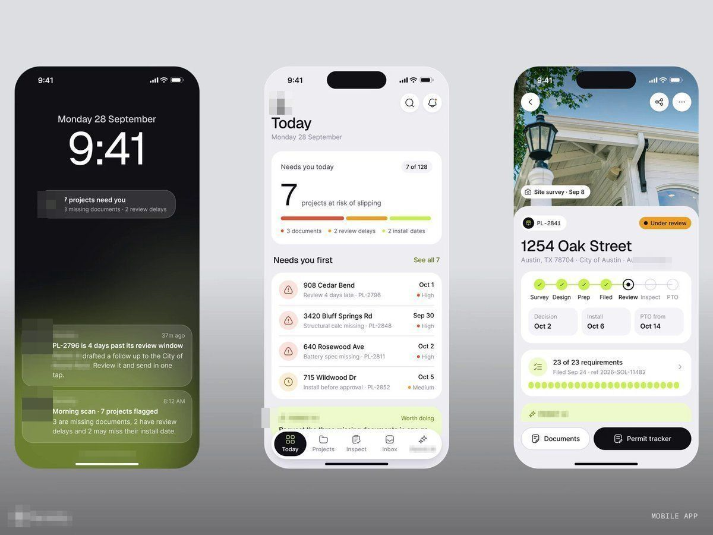
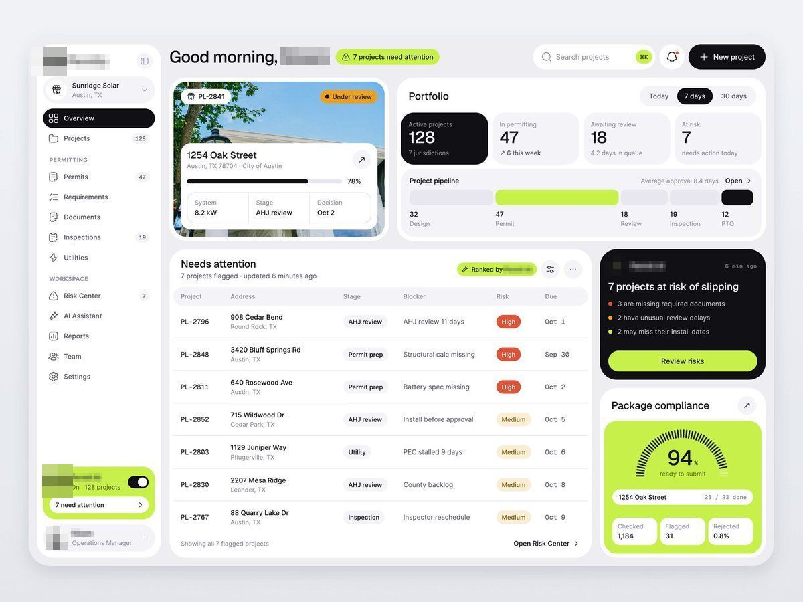
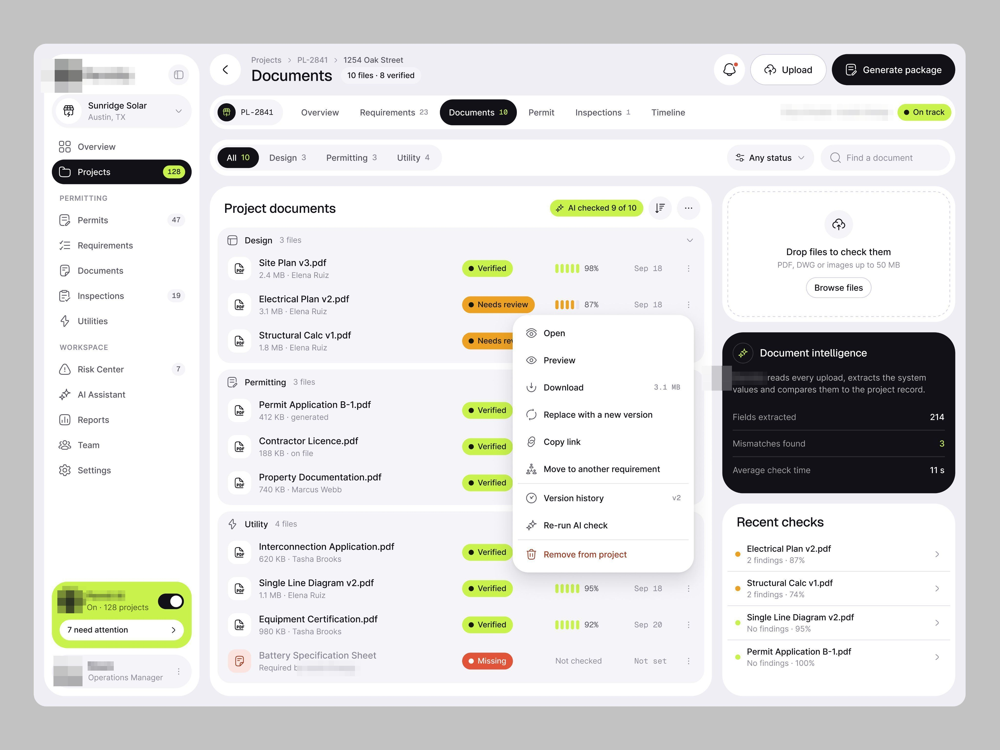

## Mais telas

- Ganhou o celular (projetos em risco, detalhe com foto, follow-up redigido pelo assistente de IA do licenciamento) e o início com o painel de notificações aberto.

Telas:

- Capa do vídeo do redesenho do painel de licenciamento solar: "Good morning, [nome]" com foto da casa, "Needs attention" e o assistente de IA do licenciamento 
- Quadro a 15%: "Projects" em cartões com foto 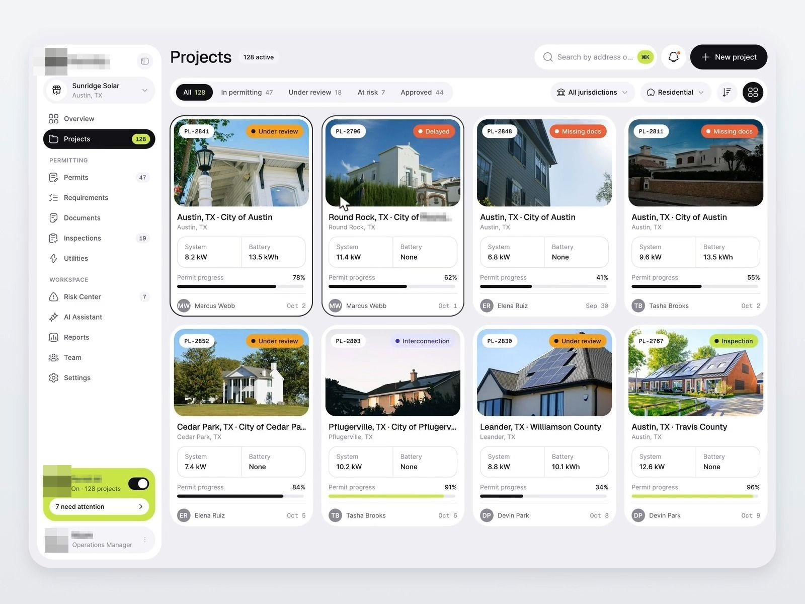
- Quadro a 50%: "Compliance review" com 87 e o que a IA corrige 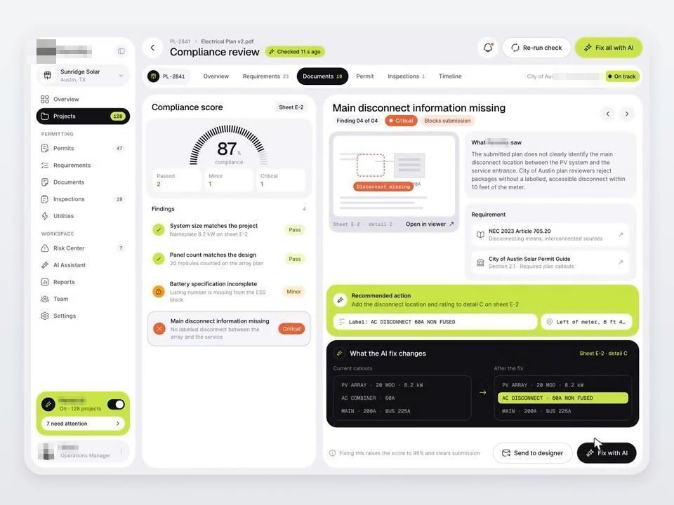
- Quadro a 85%: "Filed with the City of Austin" em lima com o pacote 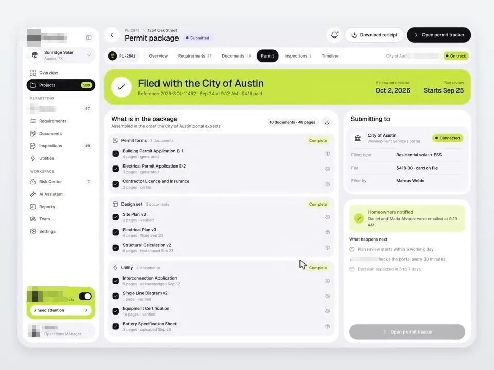
- Painel de licenciamento solar no iPhone: "Today" com 7 projetos em risco, barra segmentada, lista "Needs you first" e aba assistente de IA do licenciamento 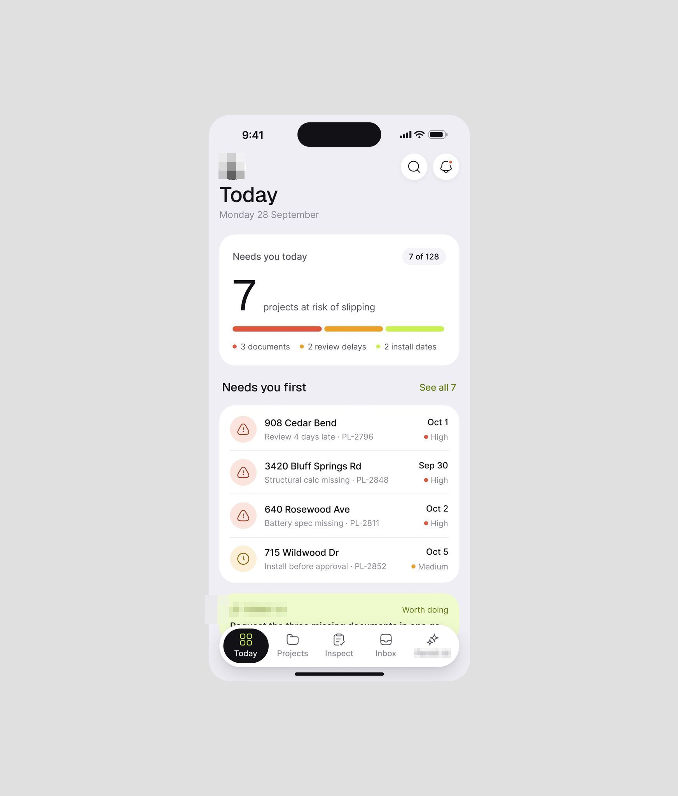
- Painel de licenciamento solar no iPhone: projeto 1254 Oak Street com foto no topo, linha de etapas e 23 de 23 requisitos 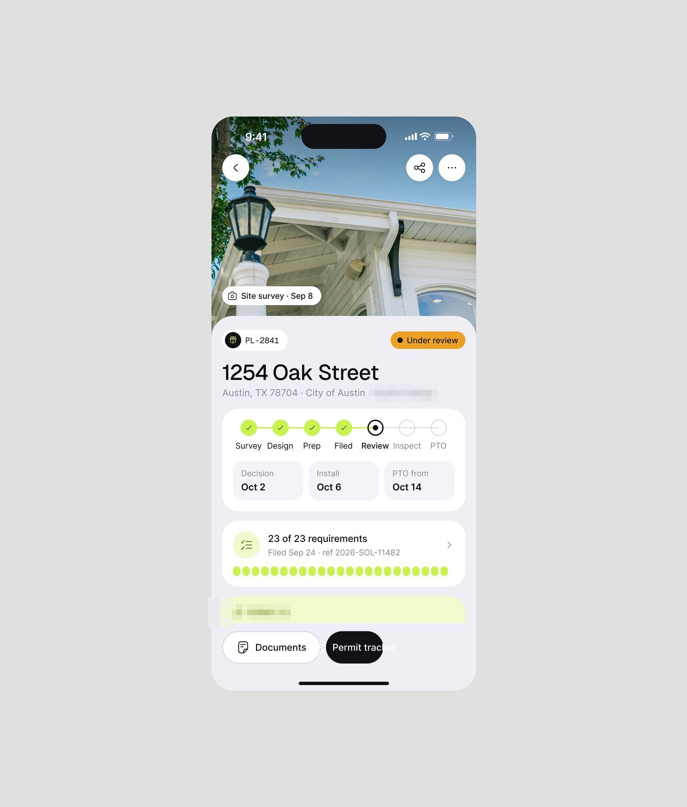
- Painel de licenciamento solar no iPhone: rastreio da licença com janela de revisão atrasada, etapas e o follow-up redigido pelo assistente de IA do licenciamento para revisar 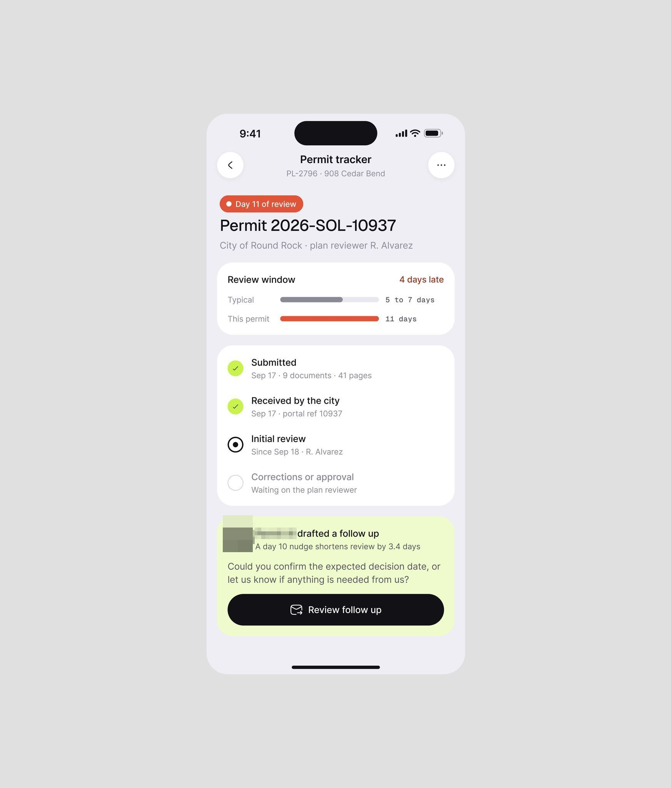
- Painel de licenciamento solar: "Good morning, [nome]" com o painel de notificações aberto, lista "Needs attention" ranqueada pelo assistente de IA do licenciamento e "Package compliance 94%" 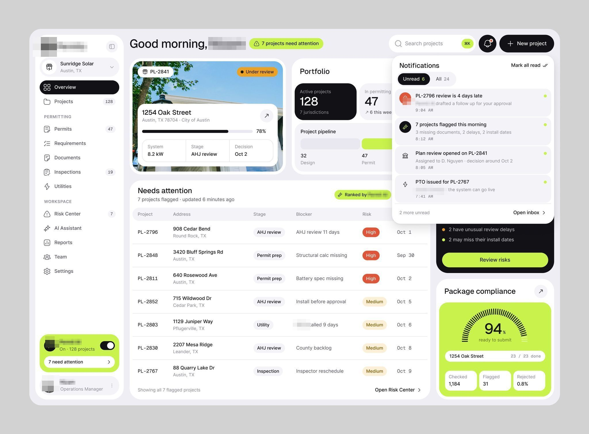
