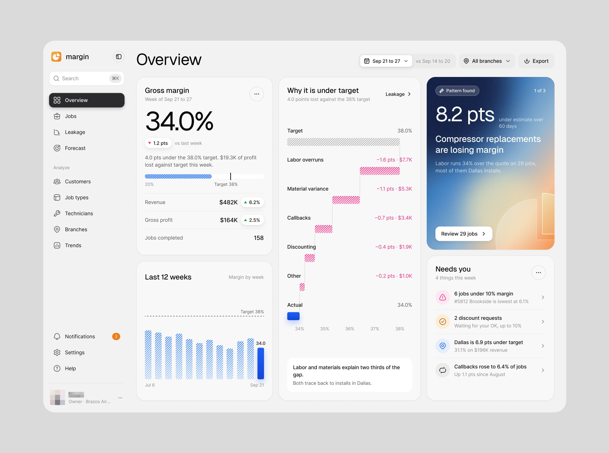
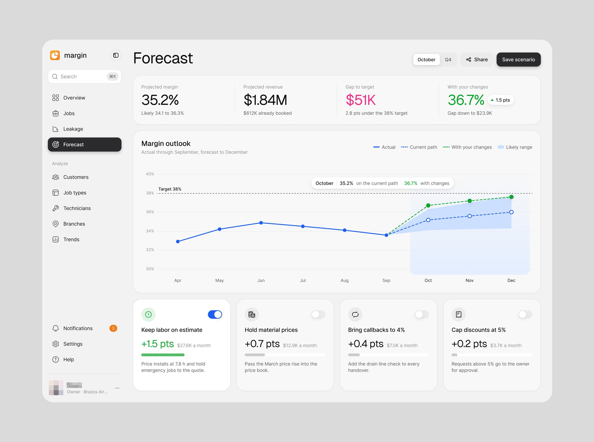

# Margin

**Margem de lucro de empresas de serviço, "design system editorial para software de finanças".**
3 peças em quatro dias, e a segunda peça mais vista do período: o vídeo *"Pixels, pills and profit:
an editorial design system for finance software"*, 78.239 views e 2.134 salvos. **[CONFIRMADO]**

| Campo | Valor |
|---|---|
| Setor | margem por trabalho de empresas de climatização e serviço residencial: vazamento de margem, filiais, técnicos, previsão |
| Para quem | o dono da empresa ("[nome] · Owner") |
| Tema | claro, cinza-claro `#F0F0F0` de página **[MEDIDO, amostra quantizada]** |
| Plataforma | web (Overview, Jobs, Leakage, Forecast) |
| Acento | logo laranja; rosa nas perdas (cascata, mapa de calor), verde nos ganhos, um cartão em degradê azul-laranja para o padrão achado; azul-acinzentado `#6C9CC0` nas barras **[MEDIDO, amostra quantizada]** |

## Telas publicadas

<!--T:Margin-->
| # | views | salvos | salvos/1k | mídia | legenda |
|---|---:|---:|---:|---|---|
| 1 | 19.698 | 335 | 17,0 | 1 img | Yoo, Not just pretty- the design is, but the distribution of information is super user-fri |
| 2 | 6.380 | 94 | 14,7 | 1 img | Forecast page uxui design! Want to take your product UXUI to the next level? |
| 3 | 78.239 | 2.134 | 27,3 | vídeo | Pixels, pills and profit: an editorial design system for finance software |
| **total** | **104.317** | **2.563** | **24,6** | | |
<!--/T-->

## O que cada tela tem

- **Overview** — margem bruta 34.0% contra a meta de 38% com a frase do que isso custa, a cascata
  **"Why it is under target"** com cada perda em rosa hachurado (labor overruns, material variance,
  callbacks, discounting), o cartão em degradê "Pattern found · 8.2 pts · Compressor replacements
  are losing margin" com "Review 29 jobs", e "Needs you" com a frase de cada caso.
  
- **Forecast** — quatro números do cenário (o que falta para a meta em rosa, o resultado com as
  mudanças em verde), a linha "Margin outlook" com o real, o caminho atual e o caminho com as
  mudanças, e quatro alavancas em cartão com chave ("Keep labor on estimate +1.5 pts").
  
- **Vídeo** — Overview, Jobs (158 trabalhos num gráfico de pontos por margem em torno da meta),
  Leakage ($82.4K, mapa de calor rosa por filial e mês, "Where to act first" em três cartões) e
  Forecast. Quadros em [../05-apresentacao/video-e-movimento.md](../05-apresentacao/video-e-movimento.md).

## O que a série ensina

- **Cada número de dinheiro vem com o "por quê" em gráfico ao lado** (cascata, mapa de calor), e a
  ação vem em cartão com o valor em pontos de margem.
- **"Editorial" = hierarquia de revista**: um número enorme por bloco, frase curta embaixo, uma
  cor de alerta (rosa) e o resto neutro.
- **Nome de design system na legenda do vídeo** ("an editorial design system for finance
  software") rendeu 2,7% de salvos por view, o maior do período.
