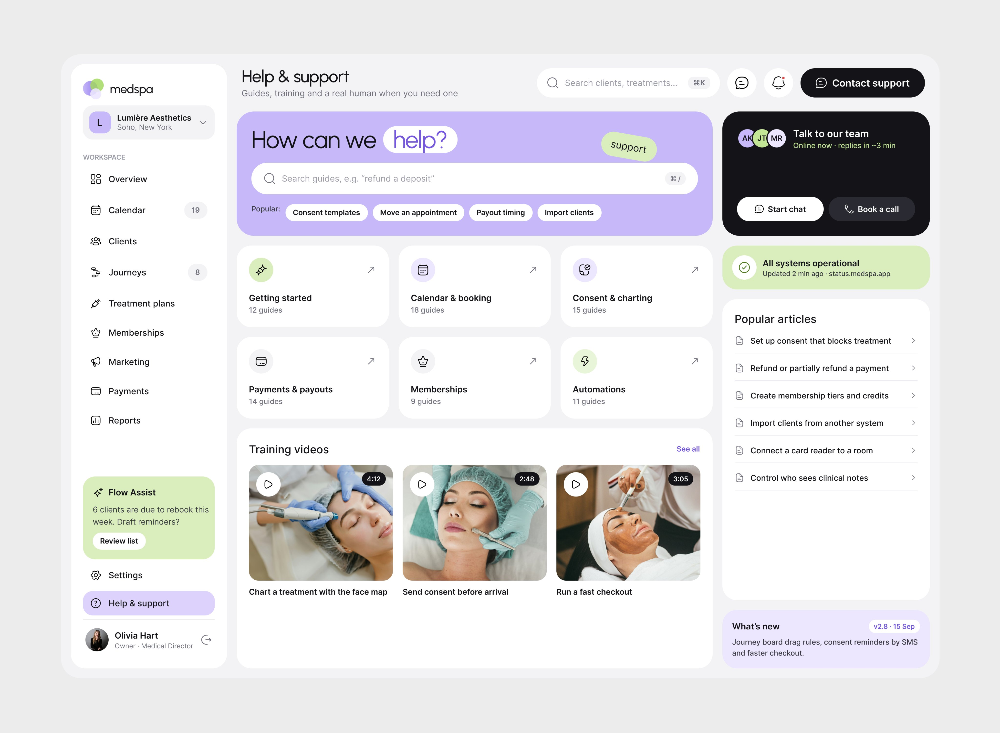
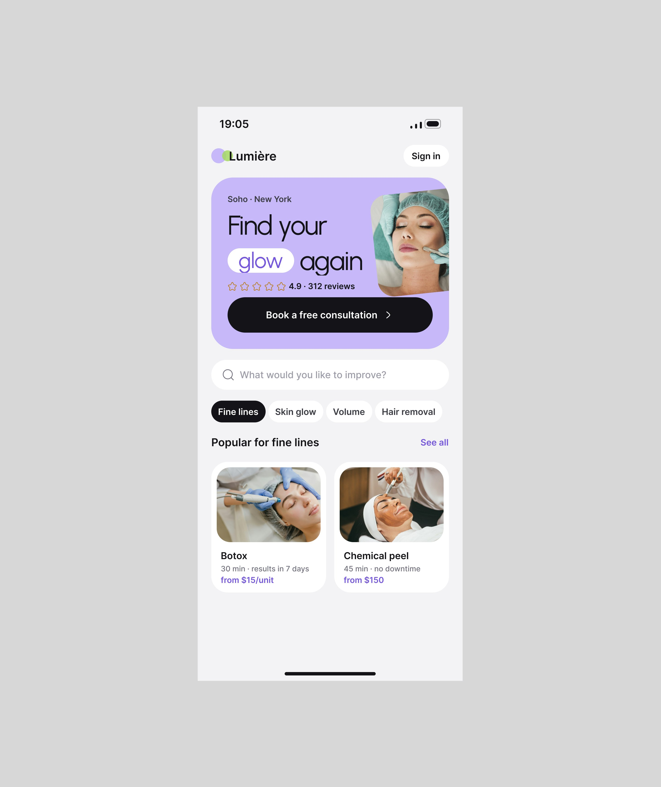
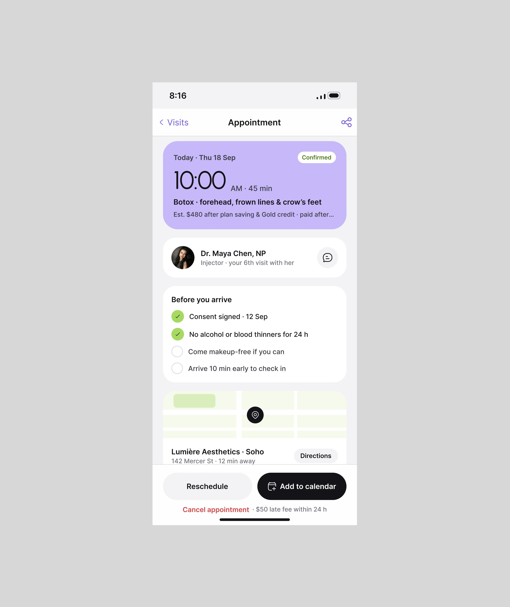
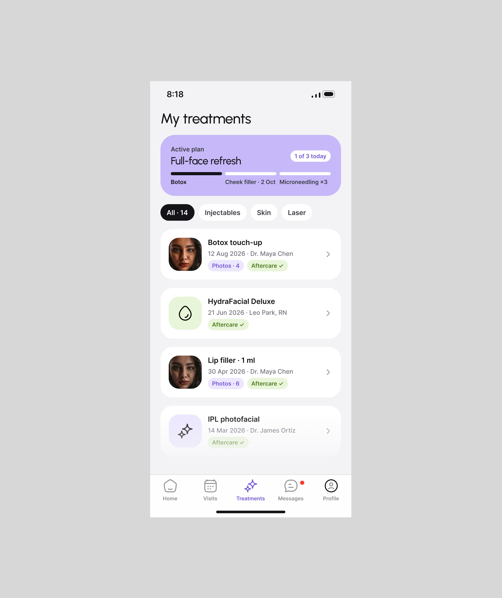
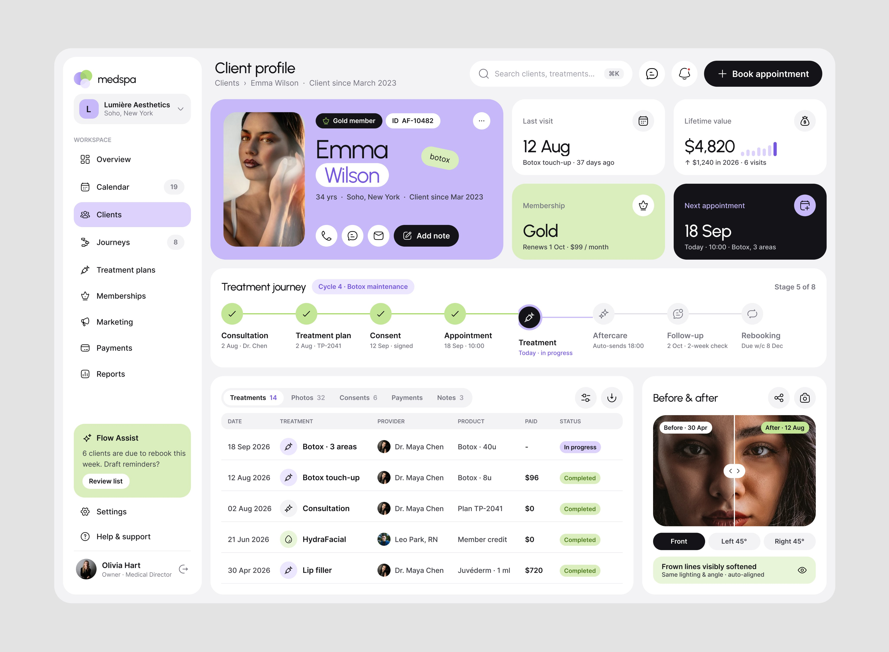
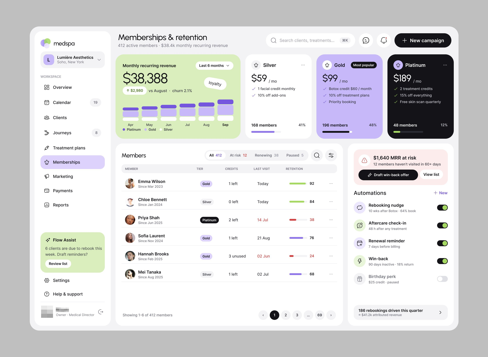

# Medspa (Lumière Aesthetics)

9 peças, 60.810 views, 598 salvos (9,8/1k). A legenda chama de
"AI-powered hospital management platform", mas a tela é de **clínica de
estética** (Botox, laser, preenchimento).

| Campo | Valor |
|---|---|
| Nome | medspa (logo: três círculos sobrepostos em lilás e verde); cliente "Lumière Aesthetics · Soho, New York" |
| Setor | clínica de estética: agenda, clientes, jornadas de tratamento, planos, memberships, marketing, pagamentos |
| Para quem | dona/diretora médica (web, "Olivia Hart · Owner · Medical Director") e a paciente (app, "Good morning, Emma") |
| Tema | claro; moldura cinza `#E4E4E4` **[MEDIDO]** |
| Plataforma | web (Reports) + mobile (app da paciente, 3 telas) |
| Acento | lavanda `#7556DF` (barras, KPI destacado, nav ativo lavanda claro) + verde-claro `#A5D962` (retenção, "Flow Assist") + amarelo no ponto de queda do funil **[MEDIDO]** |

## Telas publicadas

<!--T:Medspa-->
| # | views | salvos | salvos/1k | mídia | legenda |
|---|---:|---:|---:|---|---|
| 1 | 19.015 | 135 | 7,1 | 1 img | Report/analytic page for an AI-powered hospital management platform. |
| 2 | 12.863 | 119 | 9,3 | 3 img | Run your company smoothly... |
| 3 | 6.171 | 36 | 5,8 | 1 img | Unparlale suppr page UI design for medspa medical platform. |
| 4 | 3.610 | 38 | 10,5 | vídeo | I just want to show more screens I designed. Look at these. How clean the mobile app is de |
| 5 | 2.188 | 9 | 4,1 | 4 img | Mobile app design for doctor's booking! |
| 6 | 7.423 | 147 | 19,8 | 1 img | Wow, how clean and user-friendly the interface is! Client profile page UIUX design. MedSpa |
| 7 | 5.334 | 61 | 11,4 | 1 img | Client profile page design! |
| 8 | 1.669 | 7 | 4,2 | 4 img | Operating System for Aesthetic Clinics is about to done. |
| 9 | 2.537 | 46 | 18,1 | 1 img | Membership & Retention page design. |
| **total** | **60.810** | **598** | **9,8** | | |
<!--/T-->

## Navegação

Web: sidebar com seletor de clínica, WORKSPACE (Overview, Calendar 19, Clients,
Journeys 8, Treatment plans, Memberships, Marketing, Payments, Reports ativo em
lavanda), cartão verde "Flow Assist · 6 clients are due to rebook this week. Draft
reminders?" com botão "Review list", depois Settings e Help. Topo: "Reports",
busca com ⌘K, chat, sino, botão preto "Export report"; abas Overview / Revenue /
Retention / Providers / Marketing (ativa em pílula preta); filtros de período e
comparação ("vs Aug 2026").

App: tab bar de 5 ícones com rótulo (Home, Visits, Treatments, Messages, Profile),
ativo em lavanda.

## Módulos

| Tela | Conteúdo |
|---|---|
| Reports | 5 KPIs (Revenue $142,380, Average ticket, Rebooking rate em cartão lavanda, New clients, 90-day retention em cartão verde); Revenue by category (barras horizontais lavanda com variação); Provider utilisation (foto, nome, cargo, barra); Journey conversion (funil em barras verticais, a etapa com maior queda em amarelo com selo "Biggest drop: Plan → Consent"); Retention by first-visit month (heatmap de coorte em tons de lavanda) |
| App Home | cartão lavanda "Next appointment 18 Sep · Botox treatment" com selo inclinado verde "botox", médico, local e botão preto; "Your treatment journey" em checklist de etapas (Consultation, Plan, Consent, Treatment "Now", Aftercare bloqueado) |

## O que é específico deste setor

Negócio de recorrência: a pergunta é "a cliente volta?". Daí rebooking, retenção
por coorte, memberships e a IA sugerindo lembretes de remarcação. Tom de marca de
beleza: lavanda, nome da paciente em lavanda na saudação, selo "botox" inclinado.

## Como reproduzir

KPI destacado = cartão inteiro em cor de acento clara (lavanda `#C9BCF5`-ish ou
verde `#D5EFB5`-ish) com número preto; demais KPIs brancos. Heatmap em 5 tons da
mesma matiz. **[OBSERVADO]**

## Mais telas da série

O Medspa (Lumière Aesthetics) tem também telas de operação da clínica (perfil da cliente com o
comparador antes e depois, central de ajuda, assinaturas e retenção com "$1,640 MRR at risk" e "Draft
win-back offer") e o app do paciente completo (entrada "Find your glow again", consulta com o checklist
"Before you arrive", tratamentos, antes e depois com ângulos, notificações do Flow Assist com resposta
direta). Uma legenda dá o nome do produto: *"Operating System for Aesthetic Clinics is about to
done."*

