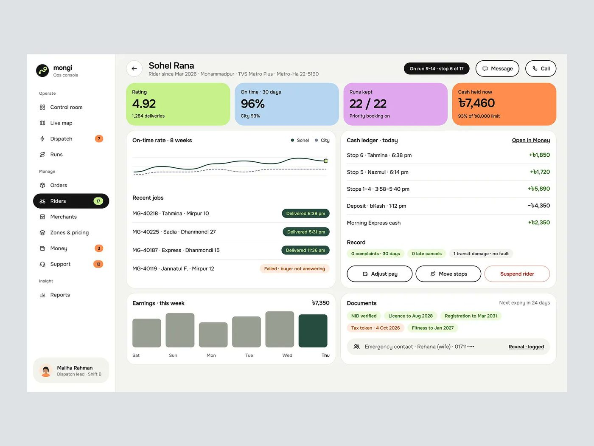
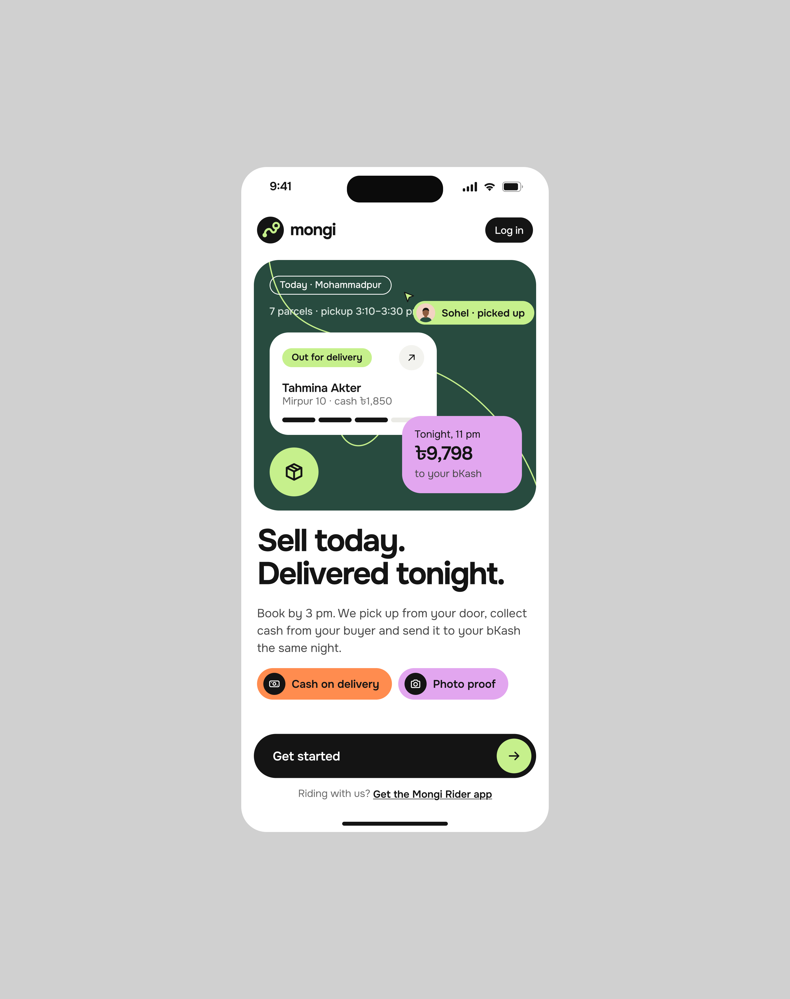
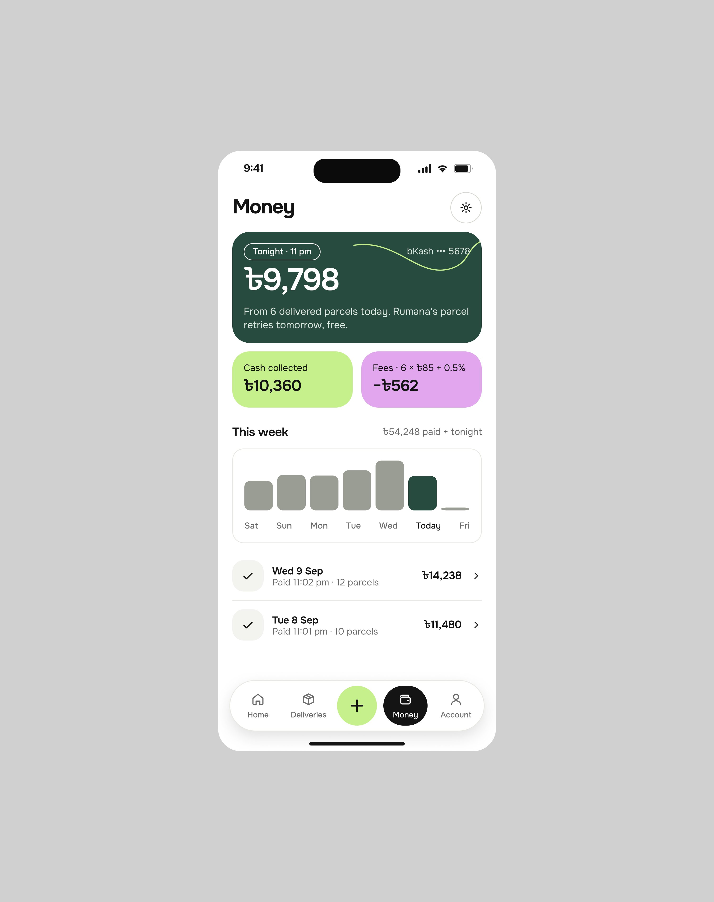

# Mongi

**O mobile mais salvo da amostra.** 8 peças, 86.747 views, 1.273 salvos (14,7/1k).
A peça "Turn your UI AI slop into production-ready design!" fez 62.896 views e 973
salvos.

| Campo | Valor |
|---|---|
| Nome | mongi (minúsculo, logo em círculo com rota) |
| Setor | entrega e logística para pequenos vendedores online em Bangladesh (moeda ৳, bairros Mirpur, Dhanmondi, pagamento bKash) |
| Para quem | o vendedor (app "Shuto & Co."), o entregador ("Mongi Rider app") e o despacho (console web) |
| Tema | claro; tela `#FFFFFF`, moldura `#E7E7E7` **[MEDIDO]** |
| Plataforma | mobile (vendedor) + web (Ops console) |
| Acento | verde-escuro `#24483C` (cartão "Today's run"), lime `#C6F08C` (payout, botão +), laranja `#FE8C4E` ("Needs you"), lilás `#E0A8F0` (avatar, bKash) **[MEDIDO]** |

## Telas publicadas

<!--T:Mongi-->
| # | views | salvos | salvos/1k | mídia | legenda |
|---|---:|---:|---:|---|---|
| 1 | 1.502 | 14 | 9,3 | vídeo | Delivery riding App design! |
| 2 | 62.896 | 973 | 15,5 | 3 img | Turn your UI AI slop into production-ready design! |
| 3 | 2.362 | 29 | 12,3 | 3 img | Ride and Enjoy |
| 4 | 892 | 6 | 6,7 | 3 img | Mongi, Delivery & Logistics Mobile App |
| 5 | 2.185 | 28 | 12,8 | 1 img | Mongi, A Modern Delivery Management Product |
| 6 | 1.784 | 25 | 14,0 | 4 img | Mongi, Delivery & Logistics Mobile App |
| 7 | 4.212 | 77 | 18,3 | 1 img | Mongi, A Modern Delivery Management Product |
| 8 | 10.914 | 121 | 11,1 | 3 img | Delivery Riding app! |
| **total** | **86.747** | **1.273** | **14,7** | | |
<!--/T-->

## Navegação

App: tab bar flutuante em pílula branca com 5 itens (Home, Deliveries, **+**
central em círculo lime, Money, Account); o item ativo vira pílula **preta** com
ícone e rótulo brancos. Cabeçalho com avatar colorido de iniciais ("S&"), nome da
loja, data e sino em círculo de borda.

Web (Ops console): sidebar com Operate (Control room, Live
map, Dispatch, Runs), Manage (Orders, Riders, Merchants, Zones & pricing, Money,
Support), Insight (Reports).

## Módulos

| Tela | Conteúdo |
|---|---|
| Home do vendedor | cartão verde "Today's run" (quem busca e quando, curva de rota em lime, 7 segmentos de progresso, o último laranja), dois cartões lado a lado (payout lime, "Needs you" laranja), lista "Ready for pickup" |
| Onboarding | "Sell today. Delivered tonight." com mapa ilustrado e chips "Cash on delivery", "Photo proof" |
| Money | saldo da noite em cartão verde, cash coletado e taxas, barras da semana |
| Nova entrega | formulário com "Filled from a pasted message" (IA lê o WhatsApp), escolha de tamanho em 3 cartões, velocidade |
| Ops console (rider) | 4 KPIs em cartões coloridos (lime, azul, lilás, laranja), linha de on-time, cash ledger, documentos |

## O que é específico deste setor

- Fala a língua do pequeno vendedor: "1 buyer hasn't confirmed", "If all 7 are
  delivered". Nenhum jargão de logística.
- Dinheiro em espécie é central (cash on delivery, cash ledger, "cash held now").
- Cartões grandes de cor chapada, cada cor com um papel (verde = rota, lime =
  dinheiro a receber, laranja = precisa de você).

## Performance

Nas sete primeiras peças, 75.833 views, 1.152 salvos, **15,2 salvos/1k**. A peça-vitrine
de uma tela sozinha sobre cinza (62.896) domina; os carrosséis de 3-4 telas ficaram entre
892 e 2.362 views.

## Como reproduzir

Tela 390 × 844; cartões com raio ≈28 px (em 390 de largura), gap 12 px, padding 16 px;
número de dinheiro ≈30 px semibold; tab bar pílula de 64 px de altura com sombra
suave.

## Mais telas da série

Mongi reaparece numa peça de três telas (*"Delivery Riding app!"*): a entrada "Sell today.
Delivered tonight.", a nova entrega **"Filled from a pasted message"** com Undo, e Money com o repasse da
noite.

