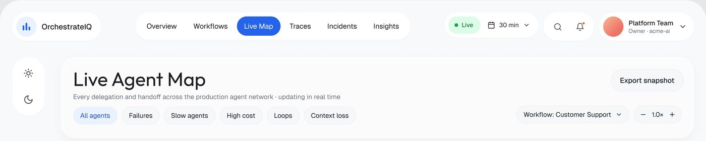
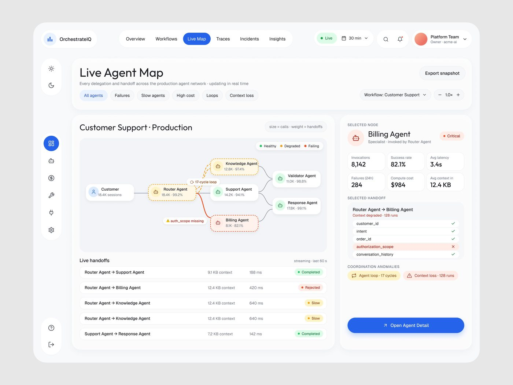
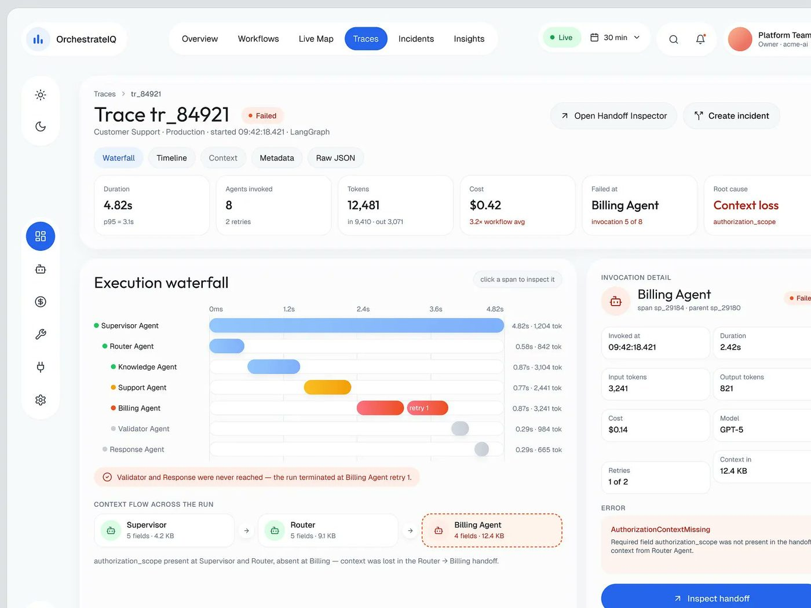
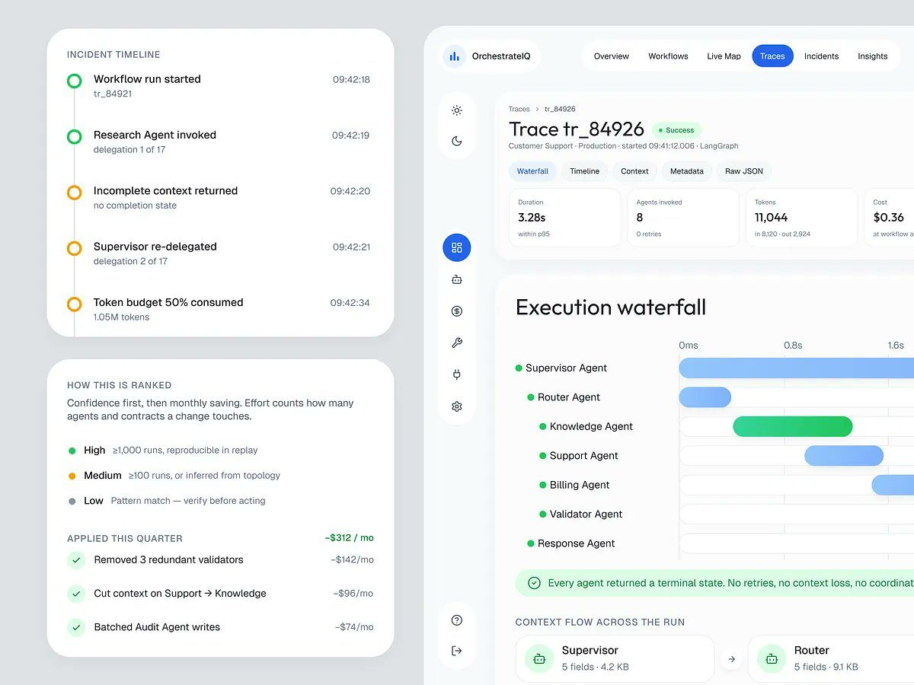
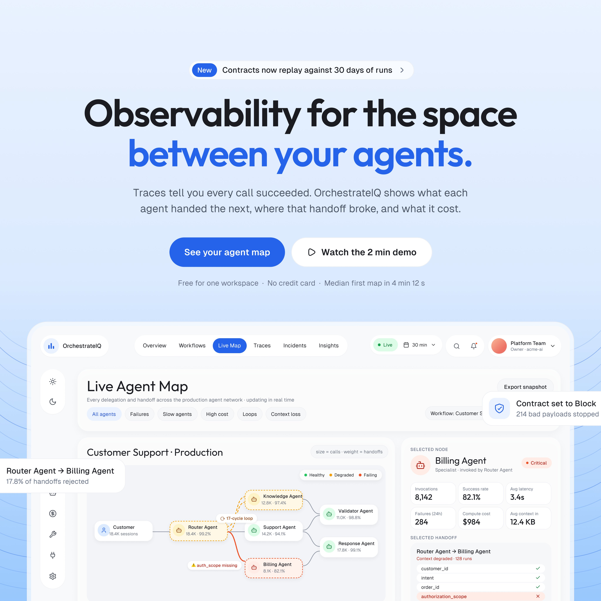
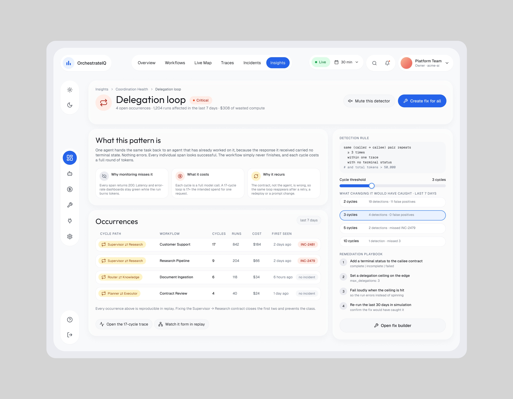
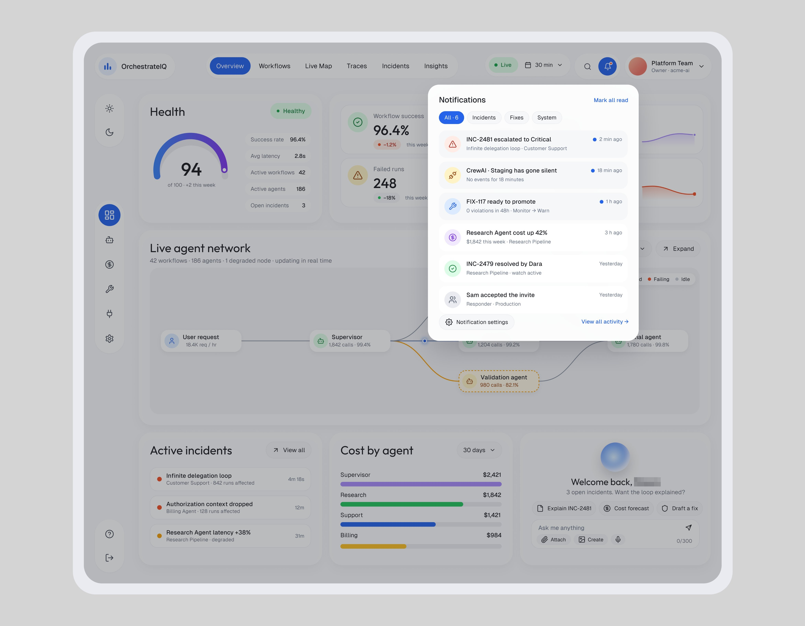
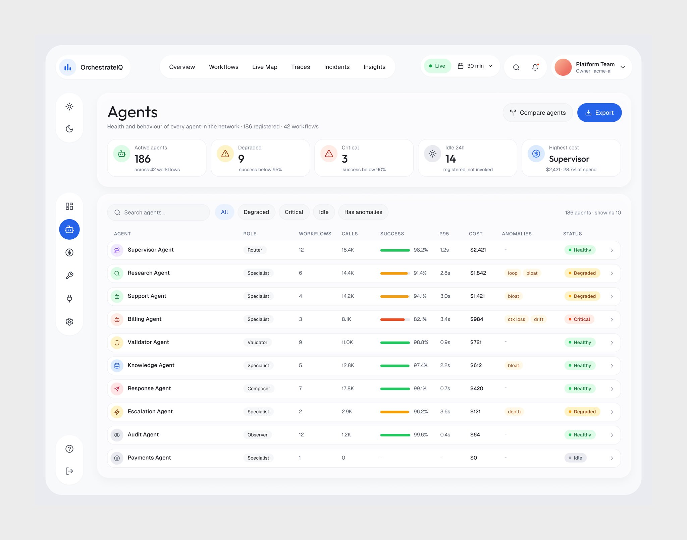
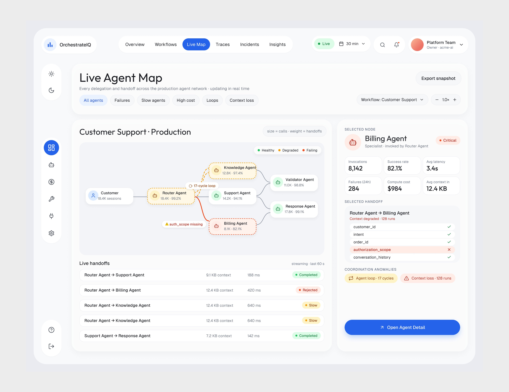

# OrchestrateIQ

**A série mais vista da amostra.** 31 peças, 408.580 views, 3.693 salvos. Contém a
peça nº 1 da amostra (vídeo, 90.913 views) e a nº 3 em imagem (78.682 views, 865
salvos).

| Campo | Valor |
|---|---|
| Nome | OrchestrateIQ (legenda: "OrchestrateIQ, AI Agent Management Product") |
| Setor | observabilidade e gestão de agentes de IA em produção |
| Para quem | time de plataforma que roda vários agentes (o avatar diz "Platform Team · Owner · acme-ai"); nos vídeos o caso é governança hospitalar ("Ai Agent for hospital governance") |
| Tema | claro, fundo da página `#F8F9FB`, cartões `#FFFFFF` **[MEDIDO]** |
| Plataforma | web desktop (1440) |
| Acento | azul `#2864E9` (aba ativa, rail ativo, botão principal) **[MEDIDO]** |
| Cores de status | verde `#30D08A`, roxo `#A279DF`, azul-claro `#8CB7FB`, amarelo `#F8D043` (cartão "Do first") **[MEDIDO]** |

## Telas publicadas

<!--T:OrchestrateIQ-->
| # | views | salvos | salvos/1k | mídia | legenda |
|---|---:|---:|---:|---|---|
| 1 | 90.913 | 188 | 2,1 | vídeo | Ai Agent for hospital governance. |
| 2 | 5.219 | 114 | 21,8 | vídeo | AI agent monitoring.. |
| 3 | 78.682 | 865 | 11,0 | 1 img | Enjoyable Saas UI that makes UX smoother... |
| 4 | 21.452 | 375 | 17,5 | 1 img | Live agent Map |
| 5 | 3.706 | 60 | 16,2 | 1 img | AI agents that help to run the hospital efficiently. |
| 6 | 31.458 | 79 | 2,5 | 1 img | OrchestrateIQ , AI Agent Management Product |
| 7 | 29.225 | 294 | 10,1 | 1 img | Turn your shitty AI slop into production-ready design. |
| 8 | 2.353 | 36 | 15,3 | 1 img | OrchestrateIQ, AI Agent Management Product |
| 9 | 1.400 | 13 | 9,3 | 1 img | OrchestrateIQ, AI Agent Management Product |
| 10 | 1.382 | 10 | 7,2 | 1 img | OrchestrateIQ , AI Agent Management Product |
| 11 | 1.911 | 17 | 8,9 | 1 img | OrchestrateIQ , AI Agent Management Product |
| 12 | 22.088 | 70 | 3,2 | 1 img | OrchestrateIQ , AI Agent Management Product |
| 13 | 4.340 | 32 | 7,4 | 3 img | I made this software with pure joy! |
| 14 | 17.374 | 252 | 14,5 | 3 img | Organized information that helps to take action without cognitive load |
| 15 | 5.697 | 108 | 19,0 | 1 img | OrchestrateIQ , AI Agent Management Product |
| 16 | 18.492 | 277 | 15,0 | vídeo | What should an agentic platform interface UI look like?  Look at this  |
| 17 | 2.825 | 18 | 6,4 | 1 img | Data Coverage screen interface..  How clean and focused the hierarchy  |
| 18 | 1.262 | 8 | 6,3 | 1 img | Experimenting with the Markeitng site/ landing page deisgn. |
| 19 | 16.809 | 131 | 7,8 | 1 img | Billing Agent page UI Design. |
| 20 | 6.679 | 108 | 16,2 | 1 img | Delegation loop page.. UI Design. Couldn't be cleaner and better! |
| 21 | 7.501 | 109 | 14,5 | 1 img | Not an overwhelming notification pop-up design, right? |
| 22 | 1.241 | 15 | 12,1 | vídeo | (legenda fora do assunto: trata a IA como assunto; os quadros do vídeo estão na seção 05) |
| 23 | 12.294 | 228 | 18,5 | vídeo | Ai agent management product UXUI design! Top-performing product . |
| 24 | 1.927 | 17 | 8,8 | 1 img | A Smarter Interface For AI Operations. |
| 25 | 4.218 | 46 | 10,9 | 1 img | Rate this design. 10 / ? |
| 26 | 6.306 | 59 | 9,4 | 1 img | Agent management product uxui design! |
| 27 | 2.682 | 30 | 11,2 | 1 img | How is this table design? Did I cook? |
| 28 | 2.729 | 39 | 14,3 | 1 img | Clean UI design for better user experience! |
| 29 | 2.888 | 44 | 15,2 | vídeo | Ai agent management product design! How about your product? |
| 30 | 3.427 | 51 | 14,9 | 1 img | Agent Delegation Loop interface design. |
| 31 | 100 | 0 | 0,0 | 1 img | Agentic software designed. How's that UI? |
| **total** | **408.580** | **3.693** | **9,0** | | |
<!--/T-->

## Navegação

Duas camadas, **as duas flutuando** como peças separadas sobre o fundo:

1. **Topo em pílulas**: logo em pílula própria à esquerda; pílula central com
   6 abas (Overview, Workflows, Live Map, Traces, Incidents, Insights), a ativa
   preenchida de azul; à direita, pílula "● Live" + seletor "30 min", pílula de
   busca e sino, e pílula do usuário com avatar em gradiente coral.
2. **Rail vertical só de ícones** à esquerda (≈66 px de largura em tela
   1440) **[MEDIDO]**, dividido em três ilhas: tema claro/escuro no alto,
   6 ícones de seção no meio (o ativo é um círculo azul cheio), ajuda e sair
   no pé.

## Módulos / telas

| Tela | O que tem |
|---|---|
| Overview "We found your system" | linha do tempo de agentes (5 linhas × 15 colunas de 15 s), barras de estado coloridas com pílula "Healthy/Pending", colunas hachuradas = tempo sem dado; embaixo 3 cartões: Next steps (cartão amarelo "Do first"), Detected (4 contadores com % de confiança), assistente "Welcome, [nome]" com orbe azul e perguntas sugeridas |
| Live Agent Map | grafo de agentes (nós = cartões com nome, chamadas e % sucesso; borda tracejada amarela = degradado, vermelha = falhando), filtros em pílula (Failures, Slow agents, High cost, Loops, Context loss), tabela "Live handoffs" e painel lateral do nó selecionado (6 KPIs, checklist de campos do handoff com o faltante em vermelho) |
| Trace | 6 KPIs no topo (Duration, Agents invoked, Tokens, Cost, Failed at, Root cause), waterfall de execução, fluxo de contexto entre agentes, painel "Invocation detail" com erro |
| Incident timeline | linha do tempo vertical com círculos verde/amarelo, "How this is ranked", economias aplicadas no trimestre |
| Overview com gauge | gauge "Health 94", 4 KPIs com sparkline, grafo "Live agent network" |
| Data Coverage | tela de cobertura de dados |
| Cartões soltos | cartões pequenos isolados em close ("Organized information… although they are small cards") |

## Componentes-chave

- **Linha do tempo de agentes** com coluna "agora" em azul cheio e linha
  tracejada vertical descendo dela; barras de estado com ícone em círculo branco
  à esquerda e pílula de status branca à direita.
- **Célula hachurada** (listras diagonais cinza `#EAEAF2`) para "sem evento".
- **Cartão "Do first"** amarelo: a única superfície de cor chapada da tela,
  reservada para a ação prioritária.
- **Orbe de assistente** (esfera azul com gradiente) + saudação em 2 linhas
  centralizadas + chips de ação + perguntas sugeridas com ícone de brilho roxo.
- **Pílula de confiança** ("92% confidence", "2 unverified") sob cada contador:
  a IA diz o quanto tem certeza.
- **Cartões destacados ao lado da tela** (a composição do shot de Traces): a linha do
  tempo do incidente, com bolinha verde ou âmbar e hora em coluna, e o "How this is
  ranked", que explica o critério da IA (High ≥1.000 runs, Medium ≥100, Low "verify
  before acting") e soma a economia já aplicada ("−$312 / mo").

## O que é específico deste setor

O produto responde "o que meus agentes estão fazendo agora e onde quebrou".
Por isso quase toda tela tem **tempo** (linha do tempo, waterfall, "streaming ·
last 60 s") e **causa raiz nomeada** ("Context loss · authorization_scope").
Vocabulário técnico de verdade (handoff, context KB, tokens, LangGraph, GPT-5)
aparece sem explicação: o público é engenheiro. **[OBSERVADO]**

## Performance

- Nas 17 primeiras peças, **338.517 views, 2.808 salvos, 8,3 salvos/1k**.
- Os 2 maiores (90.913 e 78.682) usam texto genérico ou de caso ("Ai Agent
  for hospital governance", "Enjoyable Saas UI…"). O 3º (31.458) e o 5º (22.088) levam só o nome
  do produto ("OrchestrateIQ , AI Agent Management Product"). As 7 peças com o
  nome na legenda têm mediana de 2.353 views; as 10 com gancho ou texto genérico,
  17.933 (17.374 sem os 3 vídeos) **[MEDIDO]**.
- Vídeos: 3 das 17 peças; o vídeo "Ai Agent for hospital governance." é a maior peça da amostra.

## Como reproduzir

- Tela 1440 × 1080, fundo `#F8F9FB`, cartões brancos com raio ≈24 px e
  padding ≈24-32 px, sem sombra (ou sombra muito difusa só no orbe).
- Topo em pílulas brancas de altura ≈48 px, raio total; aba ativa `#2864E9`
  com texto branco.
- Rail de ícones de 64-68 px em ilhas brancas arredondadas.
- Título da tela em ≈36-40 px, peso regular (não bold), subtítulo cinza ≈14 px.
- Status: verde `#30D08A`, roxo `#A279DF`, azul `#8CB7FB`, amarelo `#F8D043`,
  vermelho só para falha.

## Mais telas da série

Nas 14 peças seguintes (mais 2 de cartões de recurso no mesmo traço), o OrchestrateIQ ganha a
**landing quadrada** (4096×4096) "Observability for the space
between your agents.", a comparação de contexto do handoff Router → Billing campo a campo, o padrão
"Delegation loop" com a regra de detecção e o limiar, o popup de notificações, a tabela de agentes, o
trace com a cascata de execução, o mapa vivo, o Cost Intelligence apresentado sobre cena cinza com
formas em perspectiva, e dois vídeos (o de lançamento com título cinético e o de clique do mapa ao
trace). Três cartões de recurso isolados (Cost per edge, Replay on 30 days, Loop detection) viram peça
própria e um deles, vídeo de 4:5.

