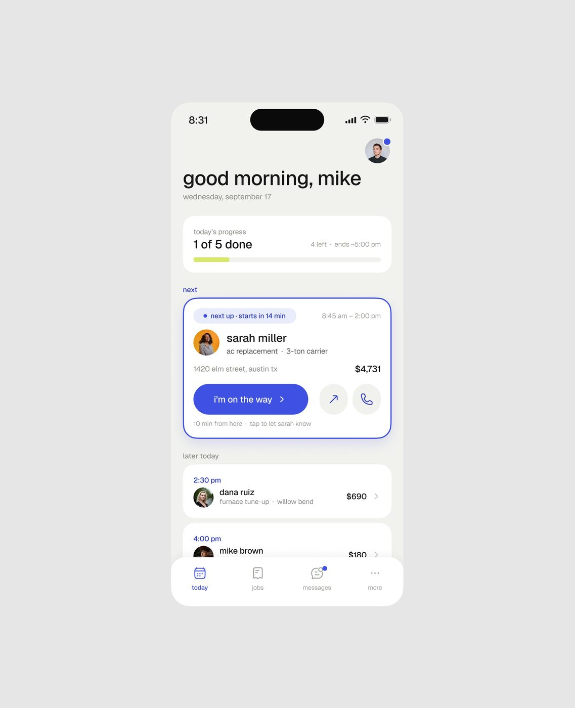
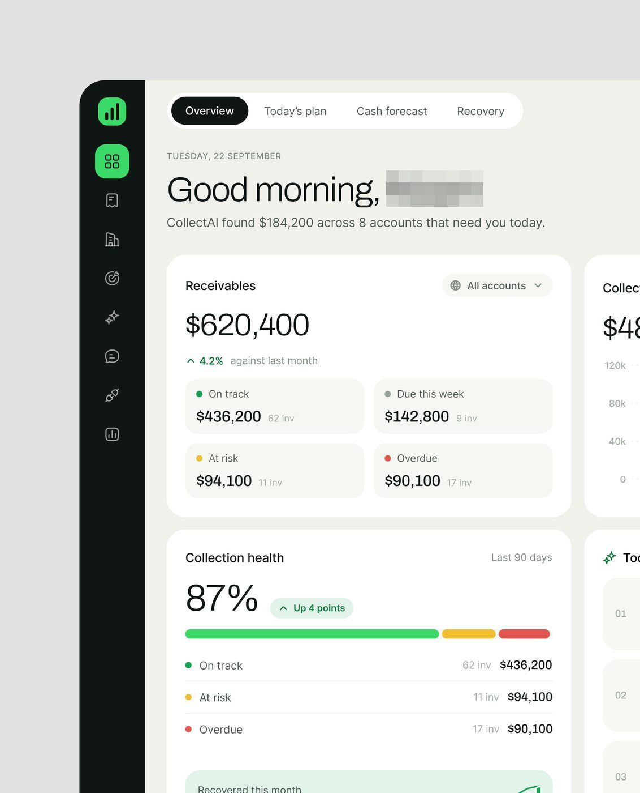
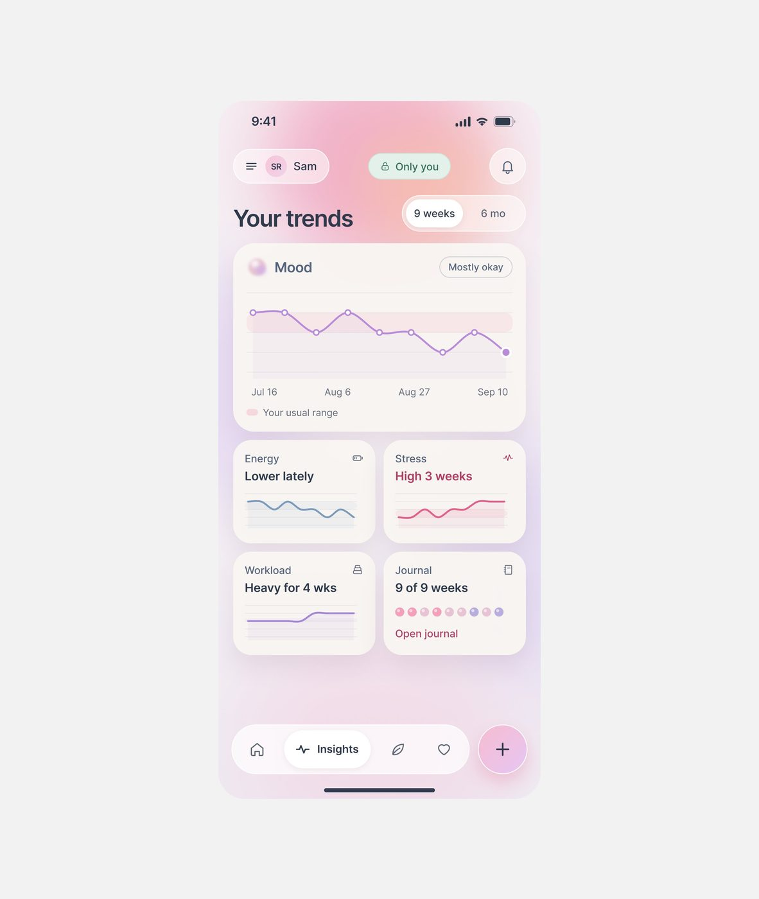
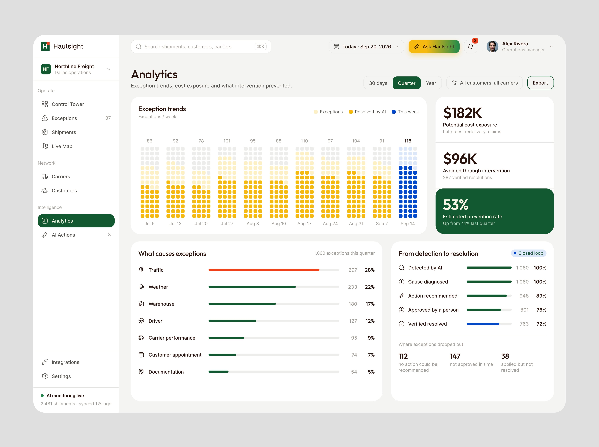
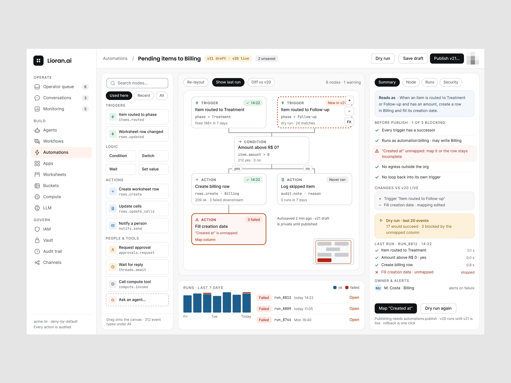
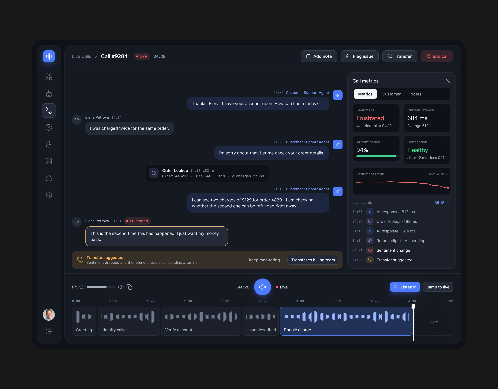
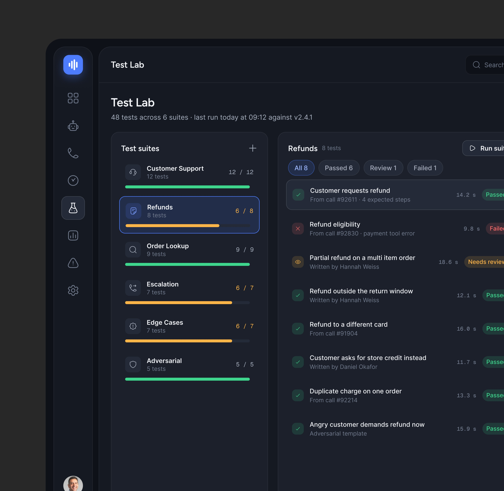
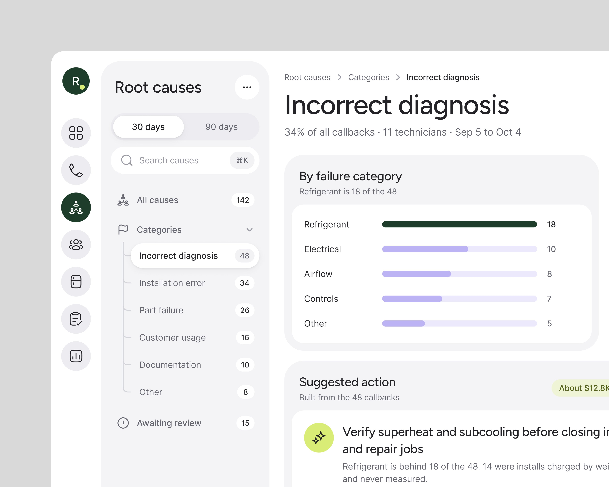
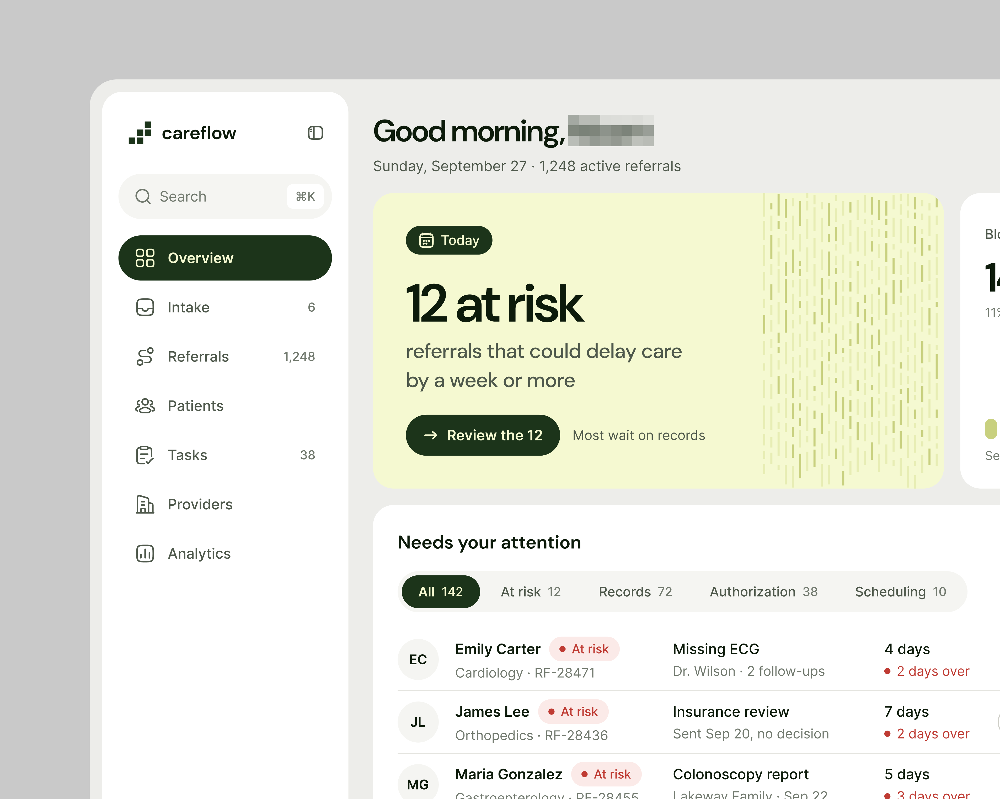
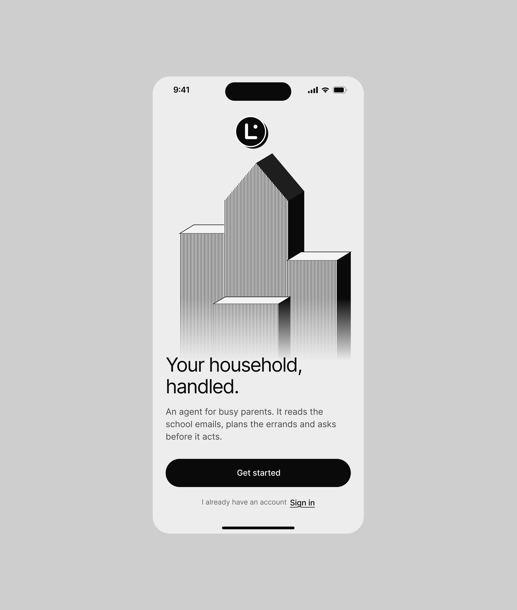

# Outros produtos: séries menores, peças únicas e sites

Fichas curtas. Produto = marca identificada pelo logo; "site" = landing de
marketing (a estrutura das landing pages está em
[../04-tipos-de-tela/landing-page.md](../04-tipos-de-tela/landing-page.md)).
Acento = matiz saturada dominante **[MEDIDO]** sobre todos os pixels com
saturação > 0,4 das imagens do produto.

## Produtos de 1 peça que valem registro

| Produto | Legenda | Views / salvos | Setor | O que tem de próprio |
|---|---|---|---|---|
| **Haulsight** | "Track your fleet! AI-powered fleet management app." | 13.342 / 265 (19,9/1k) | frota e frete (Texas) | mapa claro ocupando o conteúdo com caminhões em círculos laranja e nota de risco, cartão flutuante do frete "#2048 Dallas → Austin, Likely to miss the 4:00 PM delivery window", lista "Critical now" com barras de sinal, previsão "21 delivery windows at risk" em heatmap laranja; verde-escuro `#185D37` + amarelo `#F6B910`  |
| **Contractor app** | "Contractor Mobile app" | 10.505 / 125 | técnico de campo (HVAC, Austin) | "good morning, mike" **todo em minúsculas**, "1 of 5 done", cartão do próximo job com borda azul `#3F51E3` e botão "i'm on the way", jobs do dia com valor  |
| **CollectAI** | "What if fintech UI didn't look like traditional flashy fintech? … Less noise. Better hierarchy." | 7.377 / 173 (23,5/1k) | cobrança/contas a receber | rail escuro de ícones com o ativo em verde `#3BD968`, abas Overview / Today's plan / Cash forecast / Recovery, "CollectAI found $184,200 across 8 accounts", Receivables $620,400 em 4 quadrantes (On track, Due, At risk, Overdue), barra tricolor de saúde  |
| **Fino** | "an AI cash layer built for small service businesses" | 1.716 / 10 | caixa de pequeno prestador | 2 imagens |
| **AdStudio** | "Marketers designed this masterpiece for you!" (vídeo e imagem) | 3.028 / 25 | marketing criativo com IA | escuro, "Brand Brain" com DNA da marca em barras, "Generating concepts" com progresso |
| **ComplianceFlow** | (nome do produto) | 1.400 / 9 | compliance de IA | 1 tela |
| **Lora** | (nome do produto) | 623 / 3 | gestão doméstica com IA (mobile) | 3 telas |
| **App de bem-estar "Your trends"** | (a exceção de estilo) | 206 / 2 (horas) | saúde mental/emocional | ver abaixo |

### O app de bem-estar: a exceção declarada

A própria publicação o marca como fora do padrão (uma direção de UI diferente da
habitual) **[CONFIRMADO]**. Diferenças medidas contra as telas de
produto do método:

- Fundo em **gradiente rosa → lavanda** atrás dos cartões (gradiente de fundo em
  tela de produto quase não aparece no método).
- Cartões brancos translúcidos com cantos muito arredondados, sem borda.
- Linguagem de sentimento em vez de número: "Mood · Mostly okay", "Energy · Lower
  lately", "Stress · **High 3 weeks**" (em vermelho), "Workload · Heavy for 4 wks",
  "Journal · 9 of 9 weeks".
- Faixa rosa "Your usual range" atrás da linha: compara a pessoa com ela mesma,
  não com meta.
- Pílula de privacidade verde "🔒 Only you" no topo; tab bar com "Insights" ativo
  e botão "+" rosa.

Outros dois apps de saúde mental seguem a mesma direção suave: "Mental health
mobile app" (vídeo, 1.406 views) e um app "for Women" (1.021 views).

## Séries pequenas mais recentes

Da lista acima, três viram série e têm ficha: **CollectAI** ([collectai.md](collectai.md)),
**AdStudio** ([adstudio.md](adstudio.md)) e o **Contractor app**, que é o mesmo traço do
**Quotepilot** ([quotepilot.md](quotepilot.md)). O **Haulsight** tem mais uma peça. Produtos de 1 a 3
peças:

| Produto | Peças | Views / salvos | Setor | O que tem de próprio |
|---|---|---|---|---|
| **Haulsight** | 1 *"Designing explainable Saas AI product for logistics: exception detail and approval flow. BTW, how does this analytics look?"* | 5.015 / 92 | frota e frete | Analytics de exceções com pontos empilhados por semana (amarelo exceção, azul resolvida pela IA), três números de dinheiro com o verde "53% estimated prevention rate" e o funil "From detection to resolution" (detectado pela IA → verificado) |
| **Lioran.ai** | 3, em cinco dias | 26.435 / 411 | automação de processo (homologação de fornecedor, cobrança) | o mesmo traço do Ergond (sidebar OPERATE / BUILD / GOVERN, ferrugem `#C03C0C` **[MEDIDO, amostra quantizada]**): construtor com "Draft with AI", pipeline de fases e automações gatilho → condição → ação, histórico de versões com quem mudou (pessoa ou agente) e "Roll back to v11", e o construtor com "Dry run · last 20 events" e a checagem antes de publicar ("1 of 5 blocking") |
| **Plataforma de agentes de voz** (sem nome no shot) | 3, em oito dias | 4.242 / 16 | operação de atendimento por voz | escuro `#0C1818` com azul `#4878FC` **[MEDIDO, amostra quantizada]**: chamada ao vivo com a onda do áudio dividida por etapa da conversa, "Transfer suggested · Sentiment dropped" que depois vira "Transferred to Billing team"; Test Lab com suítes e "last run today against v2.4.1" |
| **Callbacks** (marca não aparece) | 2, no mesmo dia | 22.797 / 546 | retornos de serviço de climatização | lima-oliva `#D8E46C` **[MEDIDO, amostra quantizada]**; Root causes "Incorrect diagnosis · 34% of all callbacks" com "Suggested action · Built from the 48 callbacks"; o vídeo (*"Home service product design is getting new shape. This one is not in a traditional style."*, 20.327 views) mostra Overview, Open callbacks, Root causes e Actions com "Roll out to Dallas and Houston" |
| **Careflow** | 1 | 2.052 / 23 | encaminhamento de pacientes | cartão verde-claro com hachura "Today · 12 at risk — referrals that could delay care by a week or more" e "Review the 12" |
| **Lora** | 1 *"Mobile Onboarding Design."* | 2.564 / 18 | agente doméstico (celular) | entrada "Your household, handled." com casa em blocos 3D preto e branco; "Signing in gives Lora no access"; "Lora plans first, then asks, then does." com a lista "Lora never" |

Telas: Haulsight
,
Lioran.ai

,
agentes de voz

,
Callbacks
,
Careflow
,
Lora

.

## Séries de produto do degrau genérico (2+ peças)

| Produto | Peças | Views | Salvos | Setor | Acento | Tema | Plataforma | Peça mais vista |
|---|---:|---:|---:|---|---|---|---|---|
| Fingem | 2 | 36.984 | 126 | finanças pessoais | lime `#EDFF8E` + rosa | claro e escuro | mobile | "which UI Design is better A or B?" (36.242) |
| Fithive | 19 | 9.288 | 51 | fitness social | lime `#C0D24B` | escuro | mobile + site | (1.014) |
| Oyfile | 12 | 8.634 | 34 | gestão de arquivos na nuvem | lime `#EDFF8D` | escuro | mobile | "Wireframe to UI" (3.631) |
| Hotel booking app | 11 | 7.388 | 20 | reserva de hotel | verde `#12E47F` | claro | mobile | (3.166) |
| Averon | 11 | 5.887 | 47 | energia limpa | azul-céu `#64B0F3` | claro | site | (1.059) |
| Automax | 6 | 3.372 | 14 | automação de workflow | lime `#E2F754` | escuro | web | (1.378) |
| HR mobile | 2 | 3.313 | 6 | RH | neutro | escuro | mobile | (2.084) |
| LensLedger | 2 | 741 | 1 | SaaS financeiro | neutro | escuro | web | |
| Ecolife | 3 | 1.035 | 3 | plantas / eco | amarelo `#FFF772` | claro | mobile | |

## Sites de marketing (templates de site)

Quase todos assinados no rodapé por quem fez, com "Powered by Webflow".

| Site | Peças | Views | Salvos | Nicho | Acento | Tema | Peça mais vista |
|---|---:|---:|---:|---|---|---|---|
| Consul / Konsal | 9 | 17.175 | 164 | consultoria | amarelo `#FEF08D` sobre creme `#F9F0E7` | claro | "consul full page" (13.672) |
| Valtro | 17 | 15.738 | 152 | CRM | creme `#F3F0EA` + preto `#0F0F0F`, moldura amarela | escuro/claro | (2.272) |
| Marqor | 16 | 13.599 | 98 | gestão de projetos | roxo `#270C64` sobre lavanda | claro | "Bento Card" (2.537) |
| Sivoro | 9 | 13.284 | 144 | finanças de startup | creme `#FCF9F3` + pêssego `#FFCC5F` | claro | "Pricing page" (3.488) |
| Grovix | 9 | 10.763 | 74 | vendas (SaaS) | roxo `#9379FF` + pêssego | claro | (5.663) |
| Meetzi | 11 | 10.735 | 80 | evento/conferência | rosa `#F47EF0` + azul `#3955F8` sobre creme `#FCF6F0` | claro com blocos pretos | "meetzi full page" (6.606) |
| Hulax | 9 | 10.372 | 112 | energia solar | lime `#E5FC54`-ish + oliva `#729710` | claro com blocos pretos | "Did we cooked?" (5.573) |
| Torivo | 3 | 8.024 | 47 | gestão de vendas | índigo `#23237D` | escuro | "Torivo full page" (7.100) |
| Glirix | 14 | 6.954 | 36 | agência | vermelho-coral `#F15D43` | claro | (1.131) |
| Riquro | 11 | 6.654 | 38 | RH | lavanda `#998AF8` | claro | (1.207) |
| Optiro | 9 | 5.346 | 19 | agente de IA | verde `#318858` | escuro | (1.763) |
| Inkrow | 8 | 4.330 | 14 | blog/agência | oliva `#4F5E1B` + amarelo | claro | (781) |
| Progra.ai | 8 | 4.212 | 23 | IA para código | laranja-queimado `#6D2308` | escuro | (1.119) |
| Saaftix | 8 | 4.010 | 23 | fintech | roxo `#573A97` | escuro | (1.281) |
| Rovoxa | 6 | 3.973 | 28 | chatbot IA | verde-lima `#95AE50` | escuro | (2.550) |
| David Laid | 6 | 3.546 | 2 | portfólio pessoal | azul-marinho `#474C84` | claro | (1.580) |
| Pixaly | 7 | 3.470 | 14 | geração de imagem IA | índigo `#38347A` | escuro | (779) |
| Turex | 4 | 3.098 | 25 | transporte marítimo | azul `#3492B8` (foto) | claro | (1.931) |
| Interior "R" / Retirio | 5 | 2.548 | 6 | design de interiores | pêssego `#E8A481` | claro | (1.015) |
| Builda | 2 | 2.060 | 9 | construção | marrom `#7A4D2B` | claro | (1.267) |
| Nutivo | 3 | 1.685 | 9 | nutrição | oliva `#B0BC15` | claro | |
| Verzan | 2 | 1.667 | 6 | agência | lime `#819A35` | escuro | |
| Veko | 8 | 1.616 | 2 | agência | laranja `#FC9C54` sobre marrom | escuro quente | |
| Houset | 2 | 1.481 | 4 | imobiliário | azul-céu `#6BAAE0` | claro | |
| Orixo | 4 | 773 | 3 | coach | marrom + amarelo | claro | |
| Orbivo, Doclun, Daxory, OrinixLab, Rystro | 2 cada | < 1.000 | ≤ 6 | vários | vários | vários | |

## O que esta lista mostra

- **Site de marketing rende pouco salvo.** A mediana de salvos/1k dos sites é
  ≈6, contra 14-21 das séries de produto. A exceção é Consul (9,5) com uma única
  "full page" de 13.672 views.
- **O formato "full page 👀 What do you think?"** (página inteira em 2 colunas
  lado a lado, dentro de moldura de monitor arredondada) é o formato de vitrine do
  site: Consul, Meetzi, Torivo, Grovix, David Laid, Glirix, Builda, Orixo, Turex.
- Quando o trabalho vira produto, o site sai de cena como peça principal e as
  séries de produto tomam o lugar. **[OBSERVADO]** pela distribuição das peças.
