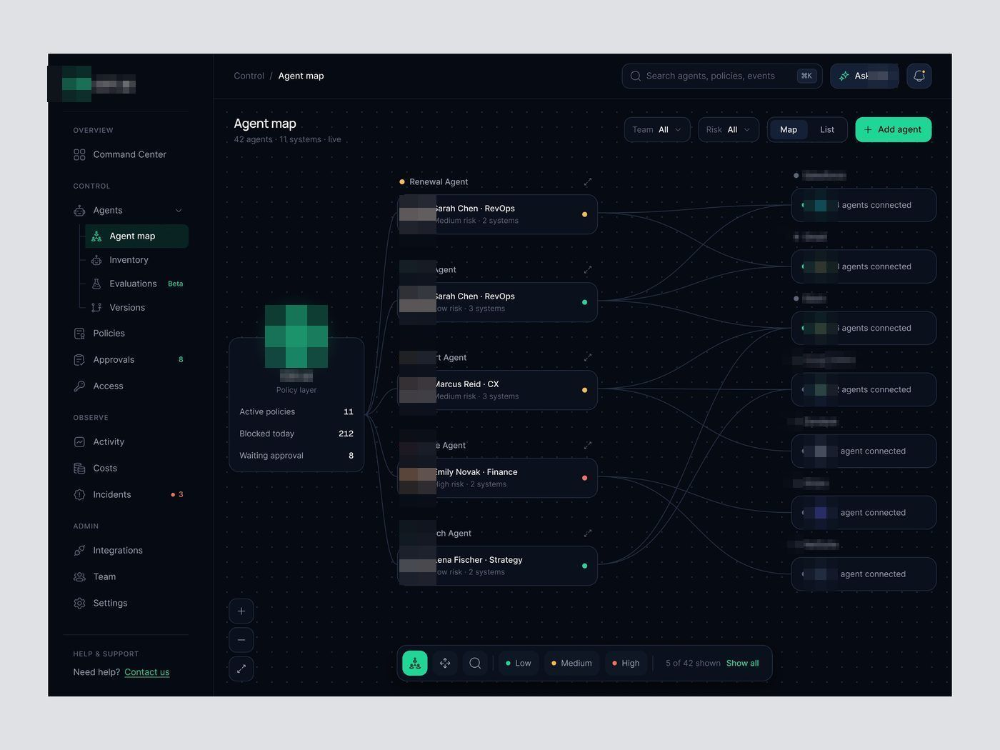
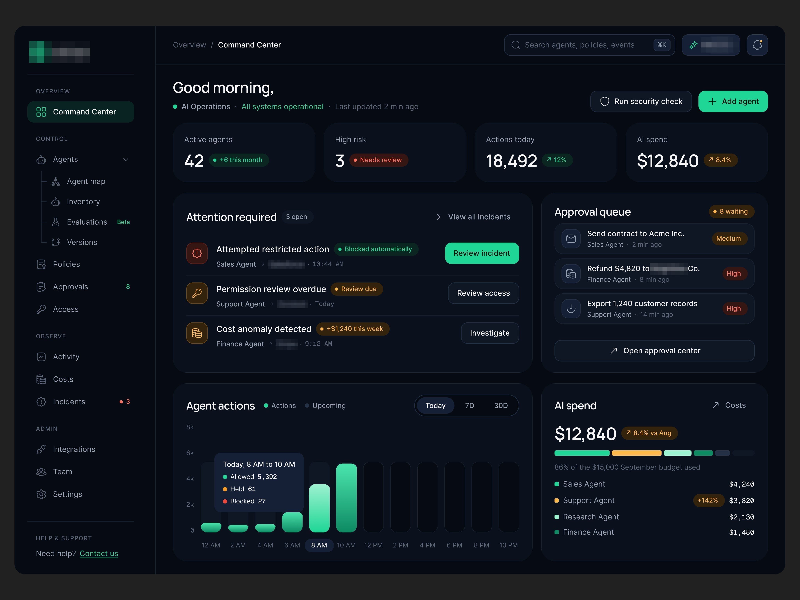
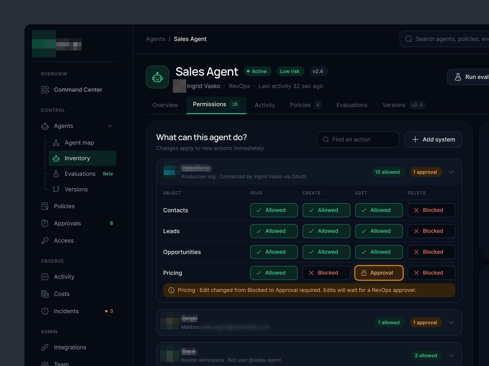
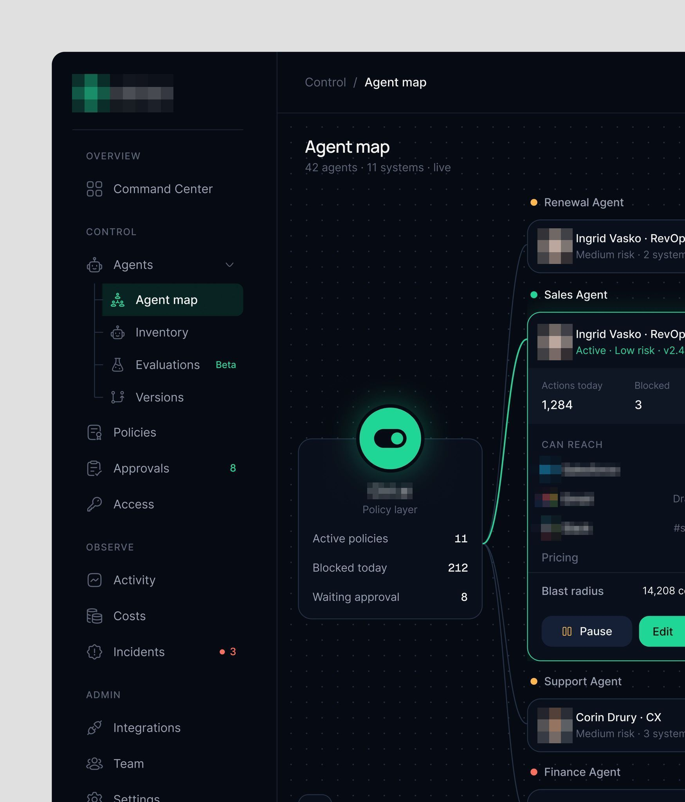
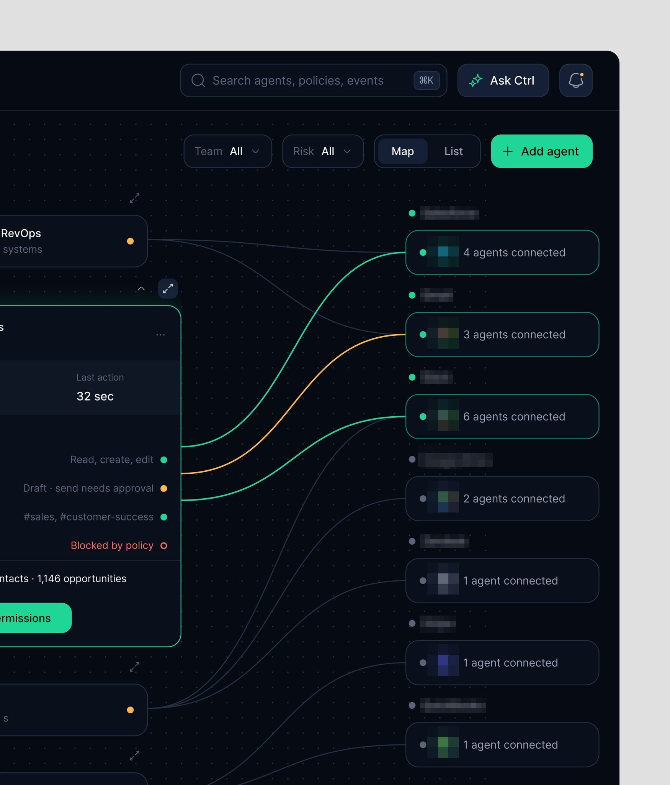

# Painel de permissões de agentes

Legenda recorrente: saber o que os agentes de IA conseguem fazer e controlar o que eles têm
permissão de fazer.

| Campo | Valor |
|---|---|
| Nome | Painel de permissões de agentes (logo: toggle branco em quadrado verde) |
| Setor | camada de política e permissão para agentes de IA ("Policy layer") |
| Para quem | TI / segurança |
| Tema | escuro, azul-noite `#060C18` **[MEDIDO]** com grade de pontos |
| Plataforma | web |
| Acento | menta `#1FD696` (botão "Add agent", nó central, toggle) **[MEDIDO]** |

## Módulos

Agent map: nó central "[produto] · Policy layer" com
contadores (Active policies 11, Blocked today 212, Waiting approval 8), coluna de
agentes com dono e risco (ponto amarelo/verde/vermelho), coluna de sistemas reais
(CRM, e-mail, chat de equipe, drive de arquivos, sistema de atendimento, gateway de pagamento, ERP) ligados por
curvas finas; legenda Low/Medium/High no pé. Sidebar OVERVIEW / CONTROL (Agents >
Agent map, Inventory, Evaluations Beta, Versions) / OBSERVE / ADMIN.

## Mais telas da série

Painel de permissões de agentes: o Command Center escuro "Good morning, [nome]" com "Attention required" (uma ação por linha),
fila de aprovação com risco e o gasto de IA por agente.

## Mais telas

- A matriz de permissões por objeto e o mapa de agentes com a camada de política no centro.

Telas:

- Painel de permissões de agentes escuro: "What can this agent do?" com matriz ler/criar/editar/apagar por sistema e a mudança para "Approval" 
- Painel de permissões de agentes escuro: "Agent map" com a camada de política no centro e os agentes ligados por linhas 
- Recorte ampliado do mapa do painel de permissões de agentes: linhas coloridas ligando agentes o CRM, e-mail, chat de equipe e outros 
