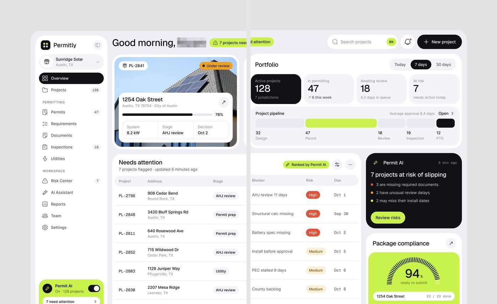
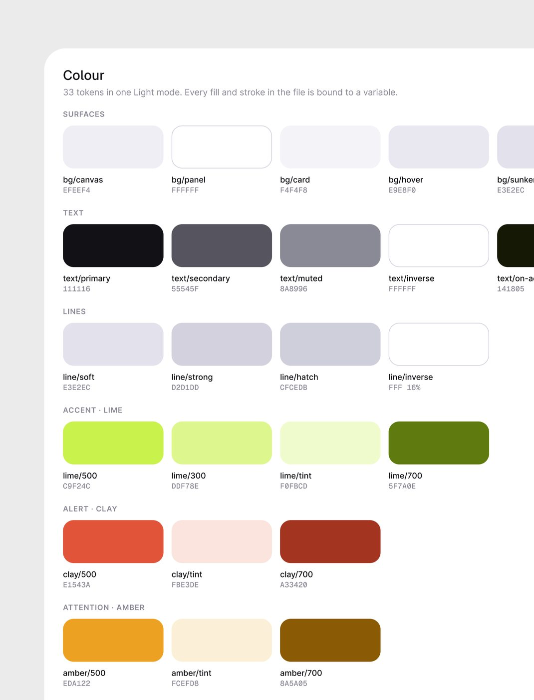
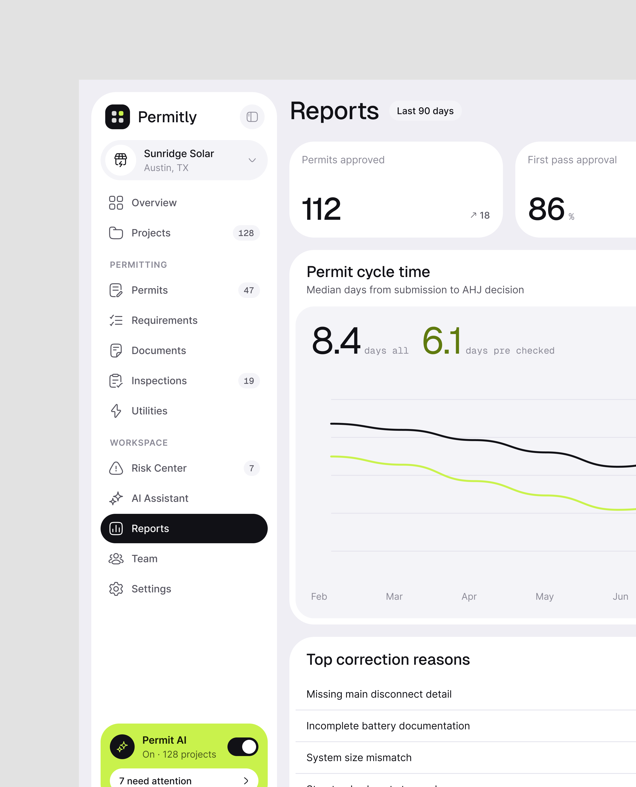
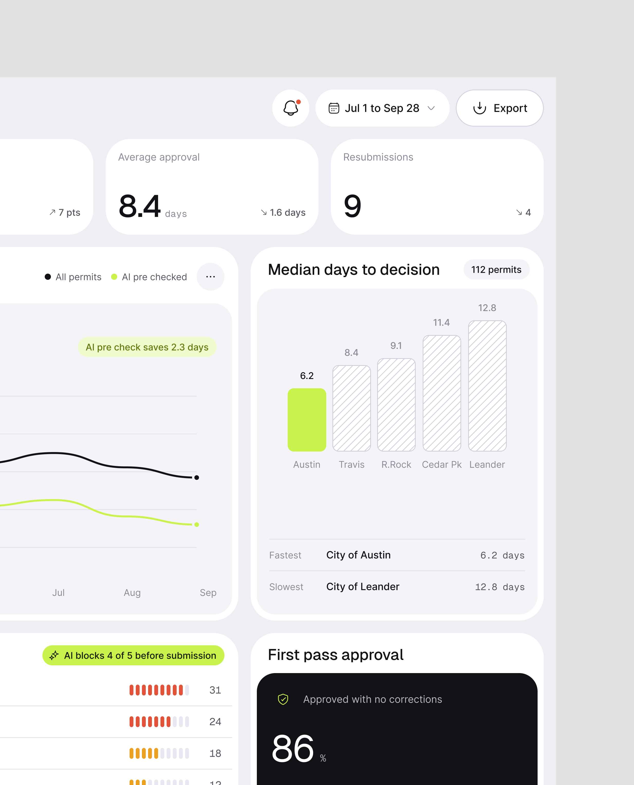
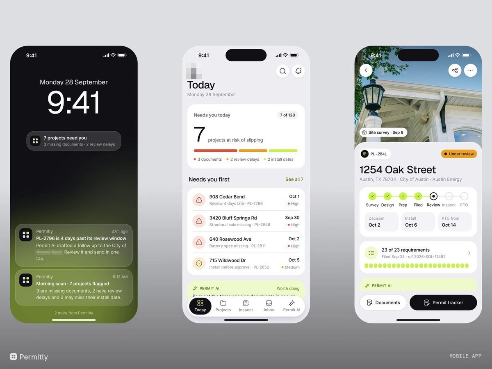
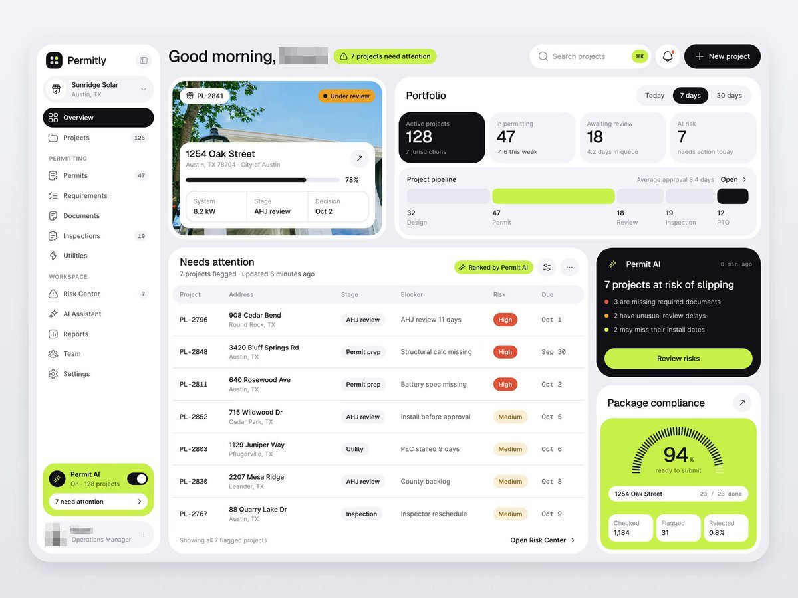
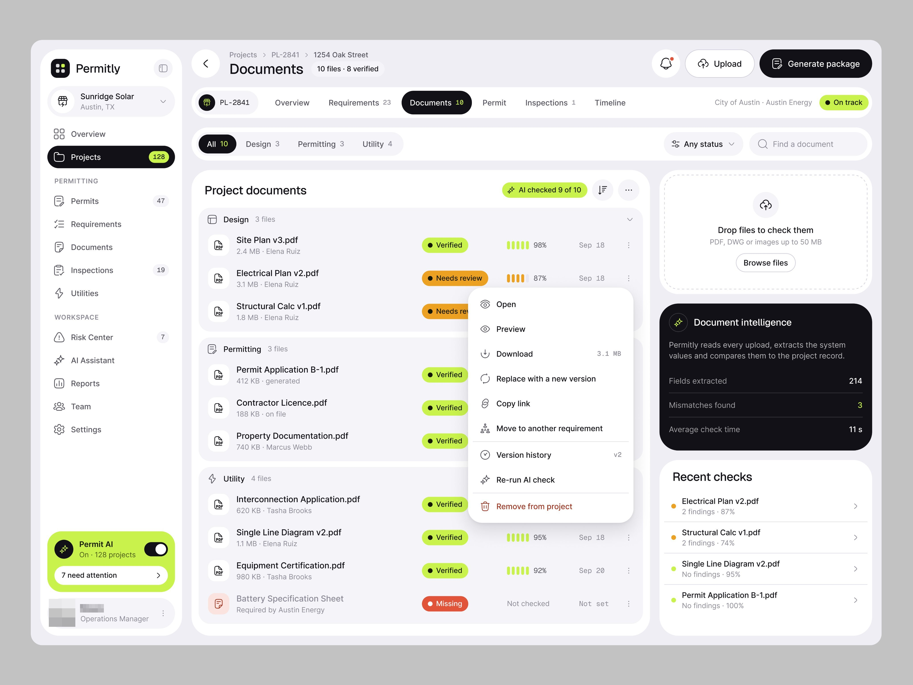

# Permitly

**A peça de melhor desempenho por salvos da amostra**: 81.873 views e 1.438 salvos
em horas, 17,6 salvos/1k. No mesmo dia saíram as folhas de variáveis do Figma do
produto: o único caso em que o **design system inteiro está escrito**. Tokens
completos em
[../01-sistema-visual/design-system-publicado.md](../01-sistema-visual/design-system-publicado.md).

| Campo | Valor |
|---|---|
| Nome | Permitly (logo: quadrado preto com 4 pontos, um deles lime) |
| Setor | licenciamento de instalação solar residencial: projeto → permit → vistoria → PTO |
| Para quem | instaladora de energia solar ("Sunridge Solar · Austin, TX"), coordenador de licenças |
| Tema | claro; `bg/canvas #EFEEF4`, `bg/panel #FFFFFF`, `bg/card #F4F4F8` **[CONFIRMADO]** |
| Plataforma | web desktop |
| Acento | `lime/500 #C9F24C`, texto sobre lime `text/on-accent #141805`; alerta `clay/500 #E1543A`; atenção `amber/500 #EDA122` **[CONFIRMADO]** |
| Texto | `text/primary #111116`, `secondary #55545F`, `muted #8A8996` **[CONFIRMADO]** |

## Telas publicadas

<!--T:Permitly-->
| # | views | salvos | salvos/1k | mídia | legenda |
|---|---:|---:|---:|---|---|
| 1 | 81.873 | 1438 | 17,6 | 2 img | From vibe-coded chaos to polished product. I revamped and designed the |
| 2 | 2.032 | 49 | 24,1 | 3 img | Does your vibe-coded product maintain a proper design system? |
| 3 | 4.995 | 67 | 13,4 | 2 img | Report page UI design.... |
| 4 | 3.300 | 70 | 21,2 | vídeo | Text-heavy but still very good user experience designed mobile app for renewable solar ene |
| 5 | 116.856 | 2.355 | 20,2 | vídeo | Client came with a vibe-coded mess and asked for a revamp. I explored 2 directions. This o |
| 6 | 5.946 | 114 | 19,2 | 1 img | AI Powered Permitting, Designed For Clarity. A Clean UI Built For Complex Workflows. |
| 7 | 3.324 | 57 | 17,1 | vídeo | Permitly, IOS mobile app design. |
| **total** | **218.326** | **4.150** | **19,0** | | |
<!--/T-->

Essa peça é **uma tela cortada em duas metades verticais** (2.466 × 3.051
cada), para caber no feed em retrato: a metade esquerda mostra sidebar + cartão do
projeto + tabela; a direita, KPIs + pipeline + cartão de IA + gauge.
Legenda: *"From vibe-coded chaos to polished product. I revamped and designed the UI
to its full potential."* É redesenho de um produto de cliente.

## Navegação

Sidebar branca com seletor de empresa (ícone de loja + "Sunridge Solar / Austin, TX"),
item ativo **preto cheio com texto branco** (raio total), grupos PERMITTING
(Permits 47, Requirements, Documents, Inspections 19, Utilities) e WORKSPACE
(Risk Center 7, AI Assistant, Reports, Team, Settings). Contadores em pílula
cinza. No pé, cartão **lime** "Permit AI · On · 128 projects" com toggle preto e
botão "7 need attention". Topo: saudação "Good morning, [nome]" em ≈48 px + pílula
lime "⚠ 7 projects need attention", busca com atalho ⌘K em lime, sino, botão preto
"+ New project".

## Módulos

| Bloco | Conteúdo |
|---|---|
| Cartão do projeto | foto de telhado com painéis ocupando o cartão, selo "PL-2841", pílula laranja "Under review", cartão branco sobreposto com endereço, barra de progresso preta 78%, 3 células (System 8.2 kW, Stage AHJ review, Decision Oct 2) |
| Portfolio | seletor Today / 7 days / 30 days; 4 KPIs (o primeiro em cartão **preto** "Active projects 128"), pipeline em 5 barras horizontais proporcionais (a etapa atual em lime, a final em preto) |
| Needs attention | tabela Project (mono "PL-2796") / Address / Stage / Blocker / Risk (pílula High vermelha, Medium bege) / Due (mono) , "Ranked by Permit AI" em pílula lime |
| Permit AI | cartão preto: "7 projects at risk of slipping", 3 motivos com ponto colorido, botão lime "Review risks" |
| Package compliance | gauge de traços lime "94% ready to submit" + "23 / 23 done" |

## Componentes-chave

- Preto `#111116` como segunda cor de destaque (item ativo, KPI principal, cartão
  de IA, botão), lime como primeira. Nada de azul.
- IDs e datas em **monoespaçada** (PL-2796, Oct 1, "6 min ago").
- A regra do DS: *"Panels sit flat on the canvas; only the plan viewer lifts."*

## O que é específico deste setor

O objeto central é **o imóvel** (foto real do telhado) e o tempo regulatório
(AHJ review, PTO, "Average approval 8.4 days"). Risco é prazo que escorrega.

## Performance

7 peças, **218.326 views e 4.150 salvos**, 19,0 salvos/1k: entre as séries de mais de 5
peças, nenhuma salva tanto por mil views. As duas primeiras (o díptico e a folha de DS, esta com
2.032 views e 49 salvos em poucas horas) somam 83.905 views e 1.487 salvos.

## Como reproduzir

Use a tabela de tokens de [design-system-publicado.md](../01-sistema-visual/design-system-publicado.md).
Pontos que o olho confirma: raio de painel ≈32 px, cartão ≈24 px, pílula total;
título 48 px regular; linhas de tabela ≈80 px de altura com separador `line/soft #E3E2EC`.

## Mais telas da série

**O Permitly é redesenho para cliente.** A peça mais vista do período é o vídeo com a legenda
*"Client came with a vibe-coded mess and asked for a revamp. I explored 2 directions. This one got
rejected. But still proud of this design."* (116.856 views, 2.355 salvos): a direção que o cliente
**recusou** no redesenho (Overview com portfólio e o cartão preto do Permit AI, Projects em
grade de fotos, Compliance review com nota 87, Permit package com a faixa lima "Filed with the City of
Austin"). **[CONFIRMADO]** Também: o díptico de Reports (ciclo da licença com e sem a
checagem da IA, "AI pre check saves 2.3 days"), a tela Documents com a checagem da IA por arquivo e o
cartão preto "Document intelligence", e o app iOS em vídeo-esteira (tela de bloqueio, rastreio da
licença, inspeções com as fotos que o fiscal espera, câmera que lê a placa, "Permit approved").

