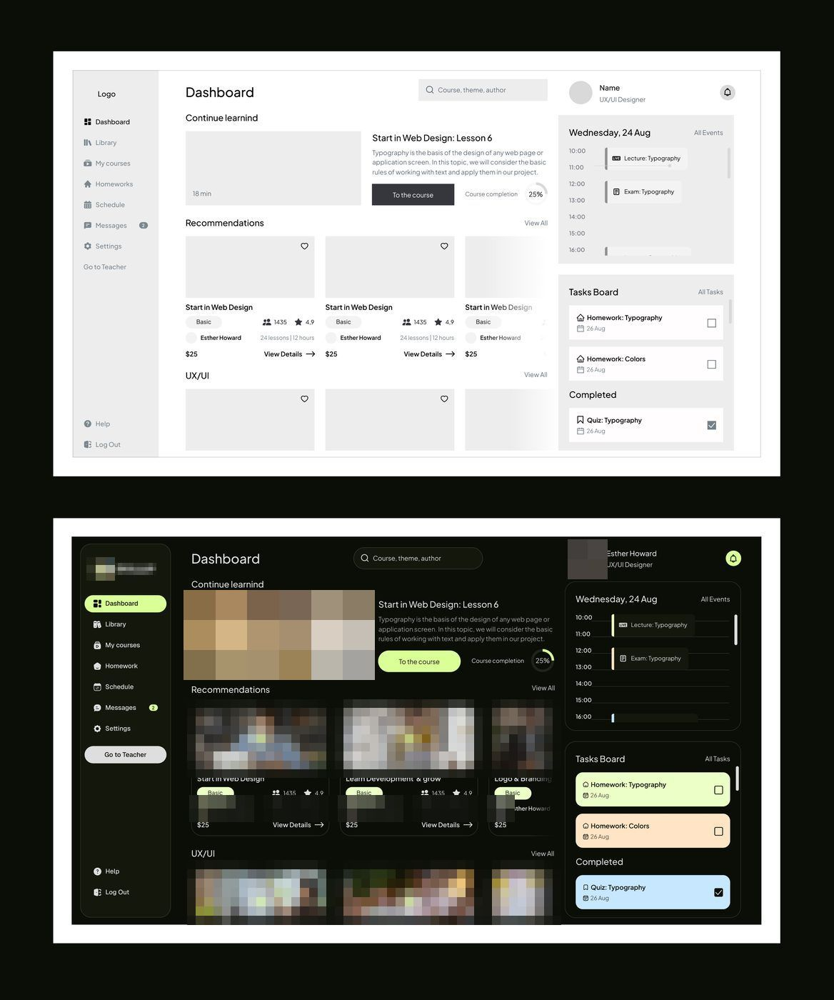

# Plataforma de cursos

O formato que mais se repete na série é o do wireframe que vira design: o wireframe em cima e a tela
final embaixo.

| Campo | Valor |
|---|---|
| Nome | plataforma de cursos (logo de 4 bolhas coloridas) |
| Setor | plataforma de cursos online (e-learning), lado aluno e lado professor |
| Tema | **escuro** `#121212` com acento lime; versão clara publicada como comparação (legendas que nomeiam a versão branca e perguntam qual das duas é melhor) |
| Plataforma | web |
| Acento | lime `#D4FA8F` (nav ativo, botões, cartão de tarefa) **[MEDIDO]** |

## Módulos

Dashboard (Continue learning com vídeo, Recommendations em cartões com foto,
agenda do dia em timeline, Tasks Board com cartões coloridos lime/pêssego/azul),
Library, UX/UI Courses (detalhe), Course builder (passos), Schedule, Messages,
Payments, Teacher Dashboard.

## Por que interessa

1. O formato **wireframe → design** (duas versões empilhadas) é um formato que
   viraliza antes mesmo das séries de produto.
2. Mostra o estilo genérico: escuro, lime, fotos de pessoas, cartões de curso de
   marketplace. O método troca isso por claro e dado de negócio.
