# PriorAuth

11 peças, 127.062 views, 1.778 salvos (14,0/1k).

| Campo | Valor |
|---|---|
| Nome | PriorAuth ("gives clinics one workspace for the whole prior authorization process") |
| Setor | autorização prévia de procedimentos junto a planos de saúde nos EUA (UnitedHealthcare, Aetna, Cigna, Anthem) |
| Para quem | coordenadora de autorização da clínica ("Northside Clinic · Sarah Mitchell") |
| Tema | claro; fundo `#D5D5D5`/`#F0F0ED` **[MEDIDO]** |
| Plataforma | web + mobile |
| Acento | verde `#2F6A4A` (cartão "Revenue at risk"), lime `#D7EE3C` (barra de destaque, Home ativo no app), âmbar `#F79E18` (alerta) **[MEDIDO]** |

## Telas publicadas

<!--T:PriorAuth-->
| # | views | salvos | salvos/1k | mídia | legenda |
|---|---:|---:|---:|---|---|
| 1 | 4.467 | 107 | 24,0 | 1 img | PriorAuth gives clinics one workspace for the whole prior authorizatio |
| 2 | 4.166 | 74 | 17,8 | 3 img | PriorAuth gives clinics one workspace for the whole prior authorizatio |
| 3 | 1.442 | 17 | 11,8 | 3 img | Share love!  Curated with passion! |
| 4 | 1.591 | 19 | 11,9 | vídeo | Hey, did I cook it? |
| 5 | 4.211 | 52 | 12,3 | 3 img | Mobile design UI Design! |
| 6 | 3.321 | 45 | 13,6 | 1 img | Complex SaaS? It’s Usually a Design Problem. Look at this page.. How simple and easy it is |
| 7 | 5.418 | 65 | 12,0 | 3 img | Small card design! Did I cook? |
| 8 | 71.243 | 849 | 11,9 | 3 img | This mobile design is killing... isn't it? |
| 9 | 18.610 | 311 | 16,7 | 1 img | This design is on another level of cleanliness. |
| 10 | 7.194 | 141 | 19,6 | vídeo | Mobile app uxui design. Check out the screens. |
| 11 | 5.399 | 98 | 18,2 | 1 img | AI Prior Authorization Platform |
| **total** | **127.062** | **1.778** | **14,0** | | |
<!--/T-->

## Módulos

- Web: nav em abas no topo (Dashboard em pílula preta,
  Pipeline, Cases, Payers, Documents, Denials, Analytics); "Revenue Cycle
  Overview / Good morning, Sarah"; cartão verde com **"$184,500"** gigante
  ("across 8 cases that may miss their procedure date") e barras hachuradas com a
  atual em lime; 4 KPIs com ícone colorido; tabela "Attention required" com logo
  do plano, "Approval odds" em % + barra de traços, botão "Review case"; "Recent
  activity" com ícones de status.
- Mobile: mesma hierarquia empilhada, tab bar preta com
  "Home" em pílula lime e "+" branco central.
- Cartões soltos ("Share love! Curated with passion!").

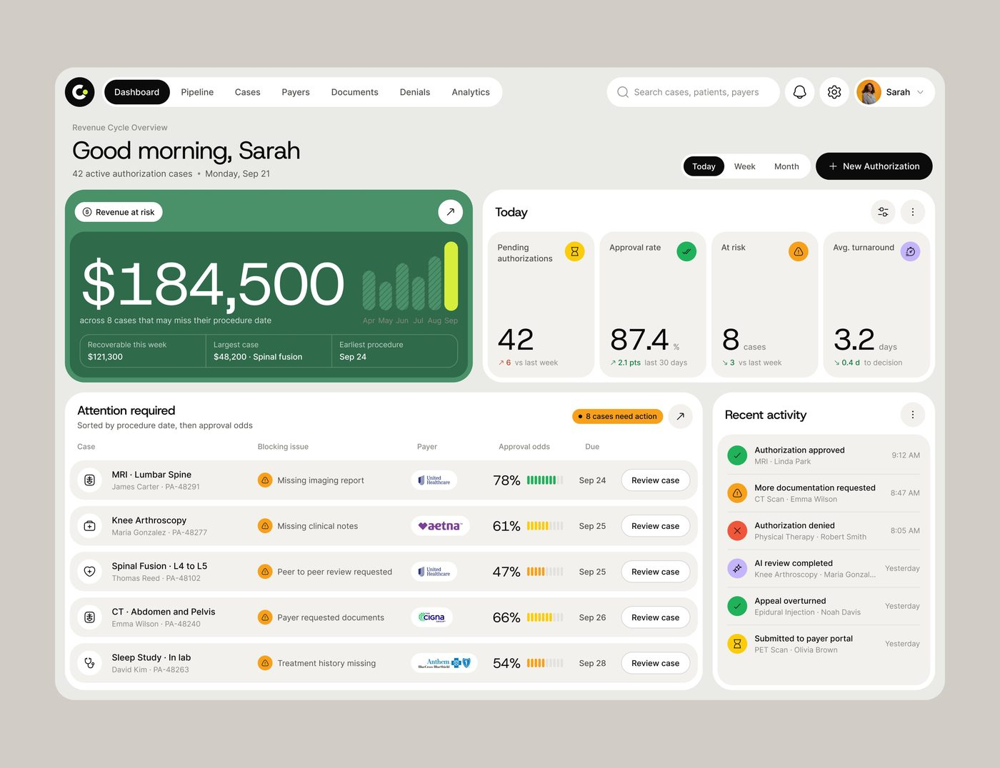

## O que é específico

Traduz burocracia em **dinheiro em risco** e **probabilidade de aprovação**.
Mesma fórmula do Permitly (prazo regulatório + risco ranqueado).

## Mais telas da série

A terceira peça mais vista do período é do PriorAuth: três telas de celular com *"This mobile
design is killing... isn't it?"* (71.243 views, 849 salvos): o acompanhamento com o cartão
amarelo "Pending Payer Review", as evidências clínicas com "Scan a paper document · The AI reads it and
links it to the right requirement" e o pacote com o resumo "AI-generated" em que cada frase leva a
etiqueta da fonte. Na web: o pipeline em kanban de seis colunas com a chance de aprovação em cada
cartão (18.610 views), o detalhe do caso com "Next best action" em lima, "Prepare Submission" com o
resumo gerado e a nota *"Review every statement against the source. You are responsible for what is
submitted."*, e três cartões isolados da chance de aprovação ("An estimate from the case information
available. Not a guarantee.", base de 214 casos semelhantes).

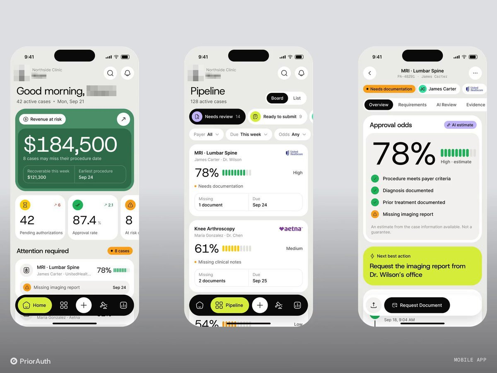
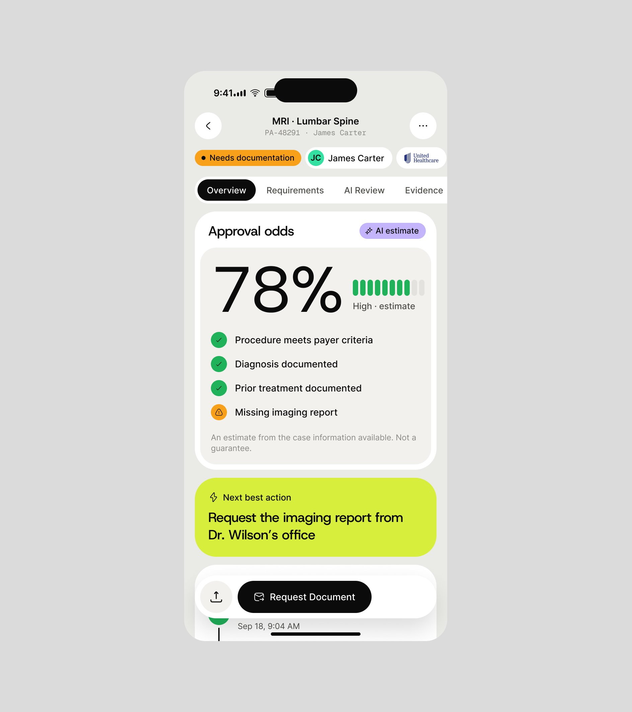
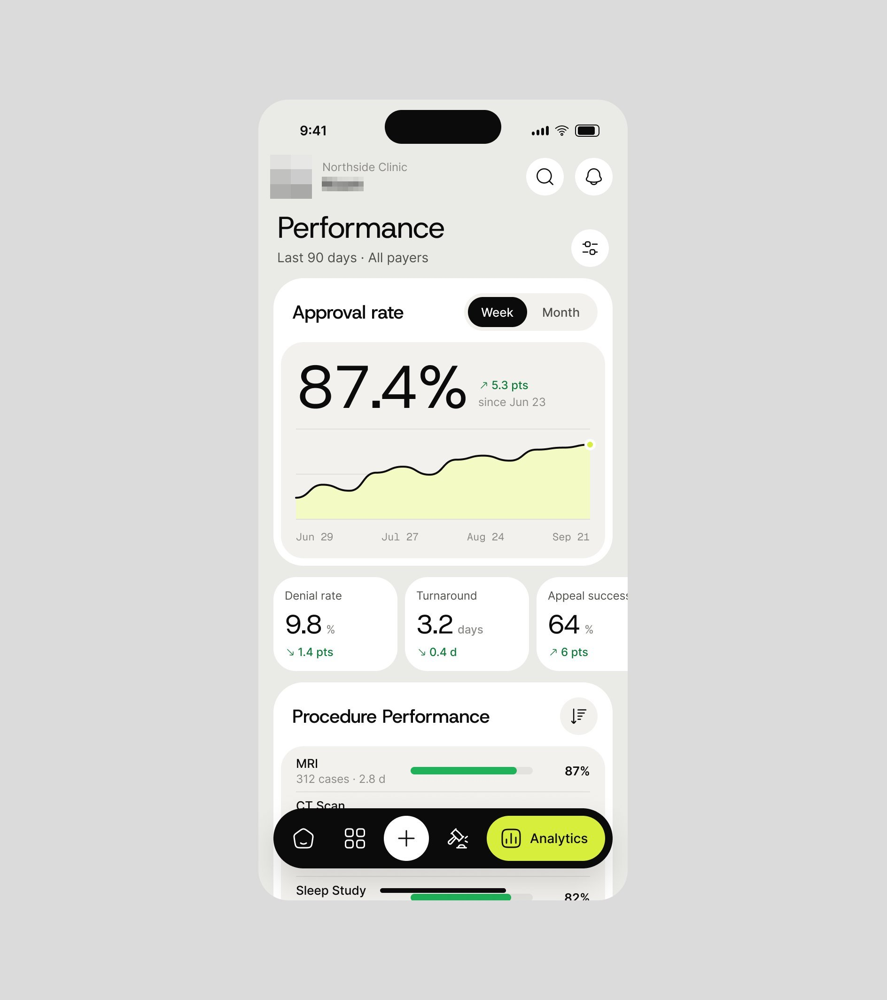
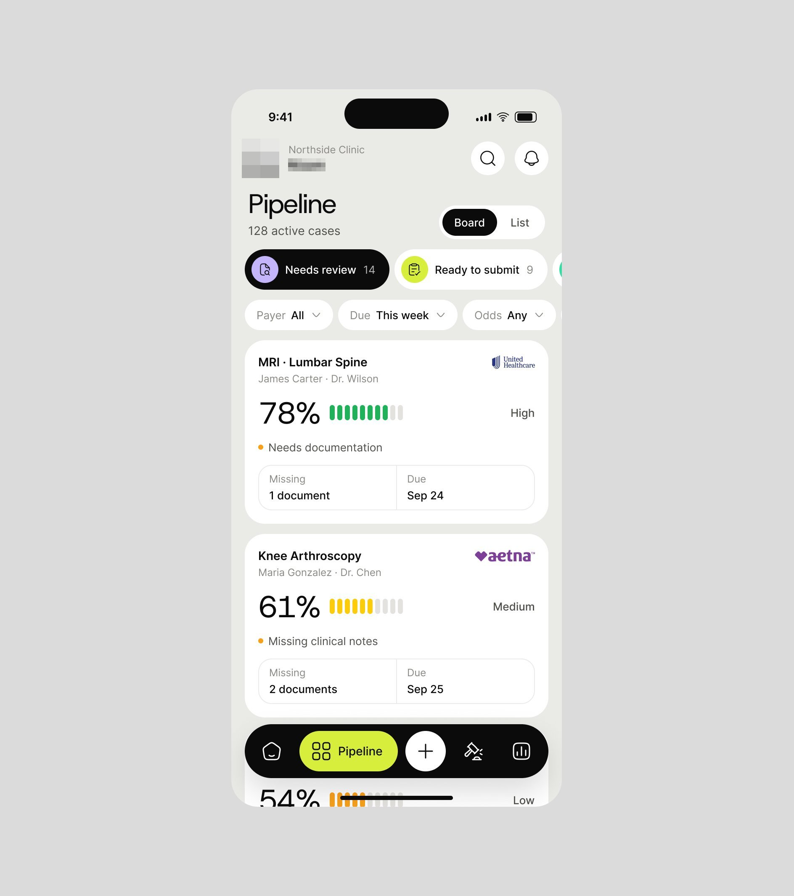

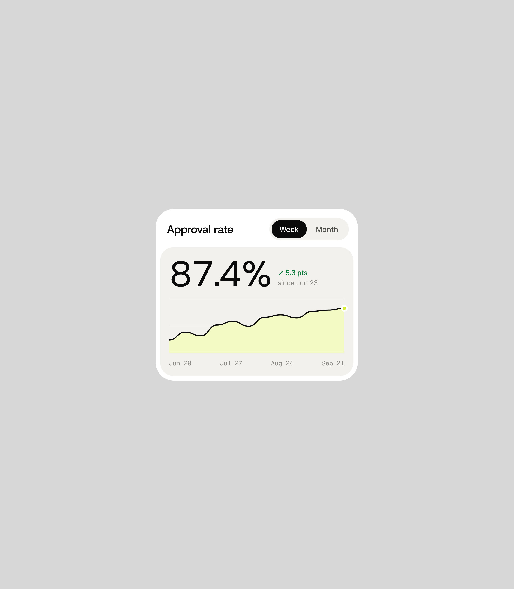

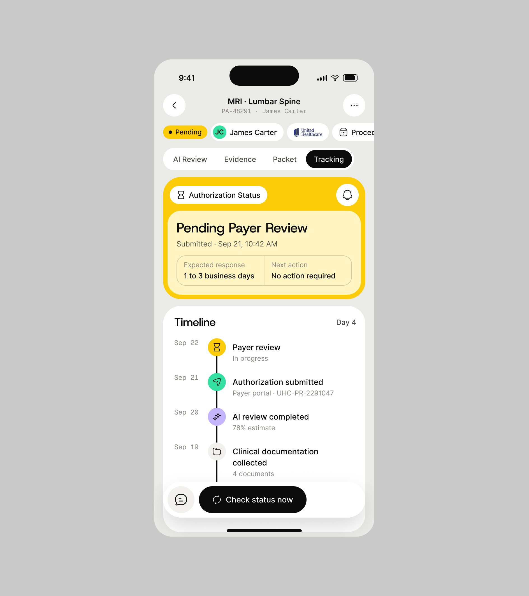
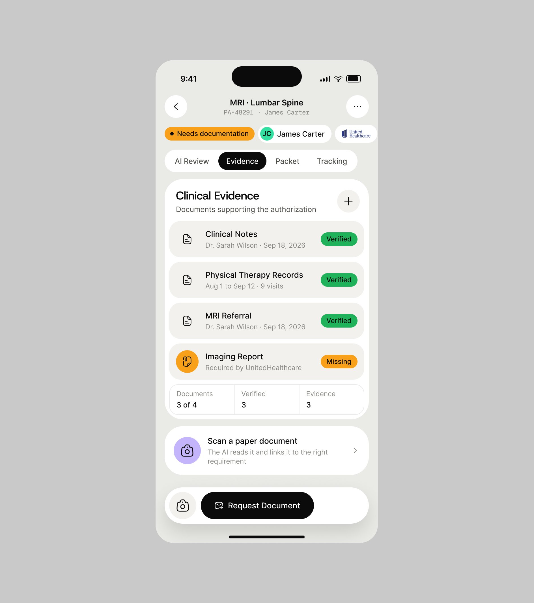
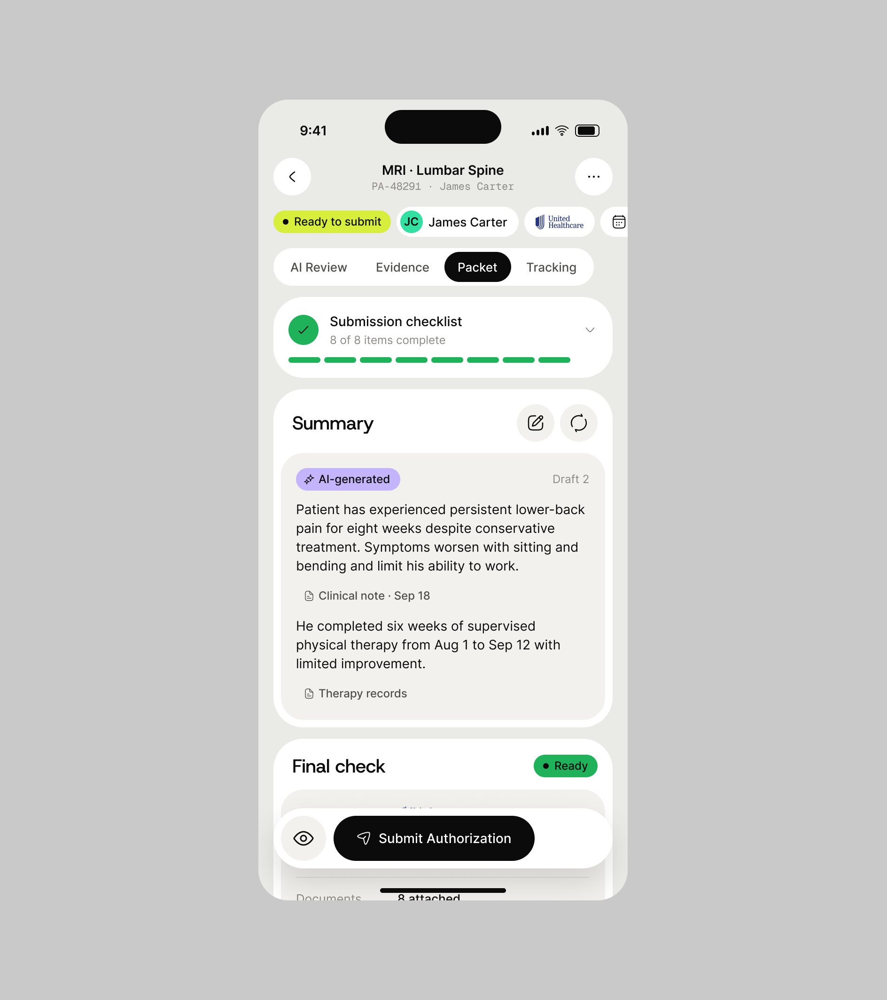
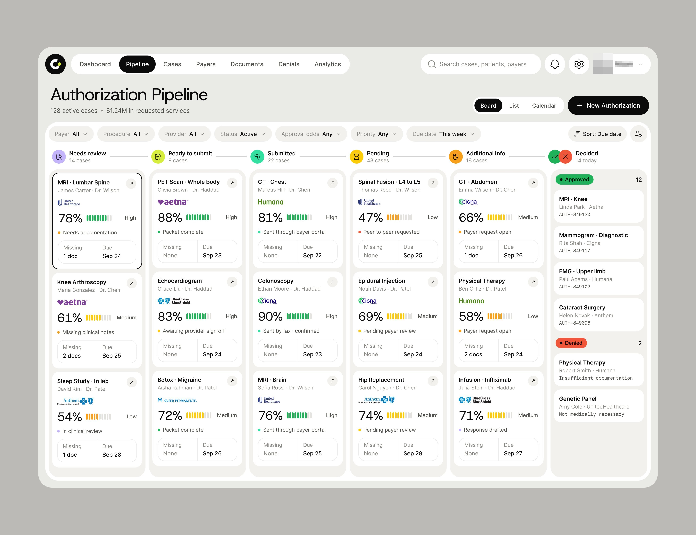
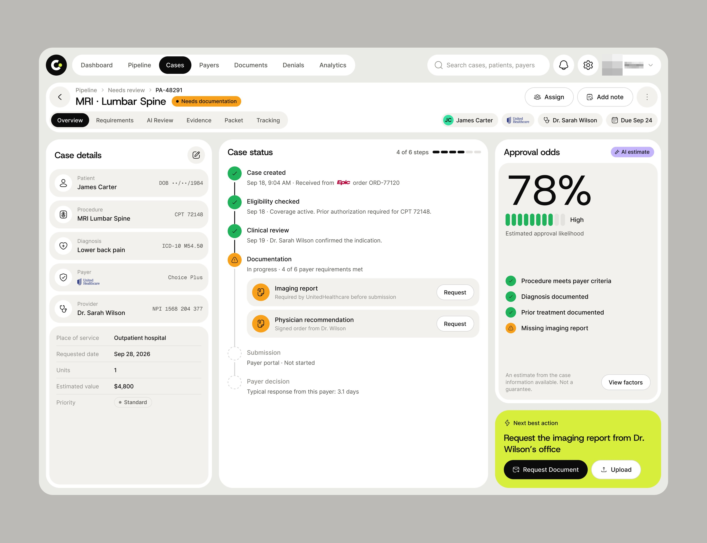
