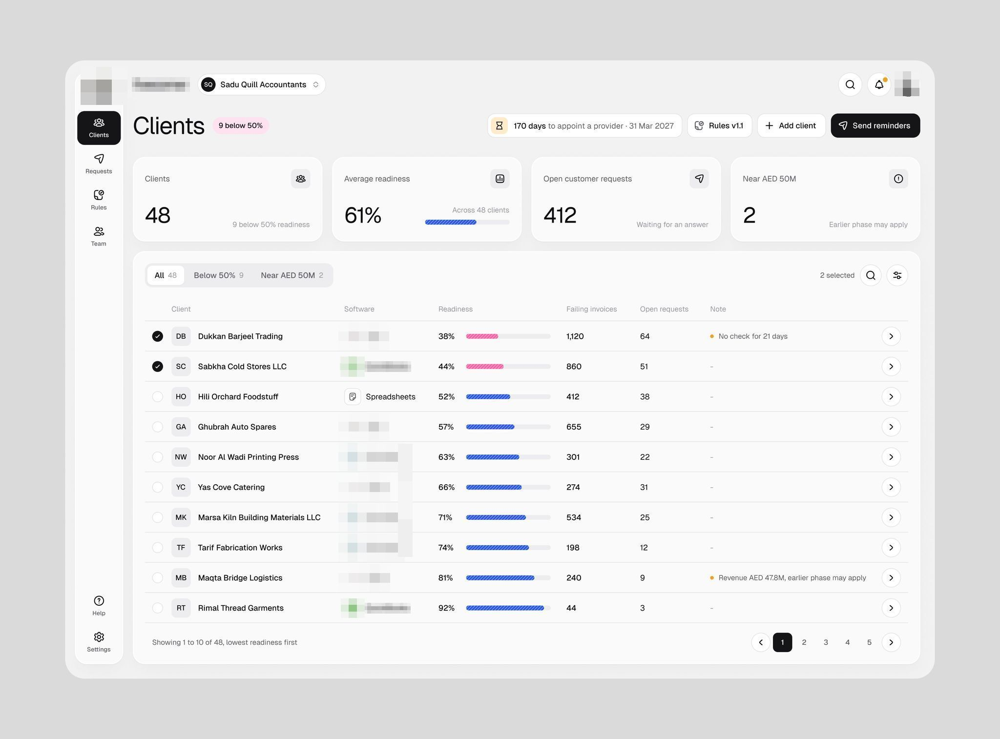
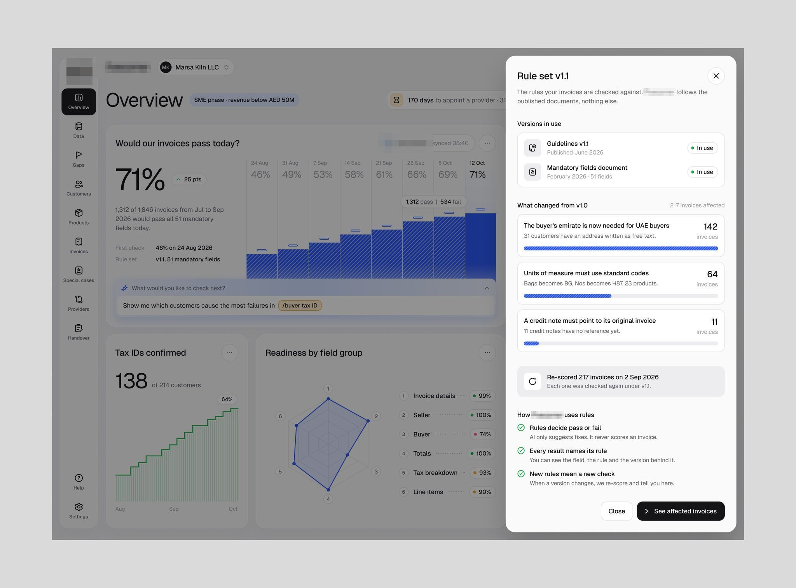
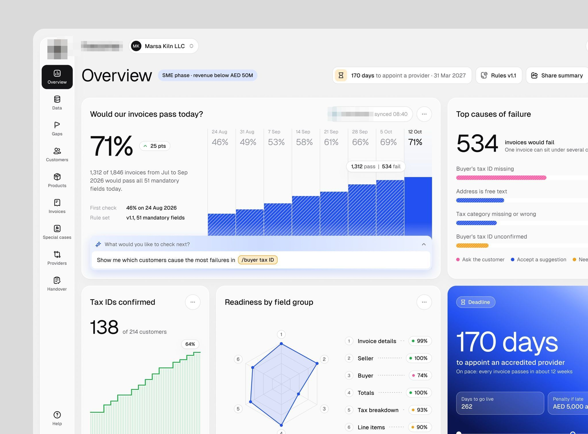
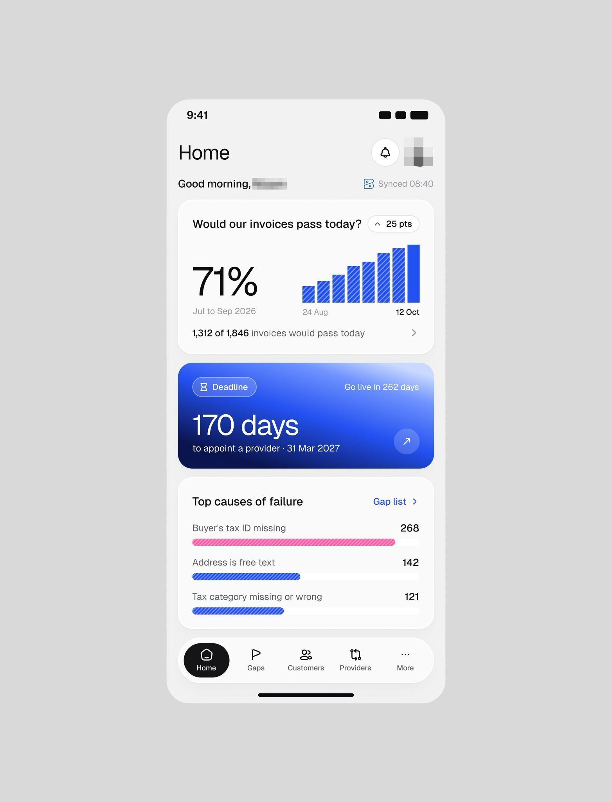
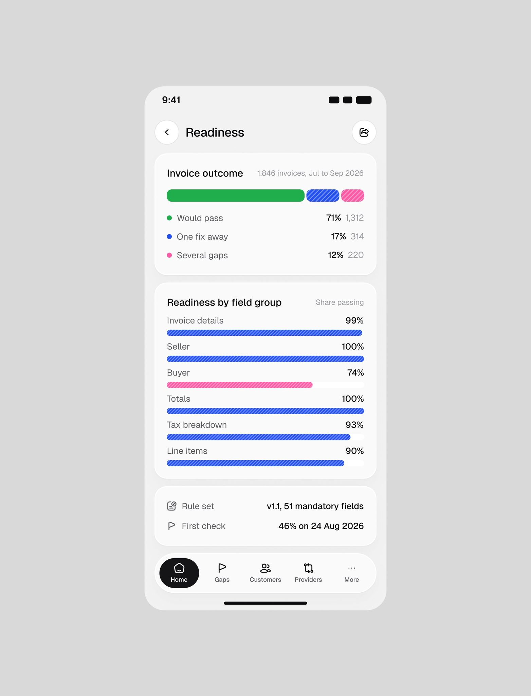
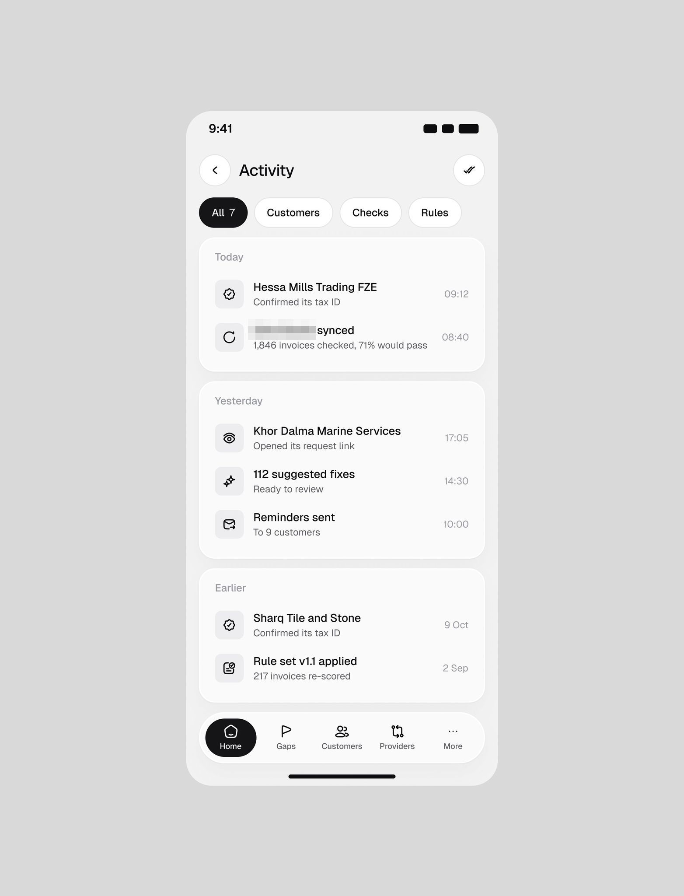
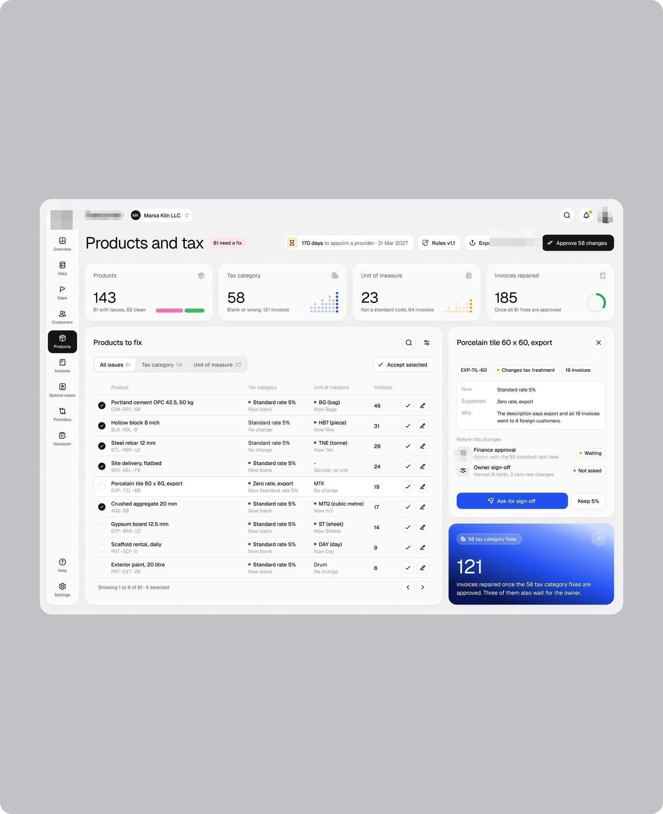
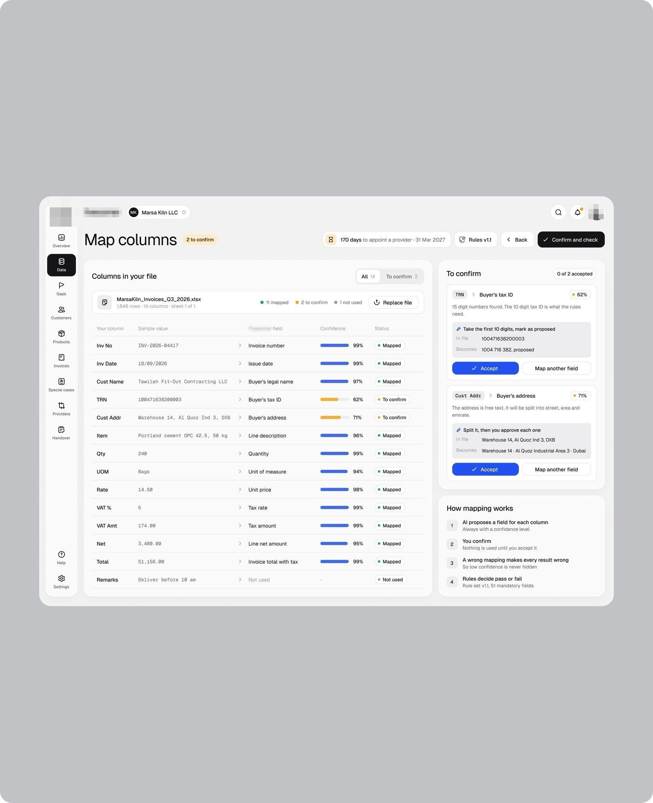
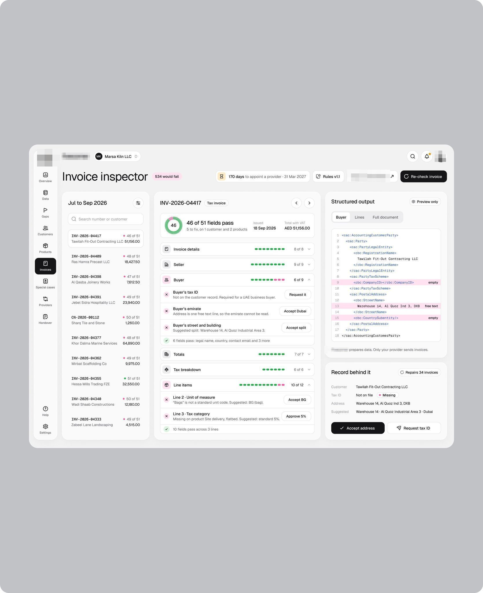
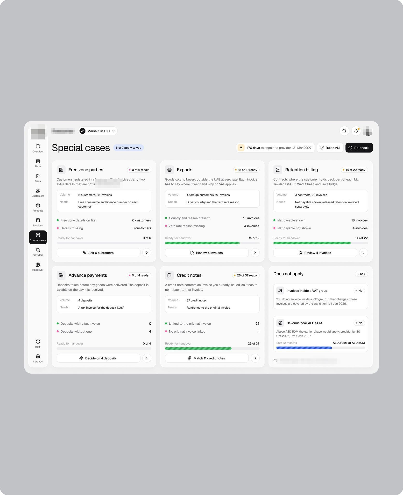

# App de prontidão de fatura

**Prontidão para fatura eletrônica (Emirados) de um escritório de contabilidade e dos clientes do escritório.** **[CONFIRMADO]** pelo logo.

| Campo | Valor |
|---|---|
| Setor | contabilidade: prontidão dos clientes para a fatura eletrônica, regras, produtos e imposto, mapeamento de colunas |
| Para quem | o escritório de contabilidade |
| Tema | claro, branco |
| Plataforma | web + iOS |
| Acento | azul (o cartão "170 days" e o cartão "121") [OBSERVADO] |

## O que a ficha ensina

- **Use uma pergunta como título do painel**: "Would our invoices pass today? 71%".
- **Escreva o prazo como número grande no acento** ("170 days").
- **Versione as regras e abra a versão numa gaveta**: "Rule set v1.1" com o que mudou desde a anterior.

## O que cada tela tem

Uma linha por imagem; o texto da tela vai entre aspas.

- App de prontidão de fatura (contabilidade, Emirados): "Clients" com quatro KPIs e tabela de prontidão por cliente com software e barra 
- App de prontidão de fatura: "Overview" com a gaveta "Rule set v1.1" aberta, o que mudou desde a versão anterior e como as regras são usadas 
- App de prontidão de fatura: "Overview" com "Would our invoices pass today? 71%", barras por semana, causas de falha, radar por grupo e "170 days" em azul 
- App de prontidão de fatura no iPhone: "Home" com 71% de faturas que passam, cartão azul "170 days" e causas de falha 
- App de prontidão de fatura no iPhone: "Readiness" com resultado das faturas em barra tricolor e prontidão por grupo de campos 
- App de prontidão de fatura no iPhone: "Activity" com filtros e eventos de clientes, checagens e regras por dia 
- Shot em retrato 4:5 com a tela pequena: "Products and tax" do app de prontidão de fatura com o cartão azul "121" 
- Shot em retrato 4:5: "Map columns" do app de prontidão de fatura com colunas do arquivo e confiança em barra 
- Shot em retrato 4:5: "Invoice inspector" do app de prontidão de fatura com 46 de 51 campos e a saída estruturada 
- Shot em retrato 4:5: "Special cases" do app de prontidão de fatura em cartões com progresso 
