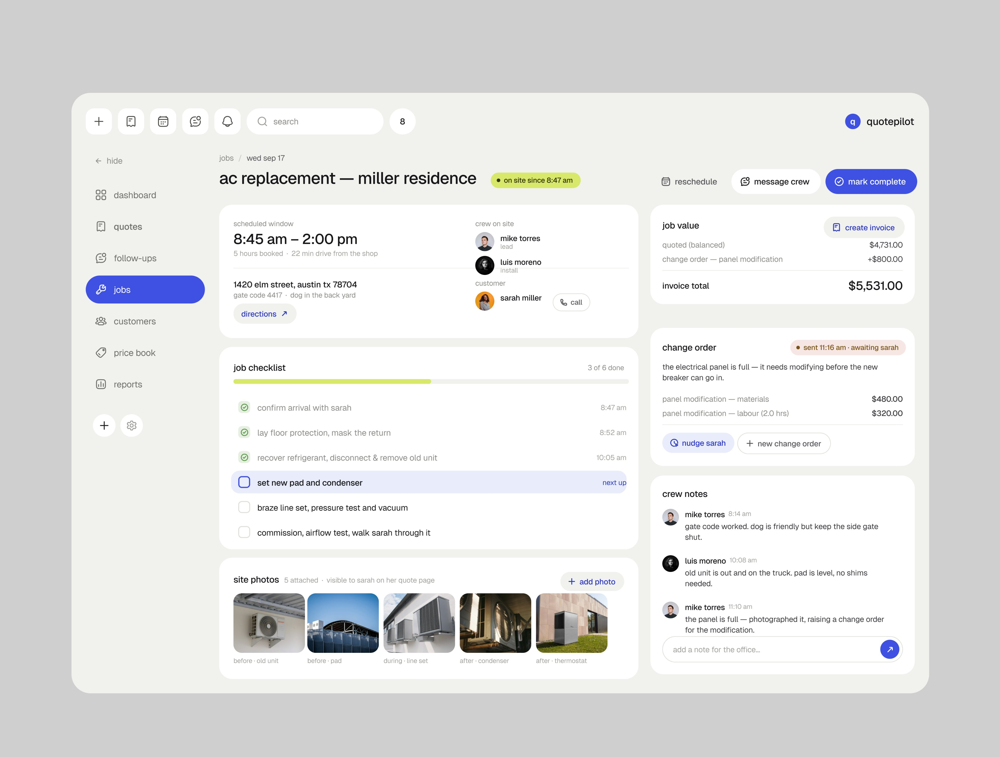
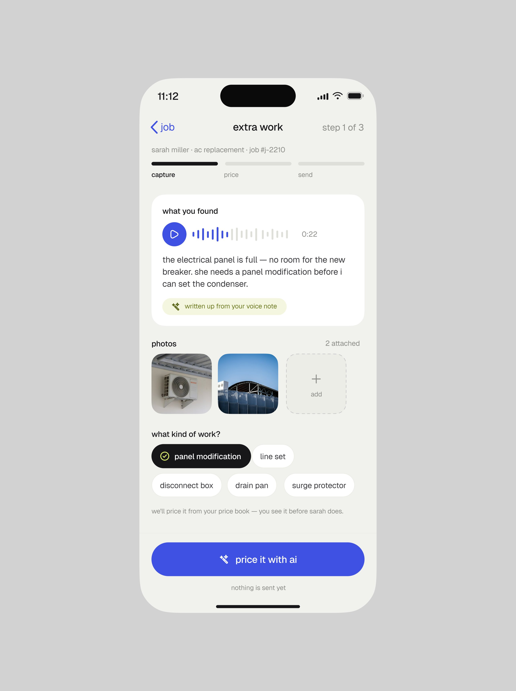
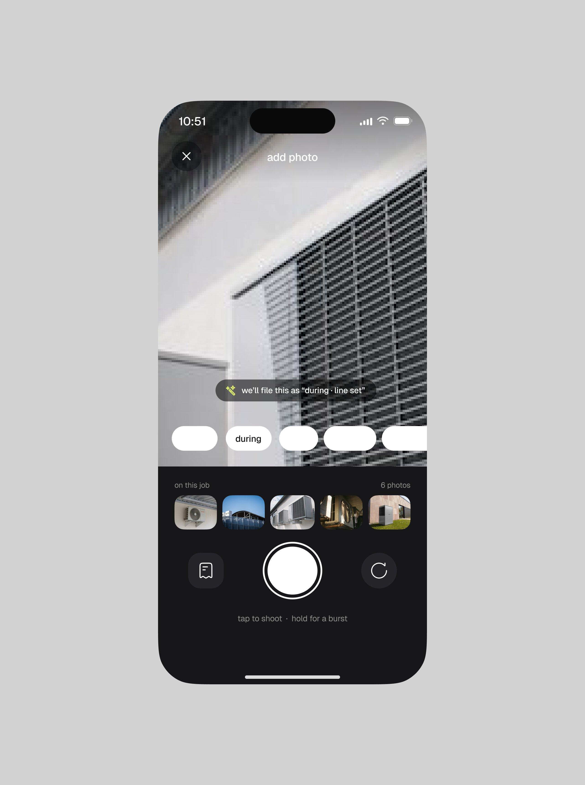
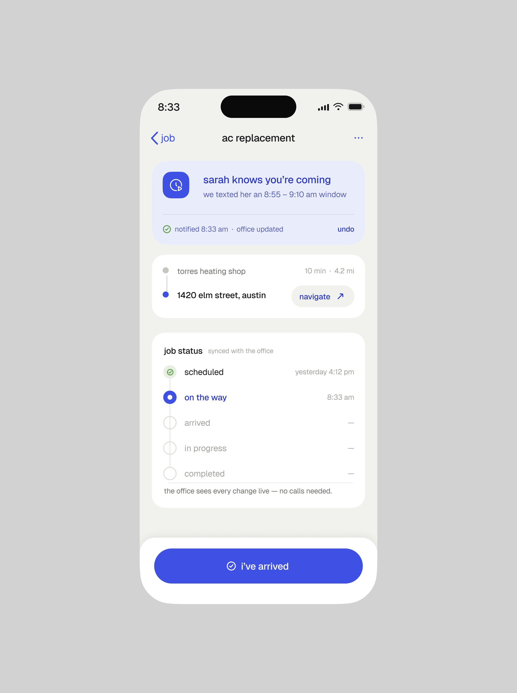
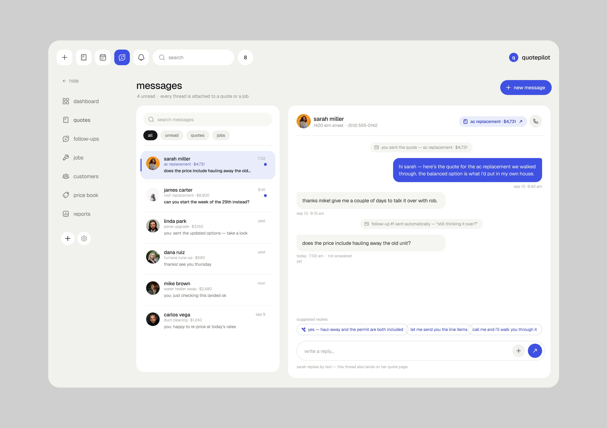

# Quotepilot

**Serviço de campo de climatização, com a interface inteira em minúsculas.** 3 peças em nove
dias. É o mesmo traço do "Contractor app" da [ficha curta](outros-produtos.md) ("good morning,
mike", cartão com borda azul, "i'm on the way"), agora com nome de série. **[OBSERVADO: mesma caixa minúscula, mesmo azul e mesmo técnico]**

| Campo | Valor |
|---|---|
| Setor | instalação e manutenção de ar-condicionado (Austin): trabalho, orçamento, change order, equipe |
| Para quem | o dono da empresa no web; o técnico no celular |
| Tema | claro; toda a interface em minúsculas, inclusive títulos ("ac replacement — miller residence", "messages") |
| Plataforma | web (trabalho, mensagens) + celular (trabalho extra, câmera, a caminho) |
| Acento | azul `#3C48D8` (botão principal, mensagem enviada, passo atual); lima `#CCE460` em detalhe **[MEDIDO, amostra quantizada]** |

## Telas publicadas

<!--T:Quotepilot-->
| # | views | salvos | salvos/1k | mídia | legenda |
|---|---:|---:|---:|---|---|
| 1 | 6.352 | 101 | 15,9 | 1 img | Job screen interface design.. |
| 2 | 7.411 | 53 | 7,2 | 3 img | Property maintenance mobile app ui design. |
| 3 | 1.704 | 25 | 14,7 | 1 img | Message/Chat screen ui design. |
| **total** | **15.467** | **179** | **11,6** | | |
<!--/T-->

## O que cada tela tem

- **Trabalho (web)** — "ac replacement — miller residence" com selo verde "on site since 8:47 am",
  janela de horário, equipe com foto, checklist com barra de progresso e o passo atual destacado,
  fotos do local, valor do trabalho com o change order somado, o change order "sent 11:16 am ·
  awaiting sarah" com "nudge sarah", e as notas da equipe por pessoa.
  
- **Celular** — "extra work" com a nota de voz transcrita ("written up from your voice note") e o
  botão azul "price it with ai"; a câmera que já diz onde a foto vai ("we'll file this as
  'during · line set'"); e "sarah knows you're coming · we texted her" com "undo", antes de "I've
  arrived".
  
  
  
- **Mensagens (web)** — lista de conversas com o valor do orçamento de cada uma, a conversa com
  o orçamento em bolha azul, o follow-up automático registrado na linha do tempo e as respostas
  sugeridas em pílula acima do campo.
  

## O que a série ensina

- **Caixa minúscula como voz de marca** num produto de ofício: fala como o técnico fala. É o
  único produto da biblioteca com essa regra em toda a interface.
- **A IA faz o trabalho de escritório do técnico** (transcreve a nota de voz, precifica, avisa o
  cliente, arquiva a foto) e cada ação tem o desfazer ou a revisão do lado.
