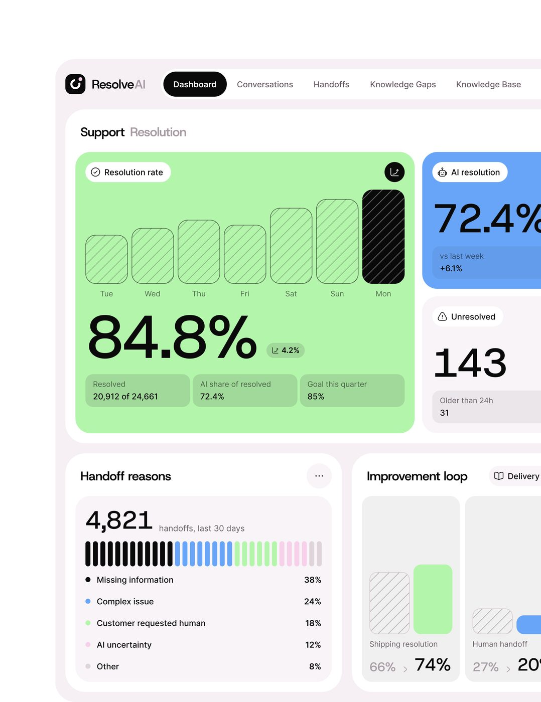
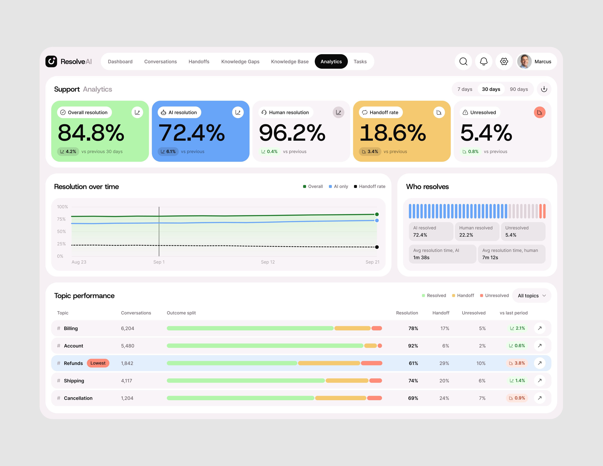
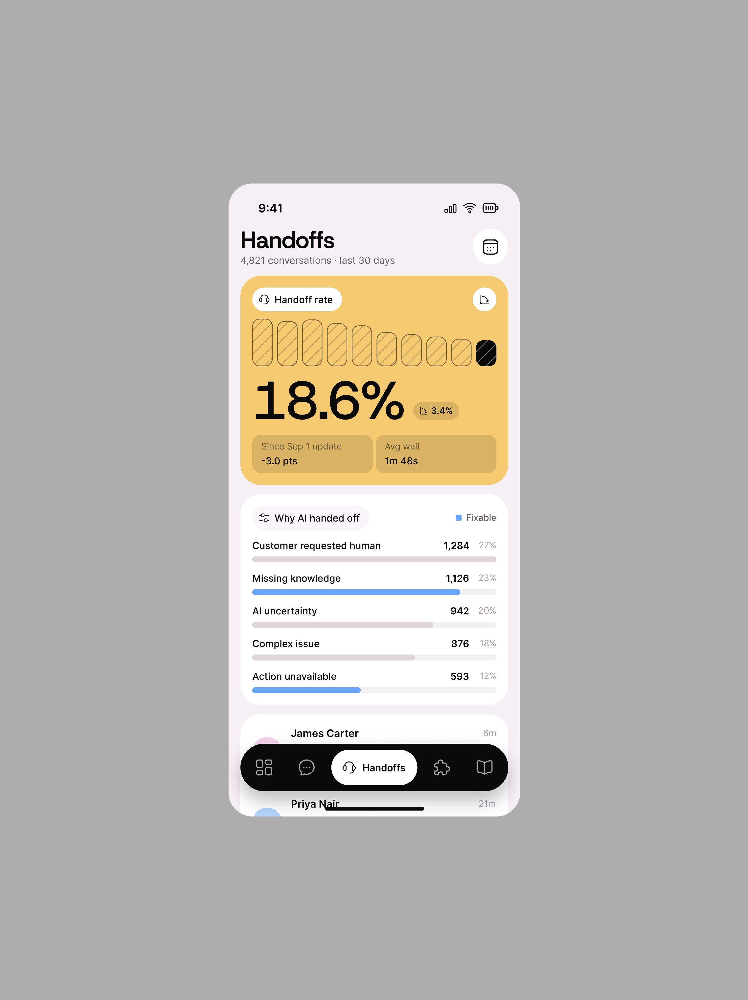
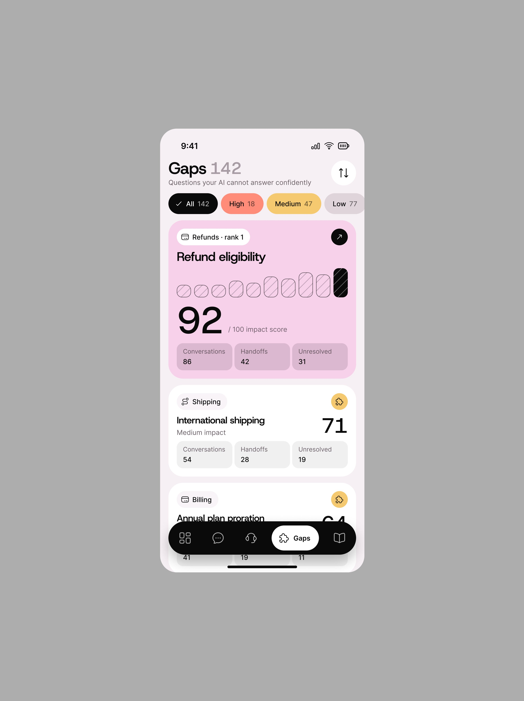
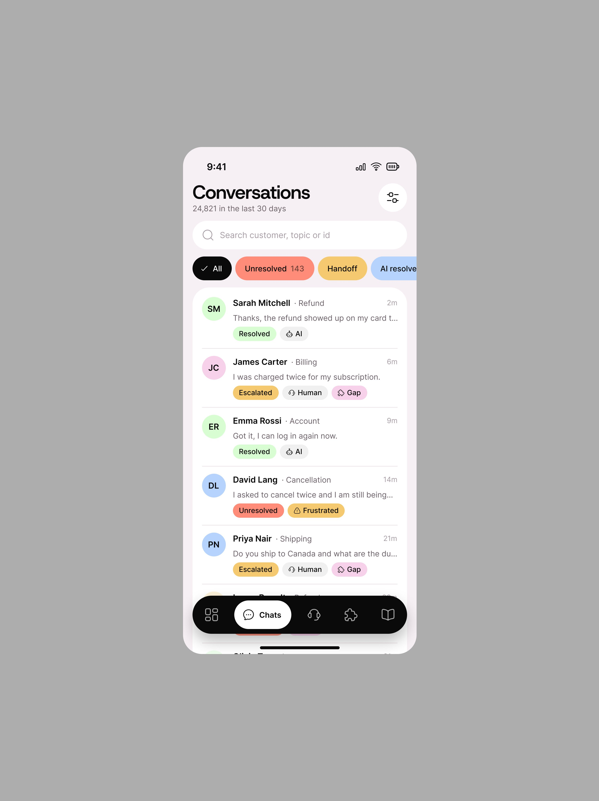

# ResolveAI

7 peças, 31.436 views, 487 salvos (15,5/1k). As três primeiras, no mesmo dia,
fizeram 14.065 views e 294 salvos: **20,9 salvos/1k, o maior entre as séries na
leitura**.

Legenda da peça principal: *"Imagine customer support your
team actually enjoys using. Fun, Peach, and enjoyable UI. Designing a serious
project is easier than a fun product for sure! AI Customer Support Resolution
Platform!"* **[CONFIRMADO]**

| Campo | Valor |
|---|---|
| Nome | ResolveAI ("Resolve" preto + "AI" cinza; logo em quadrado preto) |
| Setor | atendimento ao cliente resolvido por IA, com handoff para humano |
| Para quem | líder de suporte |
| Tema | claro, fundo rosado `#F6F3F6` **[MEDIDO]** |
| Plataforma | web |
| Acento | **vários cartões de cor chapada**: verde-claro, azul `#6FA4F8`-ish, lilás, laranja `#FF6A4A`, amarelo-lime `#E4FC3C`, âmbar `#F5C970`, e preto para a barra "hoje" **[MEDIDO: top 4 matizes 31%, 14%, 14% dos pixels saturados]** |

## Telas publicadas

<!--T:ResolveAI-->
| # | views | salvos | salvos/1k | mídia | legenda |
|---|---:|---:|---:|---|---|
| 1 | 9.648 | 267 | 27,7 | 3 img | Imagine customer support your team actually enjoys using. Fun, Peach,  |
| 2 | 2.919 | 15 | 5,1 | vídeo | Cool cards in motion! |
| 3 | 1.498 | 12 | 8,0 | 1 img | Share love❤️ |
| 4 | 10.177 | 116 | 11,4 | 1 img | A lot of colors, still no noise in the interface. Fresh, warm interface design. |
| 5 | 2.806 | 24 | 8,6 | 1 img | Designers, How do you handle information-heavy pages while keeping the layout consistent,  |
| 6 | 2.918 | 37 | 12,7 | 1 img | Different level Design with clear information architecture. |
| 7 | 1.470 | 16 | 10,9 | 3 img | Playing with colors.. It's fun and useful. |
| **total** | **31.436** | **487** | **15,5** | | |
<!--/T-->

## Módulos

- Nav no topo em abas (Dashboard em pílula preta, Conversations, Handoffs,
  Knowledge Gaps, Knowledge Base).
- "Support Resolution": cartão verde grande "Resolution rate 84.8%" com 7 barras
  hachuradas e a de hoje **preta**; cartão azul "AI resolution 72.4%"; "Unresolved
  143"; "Handoff reasons 4,821" com barra de traços multicolor; "Improvement loop".
- Grade de 6 cartões coloridos, cada um uma métrica com o
  mesmo desenho: barras hachuradas + barra preta de hoje + número gigante + 3
  submétricas em células translúcidas.

## O que é específico

É o "fun product" declarado: mesma gramática de KPI dos outros, mas cada cartão
inteiro em cor. Mostra que a cor é decisão de tom de marca, não do dado.

## Mais telas da série

O ResolveAI é **o caso de muita cor sem ruído**: *"A lot of colors, still no noise in
the interface. Fresh, warm interface design."* (10.177 views) e *"Designers, How do you handle
information-heavy pages while keeping the layout consistent, engaging, and colorful? Here is what I have
come up with something.."*. Cada métrica tem um cartão inteiro numa cor (verde, azul, amarelo,
rosa), e o resto da tela é branco; no celular (*"Playing with colors.. It's fun and useful."*)
o mesmo cartão colorido abre cada aba (Handoffs em amarelo, Gaps em rosa).

