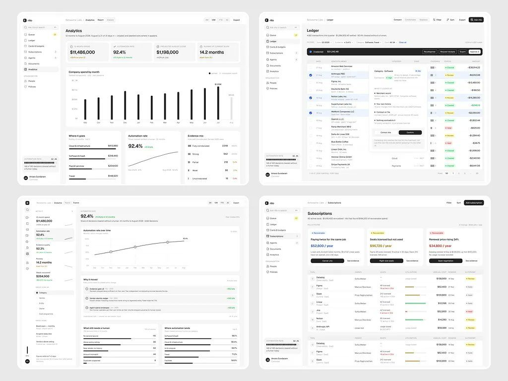
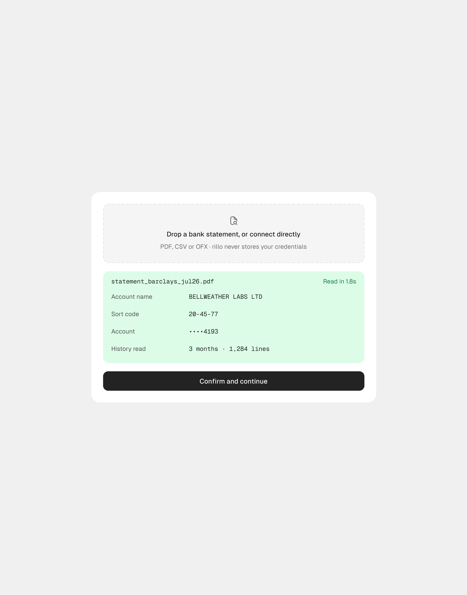

# Rillo

28 peças, 60.293 views, 880 salvos (14,6/1k). Série
irmã do Vero, publicada em paralelo e com a mesma estrutura de sidebar clara.

| Campo | Valor |
|---|---|
| Nome | rillo (logo quadrado preto) |
| Setor | despesas corporativas e recibos com IA: fila de revisão, ledger, cartões e orçamentos, assinaturas, agentes, documentos, analytics |
| Para quem | financeiro / controladoria ("Bellweather Labs", "Amara Sundaram") |
| Tema | claro; fundo `#F6F6F6`, cartão `#FFFFFF` **[MEDIDO]** |
| Plataforma | web desktop (+ site de marketing) |
| Acento | quase monocromático: preto para barras e botões ("Ask rillo" preto com atalho), cor só em status (verde "Refund matched", amarelo "Above approver ceiling", vermelho "Synthetic receipt") **[OBSERVADO]** |

## Telas publicadas

<!--T:Rillo-->
| # | views | salvos | salvos/1k | mídia | legenda |
|---|---:|---:|---:|---|---|
| 1 | 2.751 | 46 | 16,7 | 1 img | Rillo, AI-Powered Expense & Receipt Intelligence Product |
| 2 | 946 | 7 | 7,4 | 1 img | Rillo, AI-Powered Expense & Receipt Intelligence Product |
| 3 | 1.417 | 20 | 14,1 | 1 img | Rillo, AI-Powered Expense & Receipt Intelligence Product |
| 4 | 3.430 | 62 | 18,1 | 1 img | Rillo, AI-Powered Expense & Receipt Intelligence Product |
| 5 | 618 | 4 | 6,5 | 1 img | Rillo, AI-Powered Expense & Receipt Intelligence Product |
| 6 | 613 | 3 | 4,9 | 2 img | Rillo, AI-Powered Expense & Receipt Intelligence Product |
| 7 | 412 | 2 | 4,9 | 1 img | Rillo, AI-Powered Expense & Receipt Intelligence Product |
| 8 | 333 | 0 | 0,0 | 1 img | Rillo, AI-Powered Expense & Receipt Intelligence Product |
| 9 | 1.333 | 16 | 12,0 | 1 img | Vero, AI-Powered Revenue Intelligence Product |
| 10 | 390 | 2 | 5,1 | 1 img | Rillo ,AI-Powered Expense & Receipt Intelligence Product |
| 11 | 4.677 | 83 | 17,7 | 1 img | Rillo, AI Powered Expense & Receipt Intelligence Product |
| 12 | 943 | 8 | 8,5 | 1 img | Yooo !!! about finish the design... |
| 13 | 5.907 | 129 | 21,8 | 1 img | Rillo AI Powered Expense & Receipt Intelligence Product |
| 14 | 2.686 | 36 | 13,4 | 1 img |  |
| 15 | 2.306 | 25 | 10,8 | 1 img | Rillo , AI Powered Expense & Receipt Intelligence Product |
| 16 | 2.948 | 48 | 16,3 | 1 img | Rillo, AI-Powered Expense & Receipt Intelligence Product |
| 17 | 2.566 | 33 | 12,9 | 1 img | Rillo, AI-Powered Expense & Receipt Intelligence Product |
| 18 | 2.245 | 38 | 16,9 | 1 img | Rillo, AI-Powered Expense & Receipt Intelligence Product |
| 19 | 1.920 | 23 | 12,0 | 1 img | Rillo, AI-Powered Expense & Receipt Intelligence Product |
| 20 | 3.251 | 56 | 17,2 | 1 img | Rillo, AI Powered Expense & Receipt Intelligence Product |
| 21 | 2.330 | 37 | 15,9 | 3 img | Rillo, AI Powered Expense & Receipt Intelligence Product |
| 22 | 785 | 7 | 8,9 | 1 img | Rillo, AI-Powered Expense & Receipt Intelligence Product |
| 23 | 2.091 | 30 | 14,3 | 1 img | Rillo, AI Powered Expense & Receipt Intelligence Product |
| 24 | 2.205 | 24 | 10,9 | 1 img | Rillo, AI Powered Expense & Receipt Intelligence Product |
| 25 | 1.216 | 7 | 5,8 | 1 img | Rillo,  AI Powered Expense & Receipt Intelligence Product |
| 26 | 3.707 | 72 | 19,4 | 1 img | Rillo, AI Powered Expense & Receipt Intelligence Product |
| 27 | 1.154 | 3 | 2,6 | 1 img | Rillo, AI Powered Expense & Receipt Intelligence Product |
| 28 | 5.113 | 59 | 11,5 | 3 img | Onboarding flow cards design. |
| **total** | **60.293** | **880** | **14,6** | | |
<!--/T-->

> Nota: uma das peças tem legenda de Vero, mas a imagem mostra o logo do rillo (e uma do Vero, o inverso). As tabelas seguem o **logo**. **[OBSERVADO]**

## Navegação

Sidebar clara: Queue (12), Ledger, Cards & budgets, Subscriptions, Agents,
Documents, Analytics / ORGANISATION (People, Policies); no pé "AUTOMATION RATE
92.4%" com barra de traços e o usuário. Topo: breadcrumb, abas Queue / List /
Split / Focus, Filter, Sort, botão preto "Ask rillo ⌘K".

## Módulos

| Tela | Conteúdo |
|---|---|
| Queue | lista de decisões pendentes (fornecedor, valor, motivo em pílula colorida, barras de evidência "3/5") + detalhe do recibo: alerta vermelho "The receipt does not match the charge", "What rillo checked" com 5 verificações, "rillo proposes" em passos numerados, "Also affected" |
| Ledger | tabela de transações com seleção múltipla e barra de ação preta |
| Analytics | 4 KPIs, barras pretas finas de gasto por mês, "Where it goes", taxa de automação |
| Subscriptions | 3 cartões de recomendação ("Paying twice for the same job", "Seats licensed but not used") com valor anual e botão preto, tabela de ferramentas |

## O que é específico deste setor

Fraude e conformidade de despesa: cada item tem **evidência contada** (3/5) e a IA
mostra o que verificou antes de propor. Pouca cor porque é contabilidade.

## Performance

Nas 27 primeiras peças, 821 salvos, 14,9/1k. O pico (5.907 views, 129 salvos) é o
mockup em perspectiva da tela Queue. As views por peça crescem com o alcance do
perfil, não com a série: 618 no começo, 3.707 duas semanas depois.

## Mais telas da série

Rillo: três cartões isolados de onboarding (*"Onboarding flow cards design."*): o nível de
autonomia em três opções com a regra em mono, o extrato lido com os campos extraídos e a empresa
achada no registro oficial com "rillo filled 7 fields".

