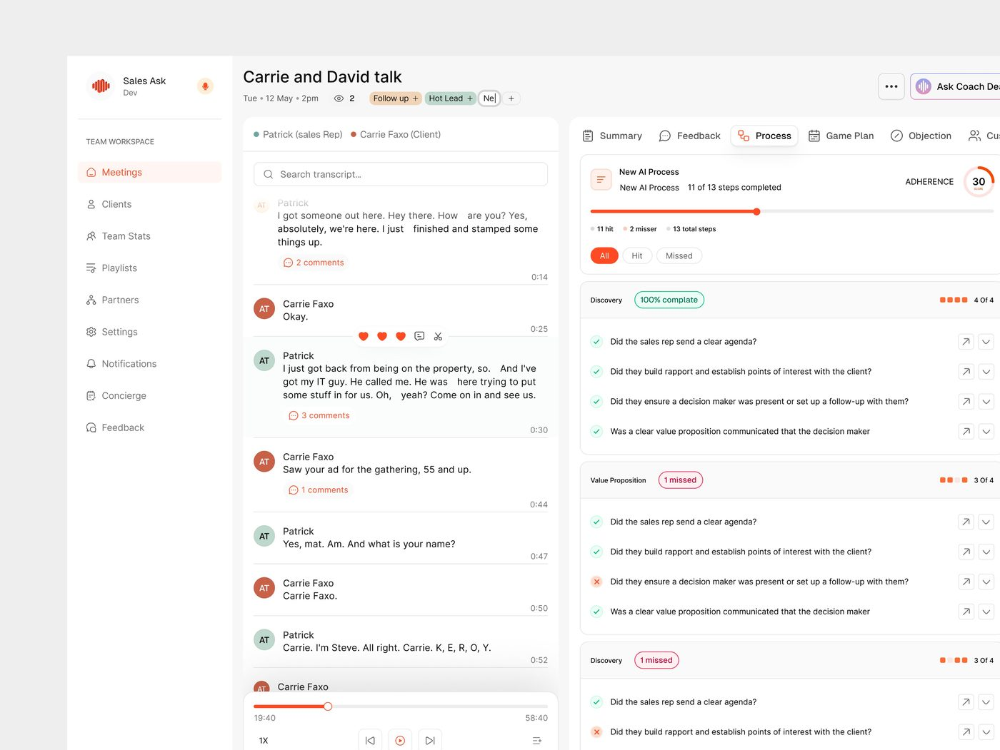

# SalesAsk (Salach.ai)

15 peças em seis semanas, 21.632 views, 124 salvos (5,7/1k). **Cliente real
com site no ar**: "High-converting hero design. Live now.",
"Footer design for salesask. This one was rejected." e
"The footer client approved and is live now.".

| Campo | Valor |
|---|---|
| Nome | Sales Ask (logo: ondas sonoras em vermelho-laranja); aparece também como "Salach.ai" |
| Setor | coaching de vendas com IA para agências: analisa gravação de reunião, aderência ao processo, objeções |
| Para quem | gestor comercial e vendedor de agência ("Ai Sales coaching for agency sales rep") |
| Tema | claro |
| Plataforma | web (produto) + site de marketing |
| Acento | laranja `#FF4922` **[MEDIDO]** |

## Telas publicadas

<!--T:SalesAsk-->
| # | views | salvos | salvos/1k | mídia | legenda |
|---|---:|---:|---:|---|---|
| 1 | 371 | 1 | 2,7 | 1 img | Ai Sales coaching for agency sales rep- how is that. |
| 2 | 296 | 0 | 0,0 | 1 img | Ai Sales coaching for agency sales rep-  how is that. |
| 3 | 1.281 | 3 | 2,3 | 1 img | AI sales coaching product design for digital agency. |
| 4 | 404 | 1 | 2,5 | 1 img | Ai Sales coaching for agency sales rep- Rate this? |
| 5 | 427 | 5 | 11,7 | 1 img | Salach.ai- AI Sales Conversation Product |
| 6 | 1.595 | 12 | 7,5 | 4 img | UI card design for Ai powered sales coaching platform. |
| 7 | 2.547 | 7 | 2,7 | 1 img | High-converting hero design. Live now. |
| 8 | 2.376 | 5 | 2,1 | 1 img | Footer design for salesask. This one was rejected. |
| 9 | 1.941 | 5 | 2,6 | 2 img | Saas website Hero design. |
| 10 | 1.164 | 5 | 4,3 | 1 img | Product design for salesask. Rate the UI. |
| 11 | 665 | 2 | 3,0 | 1 img | cards ui design. |
| 12 | 5.315 | 65 | 12,2 | 1 img | Process details tab design. |
| 13 | 1.231 | 8 | 6,5 | 1 img | The footer client approved and is live now.  Saas marketing site desig |
| 14 | 1.291 | 5 | 3,9 | 1 img | 2nd Version of hero section for AI sales coaching platform. |
| 15 | 728 | 0 | 0,0 | 3 img | Hero that converts. |
| **total** | **21.632** | **124** | **5,7** | | |
<!--/T-->

## Módulos

- **Reunião** ("Process details tab design", 5.315 views, o
  maior da série): transcrição com avatares e comentários à esquerda; à direita
  abas Summary / Feedback / Process / Game Plan / Objection; aderência "30" em
  anel laranja, "11 of 13 steps completed", checklist por fase (Discovery 100%
  complete, Value Proposition "1 missed") com ✓ verde e ✗ vermelho; player de
  áudio no pé.
- Sidebar TEAM WORKSPACE: Meetings, Clients, Team Stats, Playlists, Partners,
  Settings, Notifications, Concierge, Feedback.
- **Cartões**: cartões isolados do produto.
- **Site**: 2 versões de hero ("2nd Version of hero section… These are campaign
  focused heros"), footer rejeitado e aprovado.

## O que é específico

Avaliação de conversa: checklist binário por etapa do método de vendas e contagem
de etapas cumpridas. É a série que mostra **o que o cliente rejeitou**,
material raro. **[CONFIRMADO]** pelos textos.
