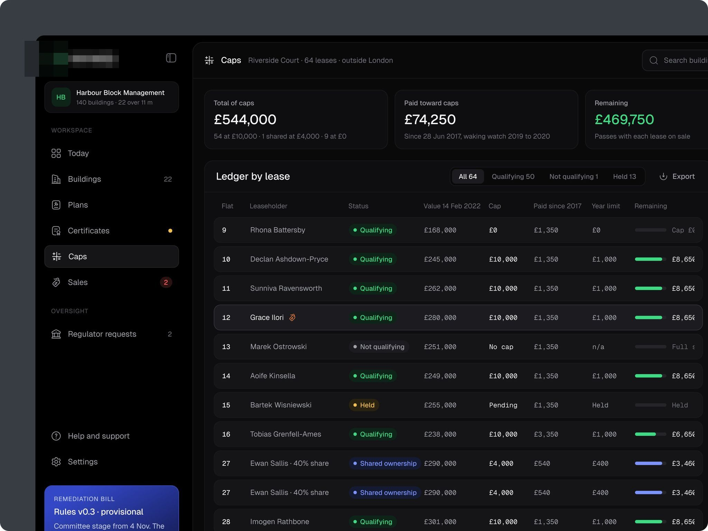
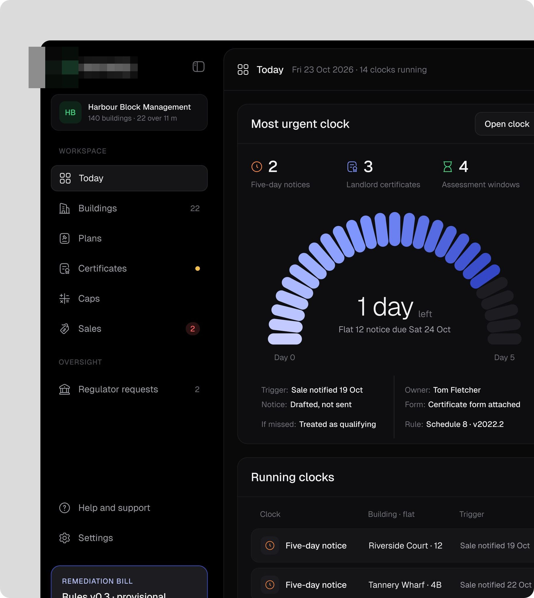
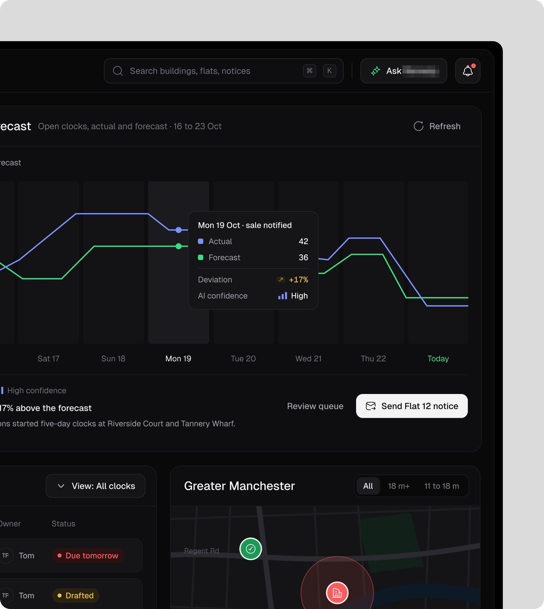
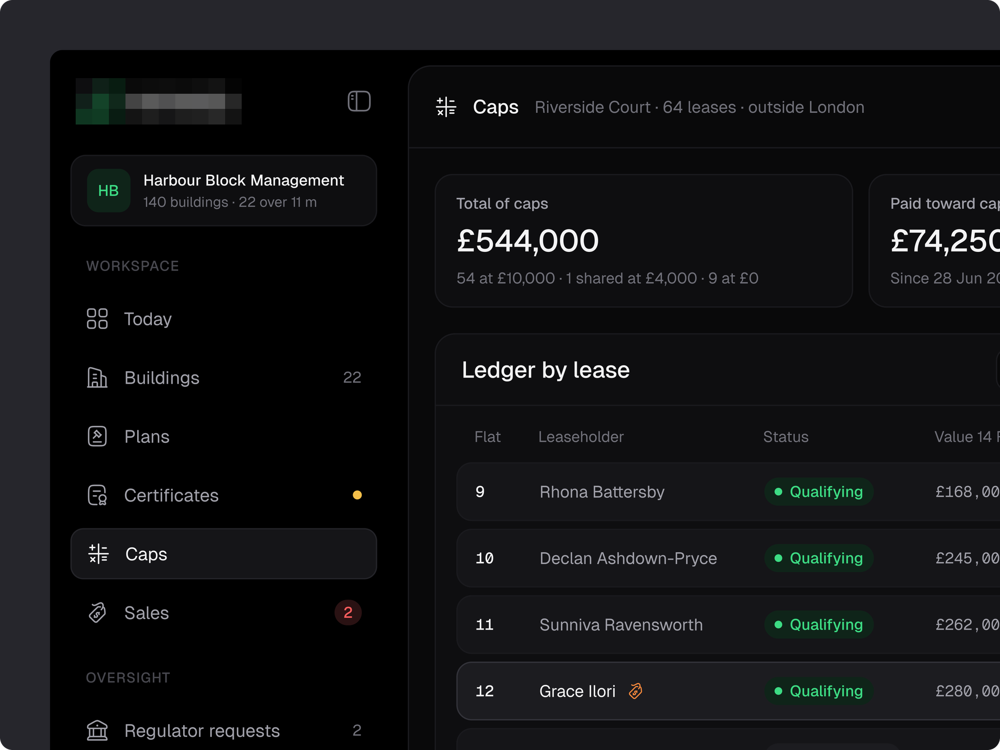
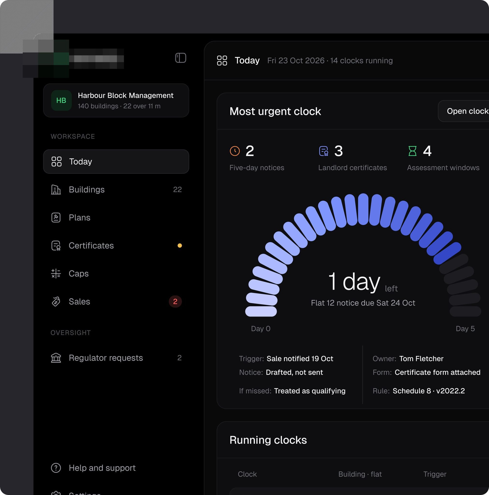
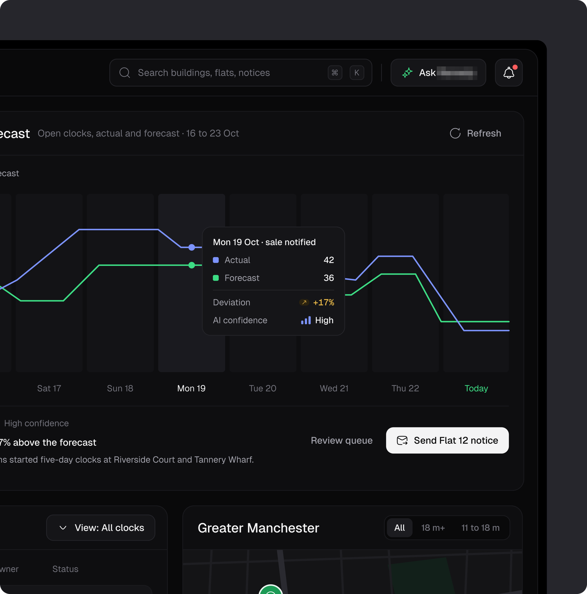
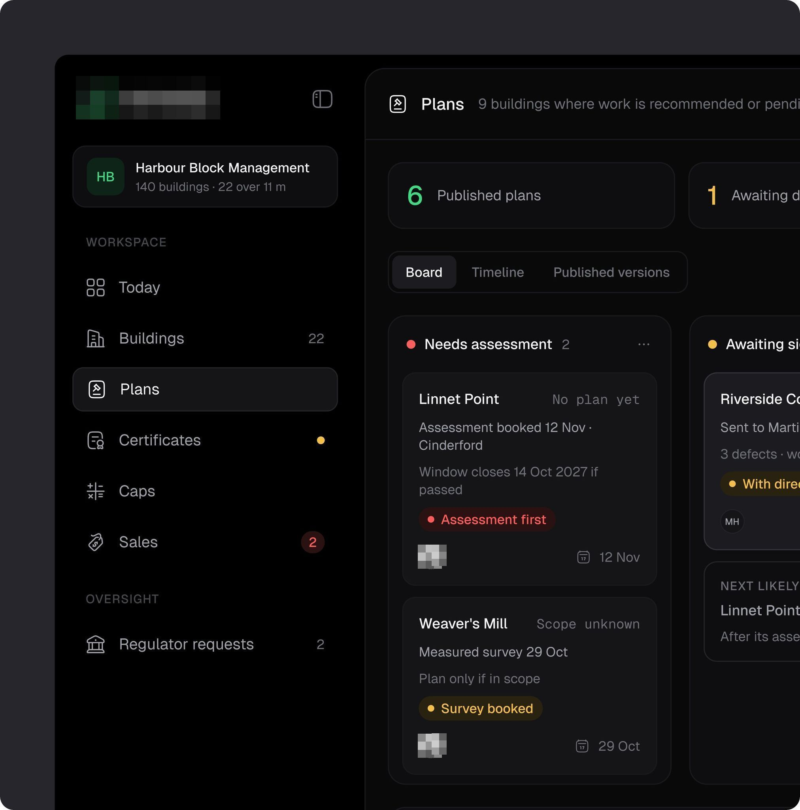
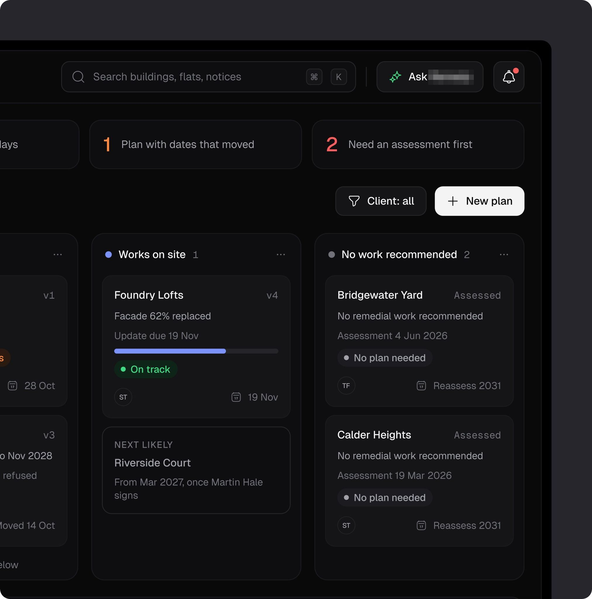

# Painel de segurança predial

**Segurança predial (Reino Unido): relógios de prazo legal, tetos por contrato e planos de remediação.** **[CONFIRMADO]** pelo logo.

| Campo | Valor |
|---|---|
| Setor | segurança de edifícios: prazos legais (clocks), certificados, planos, tetos de cobrança por contrato, vendas |
| Para quem | a administradora ("Harbour Block Management") |
| Tema | escuro, quase preto |
| Plataforma | web |
| Acento | roxo-azulado no medidor de prazo; verde no logo e no restante [OBSERVADO] |

## O que a ficha ensina

- **Desenhe o prazo mais urgente como medidor em arco**: "1 day left · Flat 12 notice due Sat 24 Oct", com gatilho, dono, formulário e regra embaixo.
- **Ponha a confiança da IA no tooltip da previsão** ("AI confidence High").
- **Mostre teto, pago e restante numa barra por contrato.**

## O que cada tela tem

Uma linha por imagem; o texto da tela vai entre aspas.

- Painel de segurança predial escuro (segurança predial, Reino Unido): "Caps" com três KPIs e o "Ledger by lease" com status, teto, pago e barra do restante 
- Metade esquerda do díptico do painel de segurança predial escuro: "Most urgent clock" com o medidor em arco "1 day left" e os relógios correndo 
- Metade direita do díptico do painel de segurança predial escuro: previsão de relógios com a linha real x prevista, "Send Flat 12 notice" e o mapa 
- Recorte ampliado do painel de segurança predial escuro: menu, "Total of caps £544,000" e o início do "Ledger by lease" 
- Metade esquerda do painel de segurança predial escuro: o medidor "1 day left" de novo 
- Metade direita do painel de segurança predial escuro: a previsão de relógios de novo 
- Recorte ampliado do painel de segurança predial escuro: "Plans" em quadro com "Needs assessment" e "Awaiting" 
- Recorte ampliado do painel de segurança predial escuro: "Plans" com "Works on site" e "No work recommended", e "New plan" 
