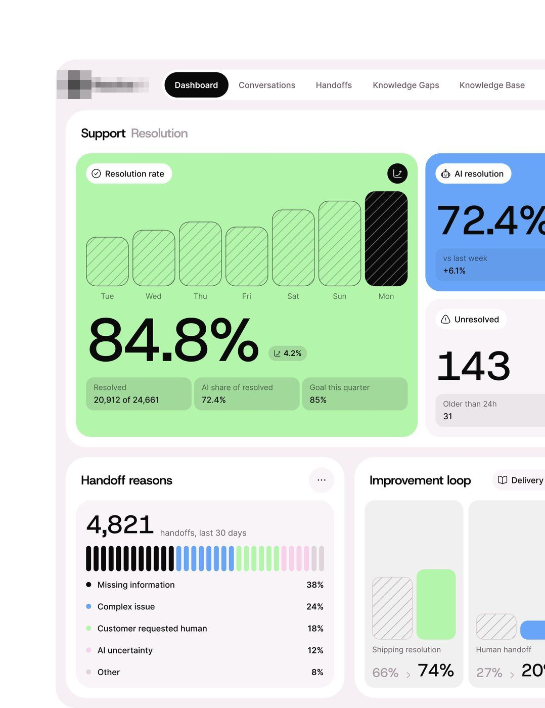
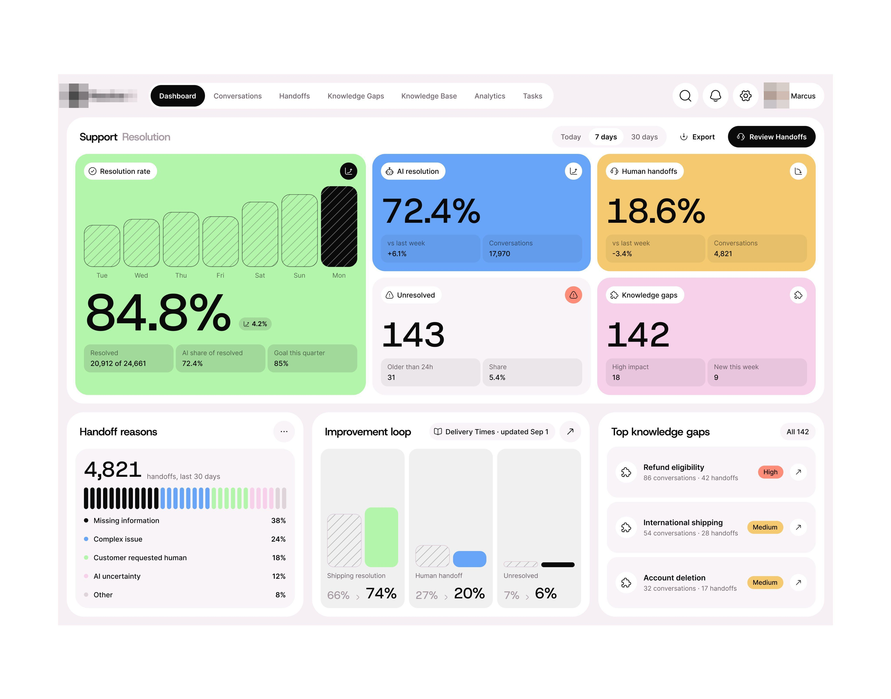
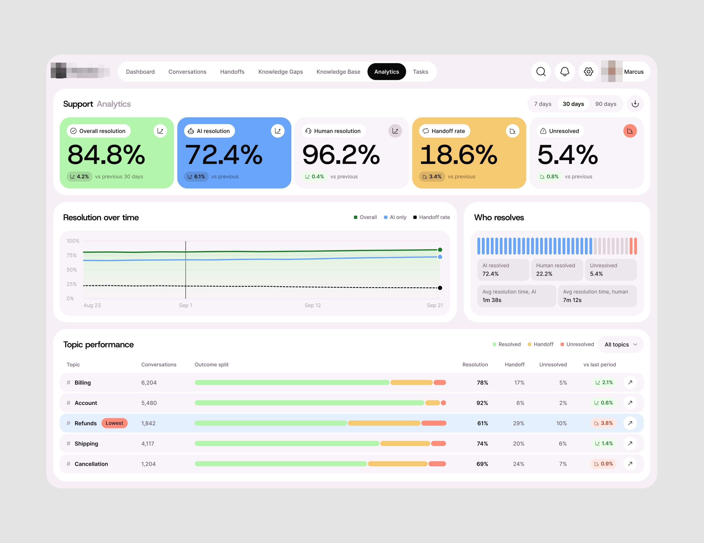
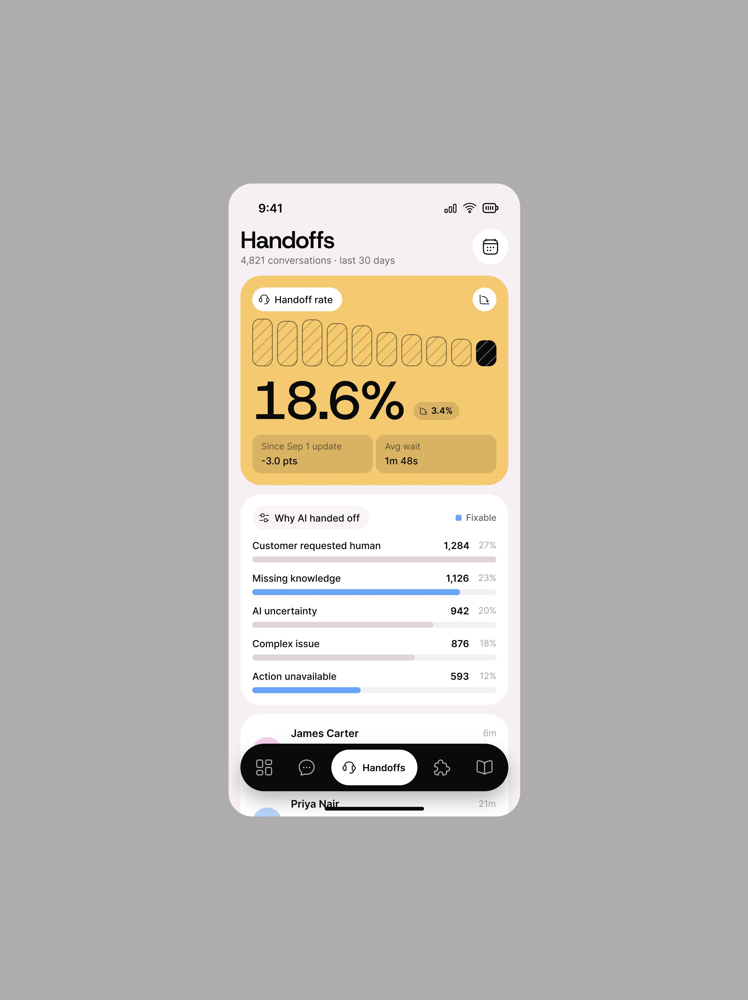
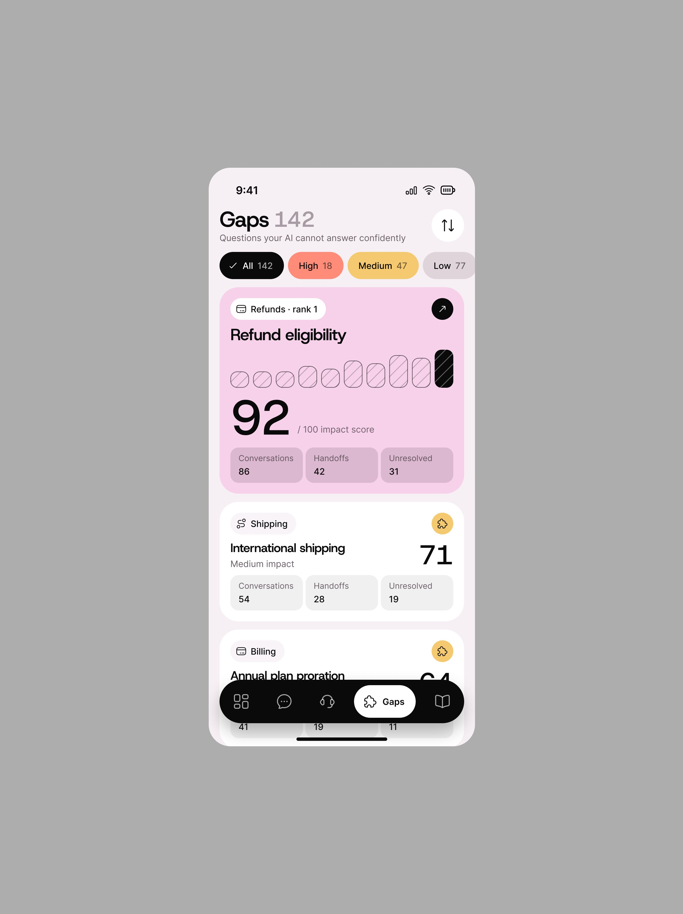
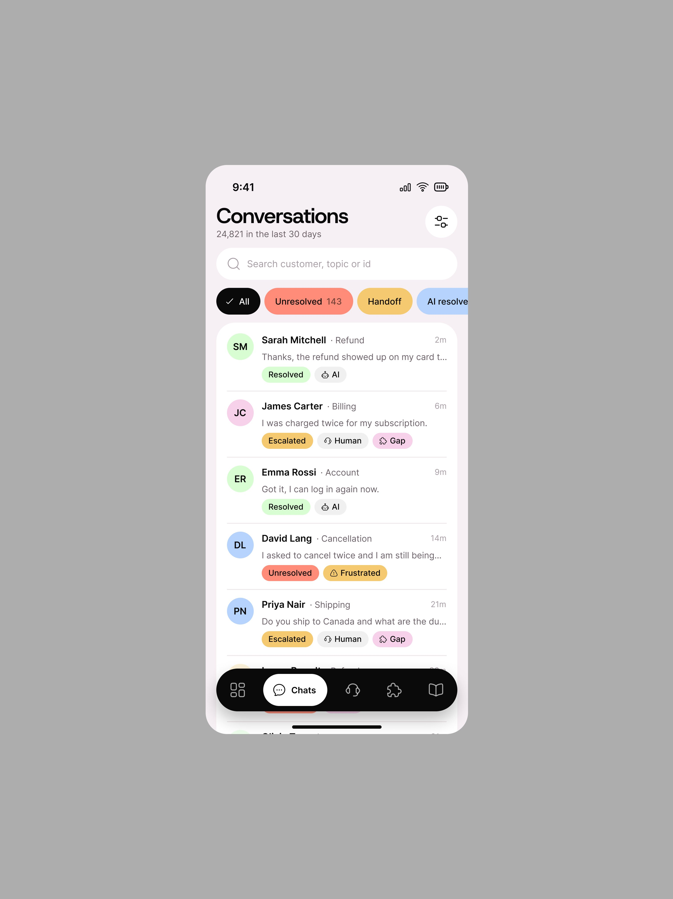

# Suporte com IA

Legenda da peça principal: um suporte ao cliente que o time gosta de usar, interface divertida,
cor de pêssego e agradável; desenhar projeto sério é mais fácil que produto divertido; e a
categoria, plataforma de resolução de suporte com IA. **[CONFIRMADO]**

| Campo | Valor |
|---|---|
| Nome | Suporte com IA ("Resolve" preto + "AI" cinza; logo em quadrado preto) |
| Setor | atendimento ao cliente resolvido por IA, com handoff para humano |
| Para quem | líder de suporte |
| Tema | claro, fundo rosado `#F6F3F6` **[MEDIDO]** |
| Plataforma | web |
| Acento | **vários cartões de cor chapada**: verde-claro, azul `#6FA4F8`-ish, lilás, laranja `#FF6A4A`, amarelo-lime `#E4FC3C`, âmbar `#F5C970`, e preto para a barra "hoje" **[MEDIDO: top 4 matizes 31%, 14%, 14% dos pixels saturados]** |

## Módulos

- Nav no topo em abas (Dashboard em pílula preta, Conversations, Handoffs,
  Knowledge Gaps, Knowledge Base).
- "Support Resolution": cartão verde grande "Resolution rate 84.8%" com 7 barras
  hachuradas e a de hoje **preta**; cartão azul "AI resolution 72.4%"; "Unresolved
  143"; "Handoff reasons 4,821" com barra de traços multicolor; "Improvement loop".
- Grade de 6 cartões coloridos, cada um uma métrica com o
  mesmo desenho: barras hachuradas + barra preta de hoje + número gigante + 3
  submétricas em células translúcidas.

## O que é específico

É o "fun product" declarado: mesma gramática de KPI dos outros, mas cada cartão
inteiro em cor. Mostra que a cor é decisão de tom de marca, não do dado.

## Mais telas da série

O suporte com IA é **o caso de muita cor sem ruído**: as legendas gabam muita cor sem ruído
na interface, fresca e quente, e perguntam aos designers como manter uma página carregada de
informação consistente, envolvente e colorida, com a tela como resposta. Cada métrica tem um cartão inteiro numa cor (verde, azul, amarelo,
rosa), e o resto da tela é branco; no celular (legenda: brincar com cor é divertido e útil)
o mesmo cartão colorido abre cada aba (Handoffs em amarelo, Gaps em rosa).

