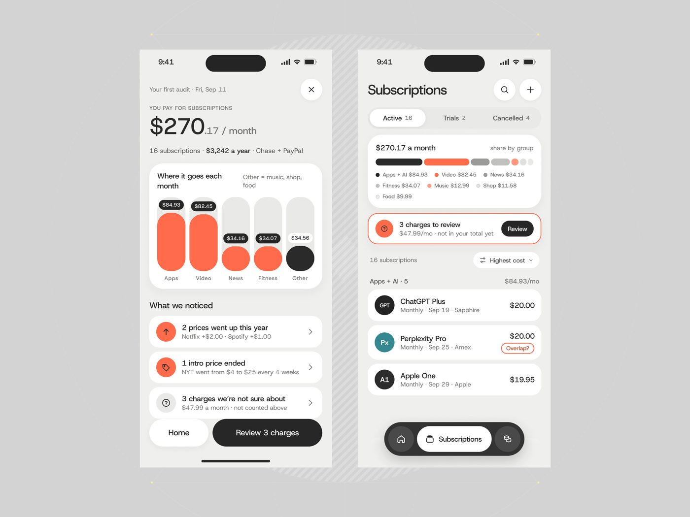
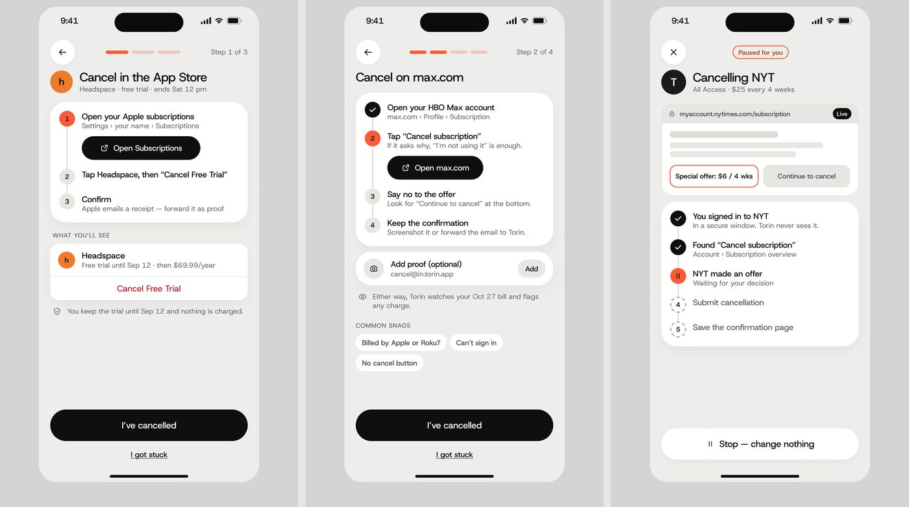
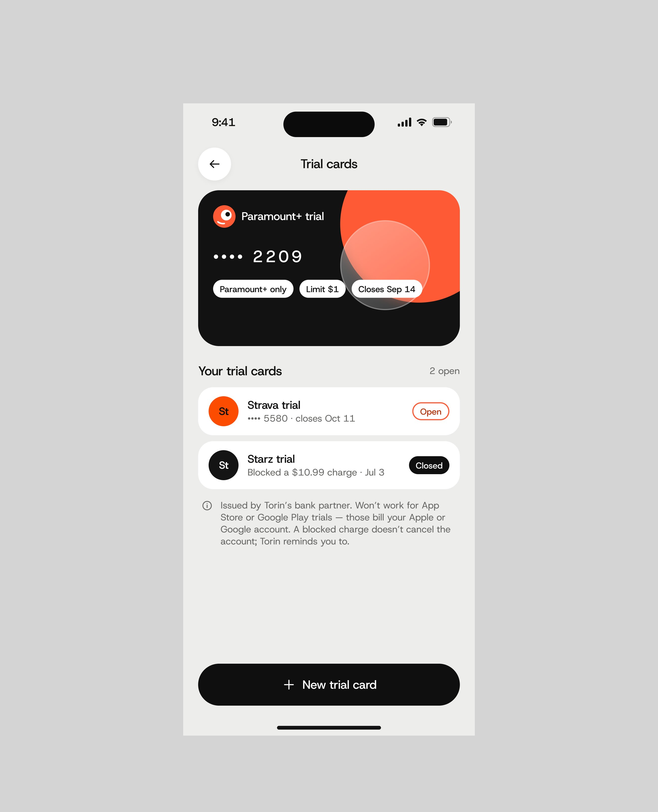
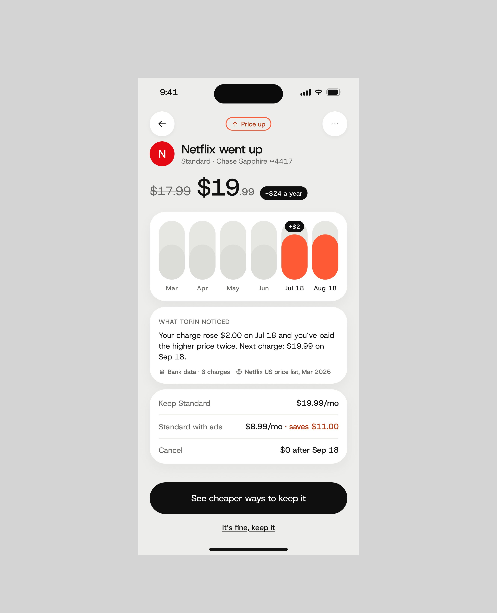
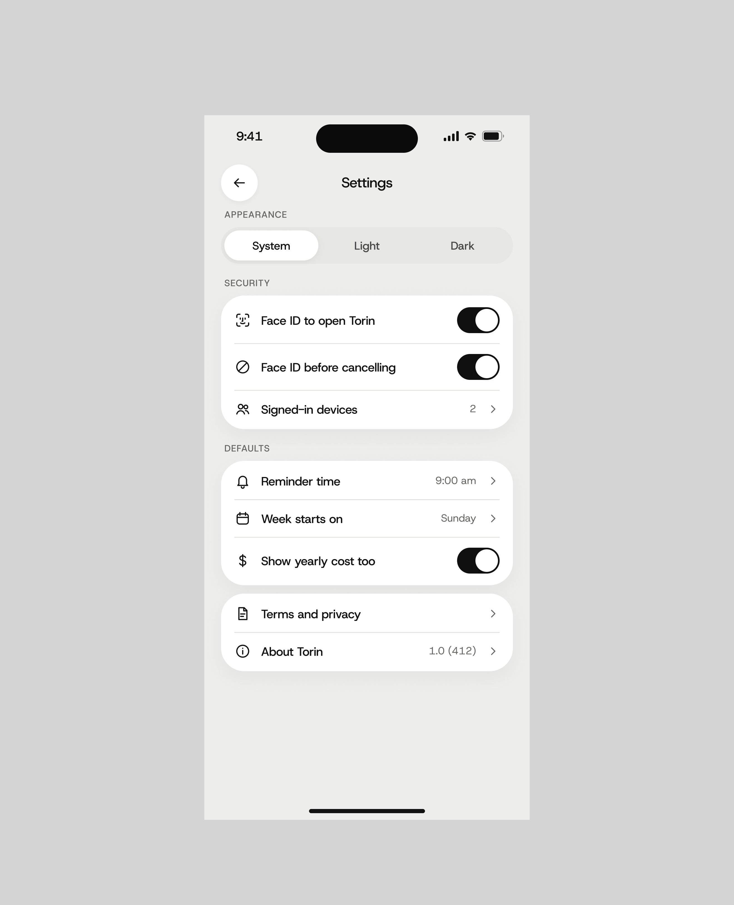

# Torin

4 peças, 23.952 views, 340 salvos (14,2/1k).

| Campo | Valor |
|---|---|
| Nome | Torin ("Subscription & Money Management Mobile App") |
| Setor | finanças pessoais: auditoria e cancelamento de assinaturas |
| Para quem | consumidor com muitas assinaturas ("16 subscriptions · $3,242 a year · Chase + PayPal") |
| Tema | claro; fundo de tela cinza-quente `#EDEDEA`, moldura `#D2D2D2` **[MEDIDO]** |
| Plataforma | mobile |
| Acento | coral `#FF6645`; botões de ação pretos **[MEDIDO]** |

## Telas publicadas

<!--T:Torin-->
| # | views | salvos | salvos/1k | mídia | legenda |
|---|---:|---:|---:|---|---|
| 1 | 7.895 | 106 | 13,4 | 3 img | Rate the UI Bro! No fancy graphics, just functionality. |
| 2 | 2.685 | 26 | 9,7 | 2 img | Torin, Subscription & Money Management Mobile App |
| 3 | 5.635 | 100 | 17,7 | 2 img | Torin, Subscription & Money Management Mobile App |
| 4 | 7.737 | 108 | 14,0 | 3 img | mobile app UI design |
| **total** | **23.952** | **340** | **14,2** | | |
<!--/T-->

## Módulos

- **Primeira auditoria**: "$270.17 / month" enorme, barras verticais arredondadas
  por grupo (Apps, Video em coral cheio; News, Fitness em coral pela metade; Other
  em preto), "What we noticed" (preço subiu, intro terminou, cobranças suspeitas),
  botão preto "Review 3 charges".
- **Subscriptions**: abas Active 16 / Trials 2 / Cancelled 4, barra empilhada por
  grupo, alerta com borda coral "3 charges to review", lista de serviços reais
  (ChatGPT Plus, Perplexity Pro com selo "Overlap?", Apple One); tab bar flutuante
  preta.
- **Fluxo de cancelamento** ("Rate the UI Bro! No fancy
  graphics, just functionality."): passo a passo com barra de progresso segmentada
  coral, passos numerados com o atual em círculo coral, botão preto de
  deep link ("Open Subscriptions", "Open max.com"), "Common snags" em chips, CTA
  "I've cancelled" + link "I got stuck".

## O que é específico

O app **não cancela por você**: guia o usuário por fora (App Store, max.com) e
pede prova. Honestidade sobre o limite do produto é o design.

## Mais telas da série

Torin tem também estas três telas: cartões virtuais de teste (limite de $1, fecha na data do fim do
teste), **"Netflix went up"** com o preço riscado, "+$24 a year", o histórico em barras e o bloco "What
Torin noticed" com a base (bank data, 6 charges), e as configurações ("Face ID before cancelling", "Show
yearly cost too").

