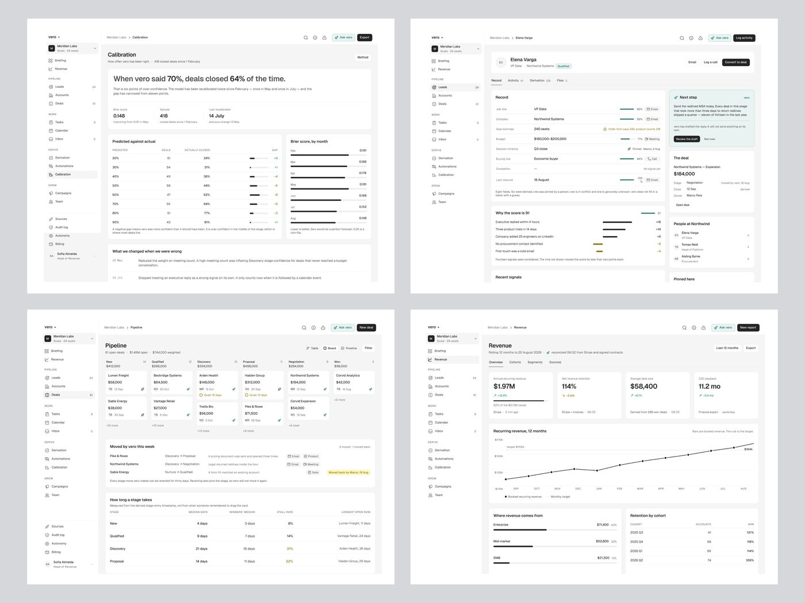
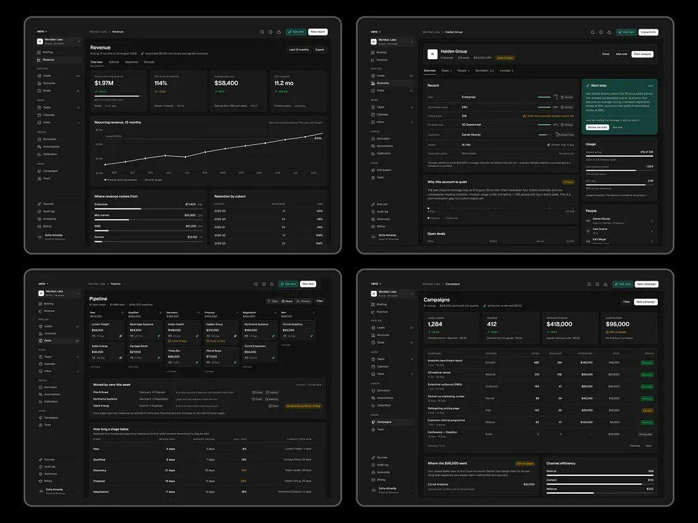

# Vero

**A série mais longa da amostra.** 30 peças em 18 dias, 76.817 views, 1.178
salvos, 15,3 salvos/1k. Quase todas com a mesma legenda ("Vero, AI Powered
Revenue Intelligence Product"), e é justamente por isso que nenhuma peça passou
de 5.553 views, exceto a de abertura com gancho ("Building Saas has become my
breakfast, lunch, and dinner", 22.467 views, 387 salvos).

| Campo | Valor |
|---|---|
| Nome | vero (minúsculo, com ponto verde depois do nome) |
| Setor | CRM / inteligência de receita: leads, contas, deals, previsão e calibração do modelo |
| Para quem | Head of Revenue de SaaS B2B ("Sofia Almeida · Head of Revenue", workspace "Meridian Labs · Scale · 24 seats") |
| Tema | claro (fundo `#F5F5F5`, cartão `#FFFFFF`) e escuro (fundo `#181818`) **[MEDIDO]** |
| Plataforma | web desktop |
| Acento | verde `#29715D`; cartão de IA em menta `#E1F4F0`; botão "Ask vero" em menta `#C8EDED` com ícone de brilho; botão de ação preto `#2E2E2E`-`#484848` **[MEDIDO]** |

## Telas publicadas

<!--T:Vero-->
| # | views | salvos | salvos/1k | mídia | legenda |
|---|---:|---:|---:|---|---|
| 1 | 22.467 | 387 | 17,2 | 1 img | Building Saas has become my breakfast, lunch, and dinner.  See how sic |
| 2 | 1.323 | 14 | 10,6 | 1 img | Vero, AI-Powered Revenue Intelligence Product |
| 3 | 1.303 | 11 | 8,4 | 1 img | Vero, AI-Powered Revenue Intelligence Product |
| 4 | 1.024 | 11 | 10,7 | 1 img | Vero, AI-Powered Revenue Intelligence Product |
| 5 | 702 | 10 | 14,2 | 1 img | Vero,AI-Powered Revenue Intelligence Product |
| 6 | 590 | 3 | 5,1 | 1 img | Vero,AI-Powered Revenue Intelligence Product |
| 7 | 474 | 1 | 2,1 | 1 img | Vero , AI-Powered Revenue Intelligence Product |
| 8 | 442 | 2 | 4,5 | 1 img | Vero , AI-Powered Revenue Intelligence Product |
| 9 | 438 | 2 | 4,6 | 1 img | Vero, AI-Powered Revenue Intelligence Product |
| 10 | 5.553 | 101 | 18,2 | 1 img | Vero , AI Powered Revenue Intelligence Product |
| 11 | 4.550 | 93 | 20,4 | 1 img | Vero,AI Powered Revenue Intelligence Product |
| 12 | 2.413 | 46 | 19,1 | 1 img | Vero ,AI-Powered Revenue Intelligence Product |
| 13 | 5.127 | 117 | 22,8 | 1 img | Vero, AI Powered Revenue Intelligence Product |
| 14 | 1.790 | 20 | 11,2 | 1 img | Clean and enjoyable UI❤️ |
| 15 | 2.603 | 38 | 14,6 | 1 img | Vero, AI Powered Revenue Intelligence Product |
| 16 | 1.536 | 7 | 4,6 | 1 img | Vero,AI Powered Revenue Intelligence Product |
| 17 | 1.397 | 21 | 15,0 | 1 img | Vero, AI Powered Revenue Intelligence Product |
| 18 | 834 | 0 | 0,0 | 1 img | Vero, AI Powered Revenue Intelligence Product |
| 19 | 3.208 | 53 | 16,5 | 1 img | Vero, AI-Powered Revenue Intelligence Product |
| 20 | 2.521 | 32 | 12,7 | 1 img | Vero, AI-Powered Revenue Intelligence Product |
| 21 | 1.318 | 12 | 9,1 | 1 img | Vero, AI Powered Revenue Intelligence Product |
| 22 | 1.189 | 9 | 7,6 | 1 img | Vero, AI Powered Revenue Intelligence Product |
| 23 | 731 | 5 | 6,8 | 1 img | Vero, AI Powered Revenue Intelligence Product |
| 24 | 2.992 | 47 | 15,7 | 1 img | Vero, AI Powered Revenue Intelligence Product |
| 25 | 2.161 | 35 | 16,2 | 1 img | Vero, AI Powered Revenue Intelligence Product |
| 26 | 2.088 | 35 | 16,8 | 1 img | Vero, AI Powered Revenue Intelligence Product |
| 27 | 2.634 | 37 | 14,0 | 1 img | Vero, AI Powered Revenue Intelligence Product |
| 28 | 1.145 | 12 | 10,5 | 1 img | Vero, AI Powered Revenue Intelligence Product |
| 29 | 1.233 | 10 | 8,1 | 1 img | Rillo, AI Powered Expense & Receipt Intelligence Product |
| 30 | 1.031 | 7 | 6,8 | 1 img | Vero, AI Powered Revenue Intelligence Product |
| **total** | **76.817** | **1.178** | **15,3** | | |
<!--/T-->

> Nota: uma peça tem legenda de Rillo, mas a imagem mostra o logo do vero; e outra (legenda de Vero) mostra o logo do rillo. As tabelas seguem o **logo**, não a legenda: as legendas dessas duas estão trocadas. **[OBSERVADO]**

## Navegação

Sidebar branca estreita (≈190 px) com grupos em caixa baixa pequena: Briefing,
Revenue / PIPELINE (Leads 24, Accounts, Deals 61) / WORK (Tasks 9, Calendar,
Inbox 5) / DERIVE (Derivation, Automations, Calibration) / GROW (Campaigns, Team)
e no pé Sources, Audit log, Autonomy, Billing. Topo: breadcrumb "Meridian Labs >
Tela", ícones de busca, info e alerta, botão menta "Ask vero" e botão preto de
ação principal ("Export", "Log activity", "New deal").

## Módulos

| Tela | O que tem |
|---|---|
| Calibration | manchete em frase ("When vero said 70%, deals closed 64% of the time."), Brier score, tabela previsto × real com barra de gap, "What we changed when we were wrong" |
| Lead (Elena Varga) | abas Record / Activity / Derivation / Files; cada campo com barra de confiança e fonte (Email, Meeting, Call); "Why the score is 91" com contribuições +/-; cartão menta "Next step" com rascunho da IA |
| Pipeline | kanban de 6 colunas com valor por coluna, "Moved by vero this week" com reversão, "How long a stage takes" |
| Revenue | 4 KPIs (ARR $1.97M, NRR 114%...), linha de 12 meses com meta, receita por segmento, retenção por coorte |
| Audit log (escuro) | tabela de ações da IA com resultado (Applied/Held/Stopped) e "Decision record" em mono |

## Componentes-chave

- **Frase-manchete** no topo de tela analítica, com o número em negrito dentro da frase.
- **Barra de confiança por campo** (curta, verde) + fonte do dado ao lado.
- **Explicação do score** como lista de sinais com barra positiva (preta) e negativa (ocre `#917110`).
- Tudo o que a IA mudou é **reversível e datado** ("Moved back by Marco, 19 Aug").

## O que é específico deste setor

Dinheiro e previsão: a tela precisa convencer o gestor de que o modelo é honesto.
Daí a tela de calibração, o log e a explicação de cada score.

## Performance

30 peças, 76.817 views, **1.178 salvos (15,3/1k)**. Views por peça baixas, salvos
altos: é a série que as pessoas guardam, não a que viraliza. Os melhores dias
somam 5.553, 4.550 e 5.127 views. A versão escura teve o mesmo desempenho da
clara.

## Como reproduzir

Apresentação em **colagem 2×2 de telas inteiras** sobre cinza `#D6D7DB`
**[MEDIDO]**; cada tela com fundo `#F5F5F5` e cartões brancos, sem sombra,
raio ≈12 px; tipografia pequena (corpo ≈13 px) e densa.
