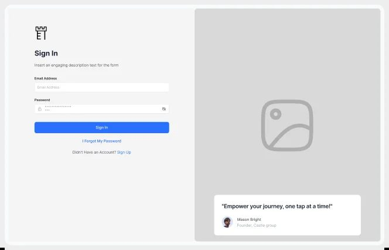
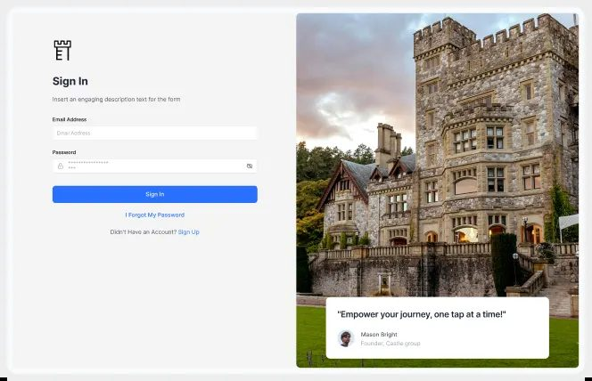

# 09 · O site de vitrine

> O site de quem vende design de produto, lido como peça de design: estrutura de seções, tokens,
> componentes e movimento de um site de vitrine calmo, medido no DOM e no pixel, e o que denuncia o
> template de site genérico. O caminho do genérico ao produto está em [README.md](README.md); a oferta e
> o funil, em [../00-oferta-e-venda/README.md](../00-oferta-e-venda/README.md).
>
> Legenda: **[MEDIDO]** no DOM, no CSS ou no pixel; **[CONFIRMADO]** lido na própria página;
> **[OBSERVADO]** visto; **[INFERIDO]** dedução.

## A vitrine calma

A regra: **a vitrine é calma e pequena para que o trabalho denso apareça por contraste**. [INFERIDO]

| | Site de vitrine | Tela de produto |
|---|---|---|
| Fonte de título | mono (Geist Mono) | Geist (grotesca, não mono), como no [design system publicado](../01-sistema-visual/design-system-publicado.md) |
| Fonte de corpo | uma humanista leve (Karla) | Inter até 16 px |
| Mono | nos títulos | só em id, hora e dinheiro |
| Densidade | quase vazio, coluna de 770 px | tela cheia de tabela e KPI |
| Cor | cinza com cor só no cartão de projeto | neutro com um acento por produto |

A família Geist liga os dois lados.

### Estrutura, de cima para baixo

Tudo numa **coluna de 770 px** centralizada, feita de painéis cinza de raio 16 sobre um fundo cinza um
tom mais escuro. A única seção que sai da coluna é a galeria. [MEDIDO no DOM a 1440 px]

| # | Seção | Altura | Conteúdo |
|---|---|---|---|
| 1 | hero | 478 | foto em meio-tom, pílula de disponibilidade ("Open to collaboration"), H1 com a promessa, resumo, linha "Currently Building" com logos, dois botões |
| 2 | projetos | 365 | "Recent Projects*" e três cartões de projeto |
| 3 | citação | 268 | uma frase sobre o tema do trabalho sobre ilustração pontilhada, revelada por animação |
| 4 | método | 477 | a frase do prazo e um diagrama das ferramentas, a principal no topo ligada às outras |
| 5 | galeria | 1103 | grade de 3 colunas em largura total com vídeos de interface |
| 6 | chamada final | 260 | "Start Today and Launch in weeks" e os dois botões |
| 7 | rodapé | 483 | onde se escreve e onde se mostra o trabalho, ícones, a frase de posicionamento, o número de projetos entregues |

Os cases não são páginas: são **painéis sobrepostos** que abrem sobre a home, cada um com "Overview *",
"Who it's for *", galeria e a mesma chamada final repetida no fim. [MEDIDO: altura 0 no DOM até abrir]

### Tokens

**Cor** [MEDIDO no estilo computado e no pixel]

| Uso | Valor |
|---|---|
| Fundo da página | `#E8E8E8` |
| Painel (hero, projetos, método, chamada) | `#F0F0F0` (lê `#EFEFEF` e `#EEEEEE` onde há textura) |
| Painel interno do diagrama | `#E9E9E9` |
| Texto de título | `#2B2B2B` |
| Texto de resumo | `#666666` |
| E-mail no rodapé | `#71717A` |
| Rótulo do cartão | `#2F2C25` (um preto quente) |
| Botão primário | fundo `#2B2B2B`, texto `rgba(255,255,255,.93)` |
| Pílula de status e moldura do cartão | `#FFFFFF` |
| Cartão de projeto lilás | `#CCB5DD` |
| Cartão de projeto verde | `#A3BE8C` |
| Cartão de projeto neutro | `#E8E8E8` |
| Marca-texto atrás de um nome | `#DFE14B` no pixel (o token é `#F9FC50`) |

**Tipo** [MEDIDO no estilo computado]

| Elemento | Família | Tamanho / altura de linha | Peso | Tracking |
|---|---|---|---|---|
| H1 do hero | Geist Mono | 24 / 29 px | 600 | -0,72 px |
| H2 de seção | Geist Mono | 20 / 29 px | 600 | -0,72 px |
| H2 da chamada | Geist Mono | 24 / 29 px | 600 | -0,72 px |
| Citação | Geist Mono | 20 / 29 px | 500 | -0,72 px |
| Resumo | Karla | 18 / 21,6 px | 400 | -0,36 px |
| Frase do rodapé | Geist Mono | 14 / 19,6 px | 500 | normal |
| Rótulo do cartão ("Site + Product*") | Geist Mono | 10 / 14 px | | -0,35 px |
| Botão | Karla | 16 / 19,2 px | 500 | -0,32 px |

**Forma e espaço** [MEDIDO]

| Elemento | Valor |
|---|---|
| Coluna | 770 px; conteúdo útil 720 px (padding 25) |
| Painel | raio 16 px, padding 25 px |
| Hero | raio `0 0 16 16` (colado no topo), padding `8 25 25` |
| Botão | pílula (raio 50 px), padding `7 12 8`, 105 × 36 px ("Quick Chat") |
| Pílula de status | raio 50 px, padding `6 12`, bolinha verde |
| Cartão de projeto | 229 px de largura, moldura branca de 6 px, raio 16 px; área colorida interna com o logo centralizado e o rótulo no canto superior direito |
| Avatar | círculo de ~170 px, foto em meio-tom |
| Diagrama do método | painel interno de ~590 × 298 px com raio grande (38); tile do topo 74 × 74 px; tiles de baixo 68 × 68 px; setas tracejadas saindo de um ponto único |

### Os traços da vitrine calma

| Traço | Onde | Leitura |
|---|---|---|
| **Monocromia com um toque de cor por cartão** | cinzas `#E8E8E8` a `#F0F0F0`, cor só nos cartões de projeto e nos tiles do diagrama | a mesma regra das telas de produto: neutro com acento contido [OBSERVADO] |
| **Mono nos títulos e tipo pequeno** | H1 de 24 px em Geist Mono | título pequeno e "técnico", nada de hero gigante [MEDIDO] |
| **Asterisco no fim de todo título** | "Recent Projects*", "Overview *" | assinatura tipográfica [CONFIRMADO] |
| **Foto em meio-tom** | hero, rodapé, imagem de compartilhamento | a mesma foto em todas as vitrines, sempre tratada como retícula [OBSERVADO] |
| **Textura pontilhada** | ilustrações de fundo do hero, da citação e do rodapé (relevo em retícula) | dá matéria ao cinza sem usar gradiente [OBSERVADO] |
| **Prova por logo, não por número** | "Currently Building ..., Previously worked at ..." com os logos na linha | [CONFIRMADO] |
| **Dois botões em pílula, sempre juntos** | hero, chamada final e cada case: um de conversa rápida, um de agenda | [MEDIDO, 4 ocorrências no DOM] |
| **Movimento discreto** | texto revelado por partes na citação, blocos que entram com a rolagem, rolagem suave | [CONFIRMADO nos scripts; o efeito exato não foi gravado] |

A galeria mostra seis peças de interface em vídeo (cartões, um seletor de créditos com botões em
relevo, ícones, um livro 3D com seletor de cor): explorações de micro-interação, não produto.
[OBSERVADO]

As imagens dos cases são **capturas do site real dentro de uma janela de navegador** (barra com
endereço), não mockup: "Turn every conversation into predictable revenue", "Production payroll. No
penalties. No surprises." [OBSERVADO]

### O esqueleto em CSS

```css
:root{
  --bg:#E8E8E8; --panel:#F0F0F0; --panel-in:#E9E9E9;
  --ink:#2B2B2B; --ink-warm:#2F2C25; --muted:#666; --muted-2:#71717A;
  --white:#FFF; --highlight:#F9FC50; --card-purple:#CCB5DD; --card-green:#A3BE8C;
  --r:16px; --r-lg:38px; --pill:50px;
  --font-brand:"Geist Mono", ui-monospace, monospace; --font-text:"Karla", system-ui, sans-serif;
}
body{background:var(--bg);color:var(--ink);font-family:var(--font-text)}
.col{width:min(770px,100% - 32px);margin-inline:auto;display:grid;gap:16px}
.panel{background:var(--panel);border-radius:var(--r);padding:25px}
.hero{border-radius:0 0 var(--r) var(--r);padding:8px 25px 25px}
h1,h2{font-family:var(--font-brand);font-weight:600;letter-spacing:-.72px;line-height:29px}
h1{font-size:24px} h2{font-size:20px}
h2::after{content:"*"}
.summary{font-size:18px;line-height:21.6px;letter-spacing:-.36px;color:var(--muted)}
.btn{border-radius:var(--pill);padding:7px 12px 8px;font:500 16px/19.2px var(--font-text);letter-spacing:-.32px;border:1px solid var(--ink)}
.btn--dark{background:var(--ink);color:rgba(255,255,255,.93)}
.status{background:#fff;border-radius:var(--pill);padding:6px 12px;font-family:var(--font-brand)}
.status::before{content:"";display:inline-block;width:10px;height:10px;border-radius:50%;background:#35D535;margin-right:8px}
.card{background:#fff;padding:6px;border-radius:var(--r)}
.card__inner{border-radius:var(--r);aspect-ratio:217/240;display:grid;place-items:center;position:relative}
.card__label{position:absolute;top:12px;right:12px;font:10px/14px var(--font-brand);letter-spacing:-.35px;color:var(--ink-warm)}
```

A cor exata da bolinha verde não foi amostrada; `#35D535` é aproximação visual. [INFERIDO]

## O case em par: wireframe e tela final lado a lado

Cada projeto abre com descrição, "Scope" e **pares de imagem com o mesmo nome**: o wireframe e a tela
final, até seis pares por projeto. O wireframe é a tela final em cinza, com caixas de imagem vazias e o
mesmo texto. [OBSERVADO em 3 pares]

|  |  |
|---|---|
| Castle, a tela de entrar em wireframe | A mesma tela no design final |

É o mesmo recurso da peça "Wireframe to design" (45.262 views), um dos formatos que mais rendem (ver
[README.md](README.md)).

## O que denuncia o template de site

O estilo dos templates de site genérico [OBSERVADO em quatro templates e nove capas de agência]:

- Foto grande de pessoa ou produto no hero, muitas vezes recortada e sobreposta ao título.
- Título em caixa alta condensada ou serifa itálica misturada.
- Faixa de logos "Trusted by" com os mesmos logos genéricos (vision, Greenish, Glossy, Ebooks, Proline,
  Flash), repetidos em quatro sites diferentes. [OBSERVADO]
- Acento saturado de marca ocupando área grande: 38,5% do quadro com cor forte (ver [README.md](README.md)).
- Site de estúdio sem escala de raio: dezessete raios fixos diferentes no mesmo CSS (8, 12, 16, 18, 20,
  24, 26, 28, 30, 32, 34, 40, 60, 70, 80, 100, 150 px). [MEDIDO]
- Vitrine parada: ano velho no rodapé, escopo de projeto trocado, o mesmo depoimento três vezes, erro
  de digitação no preço. A peça que circula se mantém impecável; a página própria envelhece.
  [CONFIRMADO]


**O que sobra do template no site de marketing de produto** [OBSERVADO]: a faixa de logos genérica e o
título com itálico serifado continuam nos sites de marketing (Sivoro, Rovoxa). O resto (foto grande,
caixa alta, cor de marca no fundo) some.
