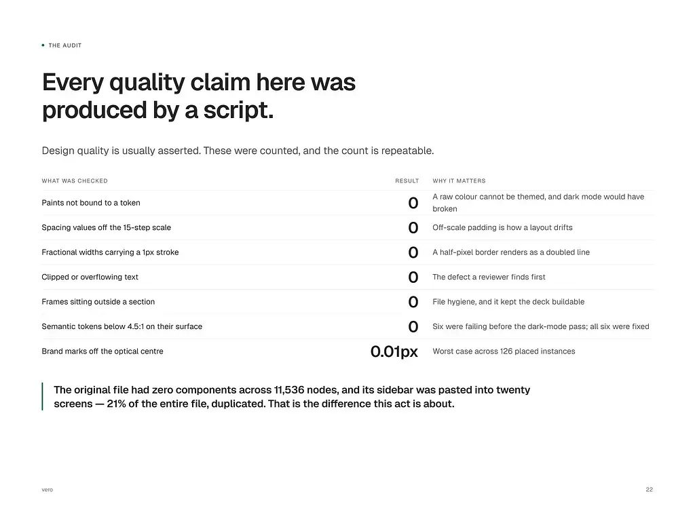
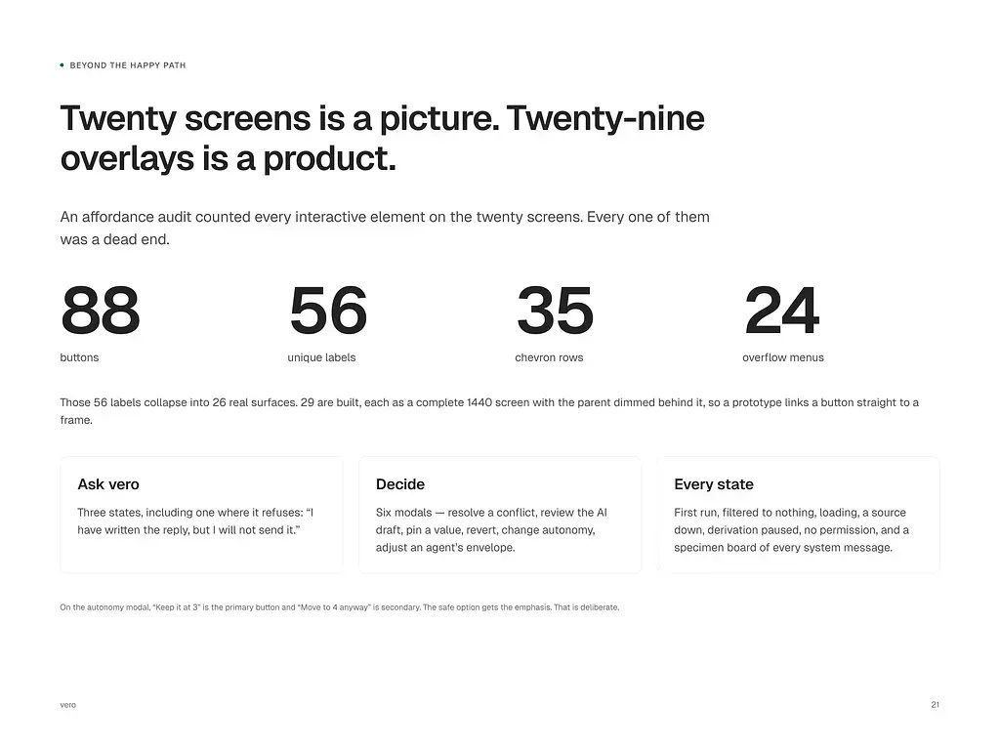
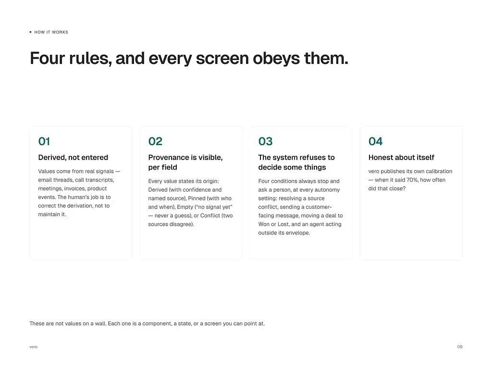

# 09 · Vitrine e estudo de caso

> Como montar a peça de vitrine de um produto (a galeria inteira, não só a capa), como escrever o texto
> dela, como fazer o estudo de caso que mostra o raciocínio e o que muda entre o case longo de processo
> e a peça curta de produto. O caminho do genérico ao produto está em [README.md](README.md).
>
> Legenda: **[MEDIDO]** contado ou amostrado; **[OBSERVADO]** visto em N peças; **[CONFIRMADO]** lido
> na própria peça; **[INFERIDO]** dedução.

## A base

| Material | Tamanho |
|---|---|
| capas de vitrine de portfólio | 355 |
| galerias completas de produto | 15 (105 arquivos) |
| peças com os números de alcance | 30 |
| imagens de cases longos de processo | 135, de 15 projetos |

A página de vitrine pode trazer um vídeo que é da própria plataforma, igual em todas as peças: não
confunda com material do produto. [MEDIDO]

## O que rende

Nas 30 peças lidas: **30 em 23 dias**, 1,3 por dia, alguns dias com 2 ou 3. Soma de **262.871 views**;
média de 8.762 views, 102 likes, 18,8 salvos e 32,6 comentários por peça. [MEDIDO]

As 10 com mais views:

| Views | Likes | Salvos | Coment. | Peça |
|---|---|---|---|---|
| 24.189 | 214 | 36 | 79 | OrchestrateIQ, AI Agent Management Product |
| 20.259 | 169 | 33 | 87 | Vero, AI-Powered Revenue Intelligence Product |
| 16.156 | 158 | 54 | 60 | Mongi, Delivery & Logistics Mobile App |
| 15.494 | 133 | 6 | 59 | OrchestrateIQ |
| 13.017 | 102 | 37 | 28 | Rillo, AI Powered Expense & Receipt Intelligence Product |
| 12.286 | 118 | 5 | 27 | ComplianceFlow, AI Compliance & Governance SaaS |
| 12.268 | 129 | 42 | 47 | OrchestrateIQ |
| 12.098 | 104 | 32 | 20 | Startup Marketing website, Sivoro |
| 11.828 | 93 | 33 | 36 | MedSpa, Product Design, Web app, marketing website, mobile |
| 10.931 | 153 | 22 | 39 | Vero |

Leitura [INFERIDO]: na vitrine rende o mesmo que rende na rede, produto de agente de IA com operação
visível (mapa de agentes, receita, logística). O único site de marketing do top 10 é o Sivoro. Um mesmo
produto em três peças (OrchestrateIQ) soma 51.951 views: a série não canibaliza.

## Anatomia da peça de produto

### A galeria

Em 19 das 30 peças o padrão é fixo: **5 imagens do produto e a imagem de contato**. [MEDIDO: 19 de 30
com 6 itens; 7 com 12 a 15 itens, as que levam páginas de estudo de caso]

| Posição | O que é | Visto em |
|---|---|---|
| 1 (capa) | o quadro mais "fotográfico": monitor ou celular em perspectiva, ou colagem de telas, ou a tela principal plana | 15 de 15 [OBSERVADO] |
| 2 a 5 | telas planas do produto, uma por tarefa (lista, detalhe, modal, estado vazio ou de erro), às vezes um segundo quadro em perspectiva | 15 de 15 |
| 6 (ou 2) | a imagem de contato, sempre a mesma: a promessa em uma frase com prazo, o botão de contato e as pílulas de serviço | 15 de 15 [MEDIDO] |

**Formato** [MEDIDO nos 105 arquivos]: 6400×4800 (4:3) em quase todas as imagens de produto; 4800×3600 e
3200×2400 nas mais antigas; a imagem de contato em 1024×372; páginas de estudo de caso em 1024×768 ou
1024×645.

**Os cinco enquadramentos** que se revezam dentro de uma galeria [OBSERVADO nas 15]:

1. **Tela plana** sobre fundo lavanda ou cinza claro, app num cartão branco (MortgageFlow, Edu.ai, Vero).
2. **Monitor ou notebook em perspectiva** num cinza de estúdio, com sombra suave (OrchestrateIQ,
   ComplianceFlow, Vero).
3. **Celular em 3D**, inclinado, cortando o quadro (Torin, Fino, Mongi).
4. **Vários celulares planos lado a lado** (Mongi, Fino, Torin, Edu.ai).
5. **Colagem ou tela inclinada** em isometria leve (Ctrl.ai, Rillo, FixTrack, Vero).

**Cor do fundo da cena** [MEDIDO no pixel do canto]: o fundo segue o registro do produto. Produto claro
sobre lavanda `#ECECF8` (MortgageFlow) ou `#EEEFF3` (OrchestrateIQ), ou cinza de estúdio `#DEDEDE`
(FixTrack); produto escuro (Ctrl.ai) sobre grafite azulado `#272E38`; telas escuras e claras juntas
(Fino) sobre azul-ardósia `#2B3541`. Nada de gradiente.

|  |  |
|---|---|
| Tela plana com o mapa de agentes (OrchestrateIQ) | Três celulares planos (Mongi) |

### As páginas de estudo de caso

Depois das telas, a galeria pode levar **páginas numeradas de um documento de case** (numeração no
rodapé, a marca do produto no canto). É o lugar de mostrar o raciocínio do projeto, não só o resultado.
No Vero [CONFIRMADO]:

| Página | Título | O que ela afirma |
|---|---|---|
| 21, "Beyond the happy path" | "Twenty screens is a picture. Twenty-nine overlays is a product." | uma auditoria contou todo elemento interativo nas 20 telas: 88 botões, 56 rótulos, 35 linhas com chevron, 24 menus. Os 56 rótulos viram 26 superfícies reais; 29 foram construídas como tela inteira de 1440 com o pai escurecido atrás. "Ask vero" tem três estados, "incluindo um em que ele se recusa: 'I have written the reply, but I will not send it.'" No modal de autonomia, "Keep it at 3" é o botão primário e "Move to 4 anyway" o secundário: "The safe option gets the emphasis. That is deliberate." |
| 22, "The audit" | "Every quality claim here was produced by a script." | "Design quality is usually asserted. These were counted, and the count is repeatable." Zero pintura fora de token; zero espaçamento fora da escala de 15 passos; zero largura fracionária com traço de 1 px; zero texto cortado; zero frame fora de seção; zero token semântico abaixo de 4,5:1 (seis falhavam antes do modo escuro, os seis corrigidos); marcas fora do centro óptico no máximo 0,01 px em 126 instâncias. "The original file had zero components across 11,536 nodes, and its sidebar was pasted into twenty screens: 21% of the entire file, duplicated." |
| 24, "The market" | "A large, slow category with a fast one inside it." | o tamanho do mercado em dólar e o crescimento ao ano, cada número com a sua fonte |
| 28, "How it works" | "Four rules, and every screen obeys them." | 01 Derived, not entered; 02 Provenance is visible, per field; 03 The system refuses to decide some things; 04 Honest about itself |

|  |  |
|---|---|
| Página 22: a auditoria por script | Página 21: além do caminho feliz |

O que as páginas ensinam [INFERIDO, com base no texto delas]:

- O caso mais forte é o **redesenho de um arquivo feito sem sistema** (zero componentes, sidebar colada
  em 20 telas): "vibe-coded chaos to polished product".
- **A qualidade se mede por script** (tokens, escala, contraste, cortes), a mesma regra do design system
  publicado ("Every fill and stroke in the file is bound to a variable"). O medidor desta skill
  (`scripts/medir-tela.cjs`) é esse script para a maquete.
- O documento tem a voz de um produto que **se recusa a agir** e deixa o humano decidir, a mesma tese
  das telas (fila de aprovação, "Needs review").
- A tipografia das páginas é uma grotesca neutra em peso médio para título, com rótulo de seção em
  caixa alta pequena precedido de um ponto verde (`• THE AUDIT`). [OBSERVADO]

### O texto da peça

Das 30 peças, **20 têm descrição**; 9 mostram só um convite genérico ("Explore More Products") e 2
estão vazias. [MEDIDO] Três moldes:

| Molde | Quantos | Exemplo |
|---|---|---|
| **Problem / Solution** | 14 de 20 | FixTrack: "THE PROBLEM A leaking sink arrives by call, text, email or voicemail... One small leak becomes ten conversations across four channels, and nobody can say where the job actually stands. THE SOLUTION Replace the ten conversations with one record... AI triages the tenant's description into a clean work order and suggests the right contractor... Nobody has to ask what happened." |
| **Produto + persona** | 4 de 20 | Rillo: "Spend management for a company of 60 to 400 people. Corporate cards, expenses, approvals and the AI agents that now spend company money alongside the staff. Amara Sundaram, Controller. She owns month end close... When an automated system approves something it should not have, she is the one who answers for it." OrchestrateIQ: "The person paged when the support workflow loops, and asked by finance why the token bill doubled." |
| **Lista curta** | 1 de 20 | Fino: "Four things. A 13 week forecast built from how each customer actually pays, not from due dates. Reminders Fino drafts and the owner approves..." |
| Frase de categoria | 1 de 20 | AgentTrail: "A black box recorder for AI agents..." |

Padrões do texto [OBSERVADO nas 20]:

- **A dor tem cena**: um objeto e um número ("A leaking sink", "A shoot hires 200 people for eight
  weeks", "a company of 60 to 400 people").
- **A IA aparece com limite**: "Reminders Fino drafts and the owner approves", "Every suggestion carries a
  reason, a source and a confidence level", "AI is embedded in existing workflows, never a chatbot".
- **O comprador tem nome e cargo** quando o produto é B2B de risco (Controller, AI engineering lead,
  compliance).
- **Fecho com consequência**: "Nobody has to ask what happened." "Proving they stopped is not."

### Como montar uma peça de vitrine

1. Produto com nome de 4 a 6 letras e tese de uma linha no título: "MortgageFlow, Always know what
   happens next".
2. Cinco imagens 6400×4800: capa em perspectiva ou colagem; três telas planas de tarefas diferentes
   (lista, detalhe, modal ou estado raro); uma quinta em outro enquadramento (celular, close).
3. Fundo da cena lavanda claro para produto claro, grafite para produto escuro. Nada de gradiente.
4. Última imagem: a de contato, sempre a mesma.
5. Texto: "Problem" em 2 a 3 frases com cena e número; "Solution" em 2 a 4 frases com o que a IA faz e
   onde o humano decide.
6. Publicar o mesmo produto em 2 ou 3 peças com ângulos diferentes, em dias seguidos.

## As 15 galerias de produto

| Produto | Views | Itens | Capa | Registro |
|---|---|---|---|---|
| MortgageFlow (hipoteca, portal do cliente) | 381 | 6 | tela plana | claro, acento índigo `#3C0CCC` e lima |
| Ctrl.ai (governança de agente) | 4.014 | 6 | colagem escura | **escuro**, acento verde |
| Fino (fluxo de caixa, mobile) | 4.615 | 6 | celular 3D | telas escuras e claras, acento pêssego |
| Edu.ai (co-professor de ensino básico) | 7.088 | 6 | tela plana | claro, acento lima e roxo |
| Torin (assinaturas, mobile) | 8.590 | 6 | celular 3D | claro, acento laranja |
| FixTrack (manutenção predial) | 9.562 | 6 | tela inclinada | claro, acento verde-escuro |
| OrchestrateIQ | 12.268 | 6 | tela em cena escura | claro, acento azul |
| MedSpa | 11.828 | 6 | tela inclinada | claro, acento lilás e lima |
| Sivoro (site de marketing) | 12.098 | 6 | site e celular | creme, acento salmão e amarelo, serifa itálica |
| Rillo | 13.017 | 6 | tela plana | claro, quase sem cor |
| Mongi (logística, ৳) | 16.156 | 6 | três celulares | claro, verde-escuro, lima e laranja |
| ComplianceFlow | 12.286 | 6 | monitor em perspectiva | claro, preto e branco |
| OrchestrateIQ | 24.189 | 6 | monitor em perspectiva | claro, acento azul |
| Vero | 10.931 | 14 | tela plana | claro, verde-escuro |
| Vero | 20.259 | 13 | tela plana | claro, verde-escuro |

Registro e acento [OBSERVADO nas folhas; hex MEDIDO só onde indicado].

## O case longo de processo

O formato anterior à peça de produto, que ainda aparece em vitrine de portfólio [OBSERVADO em 15
projetos e 9 capas]:

- Capa escura com o dispositivo em perspectiva e o nome do projeto em wordmark, ou capa clara com o
  "Overview" em texto corrido.
- Seções declaradas: "Hi-fidelity Wireframe", "Full landing page view", "UX case study", "Problem-Solving
  APP Ux/Ui Case study", e escopo "Wireframe → Information Architecture → Visual Design → Website".
- A ferramenta listada no rodapé (Figma, e os editores de imagem).
- A filosofia escrita sem prova: "My designs aren't just pretty; they're backed by data" e "Design is
  how it works".
- Nos templates de agência: título enorme com foto de pessoa recortada, fundo escuro com acento neon ou
  laranja, notebook em cena.

### Case longo × peça de produto

| | Case longo de processo | Peça de produto |
|---|---|---|
| Unidade | um projeto, 9 a 15 imagens verticais longas | um produto em 2 a 3 peças de 6 imagens 4:3 |
| Narrativa | processo (wireframe, arquitetura, visual) | problema e solução, e no caso forte uma auditoria numerada |
| Prova | "backed by data", sem dado | contagens (88 botões, 11.536 nós, 0 tokens soltos) |
| Chamada | nenhuma no corpo | a imagem de contato em toda galeria |
| Ritmo | 1 projeto por mês | 1 a 2 peças por dia |
