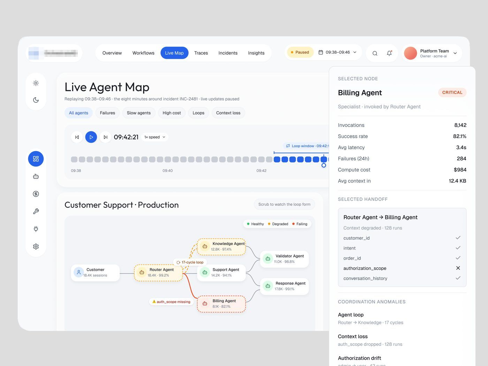
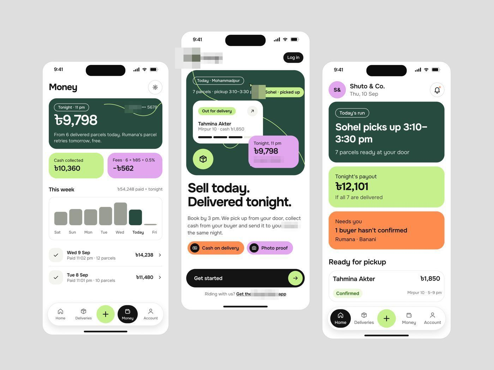
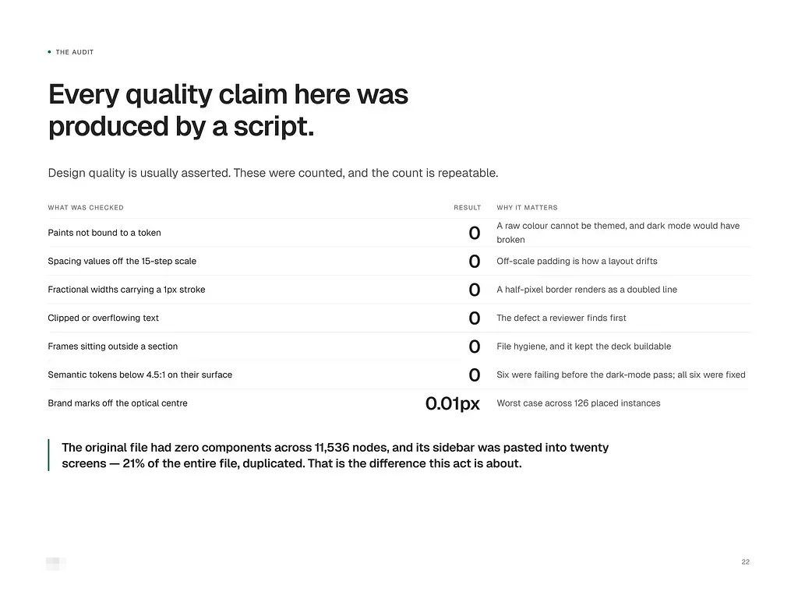
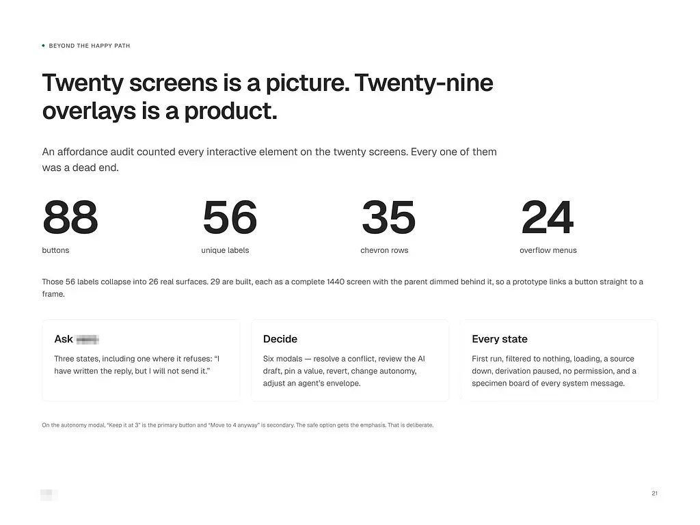
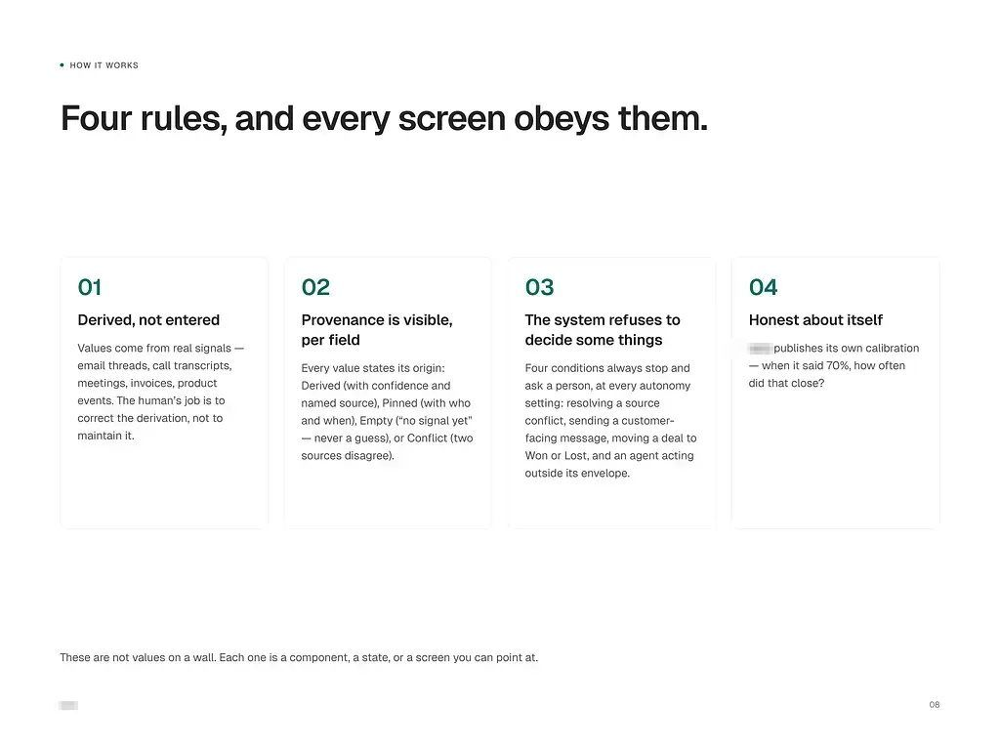
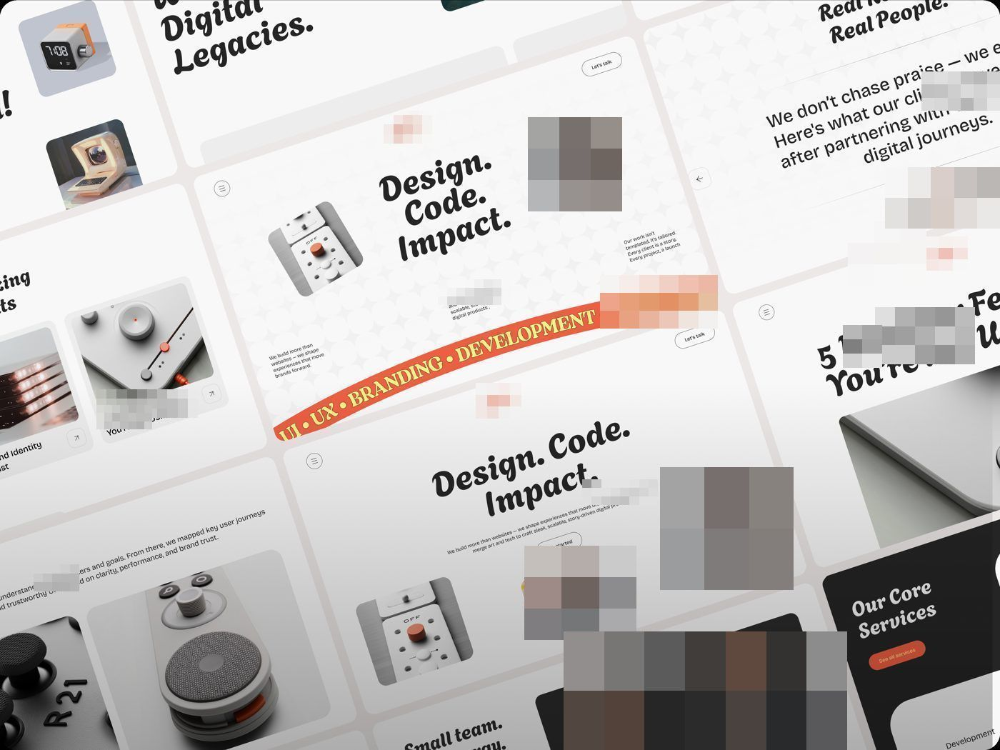

# 09 · Vitrine e estudo de caso

> Como montar a peça de vitrine de um produto (a galeria inteira, não só a capa), como escrever o texto
> dela, como fazer o estudo de caso que mostra o raciocínio e o que muda entre o case longo de processo
> e a peça curta de produto. O caminho do genérico ao produto está em [README.md](README.md).
>
> Legenda: **[MEDIDO]** contado ou amostrado; **[OBSERVADO]** visto em N peças; **[CONFIRMADO]** lido
> na própria peça; **[INFERIDO]** dedução.

## A base

| Material | Tamanho |
|---|---|
| capas de vitrine de portfólio | 355 |
| galerias completas de produto | 15 (105 arquivos) |
| peças com os números de alcance | 30 |
| imagens de cases longos de processo | 135, de 15 projetos |

A página de vitrine pode trazer um vídeo que é da própria plataforma, igual em todas as peças: não
confunda com material do produto. [MEDIDO]

## O que rende

Nas 30 peças lidas: **30 em 23 dias**, 1,3 por dia, alguns dias com 2 ou 3.

As que mais se destacam: painel de agentes hospitalares (três peças), CRM de receita (duas), app de entregas, app de despesas com IA, painel de compliance de IA, o site
de marketing site de finanças de startup e app da clínica de estética.

Leitura [INFERIDO]: na vitrine rende o mesmo que rende na rede, produto de agente de IA com operação
visível (mapa de agentes, receita, logística). O único site de marketing entre as que se destacam é o
site de finanças de startup. O mesmo produto em três peças (painel de agentes hospitalares) aparece três vezes: a série não canibaliza.

## Anatomia da peça de produto

### A galeria

Em 19 das 30 peças o padrão é fixo: **5 imagens do produto e a imagem de contato**. [MEDIDO: 19 de 30
com 6 itens; 7 com 12 a 15 itens, as que levam páginas de estudo de caso]

| Posição | O que é | Visto em |
|---|---|---|
| 1 (capa) | o quadro mais "fotográfico": monitor ou celular em perspectiva, ou colagem de telas, ou a tela principal plana | 15 de 15 [OBSERVADO] |
| 2 a 5 | telas planas do produto, uma por tarefa (lista, detalhe, modal, estado vazio ou de erro), às vezes um segundo quadro em perspectiva | 15 de 15 |
| 6 (ou 2) | a imagem de contato, sempre a mesma: a promessa em uma frase com prazo, o botão de contato e as pílulas de serviço | 15 de 15 [MEDIDO] |

**Formato** [MEDIDO nos 105 arquivos]: 6400×4800 (4:3) em quase todas as imagens de produto; 4800×3600 e
3200×2400 nas mais antigas; a imagem de contato em 1024×372; páginas de estudo de caso em 1024×768 ou
1024×645.

**Os cinco enquadramentos** que se revezam dentro de uma galeria [OBSERVADO nas 15]:

1. **Tela plana** sobre fundo lavanda ou cinza claro, app num cartão branco (app de financiamento imobiliário, co-professor de IA, CRM de receita).
2. **Monitor ou notebook em perspectiva** num cinza de estúdio, com sombra suave (painel de agentes hospitalares,
   painel de compliance de IA, CRM de receita).
3. **Celular em 3D**, inclinado, cortando o quadro (app de assinaturas, app de caixa, app de entregas).
4. **Vários celulares planos lado a lado** (app de entregas, app de caixa, app de assinaturas, co-professor de IA).
5. **Colagem ou tela inclinada** em isometria leve (painel de permissões de agentes, app de despesas com IA, app de manutenção predial, CRM de receita).

**Cor do fundo da cena** [MEDIDO no pixel do canto]: o fundo segue o registro do produto. Produto claro
sobre lavanda `#ECECF8` (app de financiamento imobiliário) ou `#EEEFF3` (painel de agentes hospitalares), ou cinza de estúdio `#DEDEDE`
(app de manutenção predial); produto escuro (painel de permissões de agentes) sobre grafite azulado `#272E38`; telas escuras e claras juntas
(app de caixa) sobre azul-ardósia `#2B3541`. Nada de gradiente.

|  |  |
|---|---|
| Tela plana com o mapa de agentes (painel de agentes hospitalares) | Três celulares planos (app de entregas) |

### As páginas de estudo de caso

Depois das telas, a galeria pode levar **páginas numeradas de um documento de case** (numeração no
rodapé, a marca do produto no canto). É o lugar de mostrar o raciocínio do projeto, não só o resultado.
No CRM de receita [CONFIRMADO]:

| Página | Título | O que ela afirma |
|---|---|---|
| 21, além do caminho feliz | vinte telas são um retrato; vinte e nove sobreposições são um produto | uma auditoria contou todo elemento interativo nas 20 telas: 88 botões, 56 rótulos, 35 linhas com chevron, 24 menus. Os 56 rótulos viram 26 superfícies reais; 29 foram construídas como tela inteira de 1440 com o pai escurecido atrás. "Ask [produto]" tem três estados, incluindo um em que o assistente escreve a resposta e se recusa a enviá-la. No modal de autonomia, "Keep it at 3" é o botão primário e "Move to 4 anyway" o secundário, e a página diz que a ênfase na opção segura é de propósito. |
| 22, a auditoria | toda afirmação de qualidade da página saiu de um script | qualidade de design costuma ser afirmada; aqui foi contada, e a contagem se repete. Zero pintura fora de token; zero espaçamento fora da escala de 15 passos; zero largura fracionária com traço de 1 px; zero texto cortado; zero frame fora de seção; zero token semântico abaixo de 4,5:1 (seis falhavam antes do modo escuro, os seis corrigidos); marcas fora do centro óptico no máximo 0,01 px em 126 instâncias. O arquivo original tinha zero componentes em 11.536 nós, e a sidebar colada em vinte telas era 21% do arquivo, duplicado. |
| 24, o mercado | uma categoria grande e lenta com uma rápida dentro dela | o tamanho do mercado em dólar e o crescimento ao ano, cada número com a sua fonte |
| 28, como funciona | quatro regras, e toda tela obedece a elas | 01 Derived, not entered; 02 Provenance is visible, per field; 03 The system refuses to decide some things; 04 Honest about itself |

|  |  |
|---|---|
| Página 22: a auditoria por script | Página 21: além do caminho feliz |

O que as páginas ensinam [INFERIDO, com base no texto delas]:

- O caso mais forte é o **redesenho de um arquivo feito sem sistema** (zero componentes, sidebar colada
  em 20 telas): o produto feito com IA que sai do caos para o acabamento.
- **A qualidade se mede por script** (tokens, escala, contraste, cortes), a mesma regra do design system
  de referência (todo preenchimento e traço do arquivo ligado a variável). O medidor desta skill
  (`scripts/medir-tela.cjs`) é esse script para a maquete.
- O documento tem a voz de um produto que **se recusa a agir** e deixa o humano decidir, a mesma tese
  das telas (fila de aprovação, "Needs review").
- A tipografia das páginas é uma grotesca neutra em peso médio para título, com rótulo de seção em
  caixa alta pequena precedido de um ponto verde (`• THE AUDIT`). [OBSERVADO]

### O texto da peça

Das 30 peças, **20 têm descrição**; 9 mostram só um convite genérico para ver mais produtos e 2
estão vazias. [MEDIDO] Três moldes:

| Molde | Quantos | Exemplo |
|---|---|---|
| **Problem / Solution** | 14 de 20 | App de manutenção predial: o problema é uma pia vazando que chega por ligação, mensagem, e-mail e recado de voz, um vazamento pequeno que vira dez conversas em quatro canais sem ninguém saber em que pé está o serviço; a solução troca as dez conversas por um registro, a IA transforma a descrição do inquilino numa ordem de serviço e sugere o prestador, e o fecho diz que ninguém precisa perguntar o que aconteceu. |
| **Produto + persona** | 4 de 20 | App de despesas com IA: gestão de gastos para empresa de 60 a 400 pessoas (cartão corporativo, despesa, aprovação e os agentes de IA que agora gastam junto com a equipe), e a persona com nome e cargo de controller, dona do fechamento do mês e quem responde quando o sistema aprova o que não devia. Painel de agentes hospitalares: a persona é quem é acionado quando o fluxo de suporte entra em loop e quem o financeiro cobra quando a conta de tokens dobra. |
| **Lista curta** | 1 de 20 | App de caixa: quatro itens, começando pela previsão de 13 semanas feita de como cada cliente paga de fato, não da data de vencimento, e pelos lembretes que o produto rascunha e o dono aprova. |
| Frase de categoria | 1 de 20 | Painel de auditoria de agentes: a caixa-preta de gravação para agentes de IA |

Padrões do texto [OBSERVADO nas 20]:

- **A dor tem cena**: um objeto e um número (a pia vazando, a filmagem que contrata 200 pessoas por oito
  semanas, a empresa de 60 a 400 pessoas).
- **A IA aparece com limite**: o produto rascunha e o dono aprova; toda sugestão leva motivo, fonte e
  nível de confiança; a IA mora dentro do fluxo que já existe, nunca num chatbot.
- **O comprador tem nome e cargo** quando o produto é B2B de risco (Controller, AI engineering lead,
  compliance).
- **Fecho com consequência**: ninguém precisa perguntar o que aconteceu; parar é fácil, provar que parou não é.

### Como montar uma peça de vitrine

1. Produto com nome de 4 a 6 letras e tese de uma linha no título: "app de financiamento imobiliário, Always know what
   happens next".
2. Cinco imagens 6400×4800: capa em perspectiva ou colagem; três telas planas de tarefas diferentes
   (lista, detalhe, modal ou estado raro); uma quinta em outro enquadramento (celular, close).
3. Fundo da cena lavanda claro para produto claro, grafite para produto escuro. Nada de gradiente.
4. Última imagem: a de contato, sempre a mesma.
5. Texto: "Problem" em 2 a 3 frases com cena e número; "Solution" em 2 a 4 frases com o que a IA faz e
   onde o humano decide.
6. Publicar o mesmo produto em 2 ou 3 peças com ângulos diferentes, em dias seguidos.

## As 15 galerias de produto

| Produto | Itens | Capa | Registro |
|---|---|---|---|
| App de financiamento imobiliário (hipoteca, portal do cliente) | 6 | tela plana | claro, acento índigo `#3C0CCC` e lima |
| Painel de permissões de agentes (governança de agente) | 6 | colagem escura | **escuro**, acento verde |
| App de caixa (fluxo de caixa, mobile) | 6 | celular 3D | telas escuras e claras, acento pêssego |
| Co-professor de IA (co-professor de ensino básico) | 6 | tela plana | claro, acento lima e roxo |
| App de assinaturas (assinaturas, mobile) | 6 | celular 3D | claro, acento laranja |
| App de manutenção predial (manutenção predial) | 6 | tela inclinada | claro, acento verde-escuro |
| Painel de agentes hospitalares | 6 | tela em cena escura | claro, acento azul |
| App da clínica de estética | 6 | tela inclinada | claro, acento lilás e lima |
| Site de finanças de startup (site de marketing) | 6 | site e celular | creme, acento salmão e amarelo, serifa itálica |
| App de despesas com IA | 6 | tela plana | claro, quase sem cor |
| App de entregas (logística, ৳) | 6 | três celulares | claro, verde-escuro, lima e laranja |
| Painel de compliance de IA | 6 | monitor em perspectiva | claro, preto e branco |
| Painel de agentes hospitalares | 6 | monitor em perspectiva | claro, acento azul |
| CRM de receita | 14 | tela plana | claro, verde-escuro |
| CRM de receita | 13 | tela plana | claro, verde-escuro |

Registro e acento [OBSERVADO nas folhas; hex MEDIDO só onde indicado].

## O case longo de processo

O formato anterior à peça de produto, que ainda aparece em vitrine de portfólio [OBSERVADO em 15
projetos e 9 capas]:

- Capa escura com o dispositivo em perspectiva e o nome do projeto em wordmark, ou capa clara com o
  "Overview" em texto corrido.
- Seções declaradas: "Hi-fidelity Wireframe", "Full landing page view", "UX case study", "Problem-Solving
  APP Ux/Ui Case study", e escopo "Wireframe → Information Architecture → Visual Design → Website".
- A ferramenta listada no rodapé (Figma, e os editores de imagem).
- A filosofia escrita sem prova: o design que não é só bonito porque tem dado por trás, e o design
  como o jeito que a coisa funciona.
- Nos templates de agência: título enorme com foto de pessoa recortada, fundo escuro com acento neon ou
  laranja, notebook em cena.

### Case longo × peça de produto

| | Case longo de processo | Peça de produto |
|---|---|---|
| Unidade | um projeto, 9 a 15 imagens verticais longas | um produto em 2 a 3 peças de 6 imagens 4:3 |
| Narrativa | processo (wireframe, arquitetura, visual) | problema e solução, e no caso forte uma auditoria numerada |
| Prova | "backed by data", sem dado | contagens (88 botões, 11.536 nós, 0 tokens soltos) |
| Chamada | nenhuma no corpo | a imagem de contato em toda galeria |
| Ritmo | 1 projeto por mês | peça quase todo dia |
